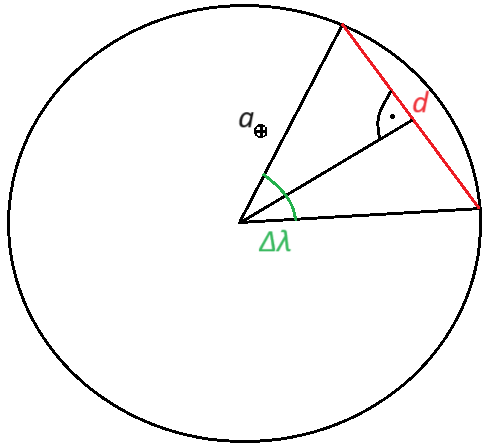

## Zadanie

Materskou kométou najznámejšieho meteorického roja Perzeíd je kométa 109P/Swift Tuttle. Jej obežná doba okolo Slnka je asi 125 rokov. Zem prechádza priesečníkom dráh v čase, keď má Slnko ekliptikálnu dĺžku $140^{\circ}$. Naposledy bola pozorovaná v roku 1992, kedy preletela uzlom svojej dráhy na poludnie 4 dni pred jesennou rovnodennosťou.

<ol type="a">

<li>

Určite veľkosť hlavnej polosi kométy.

</li>

<li>

Vypočítajte strednú obvodovú rýchlosť kométy v km/s. Počítajte s kruhovou dráhou.

</li>

<li>

Za aký čas kométa preletí vzdialenosť o veľkosti priemeru Zeme, ak jej geocentrická rýchlosť je $60\,\mathrm{km}/\mathrm{s}$?

</li>

<li>

Kedy nastáva maximum činnosti meteorického roja, t.j. Zem prechádza „stredom“ dráhy kométy. Uveďte dátum a čas s presnosťou na hodiny (excentricitu dráhy Zeme zanedbajte).

</li>

<li>

Ako ďaleko bola kométa od Zeme v okamihu prechodu uzlom svojej dráhy? Výsledok uveďte s presnosťou na desatiny AU.

</li>

<li>

Aká bola vtedy absolútna jasnosť kométy, ak bola vizuálne pozorovaná ako 6$^m$?

</li>

</ol>

Riešenie

<ol type="a">

<li>

Veľkú polos vypočítame 3. Kepleroveho zákona

</li>

</ol>

$$
a=\sqrt[3]{P^2}=\sqrt[3]{125^2}=25\,\mathrm{au} \, . \tag{1}
$$

<ol type="a" start="2">

<li>

Kruhová rýchlosť je

</li>

</ol>

$$
v=\frac{2\pi a}{P}=\frac{2\pi\cdot25\cdot1{,}496 \cdot 10^{11}}{125\cdot365,25\cdot86400}=5{,}96\,\mathrm{km}\,{\mathrm{s}}^{-1} \, . \tag{2}
$$

<ol type="a" start="3">

<li>

Relatívne voči Zemi prejde túto vzdialenosť za čas

</li>

</ol>

$$
t=\frac{2R_{\Ea}}{v_g}=\frac{2\cdot6378}{60}=213\,\mathrm{s}=3{,}5\,\min \, . \tag{3}
$$

<ol type="a" start="4">

<li>

Zem prechádza dráhou kométy v čase, kedy je ekliptikálna dĺžka Slnka $140^{\circ}$. Počas jarnej rovnodennosti sa Slnko nachádza j jarnom bode a jeho ekliptikálna dĺžka je $0^{\circ}$. Uhol $140^{\circ}$ prejde Zem za čas

</li>

</ol>

$$
\frac{140^{\circ}}{360^{\circ}}\cdot365,25=142{,}04\,\mathrm{dní}=142\,\mathrm{dní}\ 1\,\mathrm{h} \, . \tag{4}
$$

 V roku 2007, kedy bol zadaný tento príklad, nastala jarná rovnodennosť 21.3. o 1:00. Do 31.3. uplynulo 10 dní, apríl má 30 dní, máj 31 dní, jún 30 dní a júl 31 dní. Od 21.3. 0 1:00 do 31.7. o 1:00 uplynulo celkovo 11+30+31+30+31=133 dní. Do maxima roja uplynie ešte 10 dní a 1 hodina. Maximum nastalo 10.8. o 2:00.

<ol type="a" start="5">

<li>

Počas jesennej rovnodennosti je ekliptikálna dĺžka Slnka $180^{\circ}$, ekliptikálna dĺžka Zeme meraná zo Slnka je vtedy $0^{\circ}$. 4 dni pred jesennou rovnodennosťou je ekliptikálna dĺžka Zeme zhruba $356^{\circ}$. Priesečník dráh sa nachádza na ekliptikálnej dĺžke $140^{\circ}+180^{\circ}=320^{\circ}$. Vzdialenosť kométy od Zeme vypočítame na základe obrázku nižšie

<figure>

</figure>

</li>

</ol>

$$
\frac{d}{2a_{\Ea}}=\sin \left(\frac{\Delta \lambda}{2}\right) \, , \tag{5}
$$

 

$$
d=2a_{\Ea}\sin \left(\frac{\Delta \lambda}{2}\right)=2\cdot1\cdot\sin \left(\frac{356^{\circ}-320^{\circ}}{2}\right)=0{,}6\,\mathrm{au} \, . \tag{6}
$$

<ol type="a" start="6">

<li>

Absolútna magnitúda komety je definovaná ako magnitúda, ktorú by kométy, keď sa nachádza vo vzdialenosti$1\,\mathrm{au}$ od Slnka aj od Zeme. V našom prípade sa už nachádza vo vzdialenosti $1\,\mathrm{au}$ od Slnka, preto treba počítať iba s korekciou na vzdialenosť od Zeme

</li>

</ol>

$$
M-m=2,5\log \left(\frac{(1\,\mathrm{au})^2}{d^2}\right)=5\log \left(\frac{1\,\mathrm{au}}{d}\right) \, , \tag{7}
$$

 

$$
M=6+5\log \left(\frac{1\,\mathrm{au}}{0,6}\right)=7{,}1\,\mathrm{mag} \, . \tag{8}
$$

