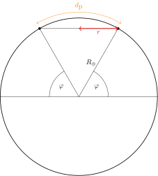

## Zadanie

Mesto Petrohrad v Rusku sa nachádza na $60^{\circ}\,30'\,15''$ severnej zemepisnej šírky a $30^{\circ}$ východnej zemepisnej dĺžky. Mesto Seward na Aljaške leží tiež na $60^{\circ}$ severnej zemepisnej šírky, ale na $150^{\circ}$ západnej zemepisnej dĺžky. Aká je vzdialenosť oboch miest meraná po rovnobežke? Aká je vzdialenosť týchto miest meraná po poludníkoch prechádzajúc cez severný pól? Predpokladajme, že Zem je guľa.

Riešenie

Obidve mestá sú vzdialené $30^{\circ}$ od severného pólu. Ich vzájomná vzdialenosť meraná cez pól je 

$$
d_\textrm{p}=\frac{60^{\circ}}{360^{\circ}}\cdot2\pi R_{\Ea}=\frac{\pi\cdot6378}{3}=6679\,\mathrm{km} \, . \tag{1}
$$

 Rozdiel zemepisných dĺžok miest je $180^{\circ}$, takže ich vzdialenosť meraná po rovnobežke bude polovicou obvodu kružnice s polomerom $r=R_{\Ea}\cos \varphi$ 

$$
d_\textrm{r}=\frac{1}{2}\cdot2\pi \cdot6378\cdot \cos 60^{\circ}= 10\,018\,\mathrm{km} \, . \tag{2}
$$

<figure>

</figure>

