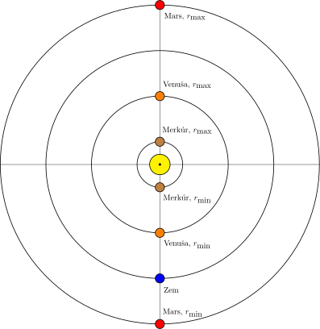

## Zadanie

Aká môže byť najmenšia a najväčšia vzdialenosť Merkúra,Venuše a Marsu od Zeme? Predpokladáme, že tieto planéty sa pohybujú okolo Slnka v jednej rovine po kružniciach so stredom v Slnku. Pre ktorú planétu je pomer najväčšej/najmenšej vzdialenosti najväčší?

Riešenie

Planéta je v najväčšej/najmenšej vzdialenosti od Zeme v momente, kedy sa spolu so Zemou a Slnkom nachádza na jednej priamke (viď obrázok). Tieto vzdialenosti sú:

<figure>

</figure>

Merkúr: 

$$
r_{\rm{min}}=a_{\Ea}-a_{\Me}=1-0,387 = 0{,}613\,\mathrm{au} \, , \tag{1}
$$

 

$$
r_{\rm{max}}=a_{\Ea}+a_{\Me}=1+0,387 = 1{,}387\,\mathrm{au} \, , \tag{2}
$$

 

$$
\frac{r_{\rm{max}}}{r_{\rm{min}}}=\frac{1,387}{0,613}=2,26 \, . \tag{3}
$$

 Venuša: 

$$
r_{\rm{min}}=a_{\Ea}-a_{\Ve}=1-0,723 = 0{,}277\,\mathrm{au} \, , \tag{4}
$$

 

$$
r_{\rm{max}}=a_{\Ea}+a_{\Ve}=1+0,723 = 1{,}723\,\mathrm{au} \, , \tag{5}
$$

 

$$
\frac{r_{\rm{max}}}{r_{\rm{min}}}=\frac{1,723}{0,277}=6,22 \, . \tag{6}
$$

 Mars: 

$$
r_{\rm{min}}=a_{\Ma}-a_{\Ea}=1,524-1 = 0{,}524\,\mathrm{au} \, , \tag{7}
$$

 

$$
r_{\rm{min}}=a_{\Ma}+a_{\Ea}=1,524+1 = 2{,}524\,\mathrm{au} \, , \tag{8}
$$

 

$$
\frac{r_{\rm{max}}}{r_{\rm{min}}}=\frac{2,524}{0,524}=4,82 \, . \tag{9}
$$

 Najväčší pomer maximálnej a minimálnej vzdialenosti od Zeme má Venuša.

