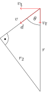

## Zadanie

Predpokladajme, že hviezda so zdanlivou jasnosťou $m$ má paralaxu $\pi$, priestorovú rýchlosť $V$, ktorej vektor zviera uhol $\theta$ so zorným lúčom. Vypočítajte:

<ol type="a">

<li>

Čas $t$ za ktorý táto hviezda bude najbližšie k Slnku.

</li>

<li>

Jej paralaxu, tangenciálnu a radiálnu rýchlosť a zdanlivú hviezdnu veľkosť v čase jej minimálnej vzdialenosti od Slnka.

</li>

</ol>

Riešenie

<figure>

</figure>

Hviezda bude ku Slnku najbližšie vo chvíli, kedy jej radiálna rýchlosť bude nulová - v tej chvíli sa prestane ku Slnku približovať a začne sa od neho vzďaľovať.

<ol type="a">

<li>

Podľa obrázka je vzdialenosť, ktorú hviezda ešte musí prejsť

</li>

</ol>

$$
d=r\cos{\theta}=\frac{\cos{\theta}}{\pi} \, . \tag{1}
$$

 Prejde ju za čas 

$$
t=\frac{d}{V}=\frac{\cos{\theta}}{\pi V} \, . \tag{2}
$$

<ol type="a" start="2">

<li>

Minimálna vzdialenosť a príslušná paralaxa sú

</li>

</ol>

$$
r_2=r\sin{\theta}=\frac{\sin{\theta}}{p} \, , \tag{3}
$$

 

$$
p_2=\frac{1}{r_2}=\frac{p}{\sin{\theta}} \, . \tag{4}
$$

 Ako bolo spomenuté vyššie, radiálna rýchlosť bude nulová, $v_\textrm{r}=0$, tangenciálna rýchlosť sa preto bude rovnať celkovej rýchlosti, $v_\textrm{t}=V$. Zdanlivú magnitúdu určíme z Pogsonovej rovnice 

$$
m_2-m=5\log{\frac{r_2}{r}}=5\log{\frac{p}{p_2}} \, , \tag{5}
$$

 

$$
m_2=m+5\log{\frac{r_2}{r}}=m+5\log{\frac{p}{p_2}} \, . \tag{6}
$$

