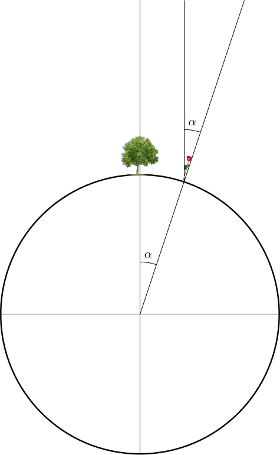

## Zadanie

Planétka, na ktorej má svoje sídlo Malý princ je takmer dokonalá guľa. Malý princ zistil, že presne v tom okamihu, keď Slnko svieti úplne kolmo zhora na jeho jediný baobab, svieti pod uhlom $10^{\circ}$ na jeho milovanú ružu, rastúcu vo vzdialenosti $6{,}28\,\mathrm{km}$ od baobabu. Vypočítajte, aký polomer má planétka Malého princa.

Riešenie

<figure>

</figure>

Vyjdeme z nakresleného obrázka. Uhol, ktorý zvierajú spojnice stredu planéty s baobabom a ružou je rovnaký ako uhol, pod ktorým svieti na ružu. Obvod planéty ($O=2\pi R$) vypočítame z trojčlenky 

$$
\frac{\alpha}{360^{\circ}}=\frac{6,28}{O} \, , \tag{1}
$$

 

$$
\frac{10^{\circ}}{360^{\circ}}=\frac{6,28}{2\pi R} \, . \tag{2}
$$

 Polomer planéty je 

$$
R=\frac{6,28\cdot360}{2\pi \cdot 10}=36\,\mathrm{km} \, . \tag{3}
$$

