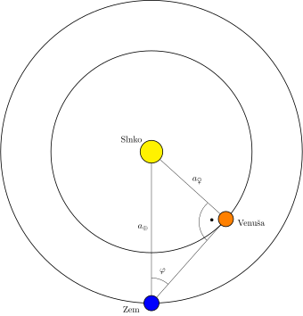

## Zadanie

Najväčšia uhlová vzdialenosť medzi Venušou a Slnkom pri pozorovaní zo Zeme je $46^{\circ}$. Vypočítajte polomer kruhovej dráhy Venuše v au, ak sa v čase tohto pozorovania Zem nachádzala v strednej vzdialenosti od Slnka.

Riešenie

<figure>

</figure>

Situácia je znázornená na obrázku. Spojnica Zeme a Venuše v maximálnej elongácii je dotyčnicou ku dráhe Venuše. Táto dotyčnica je v bode dotyku kolmá na polomer dráhy Venuše. Máme tak pravouhlý trojuholník, z ktorého vieme vypočítať polomer dráhy Venuše 

$$
\frac{a_{\Ve}}{a_{\Ea}}=\sin{46^{\circ}} \, . \tag{1}
$$

 Polomer dráhy Venuše je $a_{\Ve}=0{,}72\,\mathrm{au}$.

