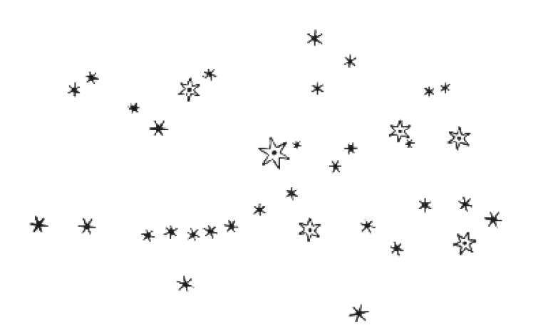

## Zadanie

Na pripojenom obrázku vidíte kresbu časti oblohy ktorú urobil pri jednom z prvých pozorovaní ďalekohľadom v roku 1609 Galileo Galilei.

<ol type="a">

<li>

Ktorú časť oblohy obrázok znázorňuje?

</li>

<li>

Podľa katalógu nájdite najslabšiu hviezdu na kresbe a určite jej magnitúdu.

</li>

<li>

Zistite pozorovaním alebo výpočtom, aký bol priemer objektívu Galileovho ďalekohľadu, ak hviezda v úlohe (b) bola na hranici pozorovateľnosti týmto ďalekohľadom. Vezmite do úvahy aj nedokonalosť vtedajšieho optického skla a stratu cca 7 % na každom rozhraní medzi sklom vzduchom v optickej schéme ďalekohľadu. Popíšte svoj postup.

</li>

</ol>

Pomôcka: skúste pozorovať túto oblasť oblohy malým ďalekohľadom. Postupne vkladajte pred objektív clony so stále menším priemerom, až kým vami určená najslabšia hviezda nezmizne.

<figure>

</figure>

Riešenie tejto úlohy sa nezachovalo.

