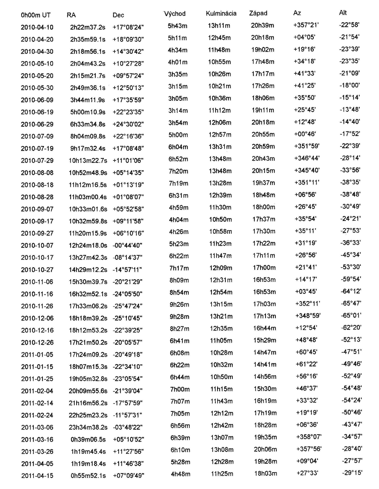
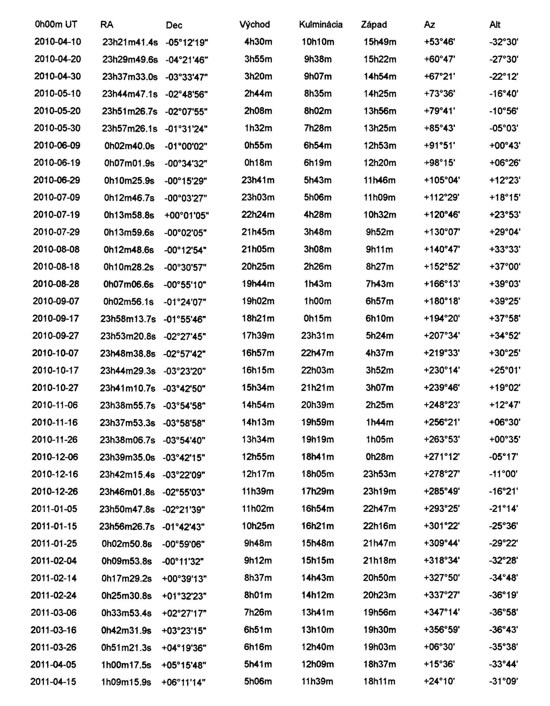

## Zadanie

V priložených 4 tabuľkách sú údaje o pozorovaní 4 rôznych nebeských telies. Určte, ktoré sú to telesá a svoj postup zdôvodnite.\
Poloha pozorovateľa: $49{,}205^{\circ}$ N $15{,}000^{\circ}$ E, čas: 12 hod. 00 min. SEČ.

|    Dátum     |   Azimut   |   Výška   |
|:------------:|:----------:|:---------:|
| 10\. 4. 2010 | $179^{\circ}\,30'$  | $48^{\circ}\,48'$ |
| 11\. 4. 2010 | $179^{\circ}\,36'$  | $49^{\circ}\,10'$ |
| 12\. 4. 2010 | $179^{\circ}\,41'$  | $49^{\circ}\,32'$ |
| 13\. 4. 2010 | $179^{\circ}\,47'$  | $49^{\circ}\,54'$ |
| 14\. 4. 2010 | $179^{\circ}\,53'$  | $50^{\circ}\,16'$ |
| 15\. 4. 2010 | $179^{\circ}\,59'$  | $50^{\circ}\,37'$ |
| 16\. 4. 2010 | $180^{\circ}\,4'$1 | $50^{\circ}\,58'$ |
| 17\. 4. 2010 | $180^{\circ}\,10'$  | $51^{\circ}\,20'$ |
| 18\. 4. 2010 | $180^{\circ}\,15'$  | $51^{\circ}\,41'$ |
| 19\. 4. 2010 | $180^{\circ}\,20'$  | $52^{\circ}\,01'$ |
| 20\. 4. 2010 | $180^{\circ}\,26'$  | $52^{\circ}\,22'$ |

Poloha pozorovateľa: $49{,}205^{\circ}$N, $15{,}000^{\circ}$E, čas: 12 hod. 00 min. SEČ.

|    Dátum     | Hodinový uhol | Deklinácia |
|:------------:|:-------------:|:----------:|
| 10\. 4. 2010 |   $2^{\mathrm{h}}\,56^{\mathrm{min}}\,0^{\mathrm{s}}$   | $-7^{\circ}\,4'$  |
| 11\. 4. 2010 |   $2^{\mathrm{h}}\,16^{\mathrm{min}}\,0^{\mathrm{s}}$   | $-2^{\circ}\,3'$  |
| 12\. 4. 2010 |   $1^{\mathrm{h}}\,35^{\mathrm{min}}\,0^{\mathrm{s}}$   | $3^{\circ}\,13'$  |
| 13\. 4. 2010 |   $0^{\mathrm{h}}\,54^{\mathrm{min}}\,0^{\mathrm{s}}$   | $8^{\circ}\,19'$  |
| 14\. 4. 2010 |   $0^{\mathrm{h}}\,1^{\mathrm{min}}\,0^{\mathrm{s}}$   | $13^{\circ}\,15'$  |
| 15\. 4. 2010 |   $23^{\mathrm{h}}\,23^{\mathrm{min}}\,0^{\mathrm{s}}$   | $17^{\circ}\,36'$  |
| 16\. 4. 2010 |   $22^{\mathrm{h}}\,34^{\mathrm{min}}\,0^{\mathrm{s}}$   | $21^{\circ}\,07'$  |
| 17\. 4. 2010 |   $21^{\mathrm{h}}\,41^{\mathrm{min}}\,0^{\mathrm{s}}$   | $23^{\circ}\,33'$  |
| 18\. 4. 2010 |   $20^{\mathrm{h}}\,54^{\mathrm{min}}\,0^{\mathrm{s}}$   | $24^{\circ}\,9'$  |
| 19\. 4. 2010 |   $19^{\mathrm{h}}\,49^{\mathrm{min}}\,0^{\mathrm{s}}$   | $24^{\circ}\,14'$  |
| 20\. 4. 2010 |   $18^{\mathrm{h}}\,53^{\mathrm{min}}\,0^{\mathrm{s}}$   | $22^{\circ}\,17'$  |

Poloha pozorovateľa: $50^{\circ}$N, $15^{\circ}$E, čas: 0 hod. 00 min. UTC.

<figure>

</figure>

Poloha pozorovateľa: $50^{\circ}$N, $15^{\circ}$E, čas: 0 hod. 00 min. UTC.

<figure>

</figure>

Riešenie

V prvom prípade sa nachádzame presne v strede časového pásma a pozeráme sa na objekt, ktorý kulminuje okolo 12:00 SEČ. Výška rovníka nad obzorom je na pozorovacom mieste približne $41^{\circ}$, vidíme, že objektu sa postupne zvyšuje výška kulminácia, takže aj deklinácia. Na základe toho usúdime, že sa nejedná o hviezdu ale o objekt slnečnej sústavy. Planétam by sa deklinácia v priebehu niekoľko dní nemohla deklinácia tak veľmi zmeniť. Kulminácia Mesiaca sa každý deň posunie zhruba o 50 minút, preto nám ako jediná možnosť zostáva Slnko, ktoré má kladnú a postupne sa zvyšujúcu deklináciu, lebo sme v období medzi jarnou rovnodennosťou a letným slnovratom.

V druhom prípade opäť vidíme Mesiac. Dá sa to určiť na základe každodenného posunu hodinového uhla 0 12:00 o niečo viac než 50 minút. Navyše vidíme, že sa mu deklinácia v priebehu pár dní zmení o $29^{\circ}$, čo môže nastať iba pre Mesiac.

V treťom prípade sa pozeráme na objekt, ktorý je o polnoci vždy pod obzorom. Z veľkých zmien rektascenzie a deklinácie môžeme usúdiť, že sa jedná o planétu. Slnko má o polnoci azimut okolo $0^{\circ}$, pričom v závislosti na aktuálnej hodnote časovej rovnice môže byť o niekoľko stupňov posunuté. Vidíme, že planéta sa počas celého roka od Slnka nevzdiali na viac než $61^{\circ}$, a kvôli časovej rovnici to bude v realite asi ešte menej. Musí sa teda jednať o vnútornú planétu. Merkúr sa nedokáže dostať do takých veľkých uhlových vzdialeností od Slnka, musí to byť preto Venuša.

V štvrtom prípade sa na základe hodnôt deklinácie dá zistiť, že sa opäť pozeráme na planétu. Podľa hodnôt rektascenzie vieme, že sa nachádza v okolí jarného bodu. Taktiež vidíme, že pri pohybe na oblohe robí slučku a za rok sa jej rektascenzia zmenila o necelé 2 hodiny. Musí to byť preto vonkajšia planéta, pravdepodobne Jupiter. Ak si pamätáme je vzdialenosť od Slnka, $5{,}2\,\mathrm{au}$, vieme vypočítať jeho obežnú dobu, $11{,}8\,\mathrm{rokov}$. Z toho vieme odhadnúť, že za rok by sa jeho rektascenzia mala zmeniť zhruba o 2 hodiny, čo sedí s údajmi tabuľke.

