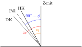

## Zadanie

Cirkumpolárna hviezda pozorovaná z miesta X v hornej kulminácii severne od zenitu má zenitovú vzdialenosť $29^{\circ}\,47'$ a v dolnej kulminácii jej zenitová vzdialenosť je $41^{\circ}\,49'$. Určite zemepisnú šírku miesta X a vypočítajte výšku hviezdy v dolnej a hornej kulminácii. Situáciu graficky znázornite.

Riešenie

Výška hviezdy nad obzorom pri hornej kulminácii je $h_1=90^{\circ}-z_1=90^{\circ}-29^{\circ}\,47'=60^{\circ}\,13'$. Výška pri dolnej kulminácii je $h_2=90^{\circ}-z_2=90^{\circ}-41^{\circ}\,49'=48^{\circ}\,11'$. Pre zemepisnú šírku platí vzťah (viď obrázok) 

$$
90^{\circ}-\varphi=\frac{z_1+z_2}{2} \, , \tag{1}
$$

 

$$
\varphi =90^{\circ}-\frac{z_1+z_2}{2}=90^{\circ}-\frac{29^{\circ}\,47'+41^{\circ}\,49'}{2}=54^{\circ}\,12' \, . \tag{2}
$$

<figure>

</figure>

