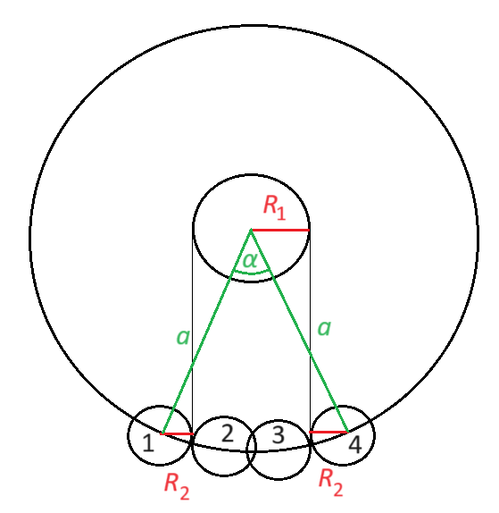

## Zadanie

Zákrytová dvojhviezda má obežnú periódu 30 dní. Svetelná krivka na obrázku ukazuje, že sekundárna zložka zakrýva primárnu hviezdu od bodu A do bodu D (merané od prvého do posledného kontaktu a toto trvá 8 hodín), od bodu B do bodu C je úplný zákryt a tento trvá 1 hod a 18 min. Analýza radiálnych rýchlostí dáva radiálnu rýchlosť primárnej hviezdy $30\,\mathrm{km}\,{\mathrm{s}}^{-1}$ a sekundárnej hviezdy $40\,\mathrm{km}\,{\mathrm{s}}^{-1}$. Ak predpokladáme kruhové dráhy a sklon dráhy $i=90^{\circ}$, vypočítajte polomery a hmotnosti obidvoch zložiek dvojhviezdy a vyjadrite ich v jednotkách polomeru a hmotnosti Slnka.

<figure>

</figure>

Riešenie

Najskôr vypočítame polomery dráh jednotlivých hviezd 

$$
a_1=\frac{v_1P}{2\pi}=\frac{30 \cdot 10^{3}\cdot30\cdot86400}{2\pi}=1{,}24 \cdot 10^{10}\,\mathrm{m} \, , \tag{1}
$$

 

$$
a_2=\frac{v_2P}{2\pi}=\frac{40 \cdot 10^{3}\cdot30\cdot86400}{2\pi}=1{,}65 \cdot 10^{10}\,\mathrm{m} \, . \tag{2}
$$

 Súčet $a=a_1+a_2=1{,}24 \cdot 10^{10}+1{,}65 \cdot 10^{10}=2{,}89 \cdot 10^{10}\,\mathrm{m}$ nám dá veľkú polos vzájomnej dráhy dvojhviezdy. Dosadíme ho do 3. Kepleroveho zákona a vypočítame súčet hmotností hviezd 

$$
M_1+M_2=\frac{4\pi^2a^3}{GP^2}=\frac{4\pi^2\cdot(2{,}89 \cdot 10^{10})^3}{6{,}67 \cdot 10^{-11}\cdot(30\cdot86400)^2}=2{,}13 \cdot 10^{30}\,\mathrm{kg}=1{,}07\,\mathit{M}_\Sun \, . \tag{3}
$$

 Pomer hmotností hviezd sa rovná prevrátenému pomeru ich rýchlostí 

$$
\frac{M_1}{M_2}=\frac{v_2}{v_1}=\frac{40}{30}=\frac{4}{3} \, . \tag{4}
$$

 Hmotnosť primáru je 

$$
M_1=\frac{4}{7}(M_1+M_2)=\frac{4}{7}\cdot1,07=0{,}61\,\mathit{M}_\Sun \, . \tag{5}
$$

 Hmotnosť sekundáru je 

$$
M_2=\frac{3}{7}(M_1+M_2)=\frac{3}{7}\cdot1,07=0{,}46\,\mathit{M}_\Sun \, . \tag{6}
$$

 Pri výpočte polomerov hviezd budeme uvažovať relatívnu dráhu, kedy primárna hviezdy stojí na mieste a sekundárna hviezda okolo nej obieha rýchlosťou $v=v_1+v_2=70\,\mathrm{km}\,{\mathrm{s}}^{-1}$ po dráhe s polomerom $a=2{,}89 \cdot 10^{10}\,\mathrm{m}$. Poloha sekundárnej hviezdy na dráhe pri všetkých 4 kontaktoch je znázornená na obrázku.

<figure>

</figure>

Medzi 1. a 4. kontaktom obehne sekundárna hviezda okolo primárnej o uhol $\alpha$, pre ktorý platí 

$$
\alpha=\frac{t_{14}}{P}360^{\circ}=\frac{8}{30\cdot24}\cdot360^{\circ}=4^{\circ} \, . \tag{7}
$$

 Zároveň z geometrie na obrázku vidíme, že pre uhol $\alpha$ platí 

$$
\sin \frac{\alpha}{2}=\frac{R_1+R_2}{a} \, . \tag{8}
$$

 Podobne prídeme na to, že medzi 2. a 3. kontaktom obehne sekundárna hviezda okolo primárnej o uhol $\beta$, pre ktorý platia vzťahy 

$$
\beta=\frac{t_{23}}{P}360^{\circ}=\frac{60+18}{30\cdot24\cdot60}\cdot360^{\circ}=0{,}65^{\circ} \, , \tag{9}
$$

 

$$
\sin \frac{\beta}{2}=\frac{R_1-R_2}{a} \, . \tag{10}
$$

 Súčet a rozdiel polomerov hviezd sú 

$$
R_1+R_2=a\sin \frac{\alpha}{2}=2{,}89 \cdot 10^{10}\cdot\sin 2^{\circ}=1{,}01 \cdot 10^{9}\,\mathrm{m}=1{,}45\,\mathit{R}_\Sun \, , \tag{11}
$$

 

$$
R_1-R_2=a\sin \frac{\beta}{2}=2{,}89 \cdot 10^{10}\cdot\sin 0{,}325^{\circ}=1{,}64 \cdot 10^{8}\,\mathrm{m}=0{,}24\,\mathit{R}_\Sun \, . \tag{12}
$$

 Polomery primárnej a sekundárnej zložky sú 

$$
R_1=\frac{1,45+0,24}{2}=0{,}845\,\mathit{R}_\Sun \, , \tag{13}
$$

 

$$
R_2=\frac{1,45-0,24}{2}=0{,}605\,\mathit{R}_\Sun \, . \tag{14}
$$

