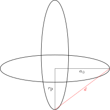

## Zadanie

Dráha kométy má nasledovné elementy: $a = 10\,\mathrm{au}$, $e = 0,9$, $i = 90^{\circ}$, $\Omega = 90^{\circ}$, $\omega = 90^{\circ}$. Dráhu Zeme považujme za kružnicu s $r = 1\,\mathrm{au}$. Ako ďaleko je kométa od Zeme, ak sa nachádza v perihéliu svojej dráhy?

Riešenie

Kométa sa pohybuje v rovine kolmej na rovinu dráhy Zeme. Vzdialenosť kométy v perihéliu od Zeme vypočítame z Pytagorovej vety (viď obrázok).

<figure>

</figure>

$$
r_\textrm{p}=a(1-e)=10\cdot(1-0,9)=1\,\mathrm{au} \, , \tag{1}
$$

 

$$
d=\sqrt{a_\Ea^2+r_\textrm{p}^2}=\sqrt{1^2+1^2}=1{,}41\,\mathrm{au} \, . \tag{2}
$$

