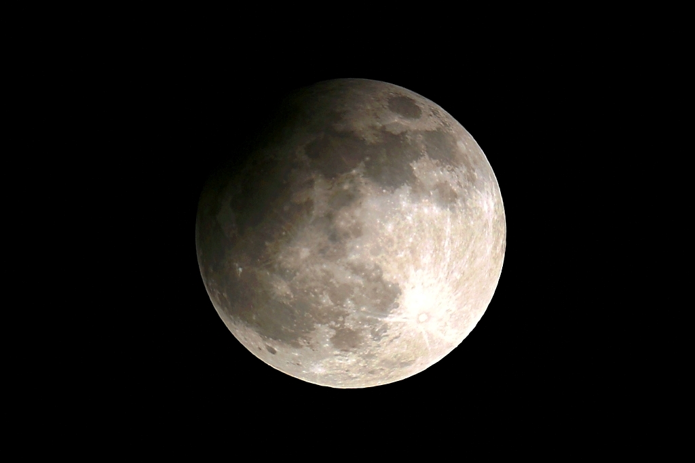

## Zadanie

Na obrázku je snímka Mesiaca pri splne a čiastočnom zatmení Mesiaca 25. 4. 2013 o 20:59:47 SEČ na čipe kamery `CANON 550D`, s rozmermi $14{,}9 \times 22\,\mathrm{mm}$. Na snímke s rozmermi 1023 px x 682 px určite najskôr priemer Mesiaca. Pomocou údajov o Mesiaci okamihu expozície z aplikácie `STELLARIUM` sme zistili, že horizontálna paralaxa Mesiaca bola rovná $60'\,20{,}32''$. Ďalšie konštanty používajte astronomickú jednotku, polomer Zeme, polomer Mesiaca, $1\,\mathrm{rad} = 206\,265''$. Vypočítajte ohniskovú vzdialenosť fotografického objektívu.

<figure>

</figure>

Riešenie

Je potrebné odmerať priemer Mesiaca na fotke a rozmer samotnej fotky a na základe toho vypočítať rozmer Mesiaca na čipe. Odmerané vzdialenosti závisia na mierke, v akej je táto zbierka zobrazená/vytlačená, ale výsledný rozmer Mesiaca by mal v každom prípade vyjsť približne $x=10{,}1\,\mathrm{mm}$. Uhlový priemer Mesiaca je 

$$
\theta_{\Mo}=\frac{2R_{\Mo}}{d_{\Mo}} \, . \tag{1}
$$

 Okamžitú vzdialenosť Mesiaca zistíme z jeho paralaxy $p=3620{,}32''$, pre ktorú približne platí 

$$
p=\frac{R_{\Ea}}{d_{\Mo}} \, . \tag{2}
$$

 Uhlový priemer Mesiaca sa dá tiež vypočítať z rozmerov Mesiaca v ohniskovej rovine (teda na čipe) a ohniskovej vzdialenosti 

$$
\theta_{\Mo}=\frac{x}{f}=\frac{2R_{\Mo}}{R_{\Ea}}p \, . \tag{3}
$$

 Ohnisková vzdialenosť objektívu je 

$$
f=\frac{xR_{\Ea}}{2pR_{\Mo}}=\frac{10,1\cdot6{,}378 \cdot 10^{6}\cdot206265}{2\cdot1{,}7374 \cdot 10^{6}\cdot3620,32}=1060\,\mathrm{mm}=1{,}06\,\mathrm{m} \, . \tag{4}
$$

