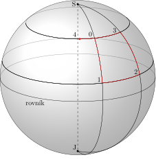

## Zadanie

Z letiska Sliač štartovalo prieskumné lietadlo U-2 smerom na juh. Po 6 hodinách letu doplnilo pomocou tankovacieho lietadla KC-135 palivo (1. bod) a pokračovalo smerom na východ. Po 6 hodinách letu znova doplnilo palivo (2. bod) a pokračovalo smerom na sever. Po 6 hodinách znova doplnilo palivo (3. bod), zmenilo kurz na západ a po ďalších šiestich hodinách letu pristálo. Priemerná rýchlosť letu prieskumného lietadla bola $650\,\mathrm{km}\,{\mathrm{h}}^{-1}$ vo všetkých štyroch úsekoch letu. Vypočítajte zemepisné súradnice všetkých troch bodov, nad ktorými lietadlo dopĺňalo palivo a pre úplnosť udajte aj súradnice miesta štartu a pristátia.

Riešenie

Dráha lietadla je nakreslená na obrázku. Súradnice bodu 0 (letiska Sliač) sú uvedené na stránke letiska: $\varphi_0=48^{\circ}\,38'\,17''$ N a $\lambda_0=19^{\circ}\,8'\,3''$ E. Za 6 hodín lietadlo preletí úsek dlhý $d=vt=650\cdot6=3900\,\mathrm{km}$. Zemepisná dĺžka bodu 1 je rovnaká ako zemepisná dĺžka bodu 0. Zemepisná šírka sa pri prelete z bodu 0 do bodu 1 zmení o 

$$
\Delta \varphi =\frac{3900}{2\pi R_{\Ea}}\cdot360^{\circ}=\frac{3900}{2\pi \cdot 6378}\cdot360^{\circ}=35^{\circ}\,2'\,6'' \, . \tag{1}
$$

<figure>

</figure>

Zemepisná šírka bodov 1 a 2 bude $\varphi_1=\varphi_2=\varphi_0-\Delta \varphi=48^{\circ}\,38'\,17''-35^{\circ}\,2'\,6''=13^{\circ}\,36'\,11''$. Pri prelete z bodu 1 do bodu 2 sa lietadlo pohybuje po oblúku kružnice s polomerom $r_{12}=R_{\Ea}\cos \varphi_1$. Zemepisná dĺžka sa zmení o 

$$
\Delta \lambda_{12} = \frac{3900}{2\pi R_{\Ea} \cos \varphi_1}\cdot360^{\circ}=\frac{3900}{2\pi \cdot 6378\cdot \cos 13^{\circ}\,36'\,11''}\cdot360^{\circ}=36^{\circ}\,2'\,47'' \, . \tag{2}
$$

<figure>

</figure>

Zemepisná dĺžka bodov 2 a 3 bude $\lambda_2=\lambda_3=\lambda_0+\Delta \lambda=19^{\circ}\,8'\,3''-36^{\circ}\,2'\,47''=55^{\circ}\,10'\,50''$. Zemepisná šírka bodov 3 a 4 je $\varphi_3=\varphi_4=\varphi_0$. Pri pohybe z bodu 3 do bodu 4 lietadlo letí po oblúku kružnice s polomerom $r_{30}=R_{\Ea}\cos \varphi_0$. Rozdiel zemepisných dĺžok bodov 3 a 4 je 

$$
\Delta \lambda{34} = \frac{3900}{2\pi R_{\Ea} \cos \varphi_0}\cdot360^{\circ}=\frac{3900}{2\pi \cdot 6378\cdot \cos 48^{\circ}\,38'\,17''}\cdot360^{\circ}=53^{\circ}\,1'\,5'' \, . \tag{3}
$$

 Zemepisná dĺžka bodu 4 bude $\lambda_4=\lambda_3-\Delta \lambda_{34}=55^{\circ}\,10'\,50''-53^{\circ}\,1'\,5''=2^{\circ}\,9'\,45''$. 

$$
t=\frac{d}{v}=\frac{14351,6}{650}=22\,\mathrm{h} \ 5\,\min \, . \tag{4}
$$

 Súhrn súradníc všetkých bodov:

- $\varphi_0=48^{\circ}\,38'\,17''$ N, $\lambda_0=19^{\circ}\,8'\,3''$ E ,

- $\varphi_1=13^{\circ}\,36'\,11''$ N, $\lambda_1=19^{\circ}\,8'\,3''$ E ,

- $\varphi_2=13^{\circ}\,36'\,11''$ N, $\lambda_2=55^{\circ}\,10'\,50''$ E ,

- $\varphi_3=48^{\circ}\,38'\,17''$ N, $\lambda_3=55^{\circ}\,10'\,50''$ E ,

- $\varphi_4=48^{\circ}\,38'\,17''$ N, $\lambda_4=2^{\circ}\,9'\,45''$ E .

