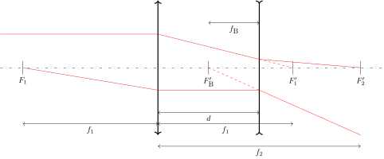

## Zadanie

Navrhnite na existujúci ďalekohľad Barlowovu šošovku pre predĺženie ohniskovej vzdialenosti objektívu z $f_1 = 1200\,\mathrm{mm}$ na $f_2 = 1800\,\mathrm{mm}$. Určite polohu, kde bude Barlowova šošovka umiestnená aj jej ohniskovú vzdialenosť.

Riešenie

Pri výpočtoch využijeme zobrazovaciu rovnicu šošovky 

$$
\frac{1}{f}=\frac{1}{a}+\frac{1}{a'} \, . \tag{1}
$$

 V tomto vzorovom riešení je použitá nasledujúca znamienková konvencia (je možné použiť aj inú, rovnice treba v tom prípade náležito upraviť)

- $a$ - vzdialenosť predmetu od šošovky, ak je predmet vľavo od šošovky, je kladná, ak je predmet vpravo od šošovky, je záporná,

- $a'$ - vzdialenosť obrazu od šošovky, vpravo je kladná, vľavo je záporná,

- $f$ - ohnisková vzdialenosť šošovky, spojka kladná, rozptylka záporná,

- $d$ - vzdialenosť Barlowovej šošovky od spojky objektívu, vpravo kladná, vľavo záporná.

<figure>

</figure>

Pri výpočte využijeme, že vieme ako cez spojku prechádzajú 2 typy lúčov. Situácia ja načrtnutá na obrázku. Ohnisková vzdialenosť objektívu je označená $f_1$, ohnisková vzdialenosť Barlowovej šošovky je označená $f_\textrm{B}$ a ohnisková vzdialenosť sústavy obejktív-Barlowka je označená $f_2$. Zelený lúč je pred vstupom do šošovky objektívu rovnobežný s optickou osou. Po prechode cez spojku sa zlomí tak, že optickú os pretne s obrazovom ohnisku spojky, na obrázku označenom $F'_1$. Ak je za objektív zaradená ešte aj Barlowova šošovka, ktorá je rozptylka, tak sa lúč mierne odchýli od optickej osi a pretne ju až v obrazovom ohnisku sústavy objektív-Barlowka (na obrázku označené $F'_2$). Napíšeme si zobrazovaciu rovnicu pre prechod zeleného lúča optickou sústavou 

$$
\frac{1}{f_2}=\frac{1}{a_2}+\frac{1}{a'_2} \, . \tag{2}
$$

 Ak na šošovku dopadá zväzok lúčov rovnobežných s optickou osou, znamená to, že predmet sa nachádza v nekonečne, $a_2 \rightarrow \infty$. Všetky tieto lúče sa po prechode šošovkou pretnú v ohnisku $F'_2$, obrazová vzdialenosť sa preto rovná ohniskovej vzdialenosti, $a'_2=f_2$.\
Teraz sa na túto situáciu pozrieme z pohľadu rozptylky - Barlowovej šošovky. Po prechode spojkou na ňu dopadá zväzok zbiehajúcich sa lúčov, ktoré by sa normálne stretli na optickej osi v bode $F'_1$ vpravo od polohy rozptylky. Efektívne je to, akoby rozptylka zobrazovala predmet, ktorý je od nej vpravo, teda za ňou. Z pohľadu rozptylky je preto predmetová vzdialenosť záporná a platí pre ňu $a_\textrm{B}=-(f_1-d)$, kde $(f_1-d)$, je vzdialenosť ohniska $F'_1$ od rozptylky. Ako bolo napísané vyššie, po prechode rozptylkou sa lúče stretnú v ohnisku $F'_2$, vo vzdialenosti $a'_\textrm{B}=f_2-d$ od rozptylky. Obrazová vzdialenosť je kladná, lebo sa lúče pretnú vpravo od rozptylky. Zobrazovacia rovnica pre rozptylku je 

$$
\frac{1}{f_\textrm{B}}=\frac{1}{a_\textrm{B}}+\frac{1}{a'_\textrm{B}} \, , \tag{3}
$$

 

$$
\frac{1}{f_\textrm{B}}=\frac{-1}{f_1-d}+\frac{1}{f_2-d} \, . \tag{4}
$$

 Teraz sa pozrieme na zväzok lúčov vychádzajúcich z predmetového ohniska spojky $F_1$ (na obrázku sú reprezentované červeným lúčom). Po prechode spojkou sa zlomia tak, že budú rovnobežné s optickou osou a takto dopadnú na rozptylku. Pre rozptylku je to taká istá situácia, ako keby na ňu dopadali rovnobežné lúče z predmetu umiestneného v nekonečne. Po prechode rozptylkou sa zlomia tak, že sa za ňou budú rozbiehať. Ak si ich smery predĺžime spätne do oblasti pred rozptylkou, zistíme, že sa pretnú v obrazovom ohnisku rozptylky $F'_\textrm{B}$. Pre tento typ lúčov platí pri prechode sústavou objektív-Barlowka nasledujúca zobrazovacia rovnica 

$$
\frac{1}{f_2}=\frac{1}{f_1}+\frac{1}{d+f_\textrm{B}} \, , \tag{5}
$$

 kde predmetová vzdialenosť je $f_1$ a obrazová vzdialenosť je $d+f_\textrm{B}$ (je tam +, lebo ohnisková vzdialenosť rozptylky je záporná). Riešením sústavy zobrazovacích rovníc získame hodnoty $f_\textrm{B}$ aj $d$. Najskôr upravíme druhú rovnicu a vyjadríme z nej $f_\textrm{B}$ 

$$
\frac{1}{f_\textrm{B}+d}=\frac{1}{f_2}-\frac{1}{f_1}=\frac{f_1-f_2}{f_1f_2} \, , \tag{6}
$$

 

$$
f_\textrm{B}=\frac{f_1f_2}{f_1-f_2}-d=\frac{f_1f_2-df_1+df_2}{f_1-f_2} \, . \tag{7}
$$

 Teraz upravíme prvú rovnicu 

$$
\frac{1}{f_\textrm{B}}=\frac{-1}{f_1-d}+\frac{1}{f_2-d}=\frac{d-f_2+f_1-d}{(f_1-d)(f_2-d)}=\frac{f_1-f_2}{f_1f_2-df_1-df_2+d^2} \, , \tag{8}
$$

 

$$
f_\textrm{B}=\frac{f_1f_2-df_1-df_2+d^2}{f_1-f_2} \, . \tag{9}
$$

 Dva výrazy pre $f_\textrm{B}$ dáme do rovnosti a dostaneme 

$$
f_1f_2-df_1+df_2=f_1f_2-df_1-df_2+d^2 \, , \tag{10}
$$

 

$$
df_2=d^2-df_2 \, , \tag{11}
$$

 

$$
2f_2=d \, , \tag{12}
$$

 

$$
d=\frac{f_2}{2}=\frac{1800}{2}=900\,\mathrm{mm} \, , \tag{13}
$$

 Dosadíme ešte do jednej zo zobrazovacích rovníc a vypočítame $f_\textrm{B}$ 

$$
\frac{1}{f_\textrm{B}}=\frac{-1}{f_1-d}+\frac{1}{f_2-d}=\frac{-1}{1200-900}+\frac{1}{1800-900}=\frac{-1}{300}+\frac{1}{900}=\frac{-3+1}{900} \, . \tag{14}
$$

 Dostaneme ohniskovú vzdialenosť Barlowovej šošovky $f_\textrm{B}=450\,\mathrm{mm}$. Vzdialenosť Barlowovej šošovky od objektívu musí byť $d=900\,\mathrm{mm}$.

