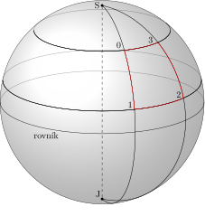

## Zadanie

Z letiska Sliač štartovalo prieskumné lietadlo U-2 smerom na juh. Po $3900\,\mathrm{km}$ letu (1. bod) doplnilo pomocou tankovacieho lietadla KC-135 palivo a pokračovalo smerom na východ. Po ďalších $3900\,\mathrm{km}$ letu (2. bod) znova doplnilo palivo a pokračovalo $3900\,\mathrm{km}$ smerom na sever, kde (3. bod) po doplnení paliva zmenilo kurz na západ smerom k letisku Sliač, kde pristálo. Priemerná rýchlosť letu prieskumného lietadla bola $650\,\mathrm{km}\,{\mathrm{h}}^{-1}$ vo všetkých štyroch úsekoch letu. Zemepisné súradnice letiska Sliač sú: SŠ $48^{\circ}\,38'\,17''$, VD $19^{\circ}\,08'\,03''$. Vypočítajte dĺžku a dobu trvania letu.

Riešenie

Dráha lietadla je nakreslená na obrázku. Súradnice bodu 0 (letiska Sliač) poznáme zo zadania. Zemepisná dĺžka bodu 1 je rovnaká ako zemepisná dĺžka bodu 0. Zemepisná šírka sa pri prelete z bodu 0 do bodu 1 zmení o 

$$
\Delta \varphi =\frac{3900}{2\pi R_{\Ea}}\cdot360^{\circ}=\frac{3900}{2\pi \cdot 6378}\cdot360^{\circ}=35^{\circ}\,2'\,6'' \, . \tag{1}
$$

<figure>

</figure>

Zemepisná šírka bodov 1 a 2 bude $\varphi_1=\varphi_2=\varphi_0-\Delta \varphi=48^{\circ}\,38'\,17''-35^{\circ}\,2'\,6''=13^{\circ}\,36'\,11''$. Pri prelete z bodu 1 do bodu 2 sa lietadlo pohybuje po oblúku kružnice s polomerom $r_{12}=R_{\Ea}\cos \varphi_1$. Zemepisná dĺžka sa zmení o 

$$
\Delta \lambda = \frac{3900}{2\pi R_{\Ea} \cos \varphi_1}\cdot360^{\circ}=\frac{3900}{2\pi \cdot 6378\cdot \cos 13^{\circ}\,36'\,11''}\cdot360^{\circ}=36^{\circ}\,2'\,47'' \, . \tag{2}
$$

<figure>

</figure>

Zemepisná dĺžka bodov 2 a 3 bude $\lambda_2=\lambda_3=\lambda_0+\Delta \lambda=19^{\circ}\,8'\,3''-36^{\circ}\,2'\,47''=55^{\circ}\,10'\,50''$. Zemepisná šírka bodu 3 je $\varphi_3=\varphi_0$. Pri pohybe z bodu 3 naspäť do bodu 0 lietadlo letí po oblúku kružnice s polomerom $r_{30}=R_{\Ea}\cos \varphi_0$. Prejde pri tom dráhu 

$$
d_{30}=\frac{\Delta \lambda}{360^{\circ}}2\pi R_{\Ea}\cos \varphi_0=\frac{36^{\circ}\,2'\,47''}{360^{\circ}}\cdot2\pi\cdot6378\cos 48^{\circ}\,38'\,17''=2651{,}6\,\mathrm{km} \, . \tag{3}
$$

 Celkovo lietadlo preletelo dráhu $d=3\cdot3900+2651,6=14\,351{,}6\,\mathrm{km}$ a trvalo mu to 

$$
t=\frac{d}{v}=\frac{14351,6}{650}=22\,\mathrm{h} \ 5\,\min \, . \tag{4}
$$

