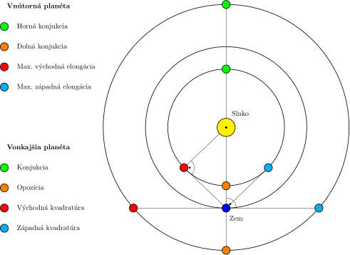

## Zadanie

Zo Zeme bol vyslaný radarový signál, ktorý sa po odraze od planéty vrátil na Zem, kde sme zaznamenali čas medzi vyslaním a prijatím signálu. Tento postup bol zopakovaný niekoľko krát, pričom signál bol vyslaný na rôzne planéty, ktoré sa nachádzali v rôznych pozíciách vzhľadom na Zem a Slnko. Doplňte nasledujúcu tabuľku:

| Planéta | Doba medzi odoslaním a prijatím signálu | Aspekt planéty | Vzdialenosť planéty od Zeme |
|:--:|:--:|:--:|:--:|
| Merkúr | $930\,\mathrm{s}$ |  |  |
| Mars |  | opozícia |  |
| Venuša |  |  | $0{,}28\,\mathrm{au}$ |
| Jupiter |  | kvadratúra |  |
| Urán |  |  | $20{,}2\,\mathrm{au}$ |

Dráhy planét predpokladajte kruhové. Zanedbajte rotáciu planét a môžete použiť polomery dráh planét zo zoznamu konštánt.

Riešenie

<figure>

</figure>

Všetky potrebné aspekty vnútorných aj vonkajších planét sú nakreslené na obrázku. Keďže signál musí prejsť zo Zeme na planétu a späť, jeho dráha je dvojnásobkom vzdialenosti planéty od Zeme. Radarový signál sa pohybuje rýchlosťou svetla, čas medzi vyslaním a prijatím signálu je 

$$
t=\frac{2d}{c} \, . \tag{1}
$$

 Merkúr: vzdialenosť od Zeme je 

$$
d=\frac{ct}{2}=\frac{2{,}9979 \cdot 10^{8}\cdot930}{2\cdot1{,}496 \cdot 10^{11}}=0{,}932\,\mathrm{au} \, . \tag{2}
$$

 Táto vzdialenosť zhruba zodpovedá maximálnej elongácii, kedy je vzdialenosť Merkúru od Zeme 

$$
d=\sqrt{a_{\Ea}^2-a_{\Me}^2}=\sqrt{1^2-0,387^2}=0{,}922\,\mathrm{au} \, . \tag{3}
$$

 Mars: vzdialenosť od Zeme je 

$$
d=a_{\Ea}-a_{\Ma}=1,524-1=0{,}524\,\mathrm{au} \, . \tag{4}
$$

 Doba letu signálu 

$$
t=\frac{2\cdot0,524\cdot1{,}496 \cdot 10^{11}}{2{,}9979 \cdot 10^{8}}=523\,\mathrm{s} \, . \tag{5}
$$

 Venuša: vzdialenosť zodpovedá dolnej konjunkcii, doba letu signálu je 

$$
t=\frac{2\cdot0,28\cdot1{,}496 \cdot 10^{11}}{2{,}9979 \cdot 10^{8}}=279\,\mathrm{s} \, . \tag{6}
$$

 Jupiter: vzdialenosť od Zeme v kvadratúre a doba letu signálu sú 

$$
d=\sqrt{a_{\Ju}^2-a_{\Ea}^2}=\sqrt{5,204^2-1^2}=5{,}11\,\mathrm{au} \, . \tag{7}
$$

 

$$
t=\frac{2\cdot5,11\cdot1{,}496 \cdot 10^{11}}{2{,}9979 \cdot 10^{8}}=5100\,\mathrm{s} \, . \tag{8}
$$

 Urán: vzdialenosť zodpovedá konjunkcii, doba letu signálu je 

$$
t=\frac{2\cdot20,2\cdot1{,}496 \cdot 10^{11}}{2{,}9979 \cdot 10^{8}}=20\,160\,\mathrm{s} \, . \tag{9}
$$

| Planéta | Doba medzi odoslaním a prijatím signálu | Aspekt planéty | Vzdialenosť planéty od Zeme |
|:--:|:--:|:--:|:--:|
| Merkúr | $930\,\mathrm{s}$ | max. elongácia | $0{,}932\,\mathrm{au}$ |
| Mars | $523\,\mathrm{s}$ | opozícia | $0{,}524\,\mathrm{au}$ |
| Venuša | $279\,\mathrm{au}$ | dolná konjunkcia | $0{,}28\,\mathrm{au}$ |
| Jupiter | $5100\,\mathrm{s}$ | kvadratúra | $5{,}11\,\mathrm{au}$ |
| Urán | $20\,160\,\mathrm{s}$ | konjunkcia | $20{,}2\,\mathrm{au}$ |

