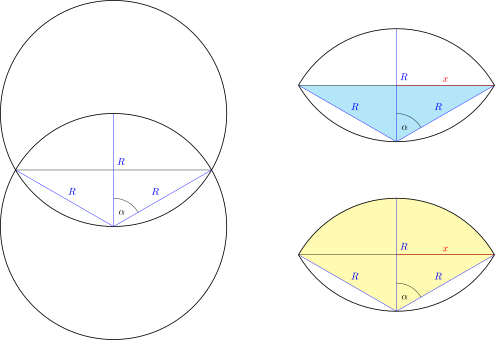

## Zadanie

<figure>

</figure>

Majme zákrytovú dvojhviezdu s rovnako veľkými zložkami $R_1 = R_2 = R$, kde primárne minimum bude to, pri ktorom je v popredí chladnejšia zložka (teplota $T_2$) pred teplejšou hviezdou (teplota $T_1$). Zákryt je taký, že pri pohľade zo Zeme zasahuje predná hviezda svojím okrajom presne na stred zakrývanej hviezdy (viď obrázok). Nech $R_1 = R_2 = R = 2{,}2\,\mathit{R}_\Sun$, $T_1 = 10\,000\,\mathrm{K}$, $T_2 = 8000\,\mathrm{K}$ a vzdialenosť stredov zložiek (dráha nech je kruhová) $r = 10 R$. Vypočítajte sklon relatívnej dráhy dvojhviezdy $i$ k rovine kolmej na zorný lúč a pokles jasnosti $\Delta m$ v magnitúdach v primárnom minime voči jasnosti mimo zákrytu.

Riešenie

Na obrázku nižšie je nakreslený pohľad na systém zboku počas zákrytu. Vidíme, že pre sklon dráhy platí

<figure>

</figure>

$$
\cos i =\frac{R}{r}=\frac{1}{10} \, . \tag{1}
$$

 Sklon dráhy je $i=84{,}3^{\circ}$. Na výpočet poklesu jasnosti v minime potrebujeme zistiť, aká čast disku primárnej hviezdy bude zakrytá sekundárnou zložkou. Opäť si pomôžeme obrázkom. Zakrytá časť sa skladá z dvoch rovnakých kruhových odsekov. Obsah jedného odseku vypočítame ako rozdiel obsahu žltého kruhového výseku s uhlom $2\alpha$ a obsahu modrého trojuholníka.

<figure>

</figure>

Najskôr vypočítame uhol $\alpha$ 

$$
\cos \alpha= \frac{\frac{R}{2}}{R}=\frac{1}{2} \, . \tag{2}
$$

 Vyjde $\alpha=60^{\circ}$. Obsah žltého kruhového výseku vypočítame z trojčlenky 

$$
S_1=\frac{120^{\circ}}{360^{\circ}}\cdot\pi R^2=\frac{\pi}{3}R^2 \, . \tag{3}
$$

 Teraz vypočítame vzdialenosť $x$ a obsah modrého trojuholníka. Základňa trojuholníka je $a=2x$ a výška na základňu je $v_\textrm{a}=\frac{R}{2}$ 

$$
x=R\sin \alpha = R \sin (60^{\circ}) =\frac{\sqrt{3}}{2}R \, , \tag{4}
$$

 

$$
S_2=\frac{1}{2}av_\textrm{a}=\frac{1}{2}\cdot2\cdot\frac{\sqrt{3}}{2}R\cdot\frac{R}{2}=\frac{\sqrt{3}}{4}R^2 \, . \tag{5}
$$

 Obsah zakrytej časti primáru je 

$$
S=2(S_1-S_2)=2\cdot\left(\frac{\pi}{3}-\frac{\sqrt{3}}{4}\right)R^2=\left(\frac{2\pi}{3}-\frac{\sqrt{3}}{2}\right)R^2 \, . \tag{6}
$$

 Intenzita mimo zákrytu je 

$$
I_0=I_1+I_2=\pi R_1^2\sigma T_1^4+\pi R_2^2\sigma T_2^4 \, . \tag{7}
$$

 Intenzita počas zákrytu je 

$$
I_\textrm{z}=I_\textrm{1z}+I_2=\pi R_1^2\sigma T_1^4-\left(\frac{2\pi}{3}-\frac{\sqrt{3}}{2}\right)R_1^2\sigma T_1^4+\pi R_2^2\sigma T_2^4 \, . \tag{8}
$$

 Dosadíme to do Pogsonovej rovnice, skrátime $\pi$ a $\sigma$ a dostaneme rozdiel magnitúd 

$$
\Delta m=2,5\log \left(\frac{I_\textrm{z}}{I_0}\right)=2,5\log\left(\frac{T_1^4+T_2^4}{\left(1-\frac{2}{3}+\frac{\sqrt{3}}{2\pi}\right)T_1^4+T_2^4}\right) \, , \tag{9}
$$

 

$$
\Delta m=2,5\log\left(\frac{10\,000^4+8000^4}{\left(\frac{1}{3}+\frac{\sqrt{3}}{2\pi}\right)10\,000^4+8000^4}\right)=0{,}35\,\mathrm{mag} \, . \tag{10}
$$

