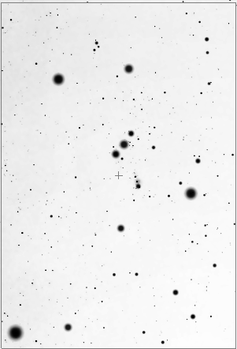
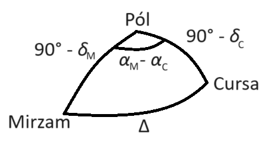

## Zadanie

`Canon 550D` má čip s rozmermi $15 \times 22\,\mathrm{mm}$ a s 4272 x 2848 pixelmi. Dané sú súradnice (ekvinokcium J 2000,0) hviezd Mirzam ($6^{\mathrm{h}}\,22^{\mathrm{min}}\,42^{\mathrm{s}}$, $-17^{\circ}\,57'\,21''$) a Cursa ($5^{\mathrm{h}}\,7^{\mathrm{min}}\,51^{\mathrm{s}}$, $-5^{\circ}\,5'\,12''$). Viete určiť zo snímky na obrázku 1 ohniskovú vzdialenosť objektívu, s ktorým bola urobená táto snímka?

<figure>

<figcaption>

**Obrázok 1:** Snímka z fotoaparátu Canon 550D.
</figcaption>

</figure>

Riešenie

Odmeriame vzdialenosť hviezd na fotke a rozmery fotky, z toho dokážeme vypočítať vzdialenosť hviezd na čipe, tá je zhruba $d=13{,}4\,\mathrm{mm}$. Uhlovú vzdialenosť hviezd $\Delta$ vypočítame pomocou kosínusovej vety pre sférický trojuholník na obrázku

<figure>

</figure>

$$
\cos \Delta = \cos (90^{\circ}-\delta_\textrm{M})\cos (90^{\circ}-\delta_\textrm{C})+\sin (90^{\circ}-\delta_\textrm{M})\sin (90^{\circ}-\delta_\textrm{C})\cos (\alpha_\textrm{M}-\alpha_\textrm{C}) \, , \tag{1}
$$

 

$$
\cos \Delta = \sin (\delta_\textrm{M})\sin (\delta_\textrm{C})+\cos (\delta_\textrm{M})\cos (\delta_\textrm{C})\cos (\alpha_\textrm{M}-\alpha_\textrm{C}) \, . \tag{2}
$$

 Rozdiel rektascenzií si prepočítame na stupne $\alpha_\textrm{M}-\alpha_\textrm{C}=1^{\mathrm{h}}\,14^{\mathrm{min}}\,51^{\mathrm{s}}=18^{\circ}\,42'\,45''$. 

$$
\cos \Delta = \sin (-17^{\circ}\,57'\,21'')\sin (-5^{\circ}\,5'\,12'')+\cos (-17^{\circ}\,57'\,21'')\cos (-5^{\circ}\,5'\,12'')\cos (18^{\circ}\,42'\,45'') \, , \tag{3}
$$

 

$$
\Delta=22^{\circ}\,21'\,46'' \, . \tag{4}
$$

 Uhlová vzdialenosť hviezd je veľká, preto je pri výpočte ohniskovej vzdialenosti objektívu potrebné namiesto približného výpočtu použiť tangens. Platí 

$$
\frac{d}{2f}=\tan \left(\frac{\Delta}{2}\right) \, . \tag{5}
$$

 Ohnisková vzdialenosť je 

$$
f=\frac{d}{2\tan \left(\frac{\Delta}{2}\right)}=\frac{13,4}{2\cdot\tan \left(\frac{22^{\circ}\,21'\,46''}{2}\right)}=33{,}9\,\mathrm{mm} \, . \tag{6}
$$

