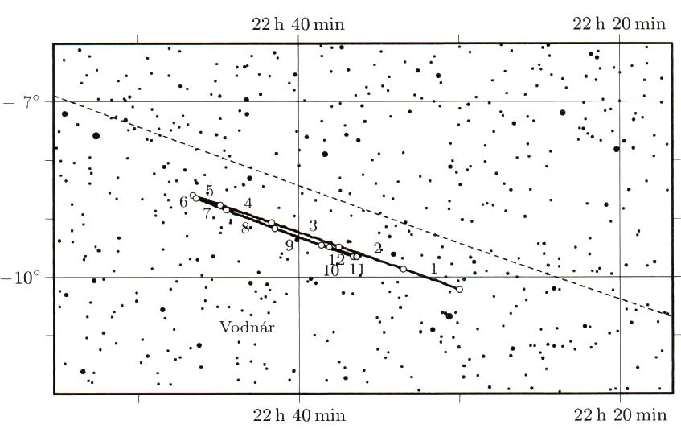
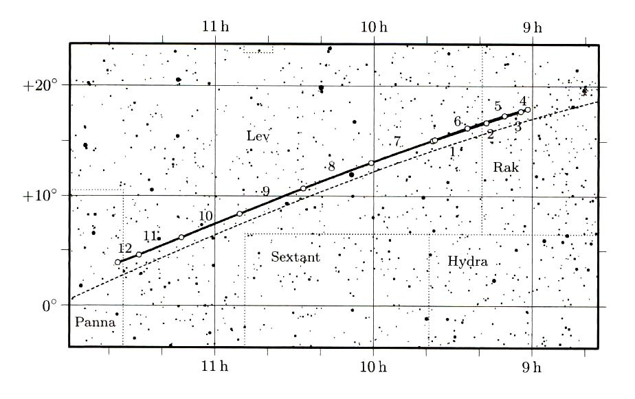
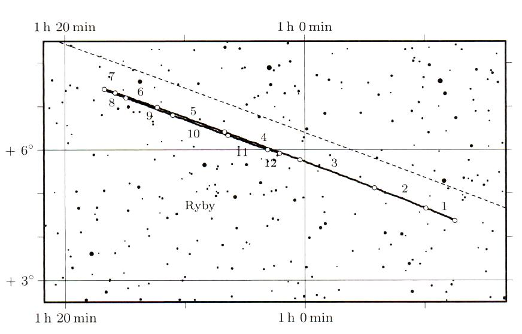
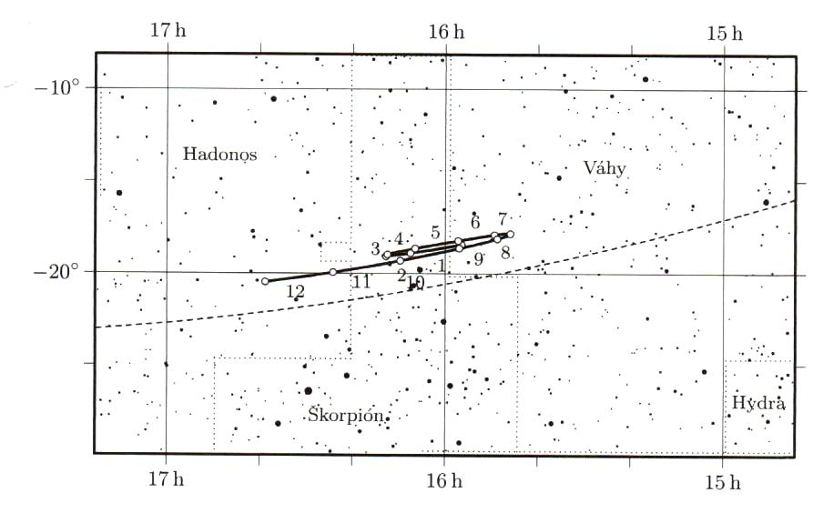

## Zadanie

Identifikujte planéty podľa ich ročného pohybu na obrázkoch 1, 2, 3, 4.

<figure>

<figcaption>

**Obrázok 1:** Pohyb neznámej planéty 1 po oblohe.
</figcaption>

</figure>

<figure>

<figcaption>

**Obrázok 2:** Pohyb neznámej planéty 2 po oblohe.
</figcaption>

</figure>

<figure>

<figcaption>

**Obrázok 3:** Pohyb neznámej planéty 3 po oblohe.
</figcaption>

</figure>

<figure>

<figcaption>

**Obrázok 4:** Pohyb neznámej planéty 4 po oblohe.
</figcaption>

</figure>

Riešenie

Okamžite vidíme, že všetky 4 planéty počas svojho pohybu na oblohe robia slučku. Na základe toho je jasné, že sa jedná o 4 vonkajšie planéty. Konkrétne názvy planét sa dajú určiť na základe to, aký uhol prejdú na oblohe za rok (aj aká veľká je ich slučka) alebo ak vieme, v ktorom súhvezdí sa planéta nachádzala v určité obdobie.

Ak si pamätáme, že veľká polos dráhy Marsu je zhruba $1{,}5\,\mathrm{au}$, vieme vypočítať jeho obežnú dobu, ktorá je približne $1{,}9\,\mathrm{rokov}$. Za jeden rok by sa mal Mars odhadom posunúť v rektascenzii o niečo viac než 12 hodín. Žiadna z planét na obrázkoch sa neposunie o tak veľký uhol, preto sa musí jednať o Jupiter, Saturn, Urán a Neptún. Planéta 2 sa posunie za rok o najväčší uhol, preto to musí byť Jupiter, druhý najväčší uhol prejde planéta 4, teda Saturn. Urán je planétou 3 a Neptún planétou 1.

