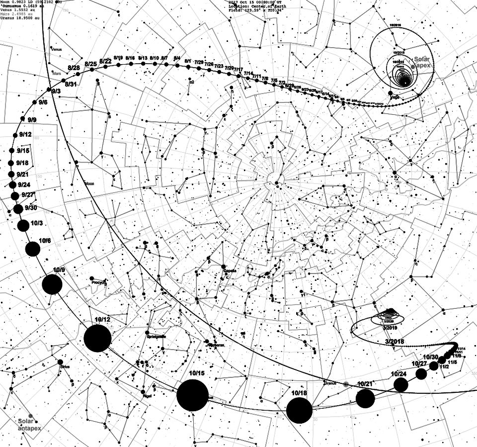
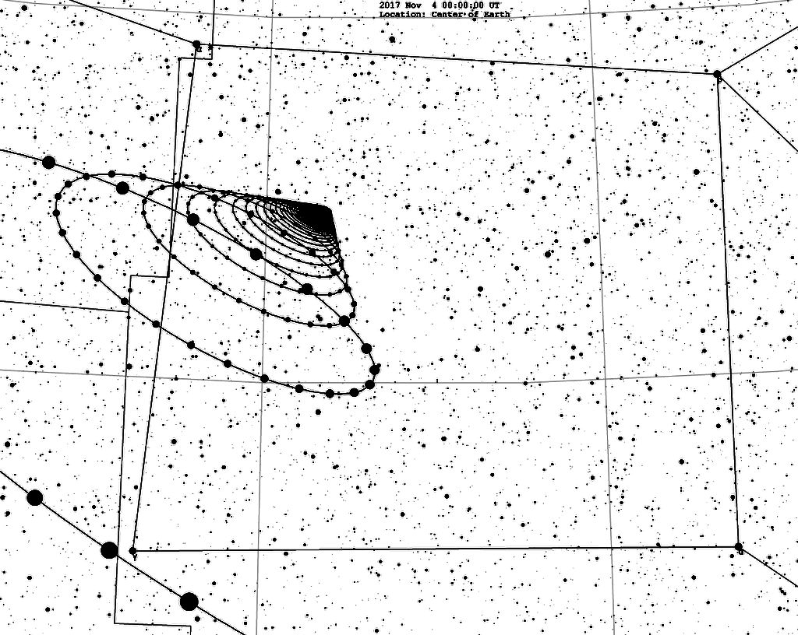

## Zadanie

**1I/2017 U1 ’Oumuamua** je prvý známy medzihviezdny objekt, ktorý prelieta slnečnú sústavu. Objavil ho 19. 10. 2017 Robert Weryk pomocou ďalekohľadu Pan-STARRS na Havaji. V čase objavu sa nachádzal už za perihéliom vo vzdialenosti $0{,}22\,\mathrm{AU}$ od Zeme. Jedná sa o malé teleso s rozmermi približne $230 \times 35\,\mathrm{m}$ tmavočervenej farby, podobnej ako mnoho objektov v periférnych častiach Slnečnej sústavy. Na pozemskej oblohe sa najjasnejšie javilo ako hviezda 19-tej magnitúdy. Vzhľadom na neprítomnosť kometárnej aktivity a rýchlu rotáciu je pravdepodobne zložené z materiálu s vysokou hustotou. Vašou úlohou je určiť parametre dráhy tohto objektu pomocou priemetu jeho trajektórie na pozemskú oblohu, znázorneného na obrázkoch.

**Pomôcky:**

polystyrénová guľa s polomerom $r=4\,\mathrm{cm}$, prípravok na rysovanie a meranie uhlov na povrchu gule, pravítko, fixka.

**Úlohy:**

<ol type="a">

<li>

Odhadnite dátum prechodu perihéliom $T_\odot$ a dátum najväčšieho priblíženia k Zemi $T_\Ea$.

</li>

<li>

Určte rovníkové súradnice smeru $A$, z ktorého do Slnečnej sústavy **1I** priletel, a smeru $B$, kam odlieta.

</li>

<li>

Na polystyrénovú guľu vyneste trajektóriu **1I** po nebeskej sfére v pohľade zo Slnka, vrátane určenia smeru pohybu.

</li>

<li>

Na guli vyznačte nasledujúce veličiny a určte (odmerajte) ich hodnoty:

- uhlovú vzdialenosť $\phi$ medzi bodmi $A$, $B$,

- sklon roviny dráhy k rovine ekliptiky $i$,

- dĺžku výstupného uzla $\Omega$,

- argument perihélia $\omega$.

</li>

<li>

Z hodnoty $\phi$ určte excentricitu dráhy $e$. Ak ste nezískali hodnotu $\phi$ vyššie, použite $\phi=70^{\circ}$.

</li>

<li>

Odhadnite rýchlosť $v_\infty$, ktorou sa bude **1I** pohybovať voči Slnku po opustení slnečnej sústavy.

</li>

<li>

Z hodnoty $v_\infty$ určte veľkosť hlavnej polosi $a$, ak ste hodnotu nezískali, použite $v_\infty=25\,\mathrm{km}.\mathrm{s}^{-1}$.

</li>

<li>

Vypočítajte vzdialenosť od Slnka v perihéliu $q$ a rýchlosť v perihéliu $v_\mathrm{q}$.

</li>

</ol>

<figure>

<figcaption>

Trajektória **1I** po pozemskej oblohe.
</figcaption>

</figure>

<figure>

<figcaption>

Detail trajektórie **1I** po pozemskej oblohe.
</figcaption>

</figure>

Riešenie

<ol type="a">

<li>

Počas najväčšieho priblíženia k Zemi má objekt najväčší uhlový rozmer (znázornené veľkosťou krúžkov) a veľký uhlový pohyb. Preto $T_\oplus\approx15.10.2017$. V príslní má teleso najväčšiu rýchlosť a pôsobí tu naň najväčšie zrýchlenie. Treba preto zvoliť miesto s prudkou zmenou smeru pohybu telesa a veľkou uhlovou rýchlosťou $T_\odot\approx 7.9.2017$.

</li>

<li>

Body, ktoré nás zaujímajú sú miesta kam smerujú slučky, súradnicová mriežka je delená v oboch súradniciach po $10\degree$, smer pohybu určíme z dátumov. Vidíme, že sa teleso pohybuje z Lýry do Pegasa, teda $\delta_A=34^{\circ}$, $\alpha_A=280^{\circ}$, $\delta_B=25^{\circ}$, $\alpha_B=358^{\circ}$.

</li>

<li>

Najprv si musíme rozmyslieť, čo je na guli už znázornené: nebeský rovník, ekliptika a štyri deklinačné polkružnice ($0^{\circ}$, $90^{\circ}$, $180^{\circ}$ a $270^{\circ}$ rektascenzie). Jeden z priesečníkov deklinačných kružníc zvolíme za severný nebeský pól $N$. Jarný bod je miesto, kde vystupuje ekliptika nad nebeský rovník pri pohybe po povrchu gule v smere hodinových ručičiek. Následne si na rovníku vyznačíme rektascenziu bodu $A$. Prípravok otočíme tak, aby prechádzal pólmi a vyznačeným bodom označujúcim $\alpha_A$ na rovníku a jemné delenie stupnice sa nachádzalo medzi pólom a rovníkom tak, že deklináciu bodu $A$ môžeme priamo vyznačiť na povrch gule a tak dostať polohu bodu $A$. Postup opakujeme pre bod $B$.

Slnko sa nachádza v rovine obehu telesa, preto pri pohľade zo Slnka Oumuamua opíše na nebeskej sfére oblúk hlavnej kružnice prechádzajúci z bodu $A$ so bodu $B$ dlhšou stranou. Pre zvýšenie presnosti zanesenia je vhodné zaniesť aj aspoň jeden z antipodálnych bodov k bodom $A$, $B$ s opačnou deklináciou a rektascenziou väčšou o $180^{\circ}$. Konečne nanesieme dlhší oblúk hlavnej kružnice medzi bodmi $A$, $B$ a šípkou označíme smer pohybu od $A$ do $B$ po dlhšom oblúku.

</li>

<li>

Uhlová vzdialenosť $\phi$ medzi bodmi $A$, $B$ je dĺžka kratšieho oblúka medzi $A$, $B$. Po odmeraní máme $\phi=67(2)^{\circ}$. Tento uhol sa dal aj vypočítať pomocou kosínusovej vety pre sférický trojuholník

</li>

</ol>

$$
\cos\phi=\cos(90^{\circ}-\delta_{\rm A})\cos(90^{\circ}-\delta_{\rm B})+\sin(90^{\circ}-\delta_{\rm A})\sin(90^{\circ}-\delta_{\rm B})\cos(\alpha_{\rm A}-\alpha_{\rm B})\, , \tag{1}
$$

 

$$
\cos\phi=\sin(\delta_{\rm A})\sin(\delta_{\rm B})+\cos(\delta_{\rm A})\cos(\delta_{\rm B})\cos(\alpha_{\rm A}-\alpha_{\rm B})\, . \tag{2}
$$

Sklon roviny dráhy $i$ je uhol medzi obežnou rovinou telesa a rovinou ekliptiky, presnejšie uhol medzi normálou k rovine obehu, pri pohľade z ktorej sa teleso pohybuje proti smeru pohybu hodinových ručičiek a severnou normálou k rovine ekliptiky (smerom k severnému pólu ekliptiky). Keďže sa teleso pohybuje okolo Slnka opačným smerom ako Zem, je jeho inklinácia $i$ väčší z uhlov zovretých trajektóriou telesa a ekliptikou. Tento uhol vieme pohodlne odmerať, ak si naznačíme na oboch kružniciach body vo vzdialenosti $90^{\circ}$ od ich priesečníkov a určíme vzdialenosť týchto bodov. Odmeriame $i=122(3)^{\circ}$.

Dĺžka výstupného uzla $\Omega$ je uhol medzi priesečníkom trajektórie telesa a ekliptiky v ktorom prechádza teleso nad ekliptiku (výstupným uzlom) a jarným bodom meraná po ekliptike, teda ekliptikálna dĺžka výstupného uzla. Výstupný uzol je v našom prípade priesečník bližšie k jarnému bodu. Po odmeraní $\Omega=25(4)^{\circ}$, kde veľká chyba je spôsobená pomerne veľkou citlivosťou tejto veličiny na nepresnosti v zakreslení ekliptiky a trajektórie telesa.

Argument perihélia $\omega$ je uhol medzi perihéliom a výstupným uzlom meraný v smere pohybu telesa. Perihélium si vyznačíme ako bod uprostred bodov A, B na trajektórii telesa. V našom prípade je $\omega$ dlhší uhol medzi bodom perihélia a výstupným uzlom, $\omega=242(5)^{\circ}$, kde chyba je ovplyvňovaná faktormi ako chyba dĺžky výstupného uzla a navyše chybou zanesenia bodu perihélia.

<ol type="a" start="5">

<li>

Pre určenie hodnoty excentricity $e$ hyperbolickej trajektórie telesa využijeme rovnicu kužeľosečky v polárnych súradniciach so stredom v ohnisku (Slnku)

</li>

</ol>

$$
r=\frac{a(1-e^2)}{1+e\cos\nu}\,, \tag{3}
$$

 kde $\nu$ je uhol zovretý sprievodičom a priamkou spájajúcou Slnko a perihélium. Vidíme, že vzťah nie je definovaný pre $1+e\cos\nu_k=0$. Tento smer určuje smer asymptôt k hyperbole. Uhol medzi nimi je $\phi$ a platí 

$$
\phi=360^{\circ}-2\nu_k\, , \tag{4}
$$

 Po dosadení a úprave máme 

$$
e=-\frac{1}{\cos{\nu_k}}=-\frac{1}{\cos(180^{\circ}-\frac{\phi}{2})}=\frac{1}{\cos{\frac{\phi}{2}}}=1.20(2)\,\, . \tag{5}
$$

<ol type="a" start="6">

<li>

Kľúčom k určeniu $v_\infty$ je druhý obrázok a pojem paralaxy. Ak by sa teleso nepohybovalo, z dĺžky hlavnej polosy opísanej elipsy (ročnej paralaxy) $\pi$ sa dá určiť vzdialenosť $r$ telesa od Slnka v astronomických jednotkách ako

</li>

</ol>

$$
r=\frac{1}{\tan{\pi}}\,. \tag{6}
$$

 Vidíme, že na obrázku vytvára teleso eliptické slučky, ktoré vypĺňajú uhol. Paralaxy môžeme odhadnúť ako uhlové vzdialenosti po sebe nasledujúcich extrémov slučiek. Odmeraním pravítkom a prevedením mierkou obrázku na stupne dostávame: 

$$
\pi_1=6.9(3)^{\circ},\,\pi_2=5.2(3)^{\circ},\,\pi_3=4.1(2)^{\circ},\,\pi_4=3.46(18)^{\circ}\, ,
$$

 odhady paraláx s ročnými odstupmi. Po prepočítaní na vzdialenosti dostávame 

$$
r_1=16.7(7)\,\mathrm{AU},\,r_2=22.2(11)\,\mathrm{AU},\,r_3=28.1(14)\,\mathrm{AU},\,r_4=33.1(18)\,\mathrm{AU}\, ,
$$

 pričom sa jedná o akési stredné vzdialenosti od Slnka počas roka. Ak rýchlosť v nekonečne odhadneme ako rozdiel $r_1$ a $r_3$ (v týchto vzdialenostiach sa teleso pohybuje prakticky priamo od Slnka) delenú tromi rokmi, dostávame 

$$
v_\infty=\frac{33.1(18)\,\mathrm{AU}-16.7(7)\,\mathrm{AU}}{3\,\mathrm{roky}}=26(3)\,\mathrm{km}.\mathrm{s}^{-1}\,. \tag{7}
$$

<ol type="a" start="7">

<li>

Veľkosť hlavnej polosy určíme zo zachovania energie (z rovnice vis-viva)

</li>

</ol>

$$
\frac{v^2}{2}-\frac{GM_\odot}{r}=-\frac{GM_\odot}{2a}\, . \tag{8}
$$

 Ak dosadíme pre $r$ nekonečno a pre $v=v_\infty$ dostávame 

$$
\frac{v^2_\infty}{2}=-\frac{GM_\odot}{2a},\qquad a=-\frac{GM_\odot}{v_\infty^2}=-1.3(3)\,\mathrm{AU}\,. \tag{9}
$$

<ol type="a" start="8">

<li>

Pre vzdialenosť $q$ od Slnka v perihéliu máme

</li>

</ol>

$$
q=a(1-e)=0.26(7)\,\mathrm{AU}\,. \tag{10}
$$

 Z nej môžeme pomocou zachovania energie 

$$
\frac{v_\infty^2}{2}=\frac{v_q^2}{2}-\frac{GM_\odot}{q}\, , \tag{11}
$$

 určiť rýchlosť v perihéliu $v_q$ ako 

$$
v_{\rm q}=\sqrt{v_\infty^2+\frac{2GM_\odot}{q}}=\sqrt{v_\infty^2+\frac{2GM_\odot}{a(1-e)}}=\sqrt{v_\infty^2+\frac{2GM_\odot}{-\frac{GM_\odot}{v_\infty^2}(1-e)}} \tag{12}
$$

 

$$
v_{\rm q} = v_\infty\sqrt{1+\frac{2}{e-1}}= v_\infty\sqrt{\frac{e-1}{e-1}+\frac{2}{e-1}} = v_\infty\sqrt{\frac{e+1}{e-1}}=86(15)\,\mathrm{km}.\mathrm{s}^{-1}. \tag{13}
$$

