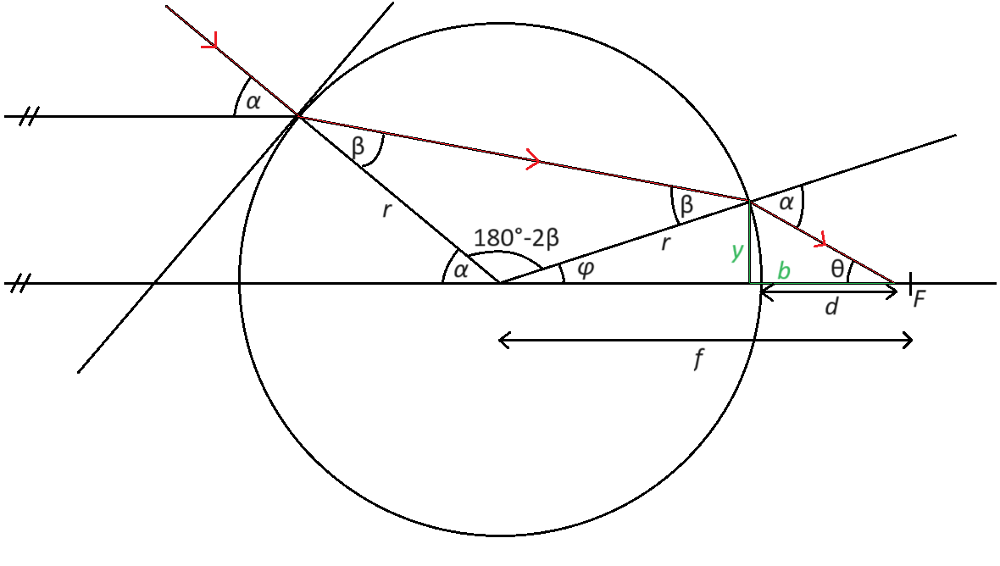

## Zadanie

Heliograf je prístroj určený na meranie dĺžky slnečného svitu. Skladá sa z gule s polomerom $r = 5\,\mathrm{cm}$, vyrobenej zo skla s indexom lomu $n = 1,5$. Určte v akej vzdialenosti od povrchu gule sa nachádza papierik, do ktorého Slnko vypaľuje stopu. Je obrazom Slnka bod, kruh alebo machuľa? Odhadnite, aký energetický tok a výkon dopadá na body stopy. Slnečná konštanta je $k = 1370\,\mathrm{W}\,{\mathrm{m}}^{-2}$. Predpokladajte efektívnu šírku stopy $D = 1\,\mathrm{mm}$.

Riešenie

Ohniskovú vzdialenosť sklenenej gule môžeme vypočítať z rovnice pre hrubé šošovky 

$$
\frac{1}{f}=(n-1) \left(\frac{1}{r_1}+\frac{1}{r_2}-\frac{n-1}{n}\frac{h}{r_1r_2}\right) \, . \tag{1}
$$

 kde $n$ je index lomu, $r_1$ a $r_2$ sú polomery krivosti prednej a zadnej guľovej plochy a $h$ je hrúbka šošovky. V našom prípade máme $n=1,5$, $h=10\,\mathrm{cm}$ a $r_1=r_2=5\,\mathrm{cm}$. Dosadíme do rovnice hrubej šošovky 

$$
\frac{1}{f}=(1,5-1) \left(\frac{1}{5}+\frac{1}{5}-\frac{1,5-1}{1,5}\frac{10}{5\cdot5}\right) \, . \tag{2}
$$

 Dostávame ohniskovú vzdialenosť $f=7{,}5\,\mathrm{cm}$. Lúče, ktoré sú pri vstupe rovnobežné s optickou osou, by sa mali pretnúť v ohnisku, kde je umiestnený papierik, do ktorého vypaľujú stopu. Vzdialenosť papierika od gule je $d=f-r=7,5-5=2{,}5\,\mathrm{cm}$. Do tejto vzdialenosti sa ale dostanú iba lúče, ktoré sú veľmi blízko optickej osi, ostatné lúče pretnú optickú os v menšej vzdialenosti $d'$. Teraz ukážeme, že naozaj platí $d'<d$. Využijeme pri tom obrázok, kde si nakreslíme prechod svetelného lúča cez guľu.

<figure>

</figure>

Snellov zákon nám dáva vzťah medzi uhlami $\alpha$ a $\beta$ 

$$
\frac{\sin \alpha}{\sin \beta}=n \, . \tag{3}
$$

 Využijeme, že dráha lúča vnútri gule tvorí spolu s polomermi gule rovnoramenný trojuholník. Preto je lúč pred výstupom z gule pod uhlom $\beta$ voči kolmici na povrch gule a po výstupe z gule sa kvôli Snellovmu zákonu zlomí tak, že bude voči kolmici sklonený pod uhlom $\alpha$. Z obrázka ďalej vyplývajú nasledujúce vzťahy pre uhly 

$$
\alpha+\varphi=2\beta \, , \tag{4}
$$

 

$$
\theta=\alpha-\varphi \, , \tag{5}
$$

 

$$
\sin \varphi=\frac{y}{r} \, , \tag{6}
$$

 

$$
\tan \theta=\frac{y}{b} \, , \tag{7}
$$

 

$$
r\cos \varphi + b=r+d' \, . \tag{8}
$$

 Vyjadríme z toho závislosť vzdialenosti pretnutia optickej osi $d$ na uhle dopadu $\alpha$ 

$$
d'=r\cos \varphi + b - r=r\cos (2\beta -\alpha)+\frac{y}{\tan \theta}-r=r\cos (2\beta -\alpha)+\frac{r\sin \varphi}{\tan (\alpha-\varphi)}-r \, , \tag{9}
$$

 

$$
d'=r\left[\cos(2\beta-\alpha)+\frac{\sin (2\beta -\alpha)}{\tan (2\alpha-2\beta)}\right] \, . \tag{10}
$$

 Uhol $\beta$ je 

$$
\beta=\arcsin \left(\frac{\sin \alpha}{n}\right) \, . \tag{11}
$$

 Napríklad pre uhol $\alpha=5^{\circ}$ dostaneme $d'=2{,}47\,\mathrm{cm}$ a pre uhol $\alpha=20^{\circ}$ dostaneme $d'=2{,}3\,\mathrm{cm}$. Pre vyššie hodnoty uhla $\alpha$ by sme dostali menšie hodnoty vzdialenosti $d'$. Zároveň pre rozličné hodnoty uhla vychádzajú rozličné vzdialenosti, z toho vyplýva, že obrazom Slnka je machuľa.\
Ak predpokladáme, že šošovka sústredí všetky svetelné lúče do stopy, tak na stopu dopadá výkon zachytený celou guľou, teda 

$$
P=k\pi r^2=1370\cdot\pi\cdot0,05^2=10{,}8\,\mathrm{W} \, . \tag{12}
$$

 Tok energie, ktorý dopadá na stopu je 

$$
F=\frac{P}{\pi\frac{D^2}{4}}=\frac{4\cdot10,8}{\pi\cdot0,001^2}=1{,}37 \cdot 10^{7}\,\mathrm{W}\,{\mathrm{m}}^{-2} \, . \tag{13}
$$

