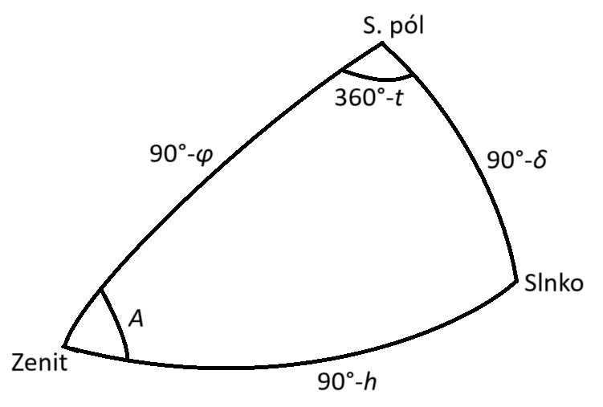

## Zadanie

Určte trvanie východu Slnka $T$ na Mesiaci, na selenografickej šírke $\varphi = 50^{\circ}$. Pre jednoduchosť predpokladajme, že dráha Mesiaca okolo Zeme sa nachádza v rovine ekliptiky a jeho rotačná os je kolmá k rovine obehu. Uhlový priemer Slnka pozorovaný zo Zeme je $\delta = 32'$. Odpoveď zapíšte číselne v hodinách.

Riešenie

V tomto zjednodušenom prípade sa rovina rovníka Mesiaca zhoduje s rovinou ekliptiky, preto je deklinácia Slnka $\delta=0^{\circ}$. Pri riešení budeme uvažovať azimut meraný od severu. Využijeme kosínusovú vetu pre sférický trojuholník. 

$$
\cos A=\cos B \cos C+\sin B\sin C \cos \alpha \, . \tag{1}
$$

<figure>

</figure>

Pre sférický trojuholník na obrázku platí 

$$
\cos(90^{\circ}-h)=\cos(90^{\circ}-\varphi)\cos(90^{\circ}-\delta)+\sin(90^{\circ}-\varphi)\sin(90^{\circ}-\delta)\cos(360^{\circ}-t) \, . \tag{2}
$$

 Využijeme vzťahy medzi sínusom a kosínusom uhla: $\sin\beta=\cos(90^{\circ}-\beta)$, $\cos\beta=\sin(90^{\circ}-\beta)$ a nasledujúcu vlastnosť funkcie kosínus: $\cos \beta=\cos(360^{\circ}-\beta)$ 

$$
\sin h =\sin \varphi \sin \delta + \cos \varphi \cos \delta \cos t \, . \tag{3}
$$

 Keďže deklinácia Slnka je nula, platí $\sin \delta = 0$ a $\cos \delta = 1$. Vzťah vyššie sa preto zjednoduší na 

$$
\sin h = \cos \varphi \cos t \, . \tag{4}
$$

 Východ Slnka začne v momente, keď sa horný okraj slnečného disku dotkne horizontu. Stred disku Slnka má v tej chvíli výšku $h_1=-16'$, tomu zodpovedá hodinový uhol 

$$
\cos t_2=\frac{\sin h_1}{\cos \varphi}=\frac{\sin -16'}{\cos 50^{\circ}} \, , \tag{5}
$$

 

$$
t_1=-90^{\circ}\,24'\,53{,}5'' \, . \tag{6}
$$

 Hodinový uhol berieme záporný, lebo Slnko sa nachádza na východ od meridiánu. Východ Slnka sa skončí vo chvíli, kedy sa disk Slnka dotýka horizontu svojím spodným okrajom. Výška stredu Slnka je vtedy $h_2=16'$ a hodinový uhol 

$$
\cos t_2=\frac{\sin h_1}{\cos \varphi}=\frac{\sin 16'}{\cos 50^{\circ}} \, , \tag{7}
$$

 

$$
t_2=-89^{\circ}\,35'\,6{,}5'' \, . \tag{8}
$$

 Dĺžku trvania východu Slnka zistíme, ak prepočítame rozdiel v hodinových uhloch na časový rozdiel 

$$
\Delta \tau = \frac{\Delta t}{360^{\circ}}T_\textrm{syn}=\frac{-90^{\circ}\,24'\,53{,}5''-(-89^{\circ}\,35'\,6{,}5'')}{360^{\circ}}\cdot29,5306=0{,}068\,\mathrm{dní}=1\,\mathrm{h} \ 38\,\min \, . \tag{9}
$$

