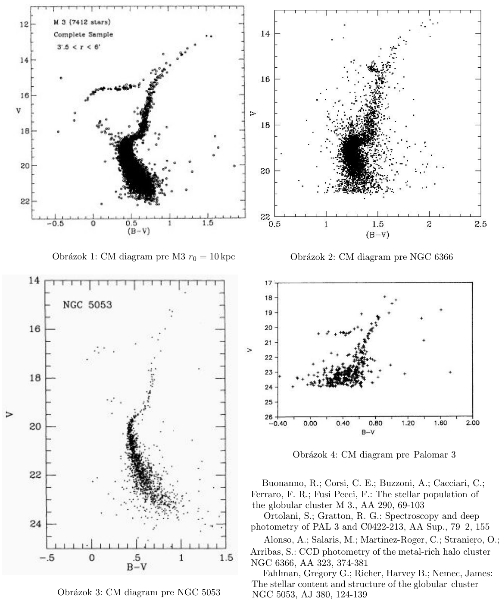
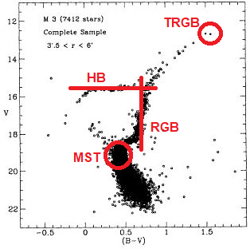
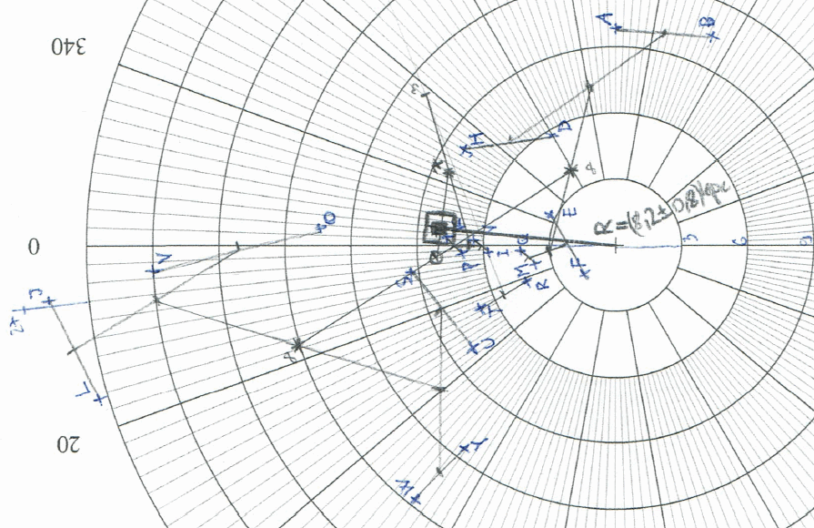

## Zadanie

V tejto úlohe z dátovej analýzy zameriame na meranie vzdialeností pomocou metódy tzv. *Colour-magnitude diagram* (CM diagram). Jedná sa o závislosť zdanlivej jasnosti hviezd ležiacich v jednej hviezdokope na ich farebnom indexe (rozdiele jasností na dvoch vlnových dĺžkach). Keďže zdanlivá jasnosť hviezdy závisí na jej žiarivom výkone a farebný index na teplote, nie je prekvapením, že grafické znázornenie sa ponáša na *Hertzsprung-Russelov diagram*. Preto porovnaním CM diagramu zostrojeného pre napr. guľovú hviezdokopu s iným štandardizovaným diagramom vieme určiť vzdialenosť tejto hviezdokopy. Následne sa zo vzdialeností guľových hviezdokôp štatistickými metódami pokúsime určiť vzdialenosť centra Galaxie od Slnka.

Zdanlivé jasnosti hviezd vo viditeľnom a v modrom svetle sú označené zaradom $V$ a $B$.

<ol type="a">

<li>

Pomocou priložených CM diagramov určte modul vzdialenosti $(m-M)$ a farebný exces 

$$
E_\mathrm{B-V}=(B-V)-(B-V)_0\, , \tag{1}
$$

 pre guľové hviezdokopy NGC 5053, NGC 6366 a Palomar 3. Využite pri tom diagram hviezdokopy M3, ktorej vzdialenosť od Zeme je $r_0=10\,\mathrm{kpc}$. Predpokladajte, že pre hviezdokopu M3 je absorpcia v medzihviezdnom prostredí zanedbateľná, teda pre M3 platí $(m_0-M_0)=15$ mag. Nezabudnite určiť chybu veličín.

</li>

<li>

Z modulov vzdialenosti $(M-m)$ a farebných excesov $E_\mathrm{B-V}$ určte skutočné vzdialenosti $r$ k týmto trom guľovým hviezdokopám. Predpokladajte, že pre medzihviezdnu extinkciu $A_\mathrm{V}$ vo filtri V platí 

$$
R_\mathrm{V}=\frac{A_\mathrm{V}}{E_\mathrm{B-V}}=3,1\,. \tag{2}
$$

 Pokúste sa odhadnúť, akou veľkou chybou je výsledná vzdialenosť $r$ zaťažená.

</li>

<li>

V tabuľke sa nachádzajú údaje o polohe na oblohe v galaktických súradniciach $(l,b)$ a vzdialenosti od Zeme $r$ pre náhodne vybrané guľové hviezdokopy ležiace v Galaxii. Galaktická dĺžka je označená $l$, galaktická šírka je $b$. Znázornite graficky rozmiestnenie priemetov polôh hviezdokôp do galaktickej roviny na milimetrový papier s polárnymi súradnicami.

</li>

<li>

Určte polohu stredu Galaxie a jeho chybu v grafe a popíšte postup, ktorý ste použili. Určte vzdialenosť k stredu Galaxie $R$ aj s chybou.

</li>

<li>

Diskutujte výsledok, najmä prítomnosť chýb, ako štatistických, tak systematických a porovnajte ho so skutočnou hodnotou $R=8,0(3)\,\mathrm{kpc}$.

</li>

</ol>

**Tabuľka 1:** Vzdialenosti a galaktické súradnice vybraných hviezdokôp.

| ID  | Kat. označenie | $l$ $[\degree]$ | $b$ $[\degree]$ | $r$ \[kpc\] |
|:----|:---------------|--------------------:|--------------------:|------------------:|
| A   | NGC 1261       |              270,54 |              -52,12 |              16,3 |
| B   | NGC 2298       |              245,63 |              -16,00 |              10,8 |
| C   | Pal 3          |              240,15 |               41,86 |                 — |
| D   | NGC 4372       |              300,99 |               -9,88 |               5,8 |
| E   | NGC 5053       |              335,70 |               78,95 |                 — |
| F   | M 3            |               42,22 |               78,71 |              10,2 |
| G   | NGC 5824       |              332,56 |               22,07 |              32,1 |
| H   | Lynga 7        |              328,77 |               -2,80 |               8,0 |
| I   | M 107          |                3,37 |               23,01 |               6,4 |
| J   | M 54           |                5,61 |              -14,09 |              26,5 |
| K   | NGC 6316       |              357,18 |                5,76 |              10,4 |
| L   | IC 1257        |               16,54 |               15,15 |              25,0 |
| M   | NGC 6366       |               18,41 |               16,04 |                 — |
| N   | Terzan 1       |              357,57 |                1,00 |               6,7 |
| O   | Djorg 1        |              356,69 |               -2,47 |              13,7 |
| P   | Terzan 9       |                3,61 |               -1,99 |               7,1 |
| Q   | NGC 6540       |                3,29 |               -3,31 |               5,3 |
| R   | IC 1276        |               21,83 |                5,67 |               5,4 |
| S   | NGC 6638       |                7,90 |               -7,15 |               9,4 |
| T   | NGC 6712       |               25,35 |               -4,32 |               6,9 |
| U   | NGC 6749       |               36,20 |               -2,21 |               7,9 |
| V   | Terzan 7       |                3,39 |              -20,07 |              22,8 |
| W   | NGC 6934       |               52,10 |              -18,89 |              15,6 |
| Y   | NGC 7492       |               53,39 |              -63,48 |              26,3 |

<figure>

<figcaption>

**Obrázok 1:** CM diagramy.
</figcaption>

</figure>

Riešenie

<ol type="a">

<li>

Hodnoty v úlohe určíme porovnaním diagramov pre M3 a ostatné hviezdokopy. Tieto diagramy by mali mať (najmä ak predpokladáme rovnaký vek hviezdokôp) rovnaký tvar. Hviezdy, ktoré sa nachádzajú v rovnakej oblasti diagramu majú rovnakú absolútnu magnitúdu. To sa dá využiť na určenie modulu vzdialenosti, potrebujeme iba porovnať $V$ magnitúdu niektorých výrazných oblastí v diagramoch s už známou hviezdokopou. Môžeme na to využiť nasledujúce časti CM diagramu

</li>

</ol>

- *Tip of the red giant branch*, teda najjasnejší červený obor v hviezdokope, metóda sa používa pre galaxie, kde máme väčšiu vzorku práve takýchto jasných hviezd;

- *Horizontal branch*, vývojová vetva v ktorej dochádza k horeniu hélia v jadre hviezdy, obsahuje RR Lyr;

- *Main sequence turnoff*, oblasť, kde hviezdy opúšťajú hlavnú postupnosť, je určené vekom hviezdokopy.

<figure>

<figcaption>

**Obrázok 2:** Časti CM diagramu
</figcaption>

</figure>

Keďže pre M3 máme dané $(m_0-M_0)=15$, k tejto hodnote musíme už iba pričítať vertikálny posun na ostatných obrázkoch.

Pre farebné excesy sledujeme hodnotu farebného indexu $B-V$ ďalšej výraznej črty diagramov - *Red giant branch*, teda vetvy obrov. V prípade hviezdokopy M3 máme podľa zadania zanedbať medzihviezdnu absorpciu. To znamená, že pre M3 platí $(B-V) = (B-V)_0$ a preto je jej farebný exces nulový, $E_\mathrm{B-V} = 0$. Pri určovaní farebného excesu ostatných hviezdokôp budeme predpokladať, že všetky majú rovnaký index $(B-V)_0$, potom nám stačí z CM diagramov odčítať index $(B-V)$ vetvy obrov. Inými slovami, farebný exces vypočítame ako horizontálny posun vetvy obrov jednotlivých hviezdokôp v porovnaní s M3.

Ako vidíme na obrázkoch, reálne dáta nie sú ideálne a v niektorých hviezdokopách sú vyššie spomínané oblasti CM diagramu výraznejšie ako v iných.

**Tabuľka 2:** Polohy významných oblastí na CM diagramoch hviezdokôp.

|                     | $h\quad$ | $A\quad$ |          |           |
|:--------------------|----------:|----------:|---------:|----------:|
|                     |        M3 |  NGC 6366 | NGC 5053 | Palomar 3 |
| $V$ (RGB tip) |      12,5 |      13,5 |     14,5 |        18 |
| $V-V_\mathrm{M3}$ (RGB tip) |           |       1,0 |      2,0 |       5,5 |
| $V$ (HB)      |      15,5 |      15,5 |     16,5 |        20 |
| $V-V_\mathrm{M3}$ (HB)      |           |       0,0 |      1,0 |       4,5 |
| $V$ (MST)     |      18,5 |      18,5 |     19,5 |      23,5 |
| $V-V_\mathrm{M3}$ (MST)     |           |       0,0 |      1,0 |       5,0 |
| $B-V$           |       0,7 |      1,45 |      0,7 |       0,7 |

Pri výpočte modulu vzdialenosti urobíme priemer z troch nameraných vertikálnych posunutí. Chybu odhadneme z presnosti odčítania význačných polôh z diagramov. Dostávame

- NGC 6366: $(m-M)=15,3\pm0,5\,, \, \,  E_\mathrm{B-V}=0,75\pm0,05\,;$

- NGC 5053: $(m-M)=16,3\pm0,5\,,\,\, E_\mathrm{B-V}=0,00\pm0,05\,;$

- Palomar 3: $(m-M)=20\pm0,5\,,\,\, E_\mathrm{B-V}=0,00\pm0,10\,.$

<ol type="a">

<li>

Do vzorca pre modul vzdialenosti musíme zahrnúť aj medzihviezdnu absorpciu 

$$
(m-M)=5\log{r} - 5 +A_\mathrm{V} = (m-M)=5\log{r} - 5 + 3,1 E_\mathrm{B-V} \, , \tag{3}
$$

 

$$
r=10^{\frac{(m-M)+5-3,1E_\mathrm{B-V}}{5}}\,. \tag{4}
$$

Nepresnosť určenia vzdialenosti môžeme určiť dosadením krajných hodnôt vstupných veličín. S využitím derivácií je tiež možné odvodiť nasledujúci vzorec na výpočet odchýlky 

$$
\sigma_r=r\,\sqrt{\left(\frac{\partial r}{\partial (m-M)}\right)^2\sigma_{(m-M)}^2+\left(\frac{\partial r}{\partial E}\right)^2\sigma_{E}^2\,\,}\,=r\,\frac{\ln 10}{5}\sqrt{\sigma_{(m-M)}^2+9,6\sigma_E^2}\,. \tag{5}
$$

 Obidve metódy sú ohodnotené rovnakým počtom bodov (ak sú použité správne), súťažiaci si teda môžu vybrať, ktorá z nich im viac vyhovuje. Po dosadení dostávame nasledujúce hodnoty vzdialeností hviezdokôp od Slnka $r$. Pre ukážku ich porovnávame s hodnotami $\tilde{r}$ z CATALOG OF PARAMETERS FOR MILKY WAY GLOBULAR CLUSTERS:

- NGC6366: $r=4,3(10)\,\mathrm{kpc}\,,\quad \tilde{r}=4{,}3\,\mathrm{kpc}$

- NGC5053: $r=17(4)\,\mathrm{kpc}\,,\,\,\,\,\,\quad \tilde{r}=17{,}4\,\mathrm{kpc}$

- Palomar 3: $r=87(19)\,\mathrm{kpc}\,,\,\quad \tilde{r}=92{,}5\,\mathrm{kpc}$

Vidíme, že nami získané hodnoty sú v medziach chýb správne, no ich nepresnosť je pomerne veľká, čoho príčinou je magnitúda v exponente vzťahu pre výpočet vzdialenosti.

</li>

<li>

Do grafu máme vynášať priemety do roviny galaxie, hodnoty vzdialeností uvedených v tabuľke musíme preto prepočítať podľa vzťahu 

$$
r^*=r\cos b \,, \tag{6}
$$

 pričom do grafu vynášame dvojice vzdialenosť, uhol $(r^*, l)$. Ako pri každom zanášaní do grafu si treba uvedomiť ako sú členené osi, poprípade si to rozvrhnúť. Radiálne lúče sú delené po $2^{\circ}$ s veľkým krokom $20^{\circ}$, sústredných kružníc je osem, autor zvolil krok $3\,\mathrm{kpc}$. Pri zanášaní sa do grafu nezmestí Palomar 3, ak by sme mierku prispôsobili tak, aby sa zmestil, stala by centrálna oblasť prihustá a neprehľadná.

</li>

<li>

Pri určení stredu Galaxie predpokladáme, že guľové hviezdokopy sú rovnomerne rozložené okolo jej ťažiska. Teda ak nájdeme ťažisko priemetov hviezdokôp, určíme polohu priemetu centra Galaxie, ak navyše predpokladáme, že leží v danej rovine, dostávame priamo jeho polohu! Pri spracovaní eliminujeme Palomar 3 ako odľahlú hodnotu súboru, jedná sa totiž o halovú guľovú hviezdokopu, ktorých je v Galaxii cca. 10, z ktorých máme v súbore len jednu. Ťažisko ostatných hviezdokôp nájdeme tak, že si súbor rozložíme na dvojice, ktorým nájdeme stred, ktorý bude reprezentovať polohu ťažiska týchto hviezdokôp. Hviezdokôp však nie je mocnina 2, musíme preto hľadať ťažisko aj „nevyváženej“ dvojice, tu platí, že ťažisko delí úsečku v pomere váh jej koncov, pričom ťažisko je bližšie ťažšiemu koncu.

Chybu určenia polohy odhadneme ako súčet chyby samotného rysovania a chyby z nasledovnej úvahy. Ak by sme nejakú z hviezdokôp v súbore nemali, ťažisko by sme dostali na inom mieste, tento posun môžeme odhadnúť ako strednú vzdialenosť hviezdokopy od stredu Galaxie delenú počtom uvažovaných hviezdokôp. Nakoniec po odčítaní hodnôt z obrázka dostávame $R=8,2(8)\,\mathrm{kpc}$.

</li>

<li>

Výsledok, ktorý sme získali sa v medziach chýb zhoduje s referenčnou hodnotu. Je však zaťažený väčšou štatistickou chybou, plynúcou z nepresnosti konštrukcie ťažiska a malej vzorky hviezdokôp. Tieto nedostatky by sa dali odstrániť výpočtom polohy ťažiska všetkých pozorovaných hviezdokôp v Galaxii metódou najmenších štvorcov.

Avšak aj tu je otázkou vplyv systematickej, resp. hrubej chyby. Totiž, **leží stred Galaxie naozaj v ťažisku hviezdokôp?** Ak Galaxia prekonala v nedávnej minulosti zrážku s inou galaxiou, platiť to nemusí. Ďalší problém, ktorý v praxi nastáva je tzv. *observation bias*, výberová chyba. Vzdialenejšie objekty a hlavne objekty za množstvom prachu sú málo jasné a nemusia byť pozorované. Vzhľadom na asymetrickú polohu Slnka v Galaxii a množstvo plynu a prachu v galaktickom disku a centre je zjavné, že objekty na presne opačnej strane Galaxie vlastne ani nie je možné pozorovať. Podobne je mierne problematické aj samotné určovanie vzdialeností. Sú uvedené hodnoty správne? Nie sú zaťažené nejakou chybou o ktorej nevieme?

</li>

</ol>

<figure>

<figcaption>

**Obrázok 3:** Hľadanie ťažiska hviezdokôp
</figcaption>

</figure>

