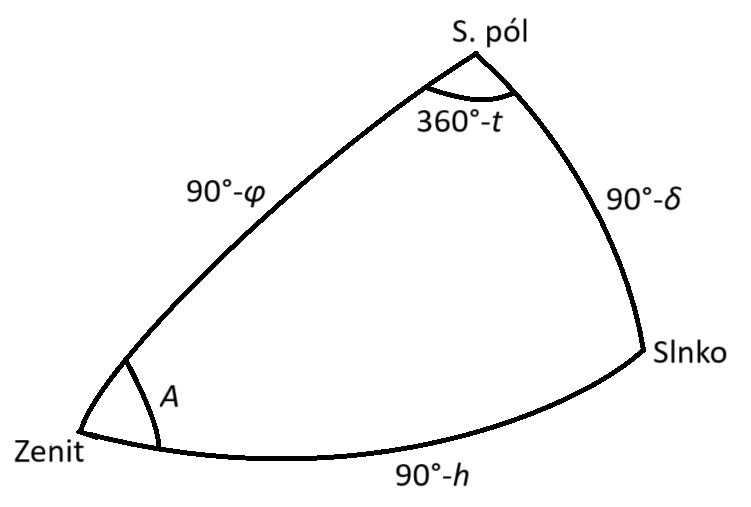

## Zadanie

Pozorovateľ A sleduje oblohu v Galante ($48^{\circ}\,11'\,20''$N, $17^{\circ}\,43'\,35''$E). V ten istý čas zároveň pozoruje oblohu aj pozorovateľ B v Michalovciach ($48^{\circ}\,44'\,57''$N, $21^{\circ}\,54'\,5''$E). Predpokladajme, že sa obe mestá nachádzajú v rovnakej nadmorskej výške (pre jednoduchosť obe sú na hladine mora). Presne o 22:00:00 spozoruje pozorovateľ A na obzore vychádzať hviezdu a zmeria jej deklináciu $\delta = 20^{\circ}\,15'$.\
Pri Vašich výpočtoch zanedbávajte atmosférickú refrakciu.

<ol type="a">

<li>

Určte hodinový uhol hviezdy v čase pozorovania pre pozorovateľa A.

</li>

<li>

Odhadnite čas východu tejto hviezdy pre pozorovateľa B.

</li>

<li>

Koľko kilometrov južne by musel pozorovateľ A cestovať, aby mohol pozorovať hviezdu Hadar ($\alpha = 14^{\rm{h}} 4^{\rm{m}}$, $\delta = -60^{\circ}\,22'$). Určte, či je pre pozorovateľa B hviezda Deneb ($\alpha = 20^{\rm{h}} 41^{\rm{m}}$, $\delta = 45^{\circ}\,20'$) cirkumpolárna hviezda.

</li>

<li>

Akú vysokú budovu by museli v Galante postaviť, aby z jej vrcholu bol pozorovateľ A schopný vidieť hviezdu presne v čase, keď ju vidí pozorovateľ B vychádzať. Pre jednoduchosť predpokladajme, že obe mestá ležia na rovnakej rovnobežke a hviezda sa nachádza presne na východe.

</li>

<li>

Odhadnite dĺžku trvania občianskeho súmraku pri západe Slnka v Galante v deň letného slnovratu. Poznámka: Vychádzajte pri Vašom výpočte z definície občianskeho súmraku.

</li>

<li>

Vyberte správnu možnosť a veľmi stručne (stačí jednou vetou) sa pokúste odôvodniť svoj výber:

<ol type="i">

<li>

Dĺžka trvania občianskeho súmraku pri západe Slnka v deň letného slnovratu je v Galante **DLHŠIA** / **KRATŠIA** / **ROVNAKO DLHÁ** ako počas zimného slnovratu.

</li>

<li>

Ak by náš výpočet bral do úvahy aj atmosférickú refrakciu (ktorá dosahuje pri horizonte asi $35'$) tak by sa vypočítaná dĺžka súmraku **PREDĹŽILA** / **SKRÁTILA** / **ZOSTALA BY ROVNAKÁ**.

</li>

</ol>

</li>

</ol>

Riešenie

<ol type="a">

<li>

Pri výpočte hodinového uhla hviezdy vyjdeme zo sférického trojuholníka. Ak si nakreslíme celú situáciu, tak môžeme pomocou kosínusovej vety pre sférický trojuholník dostať vzorec pre výšku pomocou deklinácie, zemepisnej šírky miesta a hodinového uhlu hviezdy ako

</li>

</ol>

$$
\sin h=\sin \varphi_1 \sin \delta + \cos \varphi_1 \cos \delta \cos t \, , \tag{1}
$$

 kde $h$ je výška hviezdy v čase pozorovania.

<figure>

</figure>

Je jasné, že pre východ alebo západ hviezdy platí pre jej výšku $h = 0^{\circ}$ $(\sin h=0)$. Preto sa vzťah vyššie reguluje len na 

$$
0=\sin \varphi_1 \sin \delta + \cos \varphi_1 \cos \delta \cos t \, . \tag{2}
$$

 Odtiaľ úpravou dostávame vzťah pre hodinový uhol 

$$
t=\arccos (-\tan \varphi_1 \tan \delta) \, . \tag{3}
$$

 Táto rovnica má dve riešenia $(+t, -t)$ a keďže sa jedná o východ hviezdy, tak hviezda ešte len bude kulminovať, čo znamená, že za riešenie berieme $-t$. Dosadením máme 

$$
t=\arccos (-\tan 48^{\circ}\,11'\,20'' \tan 20^{\circ}\,15')=-114^{\circ}\,21'\,32{,}5''=-7^{\mathrm{h}}\,37^{\mathrm{min}}\,26^{\mathrm{s}} \, . \tag{4}
$$

 Keďže hodinový uhol sa zvykne udávať v intervale 0 až 24$^{\rm h}$, ako výslednú hodnotu berieme $t=24^{\rm h}-7^{\mathrm{h}}\,37^{\mathrm{min}}\,26^{\mathrm{s}}=16^{\mathrm{h}}\,22^{\mathrm{min}}\,34^{\mathrm{s}}$.

<ol type="a" start="2">

<li>

Keďže obaja pozorovatelia ležia takmer na rovnakej geografickej šírke, môžeme rozdiel časov $\Delta \tau$ vo východe oboch miest vypočítať ako rozdiel geografických dĺžok oboch miest a previesť na minúty. Keďže Michalovce sa nachádzajú východnejšie ako Galanta, musel pozorovateľ B vidieť hviezdu vychádzať skôr, preto pre rozdiel časov východu tej istej hviezdy $\Delta \tau$ v hodinách platí

</li>

</ol>

$$
\Delta \tau=\frac{\lambda_2-\lambda_1}{15}=\frac{21^{\circ}\,54'\,5''-17^{\circ}\,43'\,35''}{15}=0^{\mathrm{h}}\,16^{\mathrm{min}}\,42^{\mathrm{s}} \, . \tag{5}
$$

 Takže čas východu hviezdy je asi $22^{\mathrm{h}}\,0^{\mathrm{min}}\,0^{\mathrm{s}}-0^{\mathrm{h}}\,16^{\mathrm{min}}\,42^{\mathrm{s}}=21^{\mathrm{h}}\,43^{\mathrm{min}}\,18^{\mathrm{s}}$.

<ol type="a" start="3">

<li>

Na severnej pologuli platí pre deklináciu hviezdy, ktorú môže pozorovateľ sledovať vzťah

</li>

</ol>

$$
\delta_\textrm{star}>\varphi_1-90^{\circ} \, . \tag{6}
$$

 Teda po dosadení dostávame podmienku, že deklinácia hviezdy musí byť väčšia ako $\delta_\textrm{star}=-41^{\circ}\,48'\,40''$. Hadar má deklináciu $\delta_\textrm{H}=-60^{\circ}\,22'$, preto musí pozorovateľ vyrovnať tento rozdiel, teda musí sa dostať o $18^{\circ}\,33'\,20''$ južnejšie ako sa nachádza, aby videl hviezdu pri ideálnom horizonte presne na horizonte. Pomocou obrázku nižšie dostaneme vzťah pre vzdialenosť na Zemskom povrchu 

$$
s=\frac{\delta_\textrm{star}-\delta_\textrm{H}}{360^{\circ}}\cdot2\pi R_{\Ea}=\frac{-41^{\circ}\,48'\,40''--60^{\circ}\,22'}{360^{\circ}}\cdot2\pi 6378\, . \tag{7}
$$

<figure>

</figure>

Čo sa týka pozorovateľa B tak tam zase platí podmienka, že deklinácia cirkumpolárnej hviezdy musí spĺňať 

$$
\delta_\textrm{circ}>90^{\circ}-\varphi_1 \, . \tag{8}
$$

 Dosadením deklinácie Denebu dostávame, že Deneb spĺňa túto podmienku, preto je pre pozorovateľa B cirkumpolárny.

<ol type="a" start="4">

<li>

Vieme, že ak sa pozorovateľ nachádza v určitej výške nad Zemou je schopný vidieť istý uhol pod horizont a tento uhol je úmerný výške nad Zemou. Celú situáciu zobrazuje obrázok.

</li>

</ol>

<figure>

</figure>

Označme výšku našej budovy ako $h$ a rozdiel geografických dĺžok ako $\lambda_2-\lambda_1=\Delta \lambda$. Ako je vidno z obrázku, o tento uhol musí vidieť pozorovateľ A nižšie pod obzor 

$$
\cos \Delta\lambda=\frac{R_{\Ea}}{R_{\Ea}+h} \, . \tag{9}
$$

 Odtiaľ vieme vyjadriť výšku $h$ ako 

$$
h=\frac{R_{\Ea}}{\cos \Delta\lambda}-R_{\Ea}=\frac{6378}{\cos (21^{\circ}\,54'\,5''-17^{\circ}\,43'\,35'')}-6378=16{,}97\,\mathrm{km} \, . \tag{10}
$$

<ol type="a" start="5">

<li>

Občiansky súmrak nastáva, keď sa stred Slnka nachádza $6^{\circ}$ pod horizontom. Je jasné, že dĺžka súmraku bude závisieť od deklinácie Slnka. Dĺžku súmraku $T$ určíme ako rozdiel hodinových uhlov kedy je Slnko $6^{\circ}$ pod horizontom ($t_2$) a kedy zapadá ($t_1$), teda

</li>

</ol>

$$
T=t_2-t_1 \, . \tag{11}
$$

 Vieme, že deklinácia Slnka v deň letného slnovratu je približne $\delta_{\Sun}=23^{\circ}\,26'$. Na základe toho môžeme podobne ako v časti a) určiť jeho hodinový uhol ako 

$$
t_1=\arccos (-\tan \varphi_1 \tan \delta_{\Sun})=\arccos (-\tan 48^{\circ}\,11'\,20'' \tan 23^{\circ}\,26')=118^{\circ}\,59'\,4{,}8''=7^{\mathrm{h}}\,55^{\mathrm{min}}\,56^{\mathrm{s}} \, . \tag{12}
$$

 Pre hodinový uhol Slnka $6^{\circ}$ pod obzorom máme, že výška Slnka musí byť $h = -6^{\circ}$, teda z kosínusovej vety pre sférický trojuholník dostaneme vzťah pre hodinový uhol 

$$
t_2=\arccos \left(\frac{\sin h-\sin \varphi_1 \sin \delta_{\Sun}}{\cos \varphi_1 \cos \delta_{\Sun}}\right) \, , \tag{13}
$$

 

$$
t_2=\arccos \left(\frac{\sin (-6^{\circ})-\sin (48^{\circ}\,11'\,20'') \sin (23^{\circ}\,26')}{\cos (48^{\circ}\,11'\,20'') \cos 23^{\circ}\,26'}\right)=130^{\circ}\,57'\,16{,}2''=8^{\mathrm{h}}\,43^{\mathrm{min}}\,49^{\mathrm{s}} \, . \tag{14}
$$

 Dĺžka trvania občianskeho súmraku pri západe potom bude $T=8^{\mathrm{h}}\,43^{\mathrm{min}}\,49^{\mathrm{s}}-7^{\mathrm{h}}\,55^{\mathrm{min}}\,56^{\mathrm{s}}=0^{\mathrm{h}}\,47^{\mathrm{min}}\,53^{\mathrm{s}}$.

<ol type="a" start="6">

<li>

Dĺžka súmraku je uvedená v tabuľke, overenie prebehlo v `Stellariu`, no dá sa to ukázať aj zo vzťahov kde sa zohľadňuje refrakcia. V tomto príklade nám ale ide len o odhad a kvalitatívne popísanie. Vidíme, že odpoveď na prvú otázku je **DLHŠIA** a odpoveď na druhú otázku je **SKRÁTILA**.

</li>

</ol>

Vysvetlenie 1: Pri letnom slnovrate Slnko opisuje väčšiu kružnicu na nebeskej sfére ako pri zimnom slnovrate a dá sa povedať, že ide voči horizontu pod menším uhlom, preto keďže pohyb po ekliptike počas jedného dňa je zhruba rovnomerný, tak mu trvá dlhší čas kým prejde do rovnakej výšky (resp. hĺbky) pod horizont.\
Vysvetlenie 2: Dĺžka sa skráti, pretože refrakcia (hviezdy sú vyššie ako v skutočnosti) spôsobuje, že vidíme Slnko ešte nad obzorom (zdanlivo) napriek tomu, že jeho stred je už nejaký čas pod obzorom. Po západe Slnka už viacej nepozorujeme refrakciu a preto refrakcia nemá vplyv na čas kedy Slnko dosiahne výšku $-6^{\circ}$. Výsledný efekt je taký, že uhol, ktorý Slnko musí prejsť nie je $6^{\circ}$, ale menej a to samozrejme trvá kratší čas.

<table>
<thead>
<tr>
<th colspan="2" style="text-align: center;">Letný slnovrat – západ Slnka</th>
<th colspan="2" style="text-align: center;">Zimný slnovrat – západ Slnka</th>
</tr>
</thead>
<tbody>
<tr>
<td style="text-align: center;">Čas na horizonte</td>
<td style="text-align: center;">Čas 6^{\circ} pod obzorom</td>
<td style="text-align: center;">Čas na horizonte</td>
<td style="text-align: center;">Čas 6^{\circ} pod obzorom</td>
</tr>
<tr>
<td style="text-align: center;">bez atmosféry</td>
<td style="text-align: center;">bez atmosféry</td>
<td style="text-align: center;">bez atmosféry</td>
<td style="text-align: center;">bez atmosféry</td>
</tr>
<tr>
<td style="text-align: center;">20:47:03</td>
<td style="text-align: center;">21:34:57</td>
<td style="text-align: center;">15:51:38</td>
<td style="text-align: center;">16:34:27</td>
</tr>
<tr>
<td colspan="2" style="text-align: center;">Dĺžka súmraku T = 47\,\min\ 54\,\mathrm{s}</td>
<td colspan="2" style="text-align: center;">Dĺžka súmraku T = 42\,\min\ 49\,\mathrm{s}</td>
</tr>
<tr>
<td style="text-align: center;">Čas na horizonte</td>
<td style="text-align: center;">Čas 6^{\circ} pod obzorom</td>
<td style="text-align: center;">Čas na horizonte</td>
<td style="text-align: center;">Čas 6^{\circ} pod obzorom</td>
</tr>
<tr>
<td style="text-align: center;">s atmosférou</td>
<td style="text-align: center;">s atmosférou</td>
<td style="text-align: center;">s atmosférou</td>
<td style="text-align: center;">s atmosférou</td>
</tr>
<tr>
<td style="text-align: center;">20:51:18</td>
<td style="text-align: center;">21:34:18</td>
<td style="text-align: center;">15:55:49</td>
<td style="text-align: center;">16:34:27</td>
</tr>
<tr>
<td colspan="2" style="text-align: center;">Dĺžka súmraku T = 43\,\min\ 0\,\mathrm{s}</td>
<td colspan="2" style="text-align: center;">Dĺžka súmraku T = 38\,\min\ 38\,\mathrm{s}</td>
</tr>
</tbody>
</table>

