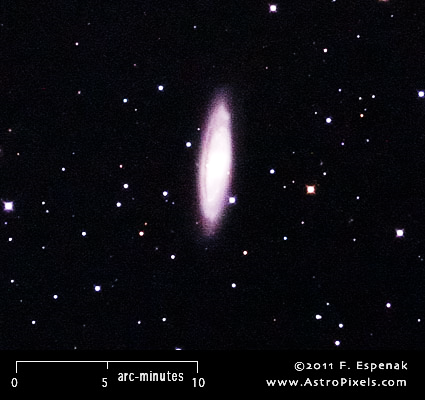
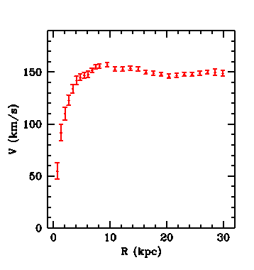

## Zadanie

Rotačná krivka galaxie je závislosť rýchlosti rotácie od vzdialenosti od stredu, značené $v(r)$. V tejto úlohe sa pozrieme na rotačné krivky galaxií a na niektoré teórie, ktoré sa snažia vysvetliť ich neočakávané tvary. Dominantnou teóriou vysvetľujúcou túto nezrovnalosť je prítomnosť tzv. tmavej hmoty. Jedná sa o exotické častice neinteragujúce s okolím elektromagneticky (napr. svetlo) ale iba gravitačne. Alternatívne teórie (MOND – Modified Newtonian Dynamics) navrhujú, že v skutočnosti sú to samotné zákony fyziky, ktoré musia byť pozmenené pri veľmi slabých poliach.\
Predstavme si fiktívnu galaxiu, v ktorej strede sedí čierna diera s hmotnosťou $M = 8 \cdot 10^{7}\,\mathit{M}_\Sun$. Obklopuje ju sférická centrálna oblasť (halo) s konštantnou hustotou $\rho_0 = 0{,}2\,\mathit{M}_\Sun\,{\mathrm{pc}}^{-3}$ s polomerom $r_0 = 5\,\mathrm{kpc}$. Hmotnosť všetkých vonkajších častí v prvom priblížení zanedbáme, vidíme ale, že hviezdy obiehajú centrum galaxie v tenkom disku. Vzdialenosť je $d = 10{,}7\,\mathrm{Mpc}$, radiálna rýchlosť je $v_\mathrm{rad} = 807\,\mathrm{km}\,{\mathrm{s}}^{-1}$.

<figure>

</figure>

Zdroj krivky: <a href="http://w.astro.berkeley.edu/ mwhite/darkmatter/rotcurve.html" class="uri">http://w.astro.berkeley.edu/ mwhite/darkmatter/rotcurve.html</a>

*Poznámka: v skutočnosti ide o M65, ale nasledujúce údaje sú vymyslené.*

**Úlohy:**

<ol type="a">

<li>

Určte rotačnú krivku $v(r)$ pre túto galaxiu a urobte hrubý náčrt ukazujúci jej správanie pre vzdialenosť $r$ od stredu po $10\,\mathrm{kpc}$. Vypočítajte rotačnú rýchlosť pre okraj hala ($r = r_0$) a vzdialenosť $10\,\mathrm{kpc}$ ($r = 2r_0$).

</li>

<li>

Predstavte si teraz, že naša skúmaná galaxia je zobrazená na obrázku č. 1. Aký je viditeľný polomer tejto galaxie v kpc? Ďalej určte najvyššiu a najnižšiu vlnovú dĺžku vodíkovej čiary H$\alpha$ s laboratórnou hodnotou $656{,}28\,\mathrm{nm}$ meranú z objektov v rovine disku (a pozdĺž veľkej osi na obrázku).

</li>

<li>

Skutočné rotačné krivky vyzerajú skôr ako tá na obrázku č. 2. Určite tvar závislosti hustoty sférického oblaku tmavej hmoty od vzdialenosti $\rho(r)$ potrebnú na pozorovanie plochej rotačnej krivky. Stačí určiť mocninu $n$ vo vzťahu $\rho(r) = kr^n$ , kde $k$ je konštanta. Hmotnosť klasickej hmoty môžete zanedbať.

</li>

</ol>

Podľa teórie modifikovanej dynamiky treba do Newtonovho zákona sily pridať korekčný člen 

$$
F = qma \a q=\left(1+\left(\frac{a_0}{a}\right)^2\right)^{-\frac{1}{2}} \,,
$$

 kde $a_0$ je zrýchlenie pri ktorom začínajú prevládať MOND efekty. V prípade správnosti teórie by sa jednalo o dôležitý parameter v kozmológii.

<ol type="a" start="4">

<li>

Ukážte, že vzťah medzi vonkajšou silou a zrýchlením bude pre $a << a_0$ mať tvar 

$$
F=m\frac{a^2}{a_0} \,,
$$

 a že táto rovnica vie vysvetliť ploché rotačné krivky za okrajom galaxie. Uvažujte platnosť klasického vzorcu pre gravitačnú interakciu. Nájdite hodnotu $a_0$ pre $v = 150\,\mathrm{km}\,{\mathrm{s}}^{-1}$ (obrázok č. 2) a hmotnosť $1 \cdot 10^{11}\,\mathit{M}_\Sun$.

</li>

</ol>

**Pomôcka:**

Tieto vzťahy možno použiť pre všetky sféricky symetrické rozloženia hmoty $M(r)$: všetka hmotnosť vnútri gule s polomerom $R$ pôsobí na časticu na jej okraji tak, ako keby bola všetka táto hmotnosť v hmotnom bode v strede gule. Všetka hmotnosť vo vzdialenosti väčšej ako $R$ na časticu nepôsobí (jej celkové pôsobenie sa presne vyruší).

Riešenie

<ol type="a">

<li>

Hviezdy obiehajú okolo centra galaxie po kruhových dráhach rýchlosťou

</li>

</ol>

$$
v(r)=\sqrt{\frac{GM(r)}{r}} \, . \tag{1}
$$

 Rotačná krivka je závislosť veľkosti kruhovej rýchlosti na vzdialenosti od stredu galaxie. Na hviezdu obiehajúcu vo vzdialenosti $r$ pôsobí podľa Gaussovho zákona (vďaka sférickej symetrii galaxie) iba hmota, ktorá sa nachádza bližšie ku stredu galaxie. Hmotnosť $M(r)$ vnútri polomeru $r$ si vyjadríme pre dva prípady 

$$
M(r)=M_0+\frac{4}{3}\pi r^3 \rho_0 \qquad \rm{pre}\ 0<r\leq r_0 \, , \tag{2}
$$

 

$$
M(r)=M_0+\frac{4}{3}\pi r_0^3 \rho_0 \qquad \rm{pre}\ r>r_0 \, . \tag{3}
$$

 Dosadíme do vzorca pre kruhovú rýchlosť 

$$
v(r)=\sqrt{\frac{GM_0}{r}+\frac{4}{3}\pi G r^2 \rho_0} \qquad \rm{pre}\ 0<r\leq r_0 \, , \tag{4}
$$

 

$$
v(r)=\sqrt{\frac{G}{r}\left(M_0+\frac{4}{3}\pi r_0^3 \rho_0\right)} \qquad \rm{pre}\ r>r_0 \, . \tag{5}
$$

 Hmotnosť galaxie obsiahnutá v polomere $r_0$ je 

$$
M_\textrm{galaxy}=8 \cdot 10^{7}\cdot1{,}9891 \cdot 10^{30}+\frac{4}{3}\pi \cdot 5000^3\cdot0,2\cdot1{,}9891 \cdot 10^{30} \, , \tag{6}
$$

 

$$
M_\textrm{galaxy}=2{,}08 \cdot 10^{41}\,\mathrm{kg}=1{,}05 \cdot 10^{11}\,\mathit{M}_\Sun \, . \tag{7}
$$

 Rotačná rýchlosť vo vzdialenostiach $r_0$ a $2r_0$ je 

$$
v(r_0)=\sqrt{\frac{GM_\textrm{galaxy}}{r_0}}=\sqrt{\frac{6{,}67 \cdot 10^{-11}\cdot2{,}08 \cdot 10^{41}}{5\cdot3{,}086 \cdot 10^{19}}}=300\,\mathrm{km}\,{\mathrm{s}}^{-1} \, , \tag{8}
$$

 

$$
v(2r_0)=\sqrt{\frac{GM_\textrm{galaxy}}{2r_0}}=\sqrt{\frac{6{,}67 \cdot 10^{-11}\cdot2{,}08 \cdot 10^{41}}{10\cdot3{,}086 \cdot 10^{19}}}=212\,\mathrm{km}\,{\mathrm{s}}^{-1} \, . \tag{9}
$$

 Pri náčrte grafu krivky rotačnej rýchlosti si musíme uvedomiť, ako sa funkcia $v(r)$ správa v určitých významných oblastiach. Pre malé $r$ blízke 0 je člen $\frac{GM_0}{r}$ oveľa väčší ako člen $\frac{4}{3}\pi G r^2 \rho_0$, funkcia $v(r)$ v tejto oblasti klesá ako $v\sim r^{-1/2}$. Keď sa $r$ približuje zdola ku $r_0$, tak naopak prevláda člen $\frac{4}{3}\pi G r^2 \rho_0$ a rotačná rýchlosť rastie ako $v\sim r$. Vo vzdialenostiach nad $r_0$ je rýchlosť opäť úmerná $v\sim r^{-1/2}$. Funkcia $v(r)$ nadobúda lokálne maximum práve na okraji hala v $r=r_0$. Rotačná krivka je načrtnutá na obrázku.

<figure>

</figure>

<ol type="a" start="2">

<li>

Na obrázku odmeriame dlhšiu os galaxie, je to zhruba $7{,}2'$, uhlový polomer galaxie je teda $\alpha=3{,}6'=1{,}05 \cdot 10^{-3}\,\mathrm{rad}$. Polomer galaxie je

</li>

</ol>

$$
r_\textrm{g}=\alpha d=1{,}05 \cdot 10^{-3}\cdot10\,700=11{,}2\,\mathrm{kpc} \, . \tag{10}
$$

 Maximálnu a minimálnu pozorovanú vlnovú dĺžku vypočítame z maximálnej a minimálnej pozorovanej radiálnej rýchlosti. Galaxiu na obrázku vidíme ako elipsu, čo znamená, že sa na jej disk nepozeráme presne zboku, ale pod nejakým sklonom $i$. Vďaka červenému posunu dokážeme merať iba radiálnu zložku rotačnej rýchlosti, teda jej priemet $v_\textrm{rot}\sin{i}$. Sklon galaxie vieme vypočítať, ak si na obrázku odmeriame aj rozmer malej polosi galaxie. To je zhruba $\beta=0{,}9'$. Sklon je potom 

$$
\cos{i}=\frac{\beta}{\alpha}=\frac{0,9}{3,6} \, , \tag{11}
$$

 

$$
i=75^{\circ} \, . \tag{12}
$$

<figure>

</figure>

Hraničné hodnoty pozorovanej radiálnej rýchlosti sú 

$$
v_\textrm{max}=v_\textrm{rad}+v_\textrm{rot}(r_0)\sin{i}=807+300\cdot\sin{75^{\circ}}=1097\,\mathrm{km}\,{\mathrm{s}}^{-1} \, , \tag{13}
$$

 

$$
v_\textrm{min}=v_\textrm{rad}-v_\textrm{rot}(r_0)\sin{i}=807-300\cdot\sin{75^{\circ}}=517\,\mathrm{km}\,{\mathrm{s}}^{-1} \, . \tag{14}
$$

 Najvyššiu a najnižšiu vlnovú dĺžku získame zo vzorca pre červený posun 

$$
\frac{\lambda-\lambda_0}{\lambda_0}=\frac{v}{c} \, , \tag{15}
$$

 

$$
\lambda_\textrm{max}=\left(\frac{v_\textrm{max}}{c}+1\right)\lambda_0=\left(\frac{1097}{2{,}9979 \cdot 10^{5}}+1\right)\cdot656,28=658{,}68\,\mathrm{nm} \, , \tag{16}
$$

 

$$
\lambda_\textrm{min}=\left(\frac{v_\textrm{min}}{c}+1\right)\lambda_0=\left(\frac{517}{2{,}9979 \cdot 10^{5}}+1\right)\cdot656,28=657{,}41\,\mathrm{nm} \, . \tag{17}
$$

<ol type="a" start="3">

<li>

Hmotnosť sférického oblaku tmavej hmoty s polomerom $r$ dosadíme do vzorca pre kruhovú rýchlosť

</li>

</ol>

$$
M(r)=\frac{4}{3}\pi r^3 \rho=\frac{4}{3}\pi r^3 kr^n \, , \tag{18}
$$

 

$$
v(r)=\sqrt{\frac{GM(r)}{r}}=\sqrt{\frac{4\pi Gk}{3}r^{2+n}} \, . \tag{19}
$$

 Aby bola krivka radiálnej rýchlosti plochá, $v$ nemôže závisieť na $r$, teda musí platiť 

$$
2+n=0 \, . \tag{20}
$$

 Z toho máme $n=-2$.

<ol type="a" start="4">

<li>

Pri úprave vzorca pre $q$ využijeme nasledujúcu aproximáciu platnú pre $x \ll 1$

</li>

</ol>

$$
(1+x)^n\approx 1+nx \, , \tag{21}
$$

 

$$
q=\left[\left(\frac{a_0}{a}\right)^2+1\right]^{-1/2} \, , \tag{22}
$$

 

$$
q=\left[\left(\frac{a_0}{a}\right)^2\right]^{-1/2}\left[1+\left(\frac{a}{a_0}\right)^2\right]^{-1/2} \, , \tag{23}
$$

 

$$
q\approx \frac{a}{a_0}\left(1+\frac{2a}{a_0}\right)^{-1/2} \, , \tag{24}
$$

 

$$
q\approx \frac{a}{a_0}\left(1-\frac{a}{a_0}\right) \, , \tag{25}
$$

 

$$
q\approx \frac{a}{a_0} \, . \tag{26}
$$

 Pre silu naozaj približne platí 

$$
F=qma\approx m\frac{a^2}{a_0} \, . \tag{27}
$$

 Táto sila sa rovná gravitačnej 

$$
F=F_\textrm{g}=\frac{GMm}{r^2}=m\frac{a^2}{a_0} \, . \tag{28}
$$

 Za $a$ dosadíme dostredivé zrýchlenie 

$$
a=\frac{v^2}{r} \, , \tag{29}
$$

 

$$
\frac{GM}{r^2}=\frac{v^4}{a_0r^2} \, . \tag{30}
$$

 Zrýchlenie $a_0$ je 

$$
a_0=\frac{v^4}{GM}=\frac{(150 \cdot 10^{3})^4}{6{,}67 \cdot 10^{-11}\cdot10^{11}\cdot
1{,}9891 \cdot 10^{30}}=3{,}82 \cdot 10^{-11}\,\mathrm{m}\,{\mathrm{s}}^{-2} \, . \tag{31}
$$

