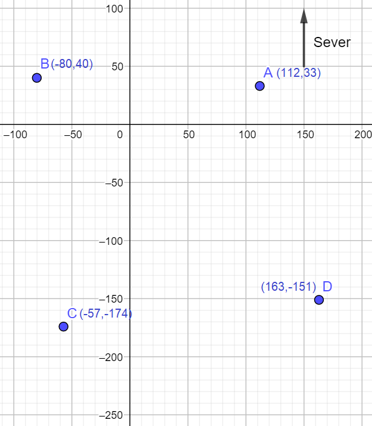
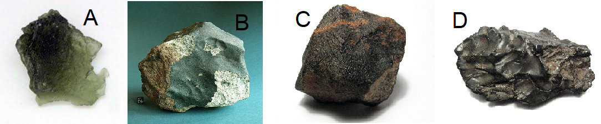
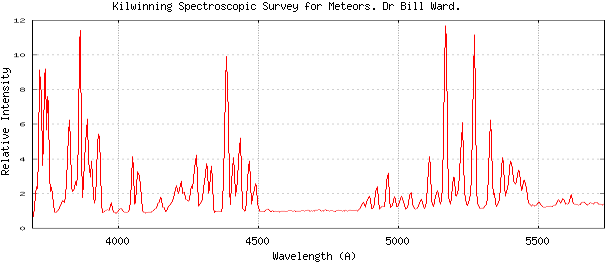
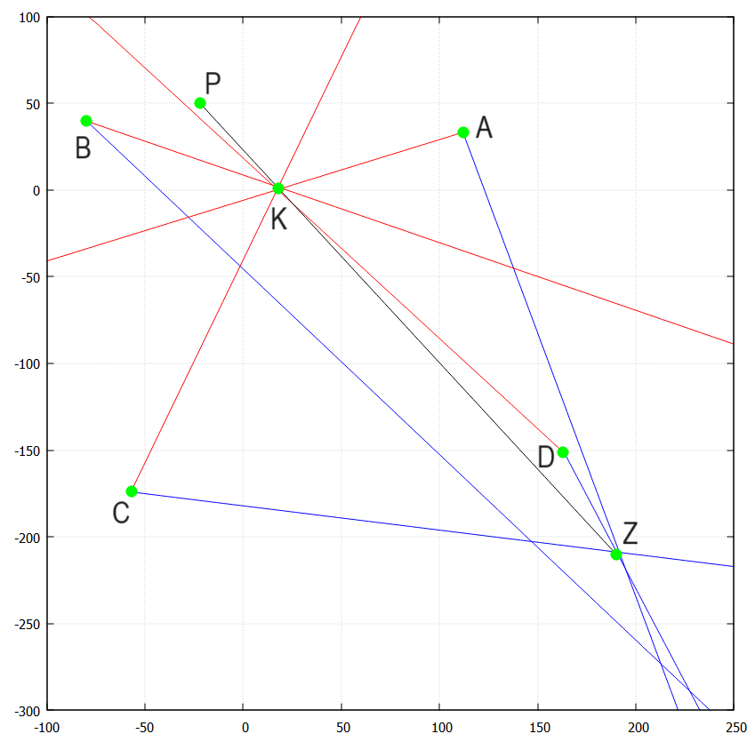
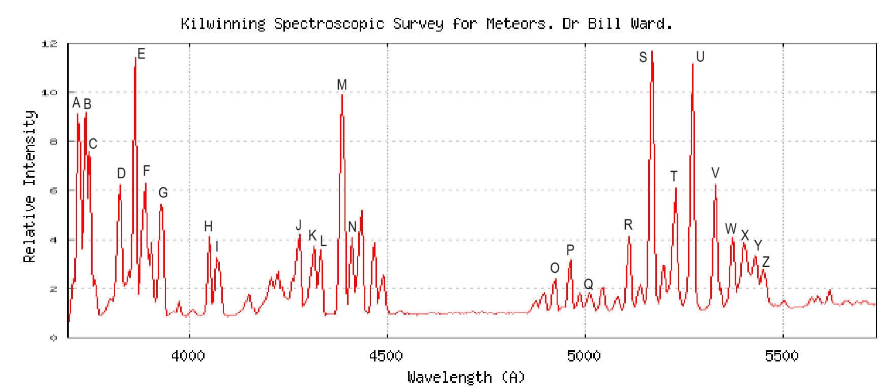

## Zadanie

*Poznámka: v roku 2020 sa celoštátne finále Astronomickej olympiády konalo online. Táto úloha preto predpokladala, že súťažiaci pri jej riešení využijú ľubovoľné zdroje.*

Dňa 22. 9. 2020 o 22:10 LSEČ štyria pozorovatelia A, B, C, D na území Slovenska pozorovali hypotetický jasný bolid. Ich polohy sú zanesené v „mape“ na obrázku 1, počiatku odpovedajú súradnice $\varphi=48{,}4^{\circ}$, $\lambda=19{,}7^{\circ}$, pri všetkých výpočtoch zakrivenie Zeme medzi pozorovateľmi zanedbajte. V tabuľke 1 sú zaznamenané pozorované polohy začiatku (z) a konca (k) svetelnej dráhy bolidu v rovníkových ($\delta$, $\alpha$) súradniciach, ktoré boli určené z fotografií (A, B), videa (C), resp. vizuálneho pozorovania (D). Pozorovateľ B pozoroval spektroskopicky, zaznamenal teda navyše aj spektrum úkazu znázornené na obrázku 3. V tabuľke $2$ sú uvedené vlnové dĺžky obvyklých čiar v spektrách bolidov.

<ol type="a">

<li>

Preveďte súradnice pozorovaných začiatkov a koncov stopy bolidu do horizontálnych súradníc, na prevody môžete použiť softvér (kalkulátor transformácií súradníc, virtuálne planetárium, …)

</li>

<li>

Do milimetrového papiera zaneste polohy pozorovateľov a zostrojte priemety miest začiatku a konca úkazu na zemský povrch a priemet trajektórie telesa.

</li>

<li>

Určte výšky telesa nad povrchom na začiatku $H_\mathrm{z}$ a konci $H_\mathrm{k}$ úkazu.

</li>

<li>

Na milimetrovom papieri zaznačte odhadované miesto dopadu. Výber miesta dopadu okomentujte.

</li>

<li>

Určte azimut a výšku nad obzorom pre smer, z ktorého teleso priletelo. V akom je to súhvezdí?

</li>

<li>

Odhadnite rýchlosť telesa $v$ voči Zemi pri vstupe do atmosféry, na videozázname pozorovateľa C sa bolid na začiatku trajektórie pohybuje rýchlosťou $2{,}55^{\circ} /\mathrm{s}$.

</li>

<li>

Na základe smeru a rýchlosti telesa odhadnite excentricitu $e$, veľkú polos $a$ a inklináciu $i$ jeho orbity okolo Slnka. Vplyv gravitačného poľa Zeme a Mesiaca zanedbajte. Vyberte jeden z intervalov:

|  |  |  |  |  |  |
|:---|:--:|:--:|:--:|:--:|:--:|
| $e$ | $0\, - 0{,}1\,$ | $0{,}1\, - 0{,}3\,$ | $0{,}3\, - 0{,}7\,$ | $0{,}7\, - 1{,}0\,$ | $>$ $1\,$ |
| $a$ | $<$ $0{,}8\,\mathrm{au}$ | $0{,}8\,\mathrm{au} - 1{,}2\,\mathrm{au}$ | $1{,}2\,\mathrm{au} - 2{,}0\,\mathrm{au}$ | $2\,\mathrm{au} - 5\,\mathrm{au}$ | $>$ $5\,\mathrm{au}$ |
| $i$ | $0\,^{\circ} - 10\,^{\circ}$ | $10\,^{\circ} - 20\,^{\circ}$ | $20\,^{\circ} - 50\,^{\circ}$ | $>$ $50^{\circ}$ |  |

Takisto odhadnite dĺžku výstupného uzla orbity telesa $\Omega$.

</li>

<li>

V spektre na obrázku 3 identifikujte aspoň 10 spektrálnych čiar, zaznačte ich do grafu. Ktoré prvky ich spôsobujú?

</li>

<li>

O aký typ prípadného meteoritu sa jedná? Typu priraďte jeden z obrázkov $2$.

</li>

</ol>

**Tabuľka 1:** Pozorované polohy začiatku a konca svetelnej dráhy bolidu.

|           | $\delta\quad$ | $\alpha\quad$ |
|:----------|----------:|----------:|
| $A_\mathrm{z}$ | $-16{,}6^{\circ}$ | $22^{\mathrm{h}}\,46^{\mathrm{min}}$ |
| $A_\mathrm{k}$ | $-3{,}2^{\circ}$ | $17^{\mathrm{h}}\,6^{\mathrm{min}}$ |
| $B_\mathrm{z}$ | $-14{,}8^{\circ}$ | $27^{\mathrm{min}}$ |
| $B_\mathrm{k}$ | $-5{,}5^{\circ}$ | $2^{\mathrm{h}}\,3^{\mathrm{min}}$ |
| $C_\mathrm{z}$ | $12{,}3^{\circ}$ | $2^{\mathrm{h}}\,9^{\mathrm{min}}$ |
| $C_\mathrm{k}$ | $43{,}4^{\circ}$ | $7^{\mathrm{h}}\,26^{\mathrm{min}}$ |
| $D_\mathrm{z}$ | $19{,}6^{\circ}$ | $22^{\mathrm{h}}\,29^{\mathrm{min}}$ |
| $D_\mathrm{k}$ | $33{,}4^{\circ}$ | $13^{\mathrm{h}}\,19^{\mathrm{min}}$ |

<figure>

<figcaption>

**Obrázok 1:** Mapa s polohami pozorovateľov, jednotky osí sú kilometre.
</figcaption>

</figure>

<figure>

<figcaption>

**Obrázok 2:** Ktorý z týchto obrázkov zodpovedá meteoritu z úlohy?
</figcaption>

</figure>

<figure>

<figcaption>

**Obrázok 3:** Spektrum získané pozorovateľom B.
</figcaption>

</figure>

**Tabuľka 2:** Zoznam spektrálnych čiar častých v spektrách meteorov a ich relatívne intenzity. Čiary označené hviezdičkou sa vyskytujú najmä v spektrách rýchlych meteorov.

| $\lambda$ \[$\mathrm{\mathring{A}}$\] | Atóm | int | $\lambda$ \[$\mathrm{\mathring{A}}$\] | Atóm | int | $\lambda$ \[$\mathrm{\mathring{A}}$\] | Atóm | int |
|:---|:---|:---|:---|:---|:---|:---|:---|:---|
| 3719,9 | Fe | 10 | 4254,4 | Cr | 9 | 5227,2 | Fe | 5 |
| 3734,9 | Fe | 8 | 4271,8 | Fe | 10 | 5269,5 | Fe | 14 |
| 3737,1 | Fe | 9 | 4274,8 | Cr | 8 | 5328,0 | Fe | 12 |
| 3745,6 | Fe | 8 | 4289,7 | Cr | 7 | 5371,5 | Fe | 9 |
| 3749,5 | Fe | 8 | 4307,9 | Fe | 10 | 5397,1 | Fe | 5 |
| 3820,4 | Fe | 9 | 4325,8 | Fe | 10 | 5405,8 | Fe | 6 |
| 3825,9 | Fe | 8 | 4383,5 | Fe | 14 | 5429,7 | Fe | 6 |
| 3829,4 | Mg | 10 | 4404,8 | Fe | 11 | 5434,5 | Fe | 4 |
| 3832,3 | Mg | 11 | 4481,2 | Mg+ | 15\* | 5446,9 | Fe | 4 |
| 3838,3 | Mg | 12 | 4920,5 | Fe | 3 | 5455,6 | Fe | 4 |
| 3859,9 | Fe | 11 | 4923,9 | Fe+ | 2\* | 5528,4 | Mg | 2 |
| 3886,3 | Fe | 9 | 4957,6 | Fe | 4 | 5615,7 | Fe | 1 |
| 3933,7 | Ca+ | 40\* | 5012,1 | Fe | 1 | 5890,0 | Na | 40 |
| 3968,5 | Ca+ | 35\* | 5018,4 | Fe+ | 3\* | 5895,9 | Na | 35 |
| 4030,8 | Mn | 10 | 5110,4 | Fe | 1 | 6156,8 | O | 1\* |
| 4045,8 | Fe | 10 | 5167.3 | Mg | 17 | 6162,2 | Ca | 1 |
| 4063,6 | Fe | 9 | 5172,7 | Mg | 25 | 6347,1 | Si+ | 6\* |
| 4131,0 | Si+ | 1\* | 5183,6 | Mg | 28 | 6371,4 | Si+ | 3\* |
| 4226,7 | Ca | 11 | 5208,4 | Cr | 10 | 6495,0 | Fe | 1 |

\

Riešenie

<ol type="a">

<li>

Súradnice z rovníkových do horizontálnych je možné pomerne rýchlo previesť vo virtuálnom planetáriu Stellarium, ktoré umožňuje vyhľadávanie podľa polohy. Prevedené súradnice sú v tabuľke 3, azimut meriame od severu. V zadaní je napísané, že je možné zanedbať zakrivenie Zeme medzi pozorovateľmi, preto pri prevode súradníc stačí použiť súradnice počiatku mapy, teda $\varphi=48{,}4^{\circ}$, $\lambda=19{,}7^{\circ}$.

**Tabuľka 3:** Prepočítané polohy začiatku a konca svetelnej dráhy bolidu.

|           | $h\quad$ | $A\quad$ |
|:----------|----------:|----------:|
| $A_\mathrm{z}$ | $23{,}3^{\circ}$ | $161{,}8^{\circ}$ |
| $A_\mathrm{k}$ | $12{,}2^{\circ}$ | $250{,}8^{\circ}$ |
| $B_\mathrm{z}$ | $16{,}4^{\circ}$ | $136{,}9^{\circ}$ |
| $B_\mathrm{k}$ | $11{,}3^{\circ}$ | $111{,}4^{\circ}$ |
| $C_\mathrm{z}$ | $23{,}7^{\circ}$ | $98{,}1^{\circ}$ |
| $C_\mathrm{k}$ | $6{,}1^{\circ}$ | $23{,}1^{\circ}$ |
| $D_\mathrm{z}$ | $59{,}4^{\circ}$ | $155{,}1^{\circ}$ |
| $D_\mathrm{k}$ | $5{,}6^{\circ}$ | $316{,}1^{\circ}$ |

</li>

<li>

Do milimetrového papiera zakreslíme polohy pozorovateľov, od každého vedieme dve polpriamky pod azimutmi odpovedajúcimi začiatku a koncu svetelnej stopy. Príslušné štvorice polpriamok by sa mali pretnúť približne v jednom bode, týmito bodmi sú priemety začiatku a konca dráhy na zemský povrch. Ako vidíme v grafe, červené polpriamky vedúce ku koncu dráhy sa naozaj takmer pretnú v jednom bode, ktorého súradnice sú zhruba $K=(18,1) \mathrm{km}$. Polohu začiatku dráhy odhadneme v mieste $Z=(190,-210) \mathrm{km}$, kde sa takmer pretínajú tri zo štyroch modrých polpriamok. Čierna priamka spájajúca začiatočný a koncový bod je potom priemetom trajektórie telesa na zemský povrch.

<figure>

</figure>

</li>

<li>

Výšky telesa nad povrchom môžeme určiť jednoducho ako 

$$
H=d \tan h \, , \tag{1}
$$

 kde $d$ je vzdialenosť pozorovateľa od priemetu polohy telesa na zemský povrch. Túto vzdialenosť najrýchlejšie dokážeme určiť tak, že ju odčítame z mapy. Výšky pre jednotlivých pozorovateľov sa budú trochu odlišovať, ako výsledné hodnoty preto použijeme ich priemery. Vzdialenosti aj výšky pre všetkých pozorovateľov sú zhrnuté v tabuľke 4.

**Tabuľka 4:** Priemety vzdialenosti a výšky začiatku a konca dráhy bolidu.

|  | $d_\mathrm{z}$ \[km\] | $d_\mathrm{k}$ \[km\] | $H_\mathrm{z}$ \[km\] | $H_\mathrm{k}$ \[km\] |
|:---|---:|---:|---:|---:|
| $A$ | 255 | 99 | 109,8 | 21,4 |
| $B$ | 368 | 105 | 108,3 | 20,4 |
| $C$ | 250 | 190 | 109,7 | 20,3 |
| $D$ | 65 | 210 | 109,9 | 20,6 |
| priemer |  |  | 109,4 | 20,7 |

Na začiatku bol bolid vo výške približne $H_z=110\,\mathrm{km}$ a na konci $H_k=21\,\mathrm{km}$.

</li>

<li>

Miesto dopadu sa musí nachádzať v blízkosti zakreslenej čiernej priamky, niekde v oblasti za bodom K. Najďalej môže byť v bode označenom písmenom $P$, ktorý je priesečníkom priamej trajektórie telesa so zemským povrchom.\
Na výpočet vzdialenosti bodu $P$ od bodu $K$ využijeme vlastnosti podobných trojuholníkov. Na obrázku označuje $d_\mathrm{ZK}$ vzdialenosť bodov $Z$ a $K$ a $d$ je vzdialenosť bodov $P$ a $K$. Z rovnosti pomerov strán trojuholníkov dostaneme výraz na výpočet $d$ 

$$
\frac{H_\mathrm{K}}{d}=\frac{H_\mathrm{Z}}{d_\mathrm{ZK}} \tag{2}
$$

 

$$
dH_\mathrm{K}+d_\mathrm{ZK}H_\mathrm{K}=dH_\mathrm{Z} \tag{3}
$$

 

$$
d=\frac{H_\mathrm{K}}{H_\mathrm{Z}-H_\mathrm{K}}d_\mathrm{ZK} \tag{4}
$$

 Vyjde nám $d=63{,}5\,\mathrm{km}$. Na čiernej priamke odmeriame túto vzdialenosť od bodu $K$ a vyjdú nám súradnice odhadovaného miesta dopadu: $P(-22, 51) \mathrm{km}$.\
Vzhľadom na pomalú rýchlosť telesa po zbrzdení atmosférou teleso nedoletí až do bodu $P$, ale dopadne skôr. Od zakreslenej priamky ho môže vychýliť atmosférické prúdenie.

</li>

<li>

Azimut smeru z ktorého teleso priletelo určíme odčítaním azimutu zakreslenej priamky $A=141^{\circ}$, výšku nad obzorom určíme ako 

$$
h=\arctan \frac{H_z-H_k}{|ZK|}=18^{\circ}\, . \tag{5}
$$

 Toto buď prevedieme do rovníkových súradníc $(\alpha\approx0^h 10^m,\, \delta\approx-15^{\circ})$, alebo priamo z horizontálnych súradníc s pomocou Stellaria určíme smer medzi hviezdami, ktorý sa premieta do súhvezdia Veľryby.

</li>

<li>

Rýchlosť telesa pri vstupe do atmosféry zistíme z pozorovanej uhlovej rýchlosti a vzdialenosti ako $v_t=d \omega=11,1(2)\,\mathrm{km}.\mathrm{s}^{-1}$. Treba si však dať pozor na prevod jednotiek (stupne treba previesť na radiány). Táto rýchlosť je navyše len tangenciálna zložka vektora rýchlosti. Pre určenie skutočnej rýchlosti musíme ešte poznať uhol zovretý vektorom rýchlosti telesa a spojnicou ZC v priestore (teda nejde o uhol z mapy!). Tento uhol najjednoduchšie spočítame ako uhlovú vzdialenosť medzi pozorovanou polohou začiatku trajektórie pozorovateľom C a polohou smeru, z ktorého teleso priletelo pomocou kosínusovej vety ako 

$$
\cos\chi=\sin h_z^C \sin h+\cos h_z^C \cos h \cos (A_z^C-A)\,, \quad \chi\approx 40(2)^{\circ}\,.
$$

 Skutočnú rýchlosť potom dostaneme ako $v=v_t / \sin \chi=17,3(8)\,\mathrm{km}.\mathrm{s}^{-1}$.

</li>

<li>

Vzhľadom na dátum pozorovania máme ihneď $\Omega=1 \pm 1^{\circ}$, keďže teleso priletelo spod ekliptiky. Pre určenie dráhových parametrov je nutné zistiť (alebo aspoň odhadnúť) vektor rýchlosti telesa v inerciálnej sústave, teda opraviť pozorovaný vektor rýchlosti o pohyb Zeme rýchlosťou asi $v_\oplus=29{,}8\,\mathrm{km}.\mathrm{s}^{-1}$. Pre tento prevod je užitočné poznať ekliptikálne súradnice smeru príletu $\lambda=357(2)^{\circ}$, $\beta=-15^{\circ}$. Ak zavedieme súradný systém ako $x$ v smere do jarného bodu, $y$ v smere pohybu Zeme do $\lambda=90^{\circ}$ a $z$ do severného pólu ekliptiky, máme zložky vektoru rýchlosti telesa voči Zemi (’) a v inerciálnej sústave

|           |            |
|:----------|:-----------|
| $v'_x=-v \cos \beta \cos \lambda = -16,7(8)\,\mathrm{km}.\mathrm{s}^{-1}$ | $v_x=-16.7(8)\,\mathrm{km}.\mathrm{s}^{-1}$, |
| $v'_y=- v \cos \beta \sin \lambda=0.8(5)\,\mathrm{km}.\mathrm{s}^{-1}$ | $v_y=30.6(5)\,\mathrm{km}.\mathrm{s}^{-1}$, |
| $v'_z= -v \sin \beta \qquad=4,5(3)\,\mathrm{km}.\mathrm{s}^{-1}$ | $v_z=4,5(3)\,\mathrm{km}.\mathrm{s}^{-1}$. |

Rýchlosť telesa v Slnečnej sústave teda bola $v=35,1(7)\,\mathrm{km}.\mathrm{s}^{-1}$, inklináciu dráhy určíme ako $\sin i=v_z/v=7,4(10)^{\circ}$. Veľkosť hlavnej polosi máme z rovnice vis-viva (zákon zachovania energie) 

$$
\frac{v^2}{2}-\frac{GM_\odot}{R}=-\frac{GM}{2a}\,,\qquad a=\frac{RGM_\odot}{2GM_\odot-v^2 R}=\frac{1}{2-(v/v_\oplus)^2}=1,6(2)\,\mathrm{AU}\,.
$$

 Excentricita sa dá určiť z tzv. Runge-Lenzovho vektoru ako 

$$
e=\sqrt{1+\frac{2 \epsilon h^2}{\mu^2}}=\sqrt{1-\frac{\left(\frac{v \sin \theta}{v_\oplus}\right)^2}{a [AU]}}=\sqrt{1-\frac{v_z^2+v_y^2}{v_\oplus^2 a [AU]}}=0.58(5)\,\,,
$$

 kde $\epsilon$ je špecifická energia telesa, $h$ je špecifický moment hybnosti, $\mu=GM_\odot$ a $\theta$ je uhol zovretý vektorom rýchlosti a sprievodičom.

</li>

<li>

Spektrálne čiary na obrázku 4 sú identifikované v tabuľke 5, vidíme, že skoro všetky čiary sú čiary železa s výnimkou maxima S, ktoré zodpovedá najintenzívnejším čiaram (tripletu) horčíka a čiare G, ktorá zodpovedá ionizovanému vápniku. Vidíme však, že tieto čiary sú výrazne slabšie voči zmieneným čiaram železa v porovnaní s hodnotami z tabuľky, takže sú v telese zastúpené málo. V spektre vidíme aj množstvo neidentifikovaných čiar, pravdepodobne sa jedná o ďalšie čiary železa, ktoré sa už do tabuľky „nezmestili“.

</li>

<li>

Zo spektra jasne vyplýva, že ide o železný meteorit, čomu zodpovedá obrázok D.

</li>

</ol>

<figure>

<figcaption>

**Obrázok 4:** Spektrum s určenými spektrálnymi čiarami.
</figcaption>

</figure>

**Tabuľka 5:** Čiary identifikované v spektre.

| Čiara | Atóm | $\lambda$ \[$\mathrm{\mathring{A}}$\] | Čiara | Atóm | $\lambda$ \[$\mathrm{\mathring{A}}$\] |
|:------|:-----|:-----------------------:|:------|:-----|:-----------------------:|
| A     | Fe   |         3719,9          | N     | Fe   |         4404,8          |
| B     | Fe   |     3734,9 + 3737,1     | O     | Fe   |         4920,5          |
| C     | Fe   |     3745,6 + 3749,5     | P     | Fe   |         4957,6          |
| D     | Fe   |         3825,9          | Q     | Fe   |         5012,1          |
| E     | Fe   |         3859,9          | R     | Fe   |         5110,4          |
| F     | Fe   |         3886,3          | S     | Mg   |     5167,3 + 5172,7     |
| G     | Ca+  |         3933,7          | T     | Fe   |         5227,2          |
| H     | Fe   |         4045,8          | U     | Fe   |         5269,5          |
| I     | Fe   |         4063,6          | V     | Fe   |         5328,0          |
| J     | Fe   |         4271,8          | W     | Fe   |         5371,5          |
| K     | Fe   |         4307,9          | X     | Fe   |         5405,8          |
| L     | Fe   |         4325,8          | Y     | Fe   |     5429,7 + 5434,5     |
| M     | Fe   |         4383,5          | Z     | Fe   |     5446,9 + 5455,6     |

\

