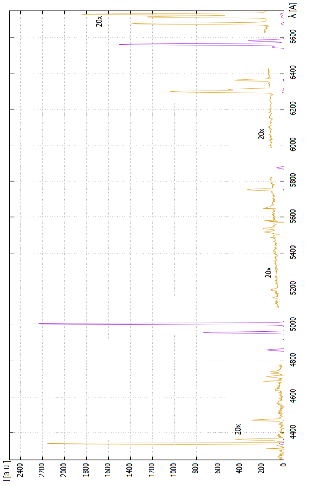
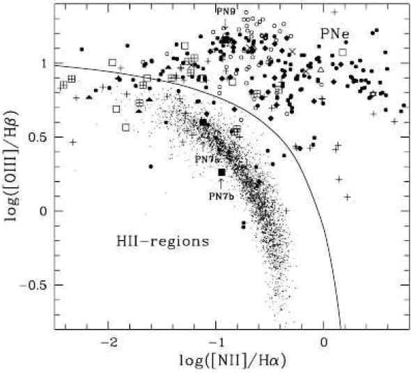
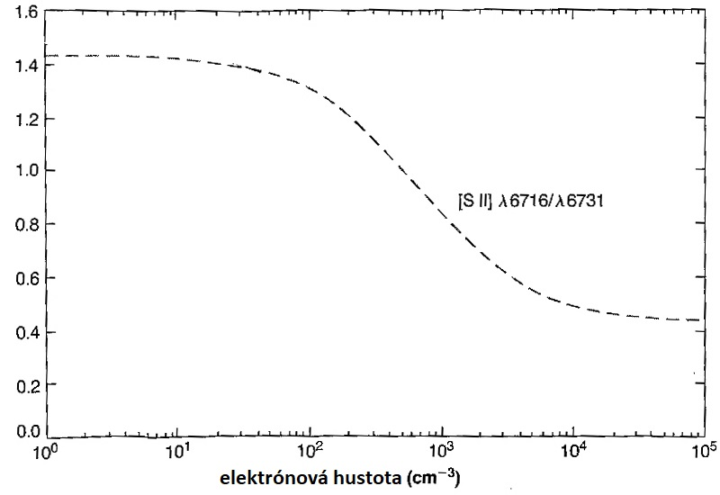
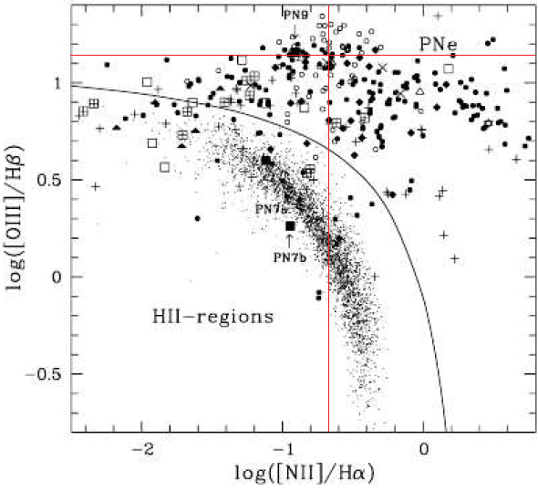
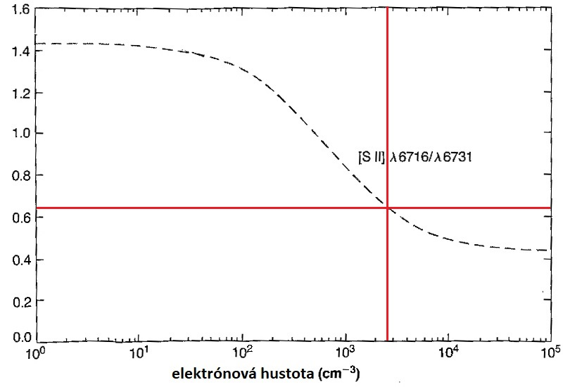

## Zadanie

Na obrázku 1 je zobrazené spektrum hmloviny. Fialovou je zobrazené emisné spektrum a žltou sú vynesené niektoré časti spektra zväčšene po vynásobení nameraných intenzít 20-timi. Z intenzít jednotlivých čiar sa pokúsite určiť povahu tohto objektu a fyzikálne vlastnosti plynu, ktorého žiarenie pozorujeme.

<ol type="a">

<li>

Zo spektra určte intenzity nasledovných spektrálnych čiar: H$\alpha$ $6563\,\mathring{A}$ ; H$\beta$ $4861\,\mathring{A}$ ; \[N II\] $6584\,\mathring{A}$ ; \[O III\] $4363\,\mathring{A}$, $4959\,\mathring{A}$, $5007\,\mathring{A}$ ; \[S II\] $6716\,\mathring{A}$, $6731\,\mathring{A}$.\
Nezabudnite odčítať žiarenie kontinua.

</li>

<li>

Vypočítajte hodnoty logaritmov pomerov intenzít čiar $\log \frac{[\textrm{O III}]\,\, 5007}{H\beta}\,,  \log \frac{[\textrm{N II}]\,\, 6584}{H\alpha}$ a pomocou BPT diagramu (Baldwin, Phillips a Terlevich) na obrázku 2 určte, či sa jedná o planetárnu hmlovinu (PNe), alebo oblasť ionizovaného vodíka (HII).

</li>

<li>

Z pomeru intenzít čiar \[S II\] zistite elektrónovú hustotu $n_\mathrm{e}$ v plyne pomocou diagramu 3. Odhadnite ďalej hustotu plynu $\rho$ za predpokladu, že plyn aproximujeme ako úplne ionizovaný oblak vodíka.

</li>

<li>

Teplotu plynu $T$ je možné určiť z intenzít čiar kyslíka \[O III\] pomocou vzťahu 

$$
\frac{I_{4959}+I_{5007}}{I_{4363}}=\frac{7,90 \exp{(3,29\cdot 10^4/T)}}{1+4,5\cdot 10^{-4} \,n_\mathrm{e} / \sqrt{T} }\, , \tag{1}
$$

 kde teplotu meriame v kelvinoch a elektrónovú hustotu v $\mathrm{cm}^{-3}$. Pri výpočte sa zamyslite nad veľkosťou druhého člena v menovateli zlomku.

</li>

<li>

Prečo sa pri analýze používajú pomery čiar s blízkymi vlnovými dĺžkami? Popíšte jav, ktorý komplikuje určenie vlastností objektu z pozorovaných intenzít vo vzdialených oblastiach spektra.

</li>

<li>

Vodík je vo vesmíre najviac zastúpený prvok. Prečo teda spektru hmloviny nedominujú spektrálne čiary (Balmerovej série) vodíka?

</li>

</ol>

<figure>

<figcaption>

**Obrázok 1:** Spektrum hmloviny.
</figcaption>

</figure>

<figure>

<figcaption>

**Obrázok 2:** BPT diagram. Oblasti HII sa nachádzajú vľavo dole a planetárne hmloviny vpravo hore.
</figcaption>

</figure>

<figure>

<figcaption>

**Obrázok 3:** Diagram pre určenie elektrónovej hustoty z pomeru intenzít čiar síry.
</figcaption>

</figure>

Riešenie

<ol type="a">

<li>

Intenzity spektrálnych čiar sú v tabuľke 1. Pri meraní je potrebné odčítať intenzitu kontinua a intenzitu žltých čiar vydeliť 20-timi, pretože sú na obrázku 20-krát zväčšené.

**Tabuľka 1:** Intenzity spektrálnych čiar.

|      Čiara | $\lambda$ | Intenzita |
|-----------:|:---------:|----------:|
|      O III | $4363\,\mathring{A}$ |        21 |
| H$\beta$ | $4861\,\mathring{A}$ |       162 |
|      O III | $4959\,\mathring{A}$ |       727 |
|      O III | $5007\,\mathring{A}$ |      2242 |
| H$\alpha$ | $6563\,\mathring{A}$ |      1495 |
|       N II | $6584\,\mathring{A}$ |       323 |
|       S II | $6716\,\mathring{A}$ |        55 |
|       S II | $6731\,\mathring{A}$ |        84 |

</li>

<li>

Dosadíme odmerané intenzity 

$$
\log \frac{I_{5007}}{I_{\mathrm{H}\beta}} = 1,14\,, \tag{2}
$$

 

$$
\log \frac{I_{6584}}{I_{\mathrm{H}\alpha}} = -0,67\, . \tag{3}
$$

 Výsledné hodnoty zakreslíme do BPT diagramu. Vidíme, že sa nám pretínajú v oblasti PNe, jedná sa teda o planetárnu hmlovinu.

<figure>

</figure>

</li>

<li>

Opäť dosadíme namerané intenzity 

$$
\frac{I_{6716}}{I_{6731}} = 0,65\, . \tag{4}
$$

 Do diagramu elektrónovej hustoty zakreslíme úsečku zodpovedajúcu pomeru intenzít. V mieste, kde sa pretne s čiarkovanou čiarou na ňu narysujeme kolmicu. Kolmica pretne $x$-ovú os pri hodnote $10^{3,14}$. Elektrónová hustota je teda $n_\mathrm{e}=1380\,{\mathrm{cm}}^{-3}$.\

<figure>

</figure>

Neutrálny vodík sa skladá z jedného protónu a jedného elektrónu. Ak sa plyn skladá iba z dokonale ionizovaného vodíka, znamená to, že sa všetky protóny a elektróny od seba oddelili, ale počet protónov v celej oblasti sa stále rovná počtu elektrónov. Preto sa aj hustota protónov (v cm$^{-3}$) rovná hustote elektrónov. Hmotnosť elektrónov je zanedbateľná v porovnaní s hmotnosťou protónov, preto môžeme hustotu (hmotnosti) plynu odhadnúť ako 

$$
\rho = m_\mathrm{p} n_\mathrm{e} = 938,27 \cdot 1{,}783 \cdot 10^{-30}\cdot1000 \cdot1380 = \mathrm{g}\,{\mathrm{cm}}^{-3} \tag{5}
$$

</li>

<li>

Využijeme nápovedu zo zadania a najskôr sa zamyslíme nad veľkosťou druhého člena v menovateli zlomku vpravo. Pri dostatočne vysokej hodnote teploty bude tento člen oveľa menší ako 1 a môžeme ho preto zanedbať. Ak by napr. teplota bola rádovo rovná $10^4$ K, potom by jej odmocnina bola rádovo $10^2$. Elektrónová hustota je v tisícoch ($10^3$), celý člen by mal preto hodnotu okolo $10^{-3}$. Po zanedbaní tohto člena dostaneme zjednodušený vzťah 

$$
\frac{I_{4959}+I_{5007}}{I_{4363}}=7,90 \exp{\left(\frac{3{,}29 \cdot 10^{4}}{T}\right)}\, . \tag{6}
$$

 Do zlomku vľavo dosadíme odmerané hodnoty intenzity a dostaneme 

$$
\frac{I_{4959}+I_{5007}}{I_{4363}}= 140\, . \tag{7}
$$

 Teraz už len potrebujeme z rovnice vyjadriť teplotu 

$$
\ln \frac{140}{7,9} = \frac{3{,}29 \cdot 10^{4}}{T}\, , \tag{8}
$$

 

$$
T=\frac{3{,}29 \cdot 10^{4}}{\ln \frac{140}{7,9}} = 11\,400\,\mathrm{K}\, . \tag{9}
$$

 Vidíme, že teplota vyšla naozaj rádovo v desaťtisícoch K, člen v menovateli zlomku sme teda zanedbali oprávnene.

</li>

<li>

Intenzita je zoslabená kvôli extinkcii v medzihviezdnom prostredí. Vo všeobecnosti je extinkcia väčšia pre kratšie vlnové dĺžky, zatiaľ čo pri veľkých $\lambda$ je menej výrazná. Kvôli tomu pozorujeme farbu objektov posunutú viac do červenej oblasti spektra (väčšie $\lambda$). Tento jav sa nazýva medzihviezdne sčervenanie.

Pri analýze hmlovín používame pomery blízkych čiar, ktoré sú takmer rovnako zoslabené v medzihviezdnom prostredí. Čiary, ktoré sú od seba ďalej nie sú zoslabené v rovnakej miere, preto by sme pri ich analýze museli počítať s extinkciou.

</li>

<li>

Spektrálne čiary vznikajú pri prechode elektrónu medzi energetickými hladinami atómu. Konkrétne čiary Balmerovej série vznikajú pri prechode medzi 2. a vyššími hladinami. Väčšina vodíka v hmlovine je ale ionizovaná, preto je len málo elektrónov viazaných a môže tvoriť čiary Balmerovej série. Navyše, vlnové dĺžky čiar sú dané energiami hladín, medzi ktorými prechádzajú elektróny. V oblasti spektra, ktorá je použitá v tejto úlohe sa nachádzajú iba 3 čiary z Balmerovej série a to H$\alpha$, H$\beta$ a H$\gamma$. Ostatné čiary zo série majú kratšie vlnové dĺžky.

</li>

</ol>

