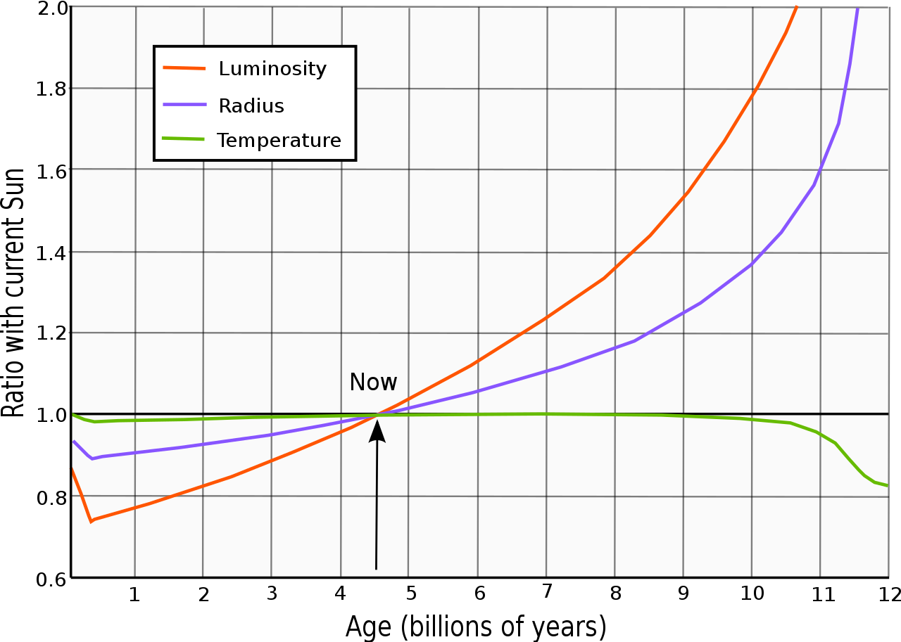
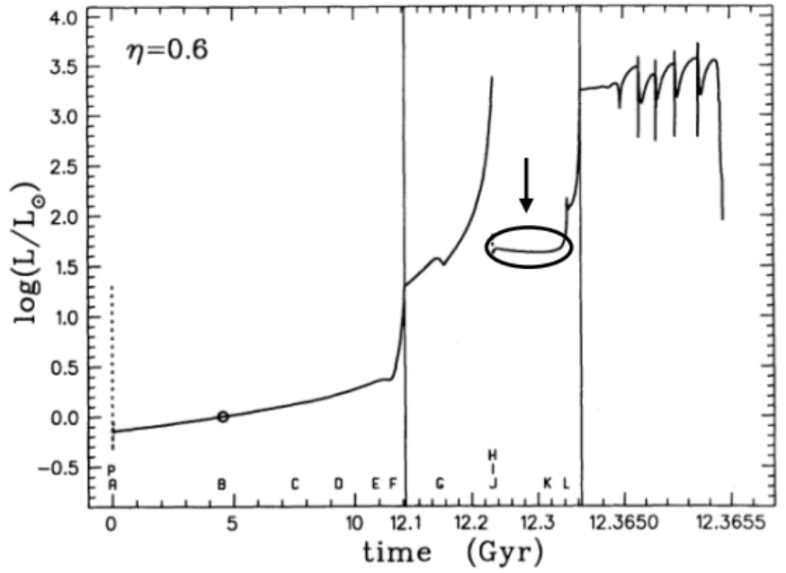
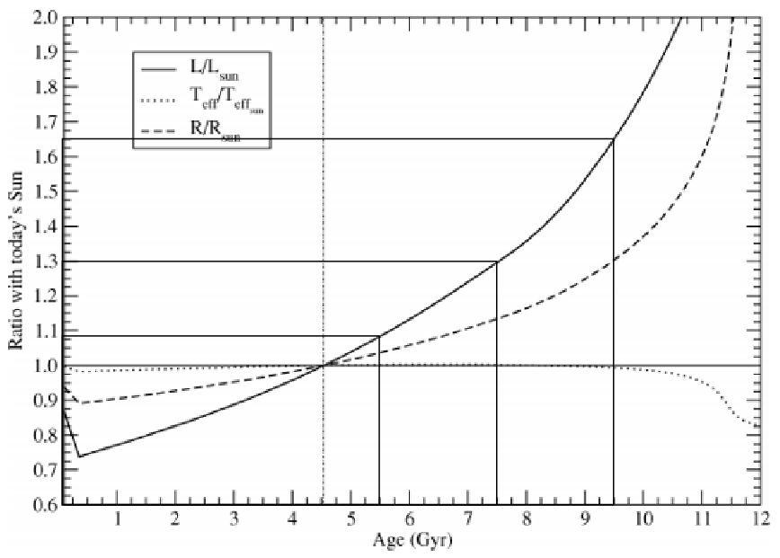
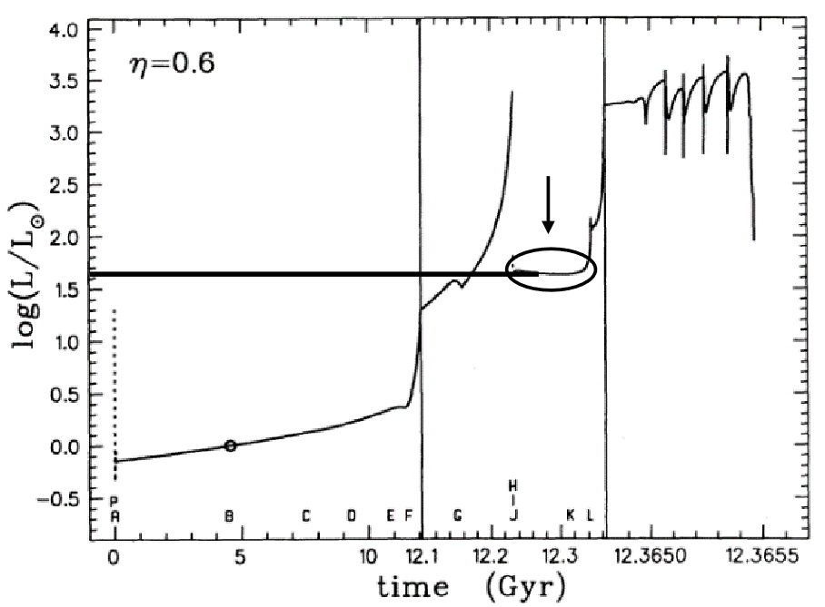

## Zadanie

Predstavme si nasledujúci scenár:\
Celú Zem (uvažujme, že je dokonale guľatá) obložíme zrkadlami s odrazivosťou $k$ = 98 %. Teda nimi prejde iba 2 % energie, ktorá potom dopadne na Zem. Zrkadlá sú umiestnené zanedbateľne nízko nad povrchom Zeme, teda vo vzdialenosti $R_\Ea$ od jej stredu. Všetka atmosféra je uzavretá pod nimi, čo znamená, že nad zrkadlami už rovno začína vesmír.

<ol type="a">

<li>

Koľko energie zo Slnka dopadá na $1\,{\mathrm{m}}^{2}$ povrchu zrkadla za sekundu?

</li>

<li>

Koľko energie zo Slnka získa celá Zem pod zrkadlom za sekundu?

</li>

</ol>

Uvažujte, že Zem obieha okolo Slnka po kruhovej dráhe.\
Zrkadlá sú konštruované tak, že zvnútra vedia prepúšťať všetku energiu von. Zanedbajte albedo a efekty atmosféry (je veľmi tenká). Uvažujte, že Zem pod zrkadlami rotuje dostatočne rýchlo na to aby sa zahrievala rovnomerne a je absolútne čierne teleso (všetku energiu čo získa následne vyžiari, ako napr. Slnko), potom:

<ol type="a" start="3">

<li>

Aká bude teplota na povrchu Zeme, pod zrkadlom?

</li>

</ol>

Graf na obrázku 1 ukazuje, ako sa bude v nasledujúcich miliardách rokov zväčšovať svietivosť Slnka.

<ol type="a" start="4">

<li>

O koľko Kelvinov vzrastie teplota na Zrkadlovej Zemi:

<ol type="i">

<li>

Za miliardu rokov?

</li>

<li>

Za 3 miliardy rokov?

</li>

<li>

Za 5 miliárd rokov?

</li>

</ol>

</li>

</ol>

<figure>

<figcaption>

**Obrázok 1:** (zdroj: cambridge.org/core)
</figcaption>

</figure>

Toto je však nič v porovnaní s tým čo sa bude diať za 7,5 miliardy rokov. Slnko začne spaľovať hélium a premení sa na červeného obra. Závislosť jeho svietivosti v tomto období vykresľuje graf na obrázku 2. Logaritmus na osi $y$ je dekadický so základom 10.

<ol type="a" start="5">

<li>

Bol by možný život pod zrkadlami počas stabilnej fázy zakrúžkovanej na obrázku?

</li>

</ol>

<figure>

<figcaption>

**Obrázok 2:** GRAF 2 (zdroj: harvard.edu)
</figcaption>

</figure>

Priemerná teplota Zeme je $10\,^{\circ}\mathrm{C}$ v súčasnosti a bola $0\,^{\circ}\mathrm{C}$ počas doby ľadovej ($0\,^{\circ}\mathrm{C}$ = $273\,\mathrm{K}$).

Riešenie

<ol type="a">

<li>

Svietivosť je množstvo energie, ktorá opustí Slnko za 1 sekundu. A to do všetkých smerov rovnomerne. Keďže sa energia vo vesmíre nestráca, na sféru s polomerom $a_\Ea$ dopadne takisto $L_\Sun$ energie za sekundu. Preto na $1\,{\mathrm{m}}^{2}$ tejto sféry, čo je zároveň aj $1\,{\mathrm{m}}^{2}$ povrchu zrkadla, dopadne tok

</li>

</ol>

$$
F=\frac{L_\Sun}{4\pi a_\Ea^2}=\frac{3{,}826 \cdot 10^{26}}{4\pi \cdot (1{,}496 \cdot 10^{11})^2}=1360\,\mathrm{W}\,{\mathrm{m}}^{-2} \, . \tag{1}
$$

<ol type="a" start="2">

<li>

Najskôr si treba uvedomiť, že Zem prijíma energiu plochou prierezu. Druhá dôležitá vec je, že $98\%$ energie sa odrazí preč, násobíme $(1 - k)$. Celkový výkon bude $F$-krát plocha prierezu

</li>

</ol>

$$
P_\Ea=F(1-k)S_\textrm{p}=\frac{L_\Sun}{4\pi a_\Ea^2}\pi R_\Ea^2(1-k)=\frac{1-k}{4}L_\Sun\left(\frac{R_\Ea}{a_\Ea}\right)^2 \, , \tag{2}
$$

 

$$
P_\Ea=\frac{1-0,98}{4}\cdot3{,}826 \cdot 10^{26}\left(\frac{6378}{1{,}496 \cdot 10^{8}}\right)^2=3{,}48 \cdot 10^{15}\,\mathrm{W} \, . \tag{3}
$$

<ol type="a" start="3">

<li>

To, že Zem považujeme za absolútne čierne teleso znamená, že žiari podľa Stefan-Boltz-mannovho zákona: $F_\Ea=\sigma T_\Ea^4$.\
Energiu, ktorú Zem prijme prierezom, vyžiari celým povrchom: $L_\Ea=P_\Ea$.

</li>

</ol>

$$
T_\Ea=\sqrt[4]{\frac{F_\Ea}{\sigma}}=\sqrt[4]{\frac{L_\Ea}{4\pi \sigma R_\Ea^2}}=\sqrt[4]{\frac{P_\Ea}{4\pi \sigma R_\Ea^2}}=\sqrt[4]{\frac{(1-k)L_\Sun\left(\frac{r_\Ea^2}{a_\Ea^2}\right)}{4\cdot4\pi \sigma R_\Ea^2}} \, , \tag{4}
$$

 

$$
T_\Ea=\sqrt[4]{\frac{(1-k)L_\Sun}{16\pi\sigma a_\Ea^2}}=\sqrt[4]{\frac{0,02\cdot3{,}826 \cdot 10^{26}}{16\pi\cdot5{,}67 \cdot 10^{-8}\cdot(1{,}496 \cdot 10^{11})^2}}=105\,\mathrm{K}=-168\,^{\circ}\mathrm{C} \, . \tag{5}
$$

<ol type="a" start="4">

<li>

Ako prvé treba presne odčítať hodnoty z grafu pre Age 5,5; 7,5; 9,5 miliárd rokov. Dôležité je sa zorientovať v grafe správne a odčítavať z čiary, ktorá predstavuje svietivosť. Dostávame výsledky

<ol type="i">

<li>

$1{,}08\,\mathit{L}_\Sun$ ,

</li>

<li>

$1{,}30\,\mathit{L}_\Sun$ ,

</li>

<li>

$1{,}65\,\mathit{L}_\Sun$ ,

</li>

</ol>

</li>

</ol>

<figure>

</figure>

Týmito koeficientmi prenásobíme svietivosť Slnka vo vzorci z podúlohy (d) 

$$
T_{\Ea,1}=\sqrt[4]{\frac{(1-k)\cdot1,08 L_\Sun}{16\pi\sigma a_\Ea^2}}=T_\Ea\sqrt[4]{1,08} \, , \tag{6}
$$

 

$$
T_{\Ea,2}=\sqrt[4]{\frac{(1-k)\cdot1,30 L_\Sun}{16\pi\sigma a_\Ea^2}}=T_\Ea\sqrt[4]{1,30} \, , \tag{7}
$$

 

$$
T_{\Ea,3}=\sqrt[4]{\frac{(1-k)\cdot1,65 L_\Sun}{16\pi\sigma a_\Ea^2}}=T_\Ea\sqrt[4]{1,65} \, . \tag{8}
$$

 Otázka sa však pýta na rozdiel teplôt, teda 

$$
\Delta T_{\Ea,1}=T_\Ea(\sqrt[4]{1,08}-1)=105\cdot(\sqrt[4]{1,08}-1)=2\,\mathrm{K} \, , \tag{9}
$$

 

$$
\Delta T_{\Ea,2}=T_\Ea(\sqrt[4]{1,30}-1)=105\cdot(\sqrt[4]{1,30}-1)=7\,\mathrm{K} \, , \tag{10}
$$

 

$$
\Delta T_{\Ea,3}=T_\Ea(\sqrt[4]{1,65}-1)=105\cdot(\sqrt[4]{1,65}-1)=14\,\mathrm{K} \, . \tag{11}
$$

<ol type="a" start="5">

<li>

Základným faktorom pre život je voda v tekutom stave, teda teplota väčšia ako $0\,^{\circ}\mathrm{C}$. Preto určíme teplotu v zakrúžkovanom období. Z grafu vyčítame, že to odpovedá 1,65 na $y$-ovej osi, ktorá predstavuje logaritmický nárast svietivosti Slnka. Preto svietivosť Slnka v danom období bude

</li>

</ol>

$$
L_{\Sun,12,3}=L_\Sun\cdot10^{1,65}\approx 45L_\Sun \, . \tag{12}
$$

<figure>

</figure>

Vzorcom z podúlohy (c) vyrátame teplotu 

$$
T_{\Ea,12,3}=\sqrt[4]{\frac{(1-k)\cdot10^{1,65} L_\Sun}{16\pi\sigma a_\Ea^2}}=T_\Ea\sqrt[4]{10^{1,65}} \, , \tag{13}
$$

 

$$
T_{\Ea,12,3}=105\cdot\sqrt[4]{10^{1,65}}=271\,\mathrm{K}=-2\,^{\circ}\mathrm{C} \, . \tag{14}
$$

 Teplota $-2\,^{\circ}\mathrm{C}$ je len trochu pod hranicou, ktorú sme si určili. Avšak netreba zabúdať že toto je priemerná teplota, teda v rovníkových oblastiach by život bol možný. Takisto Zem zahrieva aj jej jadro, respektíve skleníkový efekt plynov atmosféry, ktorú sme uzavreli pod zrkadlá. O koľko tieto efekty zvyšujú priemernú teplotu Zeme vieme zistiť, ak vyrátame podľa nášho modelu teplotu súčasnej Zeme bez zrkadiel 

$$
T_{\Ea,0}=\sqrt[4]{\frac{L_\Sun}{16\pi\sigma a_\Ea^2}}=\sqrt[4]{\frac{3{,}826 \cdot 10^{26}}{16\pi\cdot5{,}67 \cdot 10^{-8}\cdot(1{,}496 \cdot 10^{11})^2}}=278\,\mathrm{K}=5\,^{\circ}\mathrm{C} \, . \tag{15}
$$

 Vidíme, že náš model nie je až tak zlý! Dostali sme len o $5\,^{\circ}\mathrm{C}$ menšiu teplotu ako je realita (podľa zadania $10\,^{\circ}\mathrm{C}$). Preto môžeme predpokladať, že sa teplota na zrkadlovej Zemi vyhupne nad $0\,^{\circ}\mathrm{C}$ a budú tu dokonca lepšie podmienky ako v dobe ľadovej. No a preto jednoznačne život bude možný na zrkadlovej Zemi počas obdobia asi 100 miliónov rokov.

