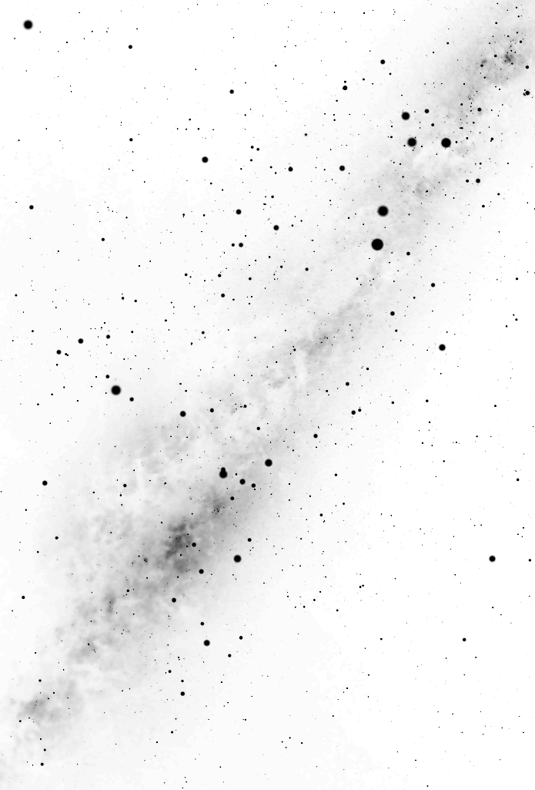
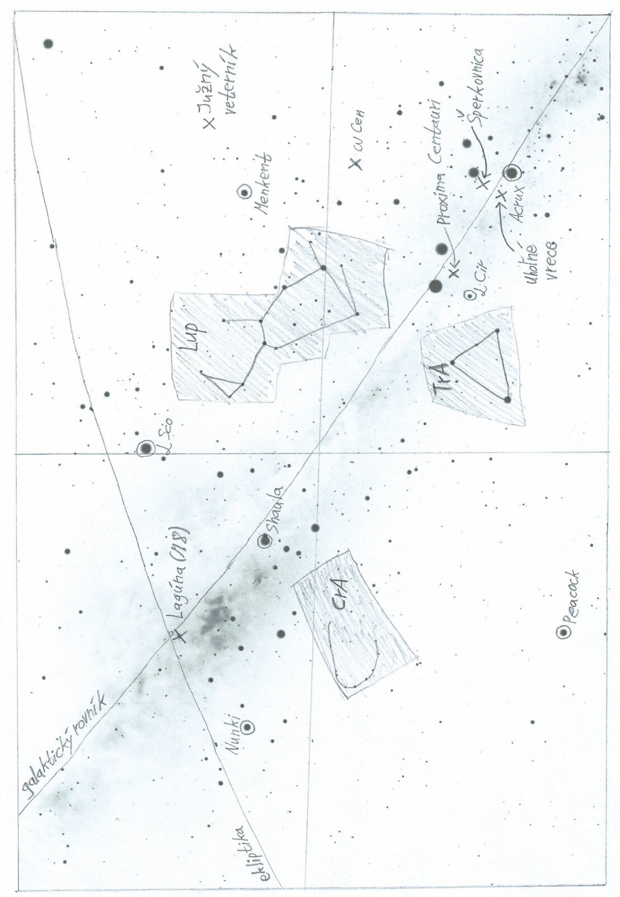

## Zadanie

Slepú mapu môžete nájsť na obrázku 1, vyznačte do nej

<ol type="a">

<li>

šrafovaním a skratkou súhvezdia Južná koruna, Vlk a Južný trojuholník, (12 b)

</li>

<li>

jednu oblasť ionizovaného vodíka HII, tmavú hmlovinu, otvorenú hviezdokopu, guľovú hviezdokopu a galaxiu podľa svojho výberu a jej pomenovanie/označenie, (10 b)

</li>

<li>

hviezdy $\alpha$ Sco, $\alpha$ Cir, Acrux, Menkent, Nunki, Peacock, Shaula, (14 b)

</li>

<li>

ekliptiku a galaktický rovník, (6 b)

</li>

<li>

najbližšiu hviezdu k Zemi (po Slnku) a jej meno. (3 b)

</li>

<li>

V ktorom mesiaci kulminuje o pravej polnoci miestneho času stred mapy? Vychádza na Slovensku nad obzor? (5 b)

</li>

</ol>

<figure>

<figcaption>

**Obrázok 1:** Slepá mapa oblohy
</figcaption>

</figure>

Riešenie

V roku 2021 sa celoštátne kolo AO konalo online, preto sa predpokladalo, že pri riešení slepej mapy súťažiaci využijú ľubovoľné zdroje. Z toho dôvodu je aj zadanie slepej mapy náročnejšie, ako by bolo na prezenčnej súťaži.

<ol type="a">

<li>

Na mape na obr. 2 sú nakreslené spojnice hviezd a vyšrafované približné oblasti, ktoré súhvezdia pokrývajú.

</li>

<li>

Na mape sú krížikmi označené nasledujúce objekty:

- oblasť ionizovaného vodíka HII - Lagúna (M8),

- tmavá hmlovina - Uhoľné vrece,

- otvorená hviezdokopa - Šperkovnica,

- guľová hviezdokopa - $\omega$ Cen,

- galaxia - Južný veterník.

</li>

<li>

Všetky hviezdy sú zakrúžkované na mape.

</li>

<li>

Pri kreslení ekliptiky je dobré si pamätať, okolo ktorých jasných hviezd prechádza: Ponad Spicu (Panna), tesne pod Zubenelgenubi (Váhy), zo súhvezdia Škorpión „odstrihne“ hviezdu Acrab a prejde ponad Antares, v súhvezdí Strelec prejde nad hviezdou Kaus Borealis. Galaktický rovník môžeme nakresliť zhruba v strede tmavého pásu na mape, prípadne sa tiež môžeme orientovať podľa jasných hviezd, okolo ktorých prechádza. Z nich sú najpodstatnejšie Acrux (Južný kríž), Toliman (Centaurus) a Shaula (Škorpión).

</li>

<li>

Najbližšia hviezda ku Slnku sa nazýva Proxima Centauri a nachádza sa v blízkosti hviezdy Toliman ($\alpha$ Centauri). Na mape je označená krížikom.

</li>

<li>

Stred mapy sa nachádza zhruba pod hviezdou Antares, blízko hranice súhvezdí Škorpión a Oltár. V zadaní nie je uvedené, v akej projekcii je mapa nakreslená, nevieme preto určiť súradnice tohto bodu. Stred mapy nájdeme napr. v Stellariu, kde zistíme, že o polnoci kulminuje v júni a na Slovenku nad obzor nevyjde.

</li>

</ol>

<figure>

<figcaption>

**Obrázok 2:** Riešenie slepej mapy z finále AO v roku 2021.
</figcaption>

</figure>

