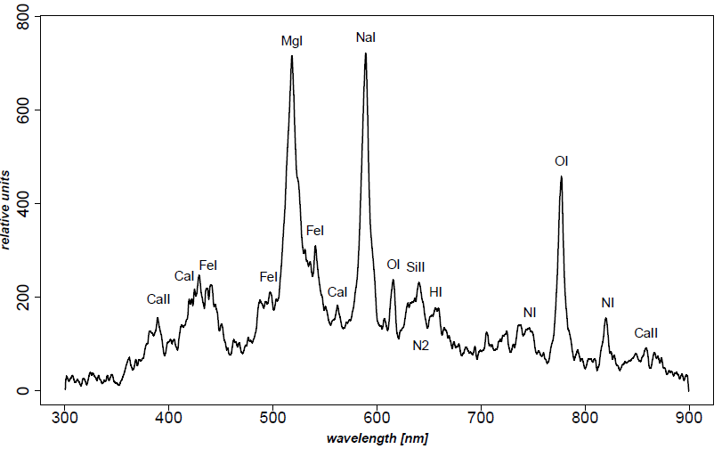
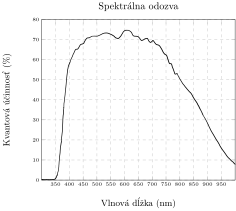

## Zadanie

Úvodom si predstavte, že v jeden deň máte toľko šťastia a zdrojov, že si zakúpite novú kameru a objektív, pretože sa chystáte s nimi vykonávať úchvatný astronomický výskum. V momente ako rozložíte aparatúru a začnete snímať sa stane to, že presne v zornom poli vášho objektívu sa objaví statický meteor (svietiaci bod), dokonca je to silný bolid. To aké parametre má vysnená aparatúra nájdete v priložených tabuľkách 1 a 2. Kamera `Moravian Instrument C4-16000` je top `CMOS` kamera so snímačom priamo vyvinutým na vedeckú prácu a `RedCat 51` je v súčasnosti `APO` teleobjektív ktorý si získava širokú obľúbenosť.

**Tabuľka 1:** Parametre objektívu.

|            Veličina             |  Hodnota   |
|:-------------------------------:|:----------:|
|               Typ               | APOchromat |
|        Priemer $D$        | $51\,\mathrm{mm}$  |
| Ohnisková vzdialenosť $f$ | $250\,\mathrm{mm}$  |
|      Svetelnosť $F$       |            |

**Tabuľka 2:** Parametre kamery.

|         Veličina          |      Hodnota      |
|:-------------------------:|:-----------------:|
|            Typ            |    APOchromat     |
|        Rozlíšenie         | 4096 px x 4096 px |
| Veľkosť pixelu $p^2$  |     $9 \times 9\,\mu\mathrm{m}$     |
| Veľkosť snímača $s^2$ |     $36{,}8 \times 36{,}8\,{\mathrm{mm}}^{2}$     |

<ol type="a">

<li>

Vypočítajte svetelnosť ďalekohľadu, ktorú výrobca zabudol napísať. Predpokladajte, že apochromát je naozaj vysokej kvality a teda všetky viditeľné vlnové dĺžky sa v optickej sústave správajú identicky.

</li>

<li>

Vypočítajte rozlišovaciu schopnosť ďalekohľadu $\theta$. Spektrum na akom vyžaruje typická perzeida je na obrázku 1. Prácu s grafom obídeme nájdením si vyžarovacej spektrálnej línie v tabuľkách. Použijeme čiaru Na I, pretože je najsilnejšia a zároveň je najvýraznejšia vo viditeľnej oblasti smerom k väčším vlnovým dĺžkam. (Môžete si rozmyslieť prečo je to vhodné.) $\lambda_{\rm{Na I}} =  5889{,}950\,\mathring{A}$.

</li>

<li>

Vypočítajte rozlišovaciu schopnosť kamery v optickej sústave $\Delta$. Tj. zistite na koľko pixelov sa zobrazí bodový zdroj svetla, keď využijete znalosť z predchádzajúcej úlohy.

</li>

<li>

Napíšte krátku úvahu aké ďalšie faktory ovplyvňujú rozostrenie obrazu bolidu. Bolid je jasný meteor ale na oblohe kvôli svojej malej veľkosti je stále bodový zdroj svetla. Doteraz ste riešili že bodový zdroj sa nezobrazí na snímači ako bod kvôli difrakcií na objektíve. Aké ďalšie efekty, na základe charakteristiky aparatúry, nepriaznivo ovplyvňujú pozorovanie.

</li>

<li>

Vypočítajte svetelný tok bolidu na snímač $F$. Bolid mal hviezdnu veľkosť $m = -5\,\mathrm{mag}$, to ste zistili z pozorovania `AMOS`. Ďalej viete, že Vega má hviezdnu veľkosť $m_\mathrm{V} = 0\,\mathrm{mag}$ a, že $L_\mathrm{V} = 58\,\mathit{L}_\Sun$ a $r_\mathrm{V} = 25{,}3\,\mathrm{ly} = 7{,}8\,\mathrm{pc}$.

</li>

<li>

Vypočítajte aký uhlovo veľký je meteor $\phi$. Keď ho pozorujeme zo Zeme ktorú aproximujeme hladinou oceánu a bolid sa nachádzal vo výške $H = 80\,\mathrm{km}$ a vďaka informácií z programu `AMOS` sa nachádzal $L = 100\,\mathrm{km}$ od vás v horizontálnej rovine. Priemer meteoroidu ktorý vyvolal bolid bol $d = 10\,\mathrm{cm}$. Ovplyvní to výsledok úlohy (e)?

</li>

<li>

Vypočítajte o aký uhol $\varepsilon$ sa posunie meteor počas toho ako žiari. Predpokladajte, že meteor je statický zdroj svetla v nekonečne, a že ste ho pozorovali na nebeskom rovníku. Bolid žiaril po dobu $T = 6\,\mathrm{s}$.

</li>

<li>

Vypočítajte hodinový uhol bolidu $t$. Z informácií v zadaniach predchádzajúcich úloh viete vypočítať, čomu je rovná výška pozorovania bolidu $h[^\circ$\] a potrebujete ešte vedieť svoju zemepisnú šírku $\phi = 48{,}934738^{\circ}$, čo je presná súradnica observatória v Kolonickom sedle.

</li>

<li>

Vypočítajte či je možné aby snímač zachytil bolid, ak viete, že priepustnosť optickej sústavy je $\eta_0 = 0,99$ a kvantová účinnosť čipu je $\eta_\mathrm{S} = 0,7$ pre vlnovú dĺžku Na I. Zároveň viete, že minimálne množstvo energie na aktiváciu pixelu je $E_\mathrm{min} = 1\,\mathrm{nJ}$.

</li>

</ol>

<figure>

<figcaption>

**Obrázok 1:** Spektrálna charakteristiky typickej Perzeidy, zdroj: fmph.uniba.sk.
</figcaption>

</figure>

<figure>

<figcaption>

**Obrázok 2:** Závislosť kvantovej účinnosti čipu na vlnovej dĺžke svetla.
</figcaption>

</figure>

Riešenie

<ol type="a">

<li>

Svetelnosť ďalekohľadu je pomer jeho priemeru a ohniskovej vzdialenosti. 

$$
\frac{D}{f}=\frac{51}{250}\approx \frac{1}{5} \, . \tag{1}
$$

</li>

</ol>

Táto veličina sa niekedy nazýva aj $f$-číslo a udáva sa v tvare 

$$
\frac{f}{5} \, . \tag{2}
$$

<ol type="a" start="2">

<li>

Rozlišovacia schopnosť ďalekohľadu je

</li>

</ol>

$$
\theta =1,22\frac{\lambda}{D}=1,22\cdot\frac{5889{,}95 \cdot 10^{-10}}{0,051}=1{,}41 \cdot 10^{-5}\,\mathrm{rad}=2{,}9'' \, . \tag{3}
$$

<ol type="a" start="3">

<li>

Bodový objekt v nekonečne pozorujeme kvôli rozlišovacej schopnosti ďalekohľadu efektívne ako objekt s uhlovým priemerom $\theta$. Po prejdení svetla ďalekohľadom bude mať takýto objekt na snímači veľkosť $x$, pre ktorú platí

</li>

</ol>

$$
\frac{x}{f}=\tan \theta \approx \theta \, . \tag{4}
$$

 Využili sme, že uhol $\theta$ nám vyšiel veľmi malý. 

$$
x=f\theta=0,25\cdot1{,}41 \cdot 10^{-5}=3{,}5\,\mu\mathrm{m} \, . \tag{5}
$$

 Rozmer obrazu bodového zdroja na snímači je iba $3{,}5\,\mu\mathrm{m}$, to je menej ako rozmer jediného pixelu ($9\,\mu\mathrm{m}$), zobrazí sa iba na jediný pixel. Rozlišovacia schopnosť kamery je teda $\Delta=1$ px.

<ol type="a" start="4">

<li>

Pozorovanie ovplyvňuje hlavne seeing, teda pohyby atmosféry v dôsledku pohybov más vzduchu. Druhotne majú vplyv určite aj optické a elektronické chyby ďalekohľadu a kamery.

</li>

<li>

Z rozdielu magnitúd vieme, že bolid bol 100-krát jasnejší ako Vega. To znamená, že svetelný tok $F_0$ od bolidu na ďalekohľad bol 100-krát väčší ako svetelný tok od Vegy.

</li>

</ol>

$$
F_0=100F_V=100\frac{L_\textrm{V}}{4\pi r_\textrm{V}^2}=100\frac{58L_{\Sun}}{4\pi r_\textrm{V}^2} \, , \tag{6}
$$

 

$$
F_0=100\cdot\frac{58\cdot3{,}826 \cdot 10^{26}}{4\pi \cdot(7,8\cdot3{,}086 \cdot 10^{16})^2}=3 \cdot 10^{-6}\,\mathrm{W}\,{\mathrm{m}}^{-2} \, . \tag{7}
$$

 Výkon zachytený celou plochou ďalekohľadu je 

$$
P=\frac{\pi D^2}{4}F_0 \, . \tag{8}
$$

 Tento výkon prejde cez ďalekohľad a sústredí sa na kruhovú plochu s priemerom $x$. Tok na snímač teda bude 

$$
F=\frac{P}{\frac{\pi x^2}{4}}=F_0\frac{D^2}{x^2}=3 \cdot 10^{-6}\cdot\frac{0,051^2}{(3{,}5 \cdot 10^{-6})^2}=640\,\mathrm{W}\,{\mathrm{m}}^{-2} \, . \tag{9}
$$

<ol type="a" start="6">

<li>

Vzdialenosť bolidu je

</li>

</ol>

$$
l=\sqrt{L^2+H^2} \, . \tag{10}
$$

 Jeho uhlový priemer je 

$$
\phi =\frac{d}{l}=\frac{d}{\sqrt{L^2+H^2}}=\frac{0,1}{\sqrt{(80 \cdot 10^{3})^2+(100 \cdot 10^{3})^2}}=7{,}8 \cdot 10^{-7}\,\mathrm{rad}=0{,}16'' \, . \tag{11}
$$

 Uhlový rozmer bolidu je menší ako rozlišovacia schopnosť ďalekohľadu, takže výsledok úlohy (e) tým nebude ovplyvnený.

<ol type="a" start="7">

<li>

Ak predpokladáme, že bolid je statický zdroj v nekonečne, tak sa na oblohe pohybuje iba kvôli rotácii Zeme. Za čas $T$ sa Zem otočí o uhol $\varepsilon$

</li>

</ol>

$$
\frac{\varepsilon}{T}=\frac{360^{\circ}}{P_\textrm{sid}} \, , \tag{12}
$$

 

$$
\varepsilon=\frac{6\cdot360^{\circ}}{23\cdot3600+56\cdot60+4}=0{,}025^{\circ}=1{,}5' \, . \tag{13}
$$

<ol type="a" start="8">

<li>

Z kosínusovej vety pre sférický trojuholník sa dá odvodiť nasledujúci vzťah medzi výškou nad obzorom $h$, deklináciou $\delta$, zemepisnou šírkou $\varphi$ a hodinovým uhlom $t$

</li>

</ol>

$$
\sin h= \sin \delta \sin \varphi + \cos \delta \cos \varphi \cos t \, . \tag{14}
$$

 Meteor sa nachádza na rovníku, jeho deklinácia je teda $\delta=0^{\circ}$, vďaka tomu sa tento vzťah ešte zjednoduší. Výška meteoru nad horizontom je 

$$
\tan h=\frac{H}{L}=\frac{80}{100} \, . \tag{15}
$$

 Vyjde $h=38{,}7^{\circ}$ a pre hodinový uhol dostaneme 

$$
\sin h = \cos \varphi \cos t \, , \tag{16}
$$

 

$$
t=\arccos \left(\frac{\sin h}{\cos \varphi}\right)=\arccos \left(\frac{\sin 38{,}7^{\circ}}{\cos 48{,}97^{\circ}}\right)=17{,}7^{\circ}=1^{\rm h}\ 11^{\rm m} \, . \tag{17}
$$

<ol type="a" start="9">

<li>

V časti (g) sme vypočítali, že meteor sa za 6 sekúnd pohne o uhol $1{,}5'$. To znamená, že jeho obraz na snímači sa pohne o niekoľko pixelov. Na jeden pixel pripadá uhol

</li>

</ol>

$$
\frac{9 \cdot 10^{-6}\cdot206265}{0,25}=7{,}4'' \, . \tag{18}
$$

 Počet pixelov, cez ktoré prešiel obraz meteoru je 

$$
\frac{1,5\cdot60}{7,4}=12 \, . \tag{19}
$$

 Na jeden pixel teda dopadať tok energie $F$ iba po dobu $0{,}5\,\mathrm{s}$, pričom nebude dopadať na celý pixel, ale iba na plôšku s priemerom $x$ (viď úlohy c), e)). Energia, ktorú zachytí jeden pixel je 

$$
E=\eta_0\eta_SF\frac{T}{12}\pi\frac{x^2}{4}=0,99\cdot0,7\cdot640\cdot\frac{6}{12}\cdot\pi\cdot\frac{(3{,}5 \cdot 10^{-6})^2}{4}=2{,}1 \cdot 10^{-9}\,\mathrm{J}=2{,}1\,\mathrm{nJ} \, . \tag{20}
$$

 To je viac ako aktivačná energia $1\,\mathrm{nJ}$, kamera preto bolid zachytí.

