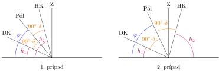
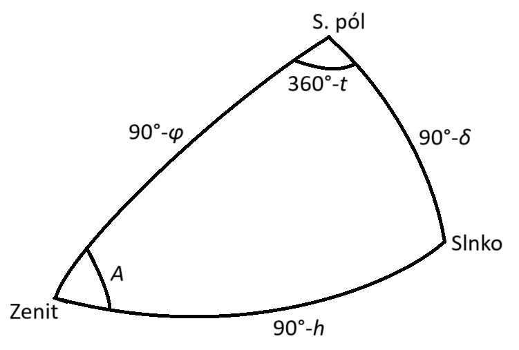

## Zadanie

Na planéte, obiehajúcej okolo vzdialenej hviezdy, je na určitom mieste na povrchu cirkumpolárnou hviezdou aj Sírius, ktorý sa počas hornej kulminácie nachádza $75^{\circ}$ nad obzorom a počas dolnej kulminácie $25^{\circ}$ nad obzorom. Planéta obehne okolo svojej materskej hviezdy za 0,15 roka a okolo svojej osi sa otočí za 48 hodín (má prográdnu rotáciu). Najdlhší čas trvania jedného dňa na mieste pozorovania je 31 hodín. Vypočítajte sklon roviny “ekliptiky“ tejto planéty voči rovine jej rovníka.

Riešenie

Úloha má dve riešenia, buď horná aj dolná kulminácia nastanú na rovnakej strane od zenitu alebo každá z nich na opačnej strane. Najskôr riešime prvý prípad.

<figure>

</figure>

Z obrázku vidíme, že medzi uhlami platia vzťahy 

$$
h_2-h_1=2(90^{\circ}-\delta) \, , \tag{1}
$$

 

$$
\varphi=h_1+90^{\circ}-\delta \, . \tag{2}
$$

 Deklinácia Síria a „zemepisná šírka“ pozorovateľa sú 

$$
\delta=90^{\circ}-\frac{h_2-h_1}{2}=90^{\circ}-\frac{75^{\circ}-25^{\circ}}{2}=65^{\circ} \, , \tag{3}
$$

 

$$
\varphi=25^{\circ}+90^{\circ}-50^{\circ} \, . \tag{4}
$$

 Počas najdlhšieho dňa v roku má miestne Slnko najvyššiu možnú deklináciu, tá sa rovná práve sklonu ekliptiky voči rovníku. Najdlhší deň trvá $31\,\mathrm{h}$, z toho polovica (od kulminácie po západ) je $15{,}5\,\mathrm{h}$. Označíme si obežnú dobu $P_\textrm{o}=0,15\cdot365,25\cdot24=1314{,}9\,\mathrm{h}$, rotačnú dobu planéty $P_\textrm{r}=48\,\mathrm{h}$ a synodický deň $T$ 

$$
T=\frac{1}{\frac{1}{P_\textrm{r}}-\frac{1}{P_\textrm{o}}}=\frac{P_\textrm{r} P_\textrm{o}}{P_\textrm{o}-P_\textrm{r}}=\frac{48\cdot1314,9}{1314,9-48}=49{,}82\,\mathrm{h} \, . \tag{5}
$$

 Hodinový uhol pri západe Slnka je 

$$
t=\frac{15,5}{49,82}360^{\circ}=112^{\circ} \, . \tag{6}
$$

<figure>

</figure>

Pre sférický trojuholník na obrázku použijeme kosínusovú vetu. 

$$
\sin h =\sin \varphi \sin \delta + \cos \varphi \cos \delta \cos t \, . \tag{7}
$$

 Pri západe slnka je jeho deklinácia nulová, $\delta_S=0^{\circ}$, rovnica vyššie sa preto zjednoduší na 

$$
\cos t=-\tan \varphi \tan \delta \, . \tag{8}
$$

 Ako sme spomínali vyššie, počas najdlhšieho dňa v roku platí $\delta_\textrm{S}=\varepsilon$. Sklon ekliptiky voči rovníku je teda 

$$
\tan \varepsilon = -\frac{\cos t}{\tan \varphi}=-\frac{\cos 112^{\circ}}{\tan 50} \, . \tag{9}
$$

 Vyjde $\varepsilon=17{,}5^{\circ}$.\
V druhom prípade postupujeme rovnako. Medzi uhlami na obrázku platia vzťahy 

$$
h_1+2(90^{\circ}-\delta)+h_2=180^{\circ} \, , \tag{10}
$$

 

$$
\varphi=h_1+90^{\circ}-\delta \, , \tag{11}
$$

 Dopočítame deklináciu Síria a zemepisnú šírku pozorovateľa 

$$
\delta=\frac{h_1+h_2}{2}=\frac{25^{\circ}+75^{\circ}}{2}=50^{\circ} \, , \tag{12}
$$

 

$$
\varphi=25^{\circ}+90^{\circ}-50^{\circ}=65^{\circ} \, . \tag{13}
$$

 Sklon ekliptiky je v tomto prípade 

$$
\tan \varepsilon = -\frac{\cos t}{\tan \varphi}=-\frac{\cos 112^{\circ}}{\tan 65} \, . \tag{14}
$$

 Teda $\varepsilon=9{,}9^{\circ}$ .

