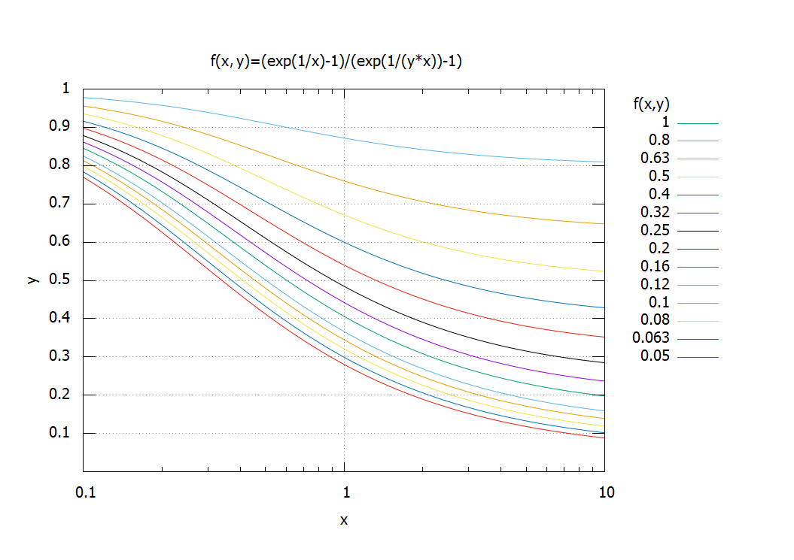
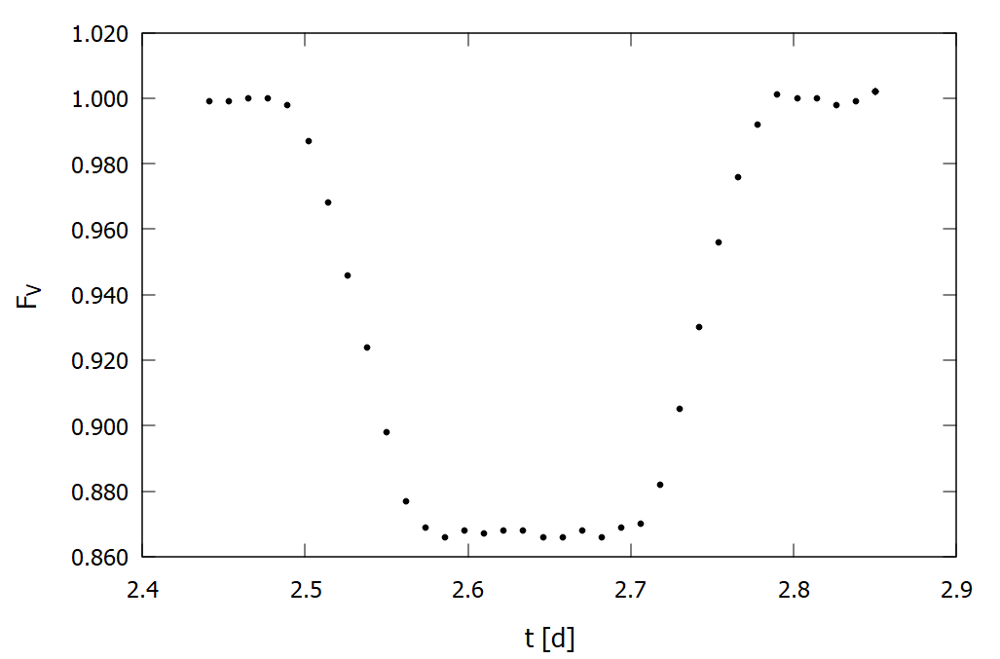
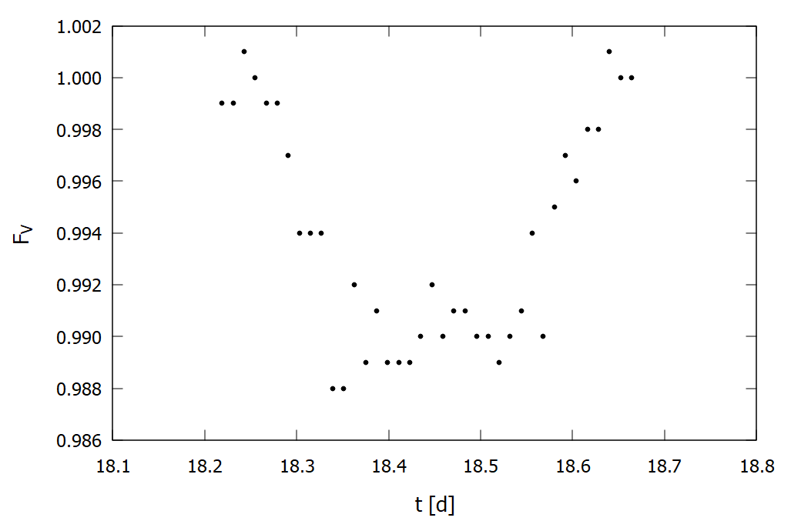
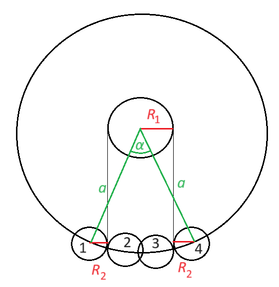
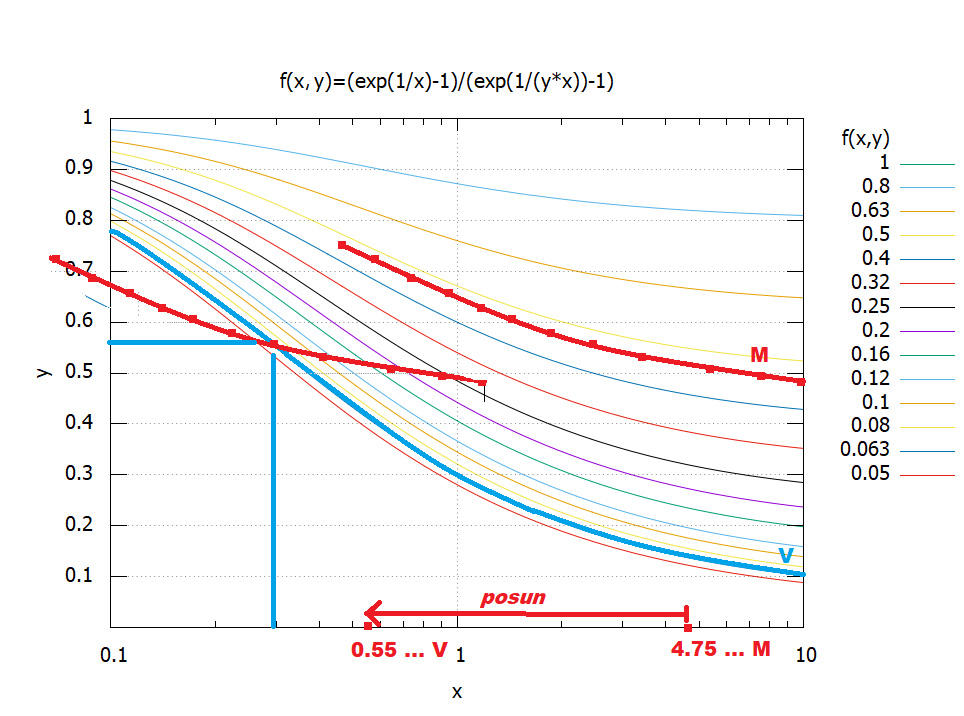

## Zadanie

Jednou zo základných oblastí astrofyziky je výskum hviezd - stelárna astronómia. Na oblohe sa však hviezdy okrem Slnka javia ako bodové zdroje v neznámej vzdialenosti. Určenie hmotností, polomerov, či povrchových teplôt hviezd teda nie je ľahká úloha. Významným je preto pozorovanie dvojhviezd, ktoré nám umožňuje tieto parametre určiť a následne vytvoriť tabuľky pomocou ktorých môžeme odhadovať parametre iných hviezd.

V tejto úlohe sa budeme venovať fotometrickému pozorovaniu modelovej zákrytovej dvojhviezdy s obežnou periódou $P=10\,\mathrm{d}$. Počas riešenia predpokladajte sklon dráhy dvojhviezdy $i=90^{\circ}$, teda že sa na sústavu pozeráme z miesta v jej obežnej rovine. Zanedbajte okrajové stemnenie disku hviezd, teda predpokladajte, že hviezdne disky majú konštantnú plošnú jasnosť.

Záznam nameraných relatívnych svetelných tokov $F_\mathrm{V}$ vo fotometrickom kanále V ($\lambda_\mathrm{V}\approx550\,\mathrm{nm}$) v okolí primárneho a sekundárneho minima v závislosti na čase danom v dňoch sa nachádza v tabuľke 1.

<ol type="a">

<li>

Vyneste graficky závislosť svetelného toku na čase. Povšimnite si, že v čase majú merania konštantný krok $0{,}012\,\mathrm{dní}$, ktorému môžete vhodne prispôsobiť mierku grafu. Z grafu odčítajte:

- $T_1$, $T_2$ časy stredu primárneho resp. sekundárneho minima,

- $\Delta t_1$, $\Delta t_2$ doby trvania primárneho resp. sekundárneho zákrytu (medzi prvým a štvrtým kontaktom),

- $\delta t_1$, $\delta t_2$ doby trvania úplnej fázy primárneho resp. sekundárneho zákrytu,

- $I_1$, $I_2$ relatívny svetelný tok v primárnom resp. sekundárnom minime.

</li>

<li>

Z hĺbok zákrytov určte pomer polomerov zložiek $R_2/R_1<1$ a ich povrchových jasností $F_2/F_1$.

</li>

<li>

Je určená hodnota pomeru polomerov zložiek konzistentná s dobami úplného a čiastočného zákrytu primárneho minima?

</li>

<li>

Určte excentricitu $e$ a argument periastra $\omega$ orbity sústavy pomocou vzťahov 

$$
e \cos \omega = \sqrt{1-e^2}\tan[ (\Delta \Phi- 0,5)\cdot 90^{\circ} ] \,, \tag{1}
$$

 

$$
e \sin \omega = \frac{\Delta t_2-\Delta t_1}{\Delta t_2+\Delta t_1} \,, \tag{2}
$$

kde $\Delta \Phi$ je rozdiel fázy medzi sekundárnym a primárnym minimom (číslo medzi 0 a 1, pre kruhovú dráhu $\Delta \Phi = 0,5$).

</li>

<li>

Ak budeme predpokladať, že hviezdy vyžarujú ako absolútne čierne telesá môžeme pre pomer povrchových jasností pre danú vlnovú dĺžku $\lambda$ pozorovania písať 

$$
\frac{F_2^\lambda}{F_1^\lambda}=\frac{\exp\left(\frac{hc}{\lambda k_\mathrm{B} T_1}\right)-1}{\exp\left(\frac{hc}{\lambda k_\mathrm{B} T_2}\right)-1} = \frac{\exp\left(\frac{1}{x}\right) -1}{\exp \left(\frac{1}{xy}\right) -1}=f(x,y)\,, \tag{3}
$$

 kde 

$$
x = \frac{\lambda k_\mathrm{B} T_1}{hc} \quad \textrm{a} \quad y=\frac{T_2}{T_1}\,. \tag{4}
$$

 Túto závislosť môžeme vidieť na obrázku 1. Pomer povrchových jasností určený z pozorovaní v strednej infračervenej oblasti $\lambda_\mathrm{M}\approx4750\,\mathrm{nm}$ bol určený ako $F_2^\mathrm{M}/F_1^\mathrm{M}\doteq0.464$. Určte teploty $T_1$, $T_2$ zložiek dvojhviezdy graficky.

</li>

<li>

Diskutujte ako by situáciu ovplyvnila iná hodnota sklonu dráhy.

</li>

<li>

Aký ďalší typ pozorovania potrebujeme pre určenie hmotností a skutočných polomerov hviezd?

</li>

</ol>

**Tabuľka 1:** Pozorované relatívne svetelné toky dvojhviezdy vo fotometrickom kanále V.

| čas ($\mathrm{d}$) | $F_\mathrm{V}$ | čas ($\mathrm{d}$) | $F_\mathrm{V}$ | čas ($\mathrm{d}$) | $F_\mathrm{V}$ | čas ($\mathrm{d}$) | $F_\mathrm{V}$ |
|:--:|:--:|:--:|:--:|:--:|:--:|:--:|:--:|
| 2,441 | 0,999 | 2,670 | 0,868 | 18,219 | 0,999 | 18,447 | 0,992 |
| 2,453 | 0,999 | 2,682 | 0,866 | 18,231 | 0,999 | 18,459 | 0,990 |
| 2,465 | 1,000 | 2,694 | 0,869 | 18,243 | 1,001 | 18,471 | 0,991 |
| 2,477 | 1,000 | 2,706 | 0,870 | 18,255 | 1,000 | 18,483 | 0,991 |
| 2,489 | 0,998 | 2,718 | 0,882 | 18,267 | 0,999 | 18,496 | 0,990 |
| 2,502 | 0,987 | 2,730 | 0,905 | 18,279 | 0,999 | 18,508 | 0,990 |
| 2,514 | 0,968 | 2,742 | 0,930 | 18,291 | 0,997 | 18,520 | 0,989 |
| 2,526 | 0,946 | 2,754 | 0,956 | 18,303 | 0,994 | 18,532 | 0,990 |
| 2,538 | 0,924 | 2,766 | 0,976 | 18,315 | 0,994 | 18,544 | 0,991 |
| 2,550 | 0,898 | 2,778 | 0,992 | 18,327 | 0,994 | 18,556 | 0,994 |
| 2,562 | 0,877 | 2,790 | 1,001 | 18,339 | 0,988 | 18,568 | 0,990 |
| 2,574 | 0,869 | 2,802 | 1,000 | 18,351 | 0,988 | 18,580 | 0,995 |
| 2,586 | 0,866 | 2,814 | 1,000 | 18,363 | 0,992 | 18,592 | 0,997 |
| 2,598 | 0,868 | 2,826 | 0,998 | 18,375 | 0,989 | 18,604 | 0,996 |
| 2,610 | 0,867 | 2,838 | 0,999 | 18,387 | 0,991 | 18,616 | 0,998 |
| 2,622 | 0,868 | 2,850 | 1,002 | 18,399 | 0,989 | 18,628 | 0,998 |
| 2,634 | 0,868 |  |  | 18,411 | 0,989 | 18,640 | 1,001 |
| 2,646 | 0,866 |  |  | 18,423 | 0,989 | 18,652 | 1,000 |
| 2,658 | 0,866 |  |  | 18,435 | 0,990 | 18,664 | 1,000 |

<figure>

<figcaption>

**Obrázok 1:** Graf potrebný na určenie povrchových teplôt zložiek, $x$-ová os je v logaritmickej mierke.
</figcaption>

</figure>

Riešenie

<ol type="a">

<li>

Primárne a sekundárne minimum nakreslíme do samostatných grafov s odlišnými mierkami. Časy minima sa dajú určiť pomocou preloženia papiera tak, aby sa vstupná a výstupná vetva prekrývali. Z grafov určíme nasledujúce hodnoty veličín

- $T_1=2{,}635\,\mathrm{d}$, $T_2=18{,}45\,\mathrm{d}$,

- $\Delta t_1=0{,}31\,\mathrm{d}$, $\Delta t_2 \doteq 0{,}40\,\mathrm{d}$,

- $\delta t_1=0{,}13\,\mathrm{d}$, $\delta t_2 \approx 0{,}18\,\mathrm{d}$,

- $I_1=0{,}867\,$, $I_2=0{,}99\,$.

<figure>

<figcaption>

**Obrázok 2:** Primárne minimum.
</figcaption>

</figure>

<figure>

<figcaption>

**Obrázok 3:** Sekundárne minimum.
</figcaption>

</figure>

</li>

<li>

Celkový svetelný tok, ktorý pozorujeme vieme vyjadriť ako 

$$
F=F_1 S_1+F_2 S_2\,, \tag{5}
$$

 kde $S_1$, $S_2$ sú viditeľné plochy diskov hviezd. Tok mimo zákrytov je 

$$
F=F_1 \pi R_1^2+F_2 \pi R_2^2\, . \tag{6}
$$

 Využijeme predpoklad zo zadania $R_2<R_1$. Pre sklon $i=90^{\circ}$ platí, že dochádza k centrálnemu zákrytu. V primárnom minime je zakrytá časť plochy primárnej zložky, dostávame od nej tok iba z plochy $\pi R_1^2-\pi R_2^2$. Relatívny tok v primárnom minime (vydelený tokom mimo zákrytov) je 

$$
I_1=\frac{F_1 (R_1^2- R_2^2)+F_2 R_2^2}{F_1 R_1^2+F_2 R_2^2}=1-\frac{F_1  R_2^2}{F_1 R_1^2+F_2 R_2^2}\, . \tag{7}
$$

 Počas sekundárneho zákrytu je celá sekundárna zložka zakrytá a dostávame tok iba od primárnej hviezdy. Relatívny tok v sekundárnom minime je preto 

$$
I_2=\frac{F_1 R_1^2}{F_1 R_1^2+F_2 R_2^2}\,. \tag{8}
$$

 To sa dá upraviť na 

$$
I_2=\frac{F_1 R_1^2}{F_1 R_1^2+F_2 R_2^2}\frac{R_2^2}{R_2^2}=\frac{R_1^2}{R_2^2}(1-I_1)\,. \tag{9}
$$

 Z tohto vieme určiť pomer polomerov ako 

$$
\frac{R_2}{R_1}=\sqrt{ \frac{1-I_1}{I_2}}\doteq 0,367\, . \tag{10}
$$

 Pomer povrchových jasností získame napríklad úpravou výrazu pre $I_2$ 

$$
\frac{1}{I_2}=\frac{F_1 R_1^2+F_2 R_2^2}{F_1 R_1^2}=1+\frac{F_2 R_2^2}{F_1 R_1^2}\, , \tag{11}
$$

 

$$
\frac{1}{I_2}=1+\frac{F_2}{F_1}\frac{1-I_1}{I_2}=\frac{I_2}{I_2}+\frac{F_2}{F_1}\frac{1-I_1}{I_2}\, , \tag{12}
$$

 

$$
1=I_2+\frac{F_2}{F_1}(1-I_1)\, , \tag{13}
$$

 

$$
\frac{F_2}{F_1}=\frac{1-I_2}{1-I_1} \doteq 0,075\,. \tag{14}
$$

</li>

<li>

Uvažujeme relatívnu dráhu sekundárnej hviezdy okolo nehybnej primárnej hviezdy. Pri prechode od 1. ku 4. kontaktu sekundárna hviezda opíše okolo primárnej uhol $\alpha$, pre ktorý platí 

$$
\sin \left(\frac{\alpha}{2}\right)=\frac{R_1+R_2}{a}\, , \tag{15}
$$

 kde $a$ je vzdialenosť hviezd. Zároveň z 2. Kepleroveho zákona dostaneme vzťah medzi dobou trvania zákrytu $\Delta t_1$ a uhlom $\alpha$ 

$$
\frac{\Delta t_1}{P}=\frac{\alpha}{2\pi}\, . \tag{16}
$$

<figure>

</figure>

V prípade, že je čas $\Delta t_1$ malý v porovnaní s periódou $P$, je malý aj uhol $\alpha$ a môžeme použiť aproximáciu 

$$
\sin \left(\frac{\alpha}{2}\right) \approx \frac{\alpha}{2}\, . \tag{17}
$$

 Dostaneme tak približný vzťah medzi trvaním zákrytu a polomermi hviezd 

$$
\frac{\pi \Delta t_1}{P}=\frac{R_1+R_2}{a}\, . \tag{18}
$$

 Po dosadení nami nameraných hodnôt vyjde $\frac{\alpha}{2}=\doteq 5{,}6^{\circ}$, to je ešte dostatočne malý uhol na to, aby sme mohli aproximáciu použiť. Podobným spôsobom môžeme odvodiť aj vzťah pre dobu trvania úplného zákrytu 

$$
\frac{\pi \delta t_1}{P}=\frac{R_1-R_2}{a}\, . \tag{19}
$$

 Tieto 2 vzťahy vydelíme a dostaneme 

$$
\frac{\delta t_1}{\Delta t_1}=\frac{R_1-R_2}{R_1+R_2}=\frac{1-\frac{R_1}{R_2}}{1+\frac{R_1}{R_2}}\, . \tag{20}
$$

 Do oboch strán dosadíme číselné údaje, vľavo dostaneme $0,42$ a vpravo $0,46$. Vzhľadom na presnosť, s akou sme schopní jednotlivé údaje určiť, nám vyšli dostatočne podobné hodnoty. Môžeme teda povedať, že pomer polomerov je konzistentný s dobami úplného a čiastočného zákrytu.

</li>

<li>

Sčítame druhé mocniny rovníc v zadaní a vyžijeme vzťah pre sin a cos 

$$
\sin^2 x + \cos^2 x = 1\, , \tag{21}
$$

 

$$
e^2 = (1-e^2)\tan^2[ (\Delta \Phi- 0,5)\cdot 90^{\circ} ]+\left(\frac{\Delta t_2-\Delta t_1}{\Delta t_2+\Delta t_1}\right)^2 \,, \tag{22}
$$

 čo je jednoduchá lineárna rovnica pre $e^2$. Do členov na pravej strane dosadíme číselné hodnoty, aby sa nám s rovnicou ľahšie manipulovalo. Najskôr je potrebné si uvedomiť, že pozorované primárne a sekundárne minimum nenastali v rámci jedného obehu, pretože perióda je len $10\,\mathrm{dní}$. Primárne minimum sme pozorovali počas jedného obehu a sekundárne až počas nasledujúceho obehu. Za rozdiel fáz preto musíme dosadiť 

$$
\Delta \Phi=\frac{T_2-T_1-P}{P}=\frac{18,45-2,635-10}{10}=0,5815\, . \tag{23}
$$

 Ďalej dostaneme 

$$
\tan^2[ (\Delta \Phi- 0,5)\cdot 90^{\circ} ]\doteq 0{,}01657\, , \tag{24}
$$

 

$$
\left(\frac{\Delta t_2-\Delta t_1}{\Delta t_2+\Delta t_1}\right)^2 \doteq 0{,}01607\, . \tag{25}
$$

 Z rovnice teraz vyjadríme excentricitu 

$$
e^2=0{,}01657-0{,}01657e^2+0{,}01607\, , \tag{26}
$$

 

$$
1{,}01657e^2=0{,}0005\, , \tag{27}
$$

 

$$
e=\sqrt{\frac{0{,}0005}{1{,}01657}} \doteq 0,022\, . \tag{28}
$$

 Teraz vypočítame argument periastra. Ak by sme dosadili číselné údaje do rovníc v zadaní, vyšlo by nám $\sin \omega > 0$ a $\cos \omega > 0$, uhol $\omega$ bude preto v 1. kvadrante. Rovnice teraz vydelíme a získame tak vzťah pre $\tan \omega$ 

$$
\tan \omega = \frac{(1-e^2)\tan[ (\Delta \Phi- 0,5)\cdot 90^{\circ} ]}{\frac{\Delta t_2-\Delta t_1}{\Delta t_2+\Delta t_1}}\, . \tag{29}
$$

 Po dosadení číselných hodnôt vyjde $\omega=45^{\circ}$. Uhol $\omega$ by sme tiež mohli vypočítať samostatne z oboch rovníc. Vyšli by nám mierne odlišné hodnoty, ako výsledok by sme potom pre väčšiu presnosť mohli použiť ich priemer.

</li>

<li>

V grafe je potrebné vyznačiť dve príslušné krivky dané hodnotami $F_2/F_1$, teda vypočítané $f_\mathrm{V}=0,075$ a zadané $f_\mathrm{M}=0,464$. Hodnota $x$ je daná iba súčinom $T_1 \lambda$ a konštantami, preto platí 

$$
\frac{x_\mathrm{M}}{x_\mathrm{V}}=\frac{\lambda_\mathrm{M}}{\lambda_\mathrm{V}}= \frac{4750}{550} \doteq 8,64\, . \tag{30}
$$

 Toto využijeme pri určení teplôt hviezd z grafu. Keďže $y$ je pomer teplôt, hodnoty $f_\mathrm{V}$ a $f_\mathrm{M}$ našej dvojhviezdy sa líšia iba kvôli odlišným $x$.

V tejto úlohe je kľúčová nasledujúca myšlienka. Predstavme si, že si nakreslíme graf ľubovoľnej funkcie $g(x)$, pričom os $x$ budeme mať v klasickej lineárnej mierke. Ak by sme chceli nakresliť funkciu $g(x+c)$, kde $c$ je ľubovoľná konštanta, stačilo by nám iba posunúť pôvodnú funkciu $g(x)$ o $c$ doľava.

Logaritmická mierka funguje podobným spôsobom pre násobenie. Ak by sme nakreslili graf funkcie $g(x)$ s logaritmickou osou $x$, potom funkciu $g(cx)$ by sme jednoducho nakreslili tak, že by sme $g(x)$ opäť posunuli o $c$ doľava.

Toto využijeme aj v našom prípade. Vieme, že pre našu dvojhviezdu platí $f(x_\mathrm{M}) = f(8,64x_\mathrm{V})$. Krivku pre filter M preto posunieme doľava o príslušnú vzdialenosť. V mieste, kde sa posunutá krivka pretne s krivkou pre filter $V$ určíme hodnotu $x$ a $y$ a z nich vypočítame teploty hviezd. Postup posunu krivky je naznačený na obrázku 4.

Vyznačíme si niekoľko bodov na krivke M, tie posunieme doľava o rovnakú vzdialenosť a potom ich voľne spojíme rukou. Na osi $x$ nájdeme hodnotu $x=8,64$ a odmeriame jej vzdialenosť od hodnoty $x=1$. Presne o túto vzdialenosť musíme krivku M posunúť doľava. Tento postup nám na jednoduchý odhad teplôt postačí.

Priesečník kriviek je približne v bode $x\doteq 0,3$ a $y\doteq 0,56$. Potrebujeme už len vypočítať hodnoty teplôt 

$$
T_1=\frac{xhc}{\lambda_V k}=\frac{0,3\cdot 6{,}626 \cdot 10^{-34}\cdot2{,}9979 \cdot 10^{8}}{550 \cdot 10^{-9}\cdot 1{,}381 \cdot 10^{-23}} \doteq 7800\,\mathrm{K}\, , \tag{31}
$$

 

$$
T_2=yT_1= 0,56\cdot7800 \doteq 4400\,\mathrm{K}\, . \tag{32}
$$

 Postupovať sa dá samozrejme aj opačným smerom, teda posunúť krivku V vpravo. Pri výpočte $T_1$ z $x$ by sme museli namiesto $\lambda_\mathrm{V}$ dosadiť $\lambda_\mathrm{M}$, inak by bol postup rovnaký.

</li>

<li>

Pri postupnej zmene sklonu by sa menila šírka, hĺbka aj tvar zákrytov, až by najprv vymizol sekundárny zákryt a následne aj primárny. Pre určenie všeobecného fitu je teda dôležitý aj samotný tvar svetelnej krivky.

</li>

<li>

Spektrálne pozorovanie - meranie radiálnych rýchlostí - umožní určiť z dynamiky absolútne rozmery dráhy, hviezd a ich hmotnosti. Ďalšou možnosťou je priame rozlíšenie zložiek interferometricky.

</li>

</ol>

<figure>

<figcaption>

**Obrázok 4:** Odčítanie z grafu
</figcaption>

</figure>

