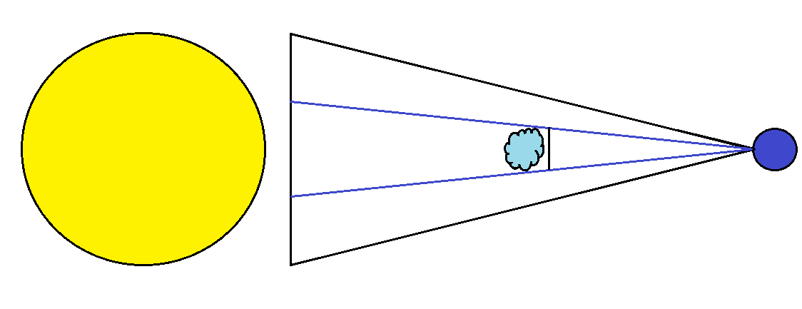
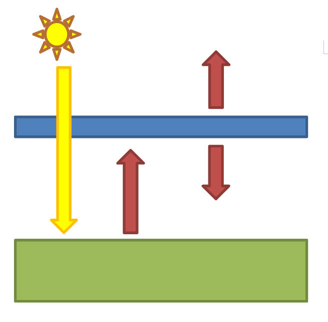

## Zadanie

Píše sa rok 2122. Ľudstvo pod tlakom globálneho otepľovania vypustí vesmírnu loď s obrovským slnečníkom do priestoru medzi Zemou a Slnkom za cieľom znížiť množstvo dopadajúceho žiarenia, a teda ochladenia celého sveta. Teleso má byť umiestnené do tzv. libračného bodu L1. L1 je bod, kde môže teleso obiehať okolo Slnka s obežnou periódou rovnou perióde Zeme, bez toho aby zrýchľovalo smerom k Zemi alebo k Slnku. Bod L1 sa nachádza $x=1{,}5 \cdot 10^{6}\,\mathrm{km}$ od Zeme smerom k Slnku, na čiare ktorá ich spája. Najskôr preskúmajme astrodynamické stránky problému:

<ol type="a">

<li>

Vypočítajte, ako ďaleko od Zeme pozdĺž úsečky Slnko-Zem sa nachádza bod v ktorom sa presne vyrušia gravitačné sily Zeme a Slnka $(x_0)$. Očakávate že bod L1 $(x)$ bude bližšie $(x_0 > x)$ alebo ďalej $(x_0 < x)$ od Zeme ako tento bod a prečo?

</li>

<li>

Aký praktický (gravitačný) problém je spojený s bodom L1? Zostane vesmírna loď v okolí tohto bodu sama od seba v jeho okolí? Vyžaduje sa intuitívne vysvetlenie opierajúc sa o základné sily, žiadne výpočty. Tlak žiarenia nateraz zanedbajte.

</li>

</ol>

Teraz sa pozrime na žiarenie:

<ol type="a" start="3">

<li>

Na základe žiarivého výkonu Slnka a vzdialenosti Zem-Slnko vypočítajte hodnotu slnečnej konštanty $F_\mathrm{S}$, teda množstva žiarivej energie prechádzajúcej kolmo nastaveným povrchom 1 m$^2$ za 1 s vo vzdialenosti Zeme od Slnka.

</li>

<li>

Ambíciou je zatieniť 1% slnečného žiarenia dopadajúceho na Zem. Približne aký rozľahlý tieniaci povrch v bode L1 je na to potrebný?

</li>

<li>

Zanedbajme problém s gravitáciou z podúlohy (b) a sústreďme sa na tlak žiarenia. Akou silou musí pôsobiť kompenzačný motor vesmírnej lode na kompenzáciu neustále dopadajúcej hybnosti zo slnečných fotónov? Ak ste nevypočítali veľkosť tieniaceho povrchu v (d), uveďte túto silu vztiahnutú na jeden meter štvorcový tieniaceho povrchu. Ak ste nevypočítali slnečnú konštantu v (c), počítajte s hodnotou $F_\mathrm{S} = 1400\,\mathrm{W}\,{\mathrm{m}}^{-2}$. Pomôcka: môže sa vám hodiť vzťah $E = pc$, kde $E$ je energia fotónu, $p$ jeho hybnosť, $c$ rýchlosť svetla vo vákuu.

</li>

</ol>

V nasledujúcej časti sa pozrieme na to, čo spraví uvedené 1 % redukcie slnečnej konštanty s teplotu Zeme. Pre tieto účely zanedbajme atmosféru Zeme a akýkoľvek skleníkový efekt. Uvažujte, že celá Zem má jednu a tú istú teplotu, žiari ako absolútne čierne teleso v infračervenej oblasti, a voči dopadajúcemu slnečnému žiareniu vykazuje albedo $A = 0,3$ (tzn. odrazivosť, pomer odrazeného a dopadajúceho žiarenia).

<ol type="a" start="6">

<li>

Vypočítajte teplotu Zeme za takýchto podmienok pri obvyklej slnečnej konštante. O koľko sa zmení pri jej zmenšení o 1 %?

</li>

</ol>

BONUS

<ol type="a" start="7">

<li>

Uvažujte atmosféru so skleníkovými plynmi. Modelujme ich ako jedinú tenkú vrstvu niekde nad povrchom, ktorá pohltí všetko tepelné žiarenie prichádzajúce zdola zo Zeme a vyžaruje ako čierne teleso rovnomerne do oboch smerov (hore a dole). Táto atmosféra nijako neovplyvní albedo Zeme. Odvoďte rovnicu a hodnotu pre rovnovážnu teplotu Zeme v tomto jednoduchom (1D) skleníkovom modeli. Odvoďte tiež všeobecnú rovnicu pre malé zmeny tejto teploty v dôsledku malých zmien slnečnej konštanty.

</li>

</ol>

Riešenie

<ol type="a">

<li>

Hľadáme bod, v ktorom sa vyrovnajú gravitačné sily Zeme a Slnka. Nech $x_0$ je vzdialenosť od Zeme. Gravitačný zákon hovorí

</li>

</ol>

$$
\frac{GM_{\Sun}}{(a_{\Ea}-x_0)^2}=\frac{GM_{\Ea}}{x_0^2} \, . \tag{1}
$$

 Z toho vyjadríme $x_0$ a dostaneme 

$$
\sqrt{M_{\Sun}}x_0=\sqrt{M_{\Ea}}a_{\Ea}-\sqrt{M_{\Ea}}x_0 \, . \tag{2}
$$

 

$$
x_0=\frac{\sqrt{M_{\Ea}}}{\sqrt{M_{\Sun}}-\sqrt{M_{\Ea}}}a_{\Ea}=\frac{\sqrt{5{,}9736 \cdot 10^{24}}}{\sqrt{1{,}9891 \cdot 10^{30}}-\sqrt{5{,}9736 \cdot 10^{24}}}\cdot1{,}496 \cdot 10^{11}=2{,}59 \cdot 10^{8}\,\mathrm{m}=0,17x \, . \tag{3}
$$

 V bode L1, vo vzdialenosti $x$ od Zeme, gravitačnej sile Zeme pomáha aj odstredivá sila generovaná obehom vesmírnej lode okolo Slnka. Balans všetkých síl v L1 ($x$) je preto dosiahnutý vo väčšej vzdialenosti od Zeme než je $x_0$, stačí nám slabšia príťažlivá sila Zeme než je tá slnečná.

<ol type="a" start="2">

<li>

Problém je, že sa jedná o vratkú (nestabilnú) rovnováhu. Výsledná sila po akomkoľvek miniatúrnom odchýlení z rovnovážnej polohy smeruje vždy od rovnovážnej polohy. Keďže gravitácia je príťažlivá sila, akákoľvek malá výchylka smerom k Zemi spôsobí zvýšenie jej príťažlivosti a zníženie príťažlivosti Slnka. V prípade opačnej výchylky zas preváži Slnko. To spôsobí porušenie rovnováhy pri akejkoľvek konečnej výchylke. Keďže vesmírna loď nie je hmotný bod, ktorý vieme znavigovať nula metrov od presného miesta rovnováhy, ponechaná napospas osudu v bode L1 nemôže zotrvať. Tento argument doposiaľ nespomenul odstredivú silu – funguje to aj s ňou. Na plný počet za túto podúlohu stačilo diskutovať gravitačné sily. Ďalší dôležitý fakt je prítomnosť ďalších telies v Slnečnej sústave (a v princípe kdekoľvek vo vesmíre) – ich slabý, no nenulový vplyv by vychýlil aj hmotný bod presne v L1, do výpočtu ktorého vplyv iných telies zahrnutý nie je. Táto poznámka taktiež nebola nutná na získanie plného počtu bodov.

</li>

<li>

Slnečná konštanta je

</li>

</ol>

$$
F_S=\frac{L_{\Sun}}{4\pi a_{\Ea}^2}=\frac{3{,}826 \cdot 10^{26}}{4\pi\cdot(1{,}496 \cdot 10^{11})^2}=1360\,\mathrm{W}\,{\mathrm{m}}^{-2} \, . \tag{4}
$$

<ol type="a" start="4">

<li>

Vychádzame z nákresu. Slnečník v L1 (v strede) a Slnko (vľavo) sa premietajú na oblohu Zeme (vpravo). Pomer slnečného žiarenia zachyteného vesmírnym slnečníkom vyrátame ako pomer ich uhlových plôch viditeľných zo Zeme, rovnaký princíp ako pri zatmení alebo zákryte iných vesmírnych objektov. Podľa zadania chceme aby bol tento pomer 0,01

<figure>

</figure>

</li>

</ol>

$$
\Omega_{\Sun}=\frac{\pi R_{\Sun}^2}{a_{\Ea}} \, , \tag{5}
$$

 

$$
\Omega_\textrm{S}=\frac{S}{x} \, , \tag{6}
$$

 

$$
\frac{\Omega_\textrm{S}}{\Omega_{\Sun}}=0,01 \, . \tag{7}
$$

 Odtiaľ získame tieniaci povrch slnečníka 

$$
S=0,01\pi R_{\Sun}^2\frac{x}{a_{\Ea}}=0,01\cdot\pi\cdot(6{,}955 \cdot 10^{8})^2\cdot\frac{1{,}5 \cdot 10^{9}}{1{,}496 \cdot 10^{11}}=1{,}52 \cdot 10^{14}\,{\mathrm{m}}^{2} \, . \tag{8}
$$

<ol type="a" start="5">

<li>

Vychádzame z rovnice v zadaní, hybnosť fotónu je

</li>

</ol>

$$
p_\textrm{f}=\frac{E}{c} \, . \tag{9}
$$

 Počet fotónov, ktoré dopadnú na slnečník za 1 sekundu je 

$$
N_f=\frac{FS}{E} \, . \tag{10}
$$

 V čitateli je energia, ktorú slnečník zachytí za 1 sekundu a v menovateli je energia jedného fotónu. Tok energie na slnečník je 

$$
F=\frac{L_{\Sun}}{4\pi (a_{\Ea}-x)^2} \, . \tag{11}
$$

 Slnečník absorbuje fotóny, čím sa naň prenesie ich hybnosť. Za jednotku času sa na slnečník prenesie hybnosť 

$$
\frac{\Delta p}{\Delta t}=N_\textrm{f}p_\textrm{f}=\frac{FS}{E}\frac{E}{c}=\frac{FS}{c}=\frac{L_{\Sun}S}{4\pi (a_{\Ea}-x)^2c} \, . \tag{12}
$$

 Sila je zmena hybnosti za čas, takže výraz vyššie je zároveň výrazom pre tlakovú silu.Jej číselná hodnota je 

$$
F_\textrm{p}=\frac{3{,}826 \cdot 10^{26}\cdot1{,}52 \cdot 10^{14}}{4\pi \cdot(1{,}496 \cdot 10^{11}-1{,}5 \cdot 10^{9})^2\cdot2{,}9979 \cdot 10^{8}}=7 \cdot 10^{8}\,\mathrm{N} \, . \tag{13}
$$

<ol type="a" start="6">

<li>

Zem je v energetickej rovnováhe, energiu, ktorú prijme musí aj vyžiariť, preto platí

</li>

</ol>

$$
(1-A)F_\textrm{S}\pi R_{\Ea}^2=4\pi R_{\Ea}^2\sigma T_{\Ea}^4 \, . \tag{14}
$$

 Teplota Zeme je 

$$
T_{\Ea}=\sqrt[4]{\frac{(1-A)F_\textrm{S}}{4\sigma}}=\sqrt[4]{\frac{(1-0,3)\cdot1360}{4\cdot5{,}67 \cdot 10^{-8}}}=254{,}5\,\mathrm{K} \, . \tag{15}
$$

 V prípade zníženia slnečnej konštanty o 1 % by sa teplota Zeme zmenila na 

$$
T'_{\Ea}=\sqrt[4]{\frac{0,99(1-A)F_\textrm{S}}{4\sigma}}=\sqrt[4]{\frac{0,99\cdot(1-0,3)\cdot1360}{4\cdot5{,}67 \cdot 10^{-8}}}=253{,}9\,\mathrm{K} \, . \tag{16}
$$

 To že sú tieto teploty také nízke by nemalo prekvapiť, keďže sme neuvažovali akýkoľvek skleníkový efekt, išlo iba o preskúmanie vplyvu slnečnej konštanty.\
BONUS

<ol type="a" start="7">

<li>

Základný model je na obrázku. Žltá šípka označuje slnečné žiarenie, červená šípka tepelné infračervené žiarenie Zeme a atmosféry (tenká modrá vrstva medzi Zemou a Slnkom). Budeme rozmýšľať o tokoch energie na 1 m$^2$ zemského povrchu, takže efektívna slnečná konštanta je $\frac{F_\textrm{S}}{4}$. Atmosféra má dva „povrchy“: dolný a horný, a pre oba platí Stefanov-Boltzmannov zákon. V rovnovážnom stave pre (i) Zem, a (ii) atmosféru platí, že prijatá energia sa musí rovnať vyžiarenej energii

</li>

</ol>

<figure>

</figure>

Energetická rovnováha pre Zem 

$$
\frac{(1-A)F_\textrm{S}}{4}+\sigma T_\textrm{A}^4=\sigma T_{\Ea}^4 \, . \tag{17}
$$

 Energetická rovnováha pre atmosféru 

$$
\sigma T_{\Ea}^4=2\sigma T_\textrm{A}^4 \, . \tag{18}
$$

 Riešením tohto systému pre teplotu Zeme dostaneme ($T_{\Ea 0}$ predstavuje teplotu Zeme bez skleníkových plynov, nájdenú v časti (f)) 

$$
T_{\Ea}=\sqrt[4]{\frac{(1-A)F_\textrm{S}}{2\sigma}}=\sqrt[4]{2}T_{\Ea 0}=\sqrt[4]{2}\cdot254,5=303\,\mathrm{K} \, . \tag{19}
$$

 Rovnicu pre malé zmeny môžme získať použitím aproximácie $(1+x)^n \approx 1+nx$, ktorá platí pre $x\ll 1$, prípadne derivovaním 

$$
\frac{\textrm{d} T_{\Ea}}{\textrm{d} F_\textrm{S}}=\frac{1}{4}\left(\frac{(1-A)F_\textrm{S}}{2\sigma}\right)^{-\frac{3}{4}}\frac{1-A}{2\sigma}=\frac{1}{4F_\textrm{S}}\frac{1-A}{2\sigma} \, , \tag{20}
$$

 

$$
\delta T_{\Ea} = \frac{1}{4F_\textrm{S}}\frac{1-A}{2\sigma} \delta F_\textrm{S} \, . \tag{21}
$$

