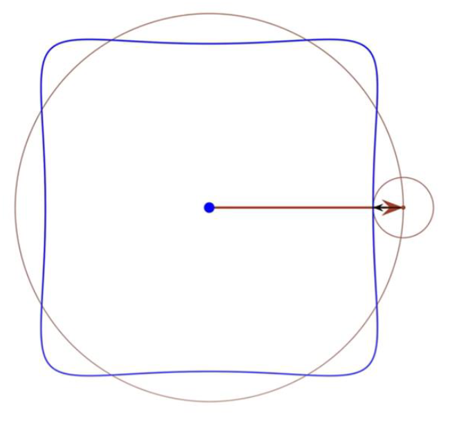

## Zadanie

Riešenie dráh v nebeskej mechanike môže niekedy viesť k zaujímavým výsledkom. V tejto úlohe sa pozrieme práve na jedno konkrétne riešenie. Predstavte si hypotetickú slnečnú sústavu kde je iba Slnka, Zem a Mesiac obiehajúci okolo Zeme. Jednotlivé hmotnosti sú $M_\Sun$ pre Slnko, $M_\Ea$ pre Zem a $M_\Mo$ pre Mesiac.

**Konštanty a aproximácie:**

|                                     |           |
|:------------------------------------|:----------|
| Vzdialenosť Zem-Mesiac ku Slnko-Zem | $r_\Mo = \frac{7}{45} r_\Ea$ |
| Obežná perióda Mesiaca ku Zeme      | $P_\Mo = \frac{1}{3} P_\Ea$ |
| Podmienka úlohy                     | $M_\Sun \gg M_\Ea \gg M_\Mo$ |
| Binomická aproximácia               | $(1 \pm x)^n \approx 1 \pm nx \, , \  x \ll 1$ |

**Úlohy:**

<ol type="a">

<li>

Overte, že pre dané vstupné parametre stále platí podmienka úlohy (na hmotnosti).\
Zamyslite sa, ako je potrebné overiť dvojitú nerovnicu $M_\Sun \gg M_\Ea \gg M_\Mo$. Hint: za $\gg$ sa dá považovať ak je jedno číslo aspoň o rád väčšie ako druhé.

</li>

<li>

Odvoďte vzťah pre polomer Hillovej sféry okolo Zeme a overte či sa Mesiac v nej nachádza.\
Pokúste sa umiestniť testovaciu časticu na hranicu Hillovej sféry okolo Zeme.

</li>

<li>

Nakreslite tvar orbity Mesiaca vo vzťažnej sústave Slnka. Pokúste sa o čo najlepšie rysovanie. Je potrebné vyniesť minimálne 8 bodov dráhy. Na aký tvar sa daná dráha podobá?

</li>

</ol>

Riešenie

<ol type="a">

<li>

Vyjdeme z 3. Keplerovho zákona, ktorý si napíšeme pre Zem aj Mesiac a vzájomne vydelíme

</li>

</ol>

$$
\frac{r^3}{T^2}=\frac{GM}{4\pi^2} \, , \tag{1}
$$

 

$$
\frac{M_{\Ea}}{M_{\Sun}}=\left(\frac{r_\Mo}{r_\Ea}\right)^3\left(\frac{P_\Ea}{P_\Mo}\right)^2 \, . \tag{2}
$$

 V takomto prípade chceme splniť podmienku $\frac{M_\Ea}{M_\Sun} \ll 1$, čo overíme dosadením do rovnice vyššie 

$$
\frac{M_{\Ea}}{M_{\Sun}}=\left(\frac{7}{45}\right)^3\cdot3^2=0,034 \, . \tag{3}
$$

 Zároveň nemusíme nijak overovať $M_\Mo \ll M_\Ea$, pretože $M_\Mo$ si môžeme nastaviť ľubovoľne malé bez žiadneho obmedzenia.

<ol type="a" start="2">

<li>

Umiestnime testovaciu časticu s nekonečne malou hmotnosťou na okraj Hillovej sféry $r_\textrm{H}$ okolo Zeme. V takom prípade musí platiť rovnováha síl

</li>

</ol>

$$
\frac{GM_\Ea}{r_\textrm{H}^2}-\frac{GM_\Sun}{(r_\Ea-r_\textrm{H})^2}+\Omega^2(r_\Ea-r_\textrm{H})=0 \, . \tag{4}
$$

 Prvý člen predstavuje gravitáciu Zeme, druhý gravitáciu Slnka, ktorá proti nej bojuje a tretí je odstredivá sila, pričom význam $\Omega$ je 

$$
\Omega=\sqrt{\frac{GM_\Sun}{r_\Ea^3}} \, , \tag{5}
$$

 

$$
\frac{M_\Ea}{r_\textrm{H}^2}-\frac{M_\Sun}{(r_\Ea-r_\textrm{H})^2}+\frac{M_\Sun}{r_\Ea^3}(r_\Ea-r_\textrm{H})=0 \, , \tag{6}
$$

 

$$
\frac{M_\Ea}{r_\textrm{H}^2}-\frac{M_\Sun}{r_\Ea^2}\frac{1}{\left(1-\frac{r_\textrm{H}}{r_\Ea}\right)^2}+\frac{M_\Sun}{r_\Ea^3}(r_\Ea-r_\textrm{H})=0 \, . \tag{7}
$$

 Na druhý člen využijeme aproximáciu $(1\pm x)^n \approx 1\pm nx$ 

$$
\frac{M_\Ea}{r_\textrm{H}^2}-\frac{M_\Sun}{r_\Ea^2}\left(1+2\frac{r_\textrm{H}}{r_\Ea}\right)+\frac{M_\Sun}{r_\Ea^2}(1-\frac{r_\textrm{H}}{r_\Ea})=0 \, , \tag{8}
$$

 

$$
\frac{M_\Ea}{r_\textrm{H}^2}-\frac{M_\Sun}{r_\Ea^2}\left(1+2\frac{r_\textrm{H}}{r_\Ea}-1+\frac{r_\textrm{H}}{r_\Ea}\right)=0 \, , \tag{9}
$$

 

$$
\frac{M_\Ea}{r_\textrm{H}^2}-\frac{M_\Sun}{r_\Ea^2}\left(3\frac{r_\textrm{H}}{r_\Ea}\right)=0 \, , \tag{10}
$$

 

$$
\frac{M_\Ea}{r_\textrm{H}^2}-3\frac{M_\Sun r_\textrm{H}}{r_\Ea^3}=0 \, , \tag{11}
$$

 

$$
\frac{r_\textrm{H}}{r_\Ea}=\sqrt[3]{\frac{M_\Ea}{3M_\Sun}} \, . \tag{12}
$$

 Po dosadení výsledku predchádzajúcej úlohy dostaneme riešenie 

$$
\frac{r_\textrm{H}}{r_\Ea}=\sqrt[3]{\frac{0,034}{3}}=0,22>\frac{7}{45}\approx 0,16 \, . \tag{13}
$$

 Takže Mesiac sa v našej úlohe nachádza vo vnútri Hillovej sféry Zeme.

<ol type="a" start="3">

<li>

Dráha by mala značne pripomínať štvorec.

</li>

</ol>

<figure>

</figure>

