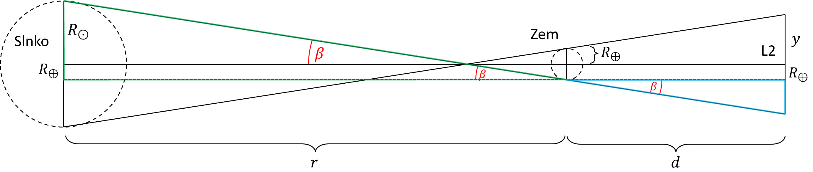
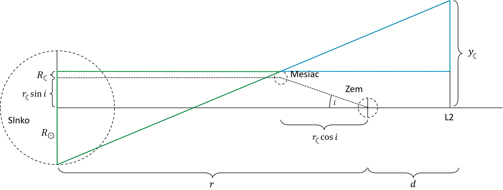

## Zadanie

Ďalekohľad Jamesa Webba je najväčší vesmírny teleskop. Má hmotnosť $m = 6160\,\mathrm{kg}$ a zrkadlo s priemerom $D = 6{,}5\,\mathrm{m}$. Špecializuje sa na pozorovanie v infračervenej oblasti spektra na vlnových dĺžkach od $\lambda_{\textrm{min}} = 600\,\mathrm{nm}$ do $\lambda_{\textrm{max}} = 28\,300\,\mathrm{nm}$. Bol vypustený koncom roku 2021 a po mesiaci sa usadil na dráhu, ktorá sa pohybuje v blízkosti Lagrangeovho bodu L2. To znamená, že si voči Zemi zachováva relatívnu polohu.

Uvažujte, že Zem obieha okolo Slnka po eliptickej dráhe. Relatívna poloha bodu L2 voči Zemi je v perihéliu $d_\mathrm{P} = 1{,}48 \cdot 10^{9}\,\mathrm{m}$ a v aféliu $d_\mathrm{A} = 1{,}53 \cdot 10^{9}\,\mathrm{m}$ (pričom leží na priamke Slnko – Zem smerom od Slnka). Okolo Zeme obieha Mesiac po eliptickej dráhe, ktorá je sklopená voči ekliptike.

<ol type="a">

<li>

Do akej vzdialenosti od Zeme siaha úplný tieň Zeme v perihéliu a aféliu? Môže JWST pozorovať úplne zatmenie Slnka (za predpokladu, že sa nachádza presne v L2)?

</li>

<li>

JWST využíva solárnu energiu, preto by vadilo ak by vstúpil aj do polotieňa Zeme. Aká je pološírka polotieňu Zeme v bode L2? Inými slovami: ako ďaleko od priamky Slnko – Zem – L2 (v bode L2) siaha polotieň Zeme? Vypočítajte pre Zem v perihéliu aj aféliu.\
*Hint: JWST je v polotieni Zeme ak z jeho pohľadu pozoruje čiastočné zatmenie Slnka Zemou.*

</li>

<li>

V akej najmenšej vzdialenosti od bodu L2 (v smere kolmo na priamku Slnko – Zem – L2) musí JWST obiehať, aby sa vyhol aj polotieňu Mesiaca?\
*Hint: počítajte prípad pre Zem v perihéliu.*

</li>

<li>

Koľkokrát viacej fotónov zachytí za sekundu JWST oproti ľudskému oku pri pozorovaní vzdialeného bodového objektu vyžarujúceho monochromaticky na $\lambda_\textrm{min}$? Priemer ľudského oka (pupily) je $D_\textrm{oko} = 4\,\mathrm{mm}$ a kvantová účinnosť (pre $\lambda_\textrm{min}$) je $\eta_\textrm{oko} = 0,1$. Extinkcia atmosféry (pre daný objekt) je $0{,}3\,\mathrm{mag}$. Kvantová účinnosť JWST (pre $\lambda_\textrm{min}$) je $\eta = 0,7$.

</li>

<li>

Aká je najmenšia vzdialenosť dvoch bodov na Mesiaci, ktoré vie JWST (niekedy) rozlíšiť? Predpokladajte, že sa nachádza presne v L2.

</li>

</ol>

Riešenie

<ol type="a">

<li>

Na základe schémy môžeme z podobnosti trojuholníkov písať

<figure>

</figure>

$$
\frac{R_\Sun}{r+x} = \frac{R_\Ea}{x} \, . \tag{1}
$$

 kde $x$ je hľadaná vzdialenosť do ktorej siaha úplný tieň Zeme. $r$ je aktuálna vzdialenosť Zeme od Slnka, čo je $r_\textrm{P} = a_{\Ea} (1-e)$ v perihéliu a $r_\textrm{A} = a_{\Ea} (1+e)$ v aféliu. Z rovnice vyjadríme a dopočítame $x_\textrm{P}$ (v perihéliu) a $x_\textrm{A}$ (v aféliu) 

$$
xR_\Sun=rR_\Ea+xR_\Ea \, , \tag{2}
$$

 

$$
x(R_\Sun-R_\Ea)=rR_\Ea \, , \tag{3}
$$

 

$$
\begin{split}
x_\textrm{P} =&\, \frac{R_\Ea \, r_\textrm{P}}{R_\Sun - R_\Ea} = \frac{R_\Ea \, a (1-e)}{R_\Sun - R_\Ea}\\
=&\, \frac{6{,}378 \cdot 10^{6}\cdot1{,}496 \cdot 10^{11}\cdot(1-0,0167)}{6{,}955 \cdot 10^{8}-6{,}378 \cdot 10^{6}}= 1{,}36 \cdot 10^{9}\,\mathrm{m} \, ,
\end{split} \tag{4}
$$

 

$$
\begin{split}
x_\textrm{A} =&\, \frac{R_\Ea \, r_\textrm{A}}{R_\Sun - R_\Ea} = \frac{R_\Ea \, a (1+e)}{R_\Sun - R_\Ea} \\ =&\, \frac{6{,}378 \cdot 10^{6}\cdot1{,}496 \cdot 10^{11}\cdot(1+0,0167)}{6{,}955 \cdot 10^{8}-6{,}378 \cdot 10^{6}}= 1{,}41 \cdot 10^{9}\,\mathrm{m} \, .
\end{split} \tag{5}
$$

 Vidíme, že tieň nesiaha až do bodu L2 (aj keď tesne). To znamená, že JWST nemôže pozorovať úplné zatmenie Slnka.

</li>

</ol>

<ol type="a" start="2">

<li>

Keďže $r \gg R_\Sun,R_\Ea$, tak môžeme uvažovať, že polomery zaznačené na ďalšej schéme šikmo sú približne kolmé na priamku stred Slnka - stred Zeme - L2, tak ako je to nakreslené na obrázku nižšie. Z podobnosti zeleného a modrého trojuholníka môžeme písať 

$$
\frac{R_\Sun + R_\Ea}{r} = \frac{y - R_\Ea}{d} \, , \tag{6}
$$

 kde $y$ je hľadaná kolmá vzdialenosť od priamky Slnko - Zem - L2 do ktorej siaha polotieň Zeme. Obdobne ako v časti a), $r$ je aktuálna vzdialenosť Zeme od Slnka, čo je $r_\textrm{P} = a (1-e)$ v perihéliu a $r_\textrm{A} = a (1+e)$ v aféliu. $d$ je aktuálna vzdialenosť bodu L2 od Zeme, čo je $d_\textrm{P}$ pre Zem v perihéliu a $d_\textrm{A}$ pre Zem v aféliu (hodnoty poznáme zo zadania). Vyjadríme si a dopočítame $y_\textrm{P}$ (v perihéliu) a $y_\textrm{A}$ (v aféliu): 

$$
y_\textrm{P} = \frac{d_\textrm{P}}{r_\textrm{P}} (R_\Sun + R_\Ea) + R_\Ea = \frac{d_\textrm{P}}{a} \frac{R_\Sun + R_\Ea}{1-e} + R_\Ea \, , \tag{7}
$$

 

$$
y_\textrm{P}=
\frac{1{,}48 \cdot 10^{9}}{1{,}496 \cdot 10^{11}}\frac{6{,}955 \cdot 10^{8}+6{,}378 \cdot 10^{6}}{1-0,0167}+6{,}378 \cdot 10^{6}= 13{,}3 \cdot 10^{6}\,\mathrm{m} \, , \tag{8}
$$

 

$$
y_\textrm{A} = \frac{d_\textrm{A}}{r_\textrm{A}} (R_\Sun + R_\Ea) + R_\Ea = \frac{d_\textrm{A}}{a} \frac{R_\Sun + R_\Ea}{1+e} + R_\Ea \doteq 13{,}3 \cdot 10^{6}\,\mathrm{m} \, . \tag{9}
$$

 Vidíme, že polotieň siaha do (približne) rovnakej vzdialenosti pre Zem v perihéliu aj aféliu.

</li>

</ol>

<figure>

</figure>

<ol type="a" start="3">

<li>

Minimálna vzdialenosť v ktorej musí JWST obiehať, aby sa vždy vyhol polotieňu Mesiaca je rovná maximálnej vzdialenosti do ktorej sa niekedy polotieň dostane. Na to aby polotieň Mesiaca siahal čo najďalej od priamky Slnko - Zem - L2, chceme aby bol Mesiac čo najbližšie ku Slnku a čo najďalej od roviny ekliptiky. To znamená, že počítame prípad, kedy je Zem v perihéliu, $r_P = a(1-e)$, a Mesiac v apogeu vo vzdialenosti $r_{\Mo_A} = a_\Mo(1+e_\Mo)$ smerom ku Slnku pod uhlom $i$. Opäť predpokladáme kolmosť polomerov na priamku Zem - Slnko - L2, tak ako to je znázornené na schéme nižšie. Z podobnosti vyznačených trojuholníkov dostávame

</li>

</ol>

$$
\frac{R_\Mo + r_\Mo \sin i + R_\Sun}{r - r_\Mo \cos i} = \frac{y_\Mo - R_\Mo - r_\Mo \sin i}{r_\Mo \cos i + d} \, , \tag{10}
$$

 kde $y_\Mo$ je hľadaná kolmá vzdialenosť od priamky Slnko - Zem - L2 do ktorej siaha polotieň Mesiaca. Po dosadení vzdialenosti Zeme od Slnka $r = r_\textrm{P}$, Mesiaca od Zeme $r_\Mo = r_{\Mo_\textrm{A}}$ a L2 od Zeme $d = d_\textrm{P}$ (diskutované vyššie) do rovnice a vyjadrení $y_\Mo$ dostávame 

$$
y_\Mo = \frac{R_\Mo + a_\Mo(1+e_\Mo) \sin i + R_\Sun}{a(1-e) - a_\Mo(1+e_\Mo) \cos i} \, \big( a_\Mo(1+e_\Mo) \cos i + d_\textrm{P} \big) + R_\Mo + a_\Mo(1+e_\Mo) \sin i = 46{,}1 \cdot 10^{6}\,\mathrm{m} \, . \tag{11}
$$

 *Poznámka: JWST vskutku obieha ďalej od bodu L2, najbližšie je $250 \cdot 10^{6}\,\mathrm{m}$.*

<figure>

</figure>

<ol type="a" start="4">

<li>

Zdroj je vzdialený, čo znamená, že vzdialenosť Zeme od L2 nehrá rolu, budeme uvažovať, že sa nachádzajú v približne rovnakej vzdialenosti od zdroja. Keďže zdroj vyžaruje monochromaticky, tak pomer energetických tokov je rovný pomeru fotónov. Ak by sa oko nachádzalo vo vesmíre, tak

</li>

</ol>

$$
\frac{N}{N_\textrm{oko,vesmír}} = \frac{S}{S_\textrm{oko}} \frac{\eta}{\eta_\textrm{oko}} \, . \tag{12}
$$

 kde je $N$ počet fotónov, ktoré zachytí JWST, $N_\textrm{oko,vesmír}$ počet fotónov, ktoré zachytí oko vo vesmíre, $S$ zberná plocha JWST a $S_\textrm{oko}$ zberná plocha oka. Dosadením $S=\pi (D/2)^2$ a $S_\textrm{oko}=\pi (D_\textrm{oko}/2)^2$ dostávame 

$$
\frac{N}{N_\textrm{oko,vesmír}} = \frac{D^2}{D_\textrm{oko}^2} \frac{\eta}{\eta_\textrm{oko}} \, . \tag{13}
$$

 Avšak oko sa nachádza na Zemi, kde dochádza ku extinkcii svetla v atmosfére. Máme zadané, že extinkcia je $\Delta m = 0{,}3\,\mathrm{mag}$, čo znamená že vieme pomocou Pogsonovej rovnice vyrátať pomer počtu fotónov dopadajúcich na oko vo vesmíre a na Zemi. 

$$
\Delta m = -2,5 \log\left( \frac{N_\textrm{oko,zem}}{N_\textrm{oko,vesmír}} \right) \, . \tag{14}
$$

 Z čoho máme 

$$
N_\textrm{oko,vesmír} = N_\textrm{oko,zem} \cdot 10^{0,4\cdot\Delta m} \, . \tag{15}
$$

 Dosadením za $N_\textrm{oko,vesmír}$ a úpravou dostávame 

$$
\frac{N}{N_\textrm{oko,zem}} = \frac{D^2}{D_\textrm{oko}^2} \frac{\eta}{\eta_\textrm{oko}} \cdot 10^{0,4\cdot\Delta m} =\frac{6,5^2}{0,004^2} \frac{0,7}{0,1} \cdot 10^{0,4\cdot0,3}= 24 \cdot 10^{6}\, \, . \tag{16}
$$

<ol type="a" start="5">

<li>

Vzdialenosť, dvoch bodov, ktoré vie JWST rozlíšiť označme $l$. Najmenšie je ak bude JWST najbližšie k Mesiaci, čo nastáva pre Mesiac v apogeu (vzdialenosť $r_{\Mo_\textrm{A}}$ od Zeme) a Zem v perihéliu (kedy je L2 najbližšie ku Zemi, vo vzdialenosti $d_\textrm{P}$). Ak je $\theta$ rozlišovacia schopnosť JWST, potom

</li>

</ol>

$$
\theta \approx \frac{l}{d_\textrm{P} - r_{\Mo_\textrm{A}}} \, . \tag{17}
$$

 Zároveň vieme rozlišovaciu schopnosť vypočítať z teórie difrakcie ako 

$$
\theta \approx 1,22 \frac{\lambda}{D} \, , \tag{18}
$$

 kde $\lambda$ je vlnová dĺžka na ktorej JWST pozoruje, teda $\lambda = \lambda_\textrm{min}$. Spojením týchto dvoch rovníc, dosadením $r_{\Mo_\textrm{A}} = a_\Mo (1+e_\Mo)$ a úpravou dostávame 

$$
l \approx 1,22 \, \big( d_\textrm{P} - a_\Mo (1+e_\Mo) \big) \frac{\lambda_\textrm{min}}{D} = 1,22\cdot\big(1{,}48 \cdot 10^{9}-3{,}844 \cdot 10^{8}\cdot(1+0,0549)\big)\cdot\frac{600 \cdot 10^{-9}}{6,5} = 121\,\mathrm{m} \, . \tag{19}
$$

