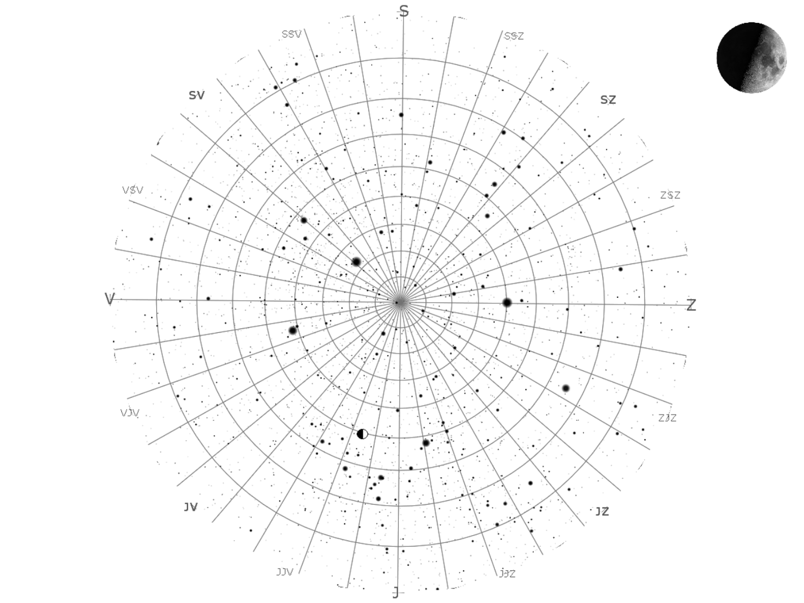

## Zadanie

Z mapky na obr. 1 odhadnite dátum a zemepisnú šírku, pre ktoré bola mapka vytvorená. Nachádza sa Slnko nad horizontom? Tolerancia v dátume je $\pm 5\,\mathrm{dní}$, tolerancia v zemepisnej šírke je $\pm 3^{\circ}$. V mapke je zaznačená poloha Mesiaca, a v pravom hornom rohu je jeho zväčšený obrázok.

<figure>

<figcaption>

**Obrázok 1:** Mapa oblohy.
</figcaption>

</figure>

Riešenie

S pomocou súradnicovej mriežky sa dá odhadnúť, že výška Polárky nad horizontom je približne $25^{\circ}$, zemepisná šírka je teda tiež $25^{\circ}$ N. Mesiac na mape je v prvej štvrti a nachádza sa prakticky v zimnom slnovratnom bode. Uhlová vzdialenosť medzi Mesiacom a Slnkom je v prvej štvrti $90^{\circ}$, Slnko je preto približne v jesennom bode, mapka bola zrejme urobená blízko jesennej rovnodennosti, ktorá nastáva okolo 22. septembra. Na mape je vidno, že sa jesenný bod nachádza nad horizontom, takže je nad horizontom aj Slnko.

