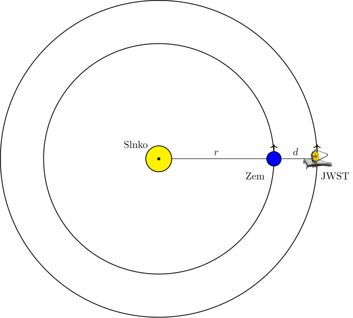

## Zadanie

Ďalekohľad Jamesa Webba je najväčší teleskop vo vesmíre. Má hmotnosť $m = 6160\,\mathrm{kg}$ a zrkadlo s priemerom $D = 6{,}5\,\mathrm{m}$. Špecializuje sa na pozorovanie v infračervenej oblasti spektra na vlnových dĺžkach od $\lambda_{\textrm{min}} = 600\,\mathrm{nm}$ do $\lambda_{\textrm{max}} = 28\,300\,\mathrm{nm}$. Bol vypustený koncom roku 2021 a po mesiaci sa usadil na dráhu, ktorá sa pohybuje v blízkosti Lagrangeovho bodu L2. To znamená, že si voči Zemi zachováva relatívnu polohu.\
Uvažujte, že Zem aj JWST obiehajú po kruhových dráhach okolo Slnka a JWST sa nachádza presne v bode L2. Polomer dráhy Zeme je $r$. JWST obieha vo vzdialenosti $d = 1{,}5 \cdot 10^{9}\,\mathrm{m}$ od Zeme smerom od Slnka.\
**Úlohy:**

<ol type="a">

<li>

Nakreslite schému dráh Zeme a JWST okolo Slnka. Vyznačte $r$ a $d$.

</li>

<li>

Aké gravitačné sily pôsobia na JWST od Zeme a od Slnka?

</li>

<li>

Koľkokrát väčšia je gravitačná sila pôsobiaca od Slnka? Aká je výsledná gravitačná sila pôsobiaca na JWST?

</li>

<li>

Ako rýchlo sa musí JWST pohybovať, aby sa udržal na kruhovej dráhe?

</li>

<li>

Ako dlho trvá JWST obeh okolo Slnka? Použite výsledok z (d). Porovnajte so Zemou.

</li>

</ol>

Riešenie

<ol type="a">

<li>

Lagrangeove body sú významné tým, že ak sa v nich usadí teleso, tak si zachováva voči Zemi a Slnku rovnakú relatívnu polohu. Tieto body rotujú okolo Slnka spolu so Zemou. Bod L2 sa nachádza na polpriamke Slnko → Zem vo vzdialenosti $d$ od Zeme smerom od Slnka (zakreslené na schéme nižšie).

</li>

<li>

Gravitačné sily vyrátame pomocou Newtonovho gravitačného zákona

</li>

</ol>

$$
F_{\textrm{G}_\Ea} = \frac{Gm M_\Ea}{d^2} = \frac{6{,}67 \cdot 10^{-11}\cdot6160\cdot5{,}9736 \cdot 10^{24}}{(1{,}5 \cdot 10^{9})^2} \doteq 1{,}09\,\mathrm{N} \, , \tag{1}
$$

 

$$
F_{\textrm{G}_\Sun} = \frac{Gm M_\Sun}{(r+d)^2} =\frac{6{,}67 \cdot 10^{-11}\cdot6160\cdot1{,}9891 \cdot 10^{30}}{(1{,}496 \cdot 10^{11}+1{,}5 \cdot 10^{9})^2} \doteq 35{,}8\,\mathrm{N} \, . \tag{2}
$$

<figure>

</figure>

<ol type="a" start="3">

<li>

Použitím výsledkov predchádzajúcej časti určíme pomer síl

</li>

</ol>

$$
\frac{F_{\textrm{G}_\Sun}}{F_{\textrm{G}_\Ea}} = \frac{35,8}{1,09} \doteq 32,8 \, . \tag{3}
$$

 Teda od Slnka pôsobí asi 33-krát väčšia sila ako od Zeme. Celková gravitačná sila $F_G$ je súčtom síl $F_{G_\Ea}$ a $F_{G_\Sun}$, pretože pôsobia v rovnakom smere. 

$$
F_\textrm{G} = F_{\textrm{G}_\Ea} + F_{\textrm{G}_\Sun} = 1,09+35,8 \doteq 36{,}9\,\mathrm{N} \, . \tag{4}
$$

<ol type="a" start="4">

<li>

Celková gravitačná sila $F_g$ pri pohybe na kruhovej dráhe pôsobí ako dostredivá sila, pre ktorú platí

</li>

</ol>

$$
F_\textrm{G} = m \frac{v^2}{r+d} \, , \tag{5}
$$

 kde $v$ je obehová rýchlosť JWST na kruhovej dráhe, ktorú vieme vyjadriť ako 

$$
\begin{gathered}
v = \sqrt{\frac{r+d}{m} F_\textrm{G}} = \sqrt{\frac{r+d}{m} G m \left( \frac{M_\Ea}{d^2} + \frac{M_\Sun}{(r+d)^2} \right)} = \\ =
\sqrt{(1{,}496 \cdot 10^{11}+1{,}5 \cdot 10^{9})\cdot6{,}67 \cdot 10^{-11}\cdot\left( \frac{5{,}9736 \cdot 10^{24}}{(1{,}5 \cdot 10^{9})^2} + \frac{1{,}9891 \cdot 10^{30}}{(1{,}496 \cdot 10^{11}+1{,}5 \cdot 10^{9})^2} \right)} \doteq \\ \doteq 30{,}09\,\mathrm{km}\,{\mathrm{s}}^{-1} \, . \end{gathered}\tag{6}
$$

<ol type="a" start="5">

<li>

Periódu obehu vyrátame jednoducho ako podiel obvodu kružnice orbity JWST a rýchlosti, ktorou sa pohybuje

</li>

</ol>

$$
t = \frac{2 \pi (r+d)}{v} = \frac{2\pi \cdot (1{,}496 \cdot 10^{11}+1{,}5 \cdot 10^{9})}{30{,}09 \cdot 10^{3}} \doteq 31{,}55 \cdot 10^{6}\,\mathrm{s} \doteq 365{,}2\,\mathrm{d} \, . \tag{7}
$$

 Vidíme, že čas obehu JWST je veľmi podobný jednému roku, čo je perióda obehu Zeme okolo Slnka. Tým sme potvrdili, že si JWST zachováva relatívnu polohu voči Zemi a Slnku.

