## Zadanie

Pozorovanie planetárnych hmlovín je skvelý nástroj na porozumenie dejov odohrávajúcich sa vo vesmíre. Je ale potrebné z meraní vždy zistiť čo najviac základných informácií o týchto objektoch. Dvojica najzákladnejších je elektrónová hustota $n_\textrm{e}$ a elektrónová teplota $T_\textrm{e}$.

Vašou úlohou je teda vyskúšať si takéto určenie z priloženého spektra planetárnej hmloviny NGC 6881 a zistiť na základe priložených vzorcov a grafov elektrónovú hustotu $n_\textrm{e}$ a elektrónovú teplotu $T_\textrm{e}$. Laboratórne vlnové dĺžky čiar, ktoré pozorujeme sú ($\text{\AA} = 10^{-10}\,\mathrm{m}$) 

$$
\begin{align*}
    \text{pre raz ionizovaný kremík [SiII]:}& \enspace \Lambda_{\mathrm{6716}}=6716\,\text{\AA} \,,\enspace \Lambda_{\mathrm{6731}}=6731\,\text{\AA} \, , \\
    \text{pre dvakrát ionizovaný kyslík [OIII]:}& \enspace \Lambda_{\mathrm{4959}}=4959\,\text{\AA} \,\enspace \Lambda_{\mathrm{5007}}=5007\,\text{\AA} \,,\enspace \Lambda_{\mathrm{4363}}=4363\,\text{\AA} \, .
\end{align*}
$$

 Pomery intenzít, ktoré budete potrebovať pre riešenie úlohy sú 

$$
P_{\mathrm{I}} = \frac{F_{\mathrm{6716}}}{F_{\mathrm{6731}}} \a
    P_{\mathrm{II}} = \frac{F_{\mathrm{4959}}+F_{\mathrm{5007}}}{F_{\mathrm{4363}}} \tag{1}
$$

 Zároveň budete potrebovať semiempirický vzťah na odhad reálnej intenzity. Ten je odvodený z predpokladu, že všetky spektrálne čiary sú v tvare Gaussovej funkcie s rovnakým rozšírením. Pre náš prípad musíme k odmeranej maximálnej intenzite (ktorú zobrazujeme na osi $y$) pripočítať hodnotu $\Delta_y$. Chybu maximálnej intenzity označíme $\sigma_y$. 

$$
\Delta_y = y \left[ 1-\exp\left(\frac{-\Delta_x^2}{20\,\text{\AA}^2} \right)\right] \a \sigma_y = \frac{\Delta_x}{10\,\text{\AA}^2}\left( y-\Delta_y \right) \sigma_x \,, \tag{2}
$$

 kde hodnota $20\,\text{\AA}^2$ je empirická konštanta pre náš príklad a $\Delta_x$ je rozdiel odhadnutej hodnoty vlnovej dĺžky (ktorú zobrazujeme na osi $x$) pre maximálnu intenzitu a bodu s nameranou maximálnou intenzitou. Vlnovú dĺžku maximálnej intenzity zistite najpresnejšie ako je možné.

**Úlohy**

<ol type="a">

<li>

**Identifikujte všetky zadané vlnové dĺžky spektrálnych čiar.**\
Máte zadaných 5 vlnových dĺžok ktoré budú pre ďalšie úlohy zaujímavé. Zaznačte ich polohu do priložených grafov celého spektra planetárnej hmloviny NGC 6881, resp. zaznačte spektrálnu čiaru ktorá zodpovedá danej vlnovej dĺžke.

</li>

<li>

**Určite elektrónovú hustotu $n_\textrm{e}$ planetárnej hmloviny.**\
Budete potrebovať vypočítať pomer $P_{\textrm{I}}$ a použiť graf na obrázku 6. Nezabudnite na kalibráciu toku voči kontinuu (dôležitá je intenzita nad úrovňou konštantného toku) a na analýzu chýb merania (metóda a presnosť je na vás). Snažte sa zdokumentovať váš postup riešenia tak aby bolo jasné, ako ste jednotlivé hodnoty získali a ako ste získali chyby merania.

</li>

<li>

**Určite elektrónovú teplotu $T_\textrm{e}$ planetárnej hmloviny.**\
Budete potrebovať vypočítať pomer $P_{\textrm{II}}$. Nezabudnite na kalibráciu toku voči kontinuu a na analýzu chýb merania. Výslednú hodnotu môžete získať buď riešením rovnice priloženej v grafe 7 (budete potrebovať výsledok predchádzajúcej úlohy alebo použiť tabuľkovú hodnotu $n_\textrm{e}=1$ \[všetky hodnoty hustoty sa používajú s jednotkou ${\mathrm{cm}}^{-3}$\] a využiť nejakú jednoduchú metódu numerického riešenia rovníc) alebo využijete graf 7, ktorý bol nakreslený pre $n_\textrm{e}=1$ (keďže ale odčítanie z grafu je už predmetom úlohy (b), tak tento postup bude ohodnotený menším počtom bodov). Snažte sa zdokumentovať váš postup riešenia tak, aby bolo jasné, ako ste jednotlivé hodnoty získali a ako ste získali chyby merania.

</li>

</ol>

Snažte sa o maximálnu možnú presnosť výsledku a výslednej chyby, pretože sú hodnotené.

<figure>

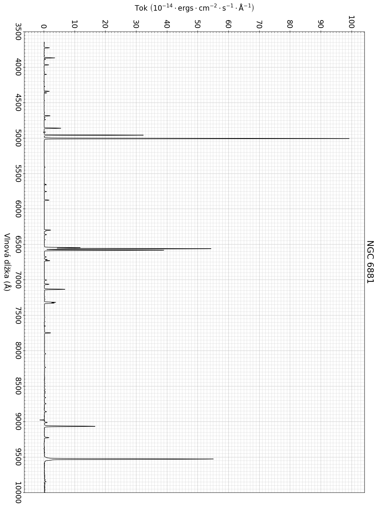

<figcaption>

**Obrázok 1:** Graf celého spektra planetárnej hmloviny NGC 6881.\
Dáta Prevzaté z: Williams College and the University of Oklahoma <https://web.williams.edu/Astronomy/research/PN/nebulae/>.
</figcaption>

</figure>

<figure>

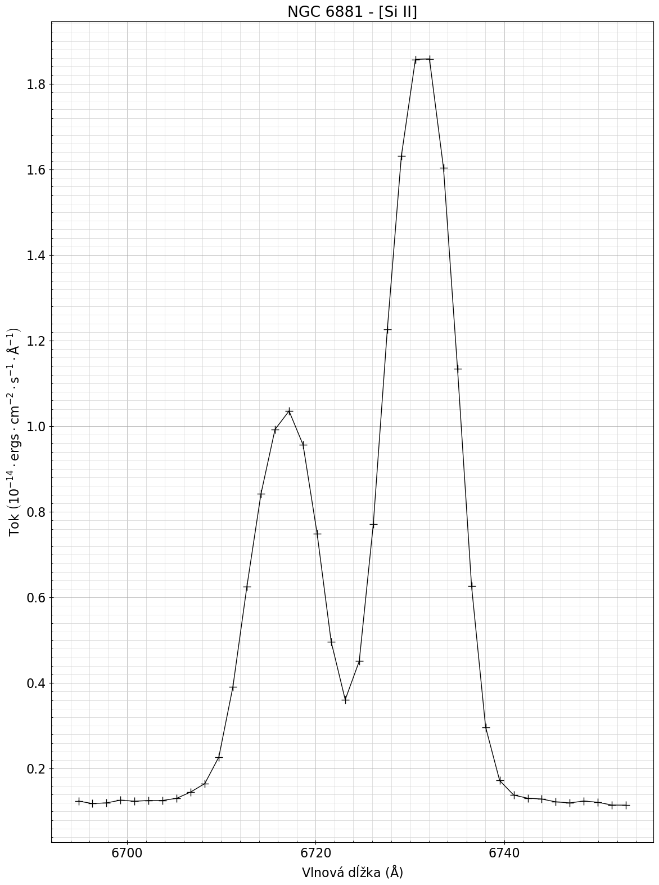

<figcaption>

**Obrázok 2:** Spektrum okolo vlnových dĺžok \[Si II\] $6716\,\text{\AA}$ a $6731\,\text{\AA}$ pre NGC 6881.\
Dáta Prevzaté z: Williams College and the University of Oklahoma <https://web.williams.edu/Astronomy/research/PN/nebulae/>.
</figcaption>

</figure>

<figure>

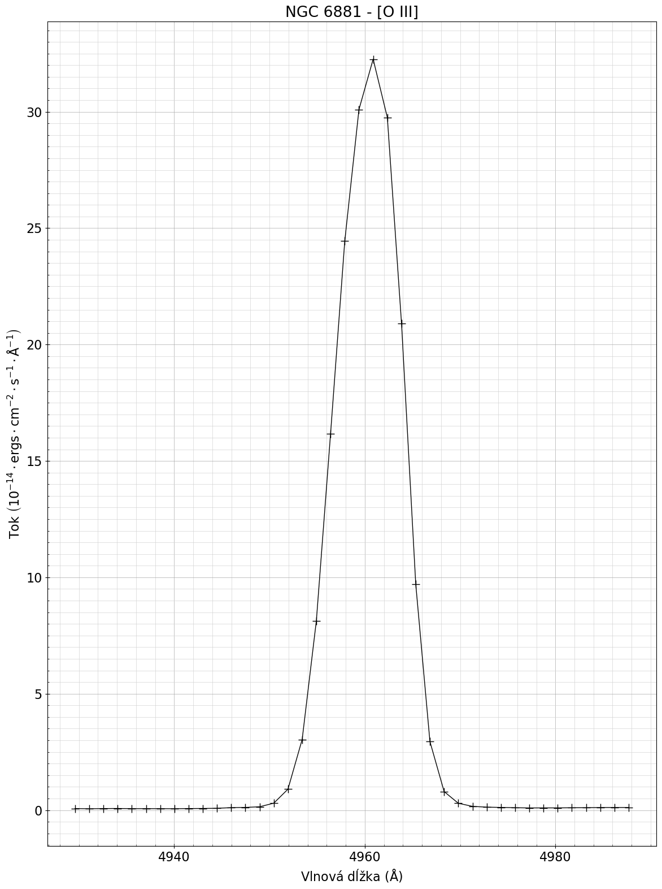

<figcaption>

**Obrázok 3:** Spektrum okolo vlnovej dĺžky \[O III\] $4959\,\text{\AA}$ pre NGC 6881.\
Dáta Prevzaté z: Williams College and the University of Oklahoma <https://web.williams.edu/Astronomy/research/PN/nebulae/>.
</figcaption>

</figure>

<figure>

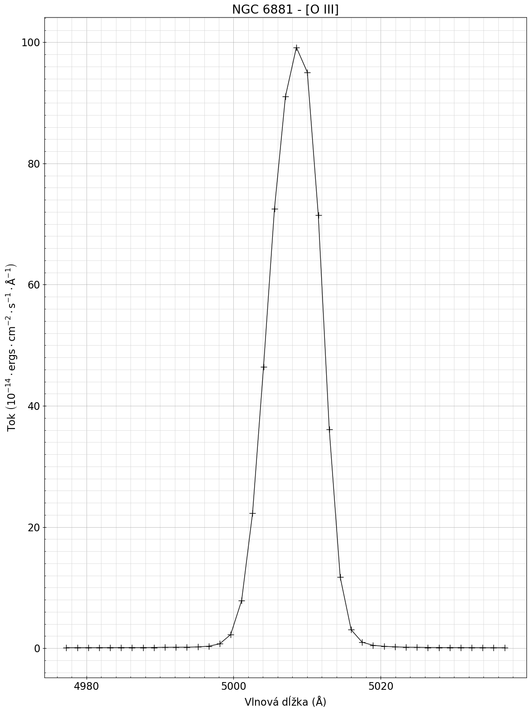

<figcaption>

**Obrázok 4:** Spektrum okolo vlnovej dĺžky \[O III\] $5007\,\text{\AA}$ pre NGC 6881.\
Dáta Prevzaté z: Williams College and the University of Oklahoma <https://web.williams.edu/Astronomy/research/PN/nebulae/>.
</figcaption>

</figure>

<figure>

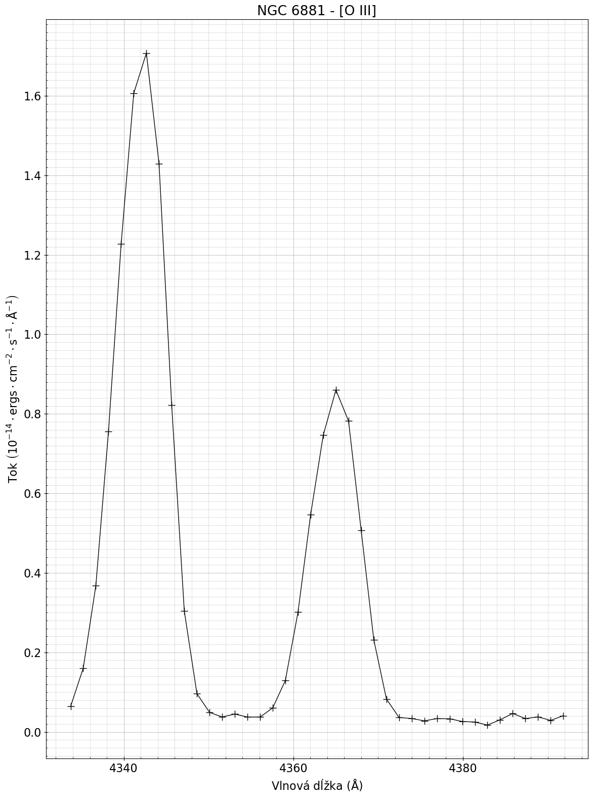

<figcaption>

**Obrázok 5:** Spektrum okolo vlnovej dĺžky \[O III\] $4363\,\text{\AA}$ pre NGC 6881.\
Dáta Prevzaté z: Williams College and the University of Oklahoma <https://web.williams.edu/Astronomy/research/PN/nebulae/>.
</figcaption>

</figure>

<figure>

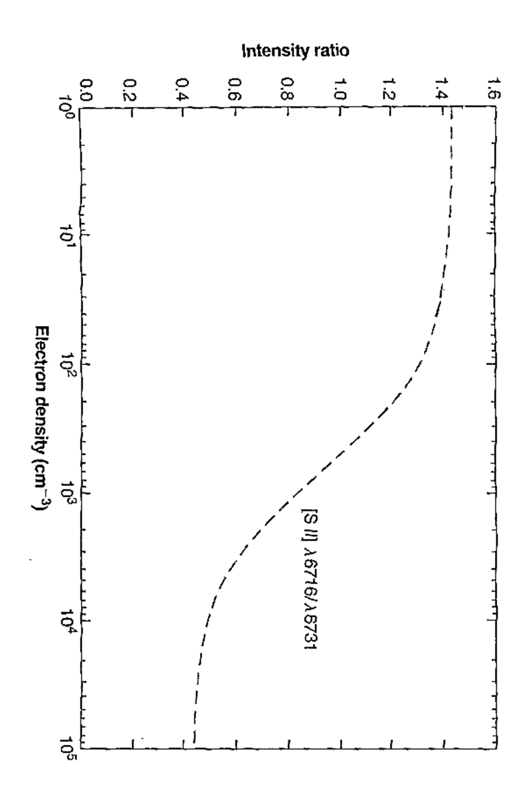

<figcaption>

**Obrázok 6:** Graf závislosti intenzity $P_{\textrm{I}}$ od elektrónovej hustoty.
</figcaption>

</figure>

<figure>

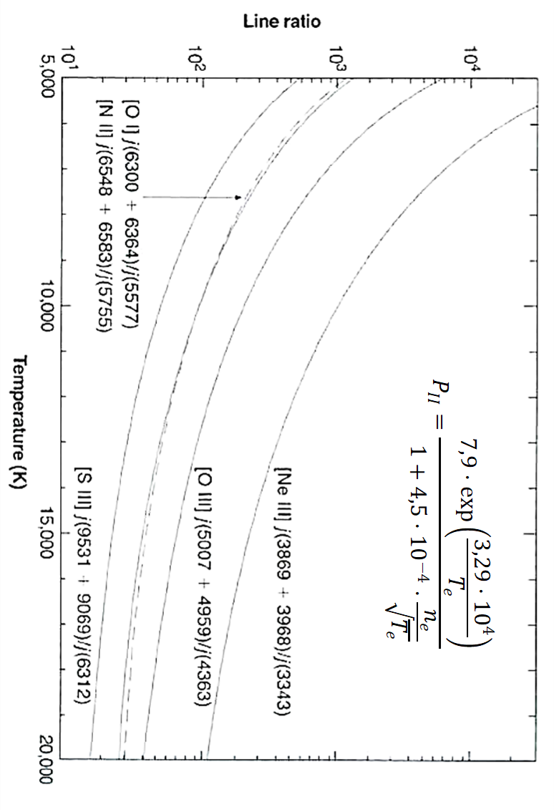

<figcaption>

**Obrázok 7:** Graf závislosti intenzity $P_{\textrm{II}}$ od elektrónovej teploty.
</figcaption>

</figure>

Riešenie

Prvou úlohou je identifikácia jednotlivých spektrálnych čiar v grafe 1, kde riešenie je celkom priame a jednoduché. Riešenie je viditeľné na grafe 8.

Následne pokračujeme na jednotlivé grafy, kde je potrebné určiť konkrétne intenzity pre skúmané spektrálne čiary. Pre jednoduchosť zápisov si definujeme skrátenie jednotky toku, ktorý sa vyskytuje na grafoch. Nech teda 

$$
1\,\mathrm{S} = 10^{-14}\,\mathrm{ergs} \cdot \mathrm{cm}^{-2} \cdot \mathrm{s}^{-1} \cdot \text{\AA}^{-1}  \,. \tag{3}
$$

Následne určíme škálu vertikálnej aj horizontálnej osi, pretože jedna jednotka na grafe nezodpovedá celočíselnému násobku milimetrov na papieri. Táto škála nám následne poslúži na presnejšie odčítavanie hodnôt z grafov.

Ak chceme analyzovať chybu určenia vlnovej dĺžky $\lambda$, tak si musíme povšimnúť, že na grafe je jasne viditeľná diskretizácia hodnôt (meraná vlnová dĺžka môže nadobúdať iba určitých konkrétnych hodnôt). Preto musíme odmerať najlepšie vzdialenosť cez viac bodov diskretizácie a pomocou škály na vodorovnej ose určiť, aký je najmenší dielik $\Delta_\lambda$ posunu vo vlnových dĺžkach. Následne je možné povedať, že smerodajná odchýlka určenia vlnovej dĺžky $\sigma_\lambda$ je jedna polovica najmenšieho dieliku. Je to z dôvodu, že akákoľvek iná chyba pri odčítavaní je rádovo menšia ako táto chyba diskretizácie.

Pre presné určenie maximálnej intenzity, tak ako je popísané v zadaní, je potrebné určiť maximálnu hodnotu, ktorá sa na grafe vyskytuje. To je jednoducho uskutočnené pohľadom a následným odčítaním zo zvislej osi. Taktiež potrebujeme odhad vlnovej dĺžky maxima. Jedna z možných, presných metód, je na niekoľkých miestach urobiť vodorovné rezy skúmanou krivkou a určiť stred toho rezu vkrivke, potom môžeme všetky tieto stredy ”fitnúť” zvislou čiarou, ktorá určuje odhad vlnovej dĺžky maximálnej intenzity. Je to z dôvodu, že predpokladáme osovú symetriu spektrálnej čiary.

Teraz už môžeme za pomoci rovníc (2) určiť hodnotu maximálnej intenzity pre všetky skúmané vlnové dĺžky. Nesmieme ale zabudnúť na odčítanie kontinua, ktoré sme nafitovali vodorovnou čiarou a jeho smerodajnú odchýlku odhadli ako polovicu dielika pravítka, ktorým meriame hodnoty na zvislej osi.

Takto získané hodnoty si následne spíšeme ako 

$$
\begin{align*}
F_{\mathrm{6716}}&=0{,}91 \pm 0{,}01\,\mathrm{S} \,, \tag{4}\\
F_{\mathrm{6731}}&=1{,}76 \pm 0{,}007\,\mathrm{S} \,, \tag{5}\\
F_{\mathrm{4959}}&=32{,}2 \pm 2\,\mathrm{S} \,, \tag{6}\\
F_{\mathrm{5007}}&=100 \pm 3\,\mathrm{S} \,, \tag{7}\\
F_{\mathrm{4363}}&=0{,}85 \pm 0{,}02\,\mathrm{S} \,. \tag{8}\end{align*}
$$

Teraz už môžeme určiť požadované pomery $P_{\mathrm{I}}$ a $P_{\mathrm{II}}$ spolu s ich smerodajnými odchýlkami. Potrebujeme vedieť vzorce pre prenesenú chybu pre jednotlivé pomery $P_{\mathrm{I}}$ a $P_{\mathrm{II}}$ 

$$
\sigma_{P_{\mathrm{I}}}^2 =  \left( \frac{1}{F_{6731}} \right)^2 \cdot \sigma_{F6716}^2 + \left( \frac{F_{6716}}{F_{6731}^2} \right)^2 \cdot \sigma_{F6731}^2 \,, \tag{9}
$$

 

$$
\sigma_{P_{\mathrm{II}}} =  \left( \frac{1}{F_{4363}} \right)^2 \cdot \sigma_{F4959}^2 + \left( \frac{1}{F_{4363}} \right)^2 \cdot \sigma_{F5007}^2 + \left( \frac{F_{4959}+F_{5007}}{F_{4363}^2} \right)^2 \cdot \sigma_{F4363}^2 \,. \tag{10}
$$

Čím získame hodnoty 

$$
\begin{align*}
P_{I}&=0,517 \pm 0,006 \,, \tag{11}\\
P_{II}&=156 \pm 6 \,. \tag{12}\end{align*}
$$

Teraz hodnotu $P_{\mathrm{I}}$ môžeme nájsť na grafe 6, pričom hľadáme hodnotu nie len $P_{\mathrm{I}}$ ale aj $P_{\mathrm{I}}+\sigma_{P_I}$ a $P_{\mathrm{I}}-\sigma_{P_I}$, aby sme zistili smerodajnú odchýlku určenia elektrónovej hustoty $\sigma_{n_e}$. Musíme mať na mysli, že hodnotu elektrónovej hustoty odrátavame z vodorovnej osi, ktorá je logaritmická. Preto je výsledná hodnota 

$$
n_e= 7230^{+1002}_{-879}\,\mathrm{cm}^{-3} \doteq
     7000^{+1000}_{-900}\,\mathrm{cm}^{-3} \,. \tag{13}
$$

 Kde je hlavné si povšimnúť, že smerodajná odchýlka už nie je symetrická, ale je rozdielna pre kladné a záporné hodnoty.

Ako posledným krok je určenie elektrónovej teploty $T_e$ a jej smerodajná odchýlka. K tomuto využijeme neanalyticky riešiteľný vzťah, ktorý je na grafe 7. Ten je potrebné upraviť do tvaru, kde máme $T_e$ osamotené na jednej strane 

$$
T_e = \frac{3,29\cdot 10^4}{\ln \left[ \cfrac{P_{II}}{7,9}\left( 1+4,5\cdot 10^{-4} \cfrac{n_e}{\sqrt{T_e}} \right) \right]} \,. \tag{14}
$$

Keďže je to neanalytický vzťah, je potrebné ho riešiť numericky a najjednoduchšie je riešiť ho iteratívne. Teda skúsime odhadnúť prvotné riešenie a to dosadíme do pravej strany rovnice. Získané nové $T_e$ dosadíme opäť do rovnice a takto opakujeme pokiaľ sa výsledné $T_e$ už nemení. Keď chceme zistiť smerodajnú odchýlku, dosadíme do vzťahu hodnoty $P_{\mathrm{II}}$ a $n_e$ také, ktoré vracajú maximálne/minimálne $T_e$. Takto získaný výsledok je rovný 

$$
T_e= 10\,917^{+100}_{-151}\,\mathrm{K} \,. \tag{15}
$$

<figure>

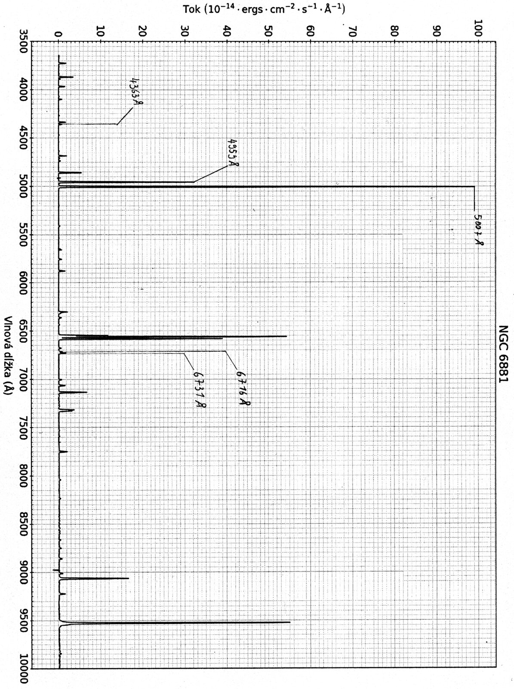

<figcaption>

**Obrázok 8:** Graf celého spektra planetárnej hmloviny NGC 6881\
doplnený o riešenie a poznámky.
</figcaption>

</figure>

<figure>

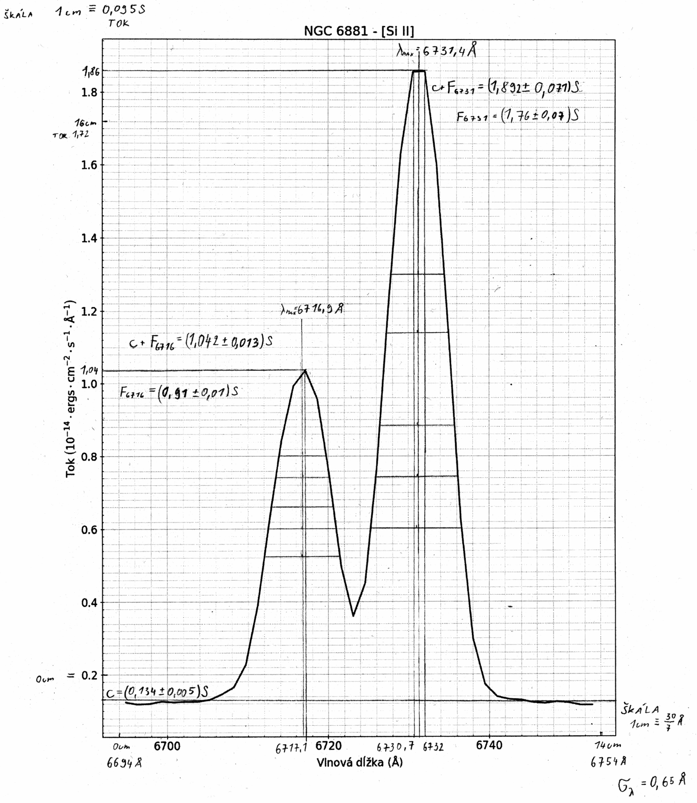

<figcaption>

**Obrázok 9:** Graf spektra okolo vlnových dĺžkok \[Si II\] $6716\,\text{\AA}$ a $6731\,\text{\AA}$ planetárnej hmloviny NGC 6881 doplnený o riešenie a poznámky.
</figcaption>

</figure>

<figure>

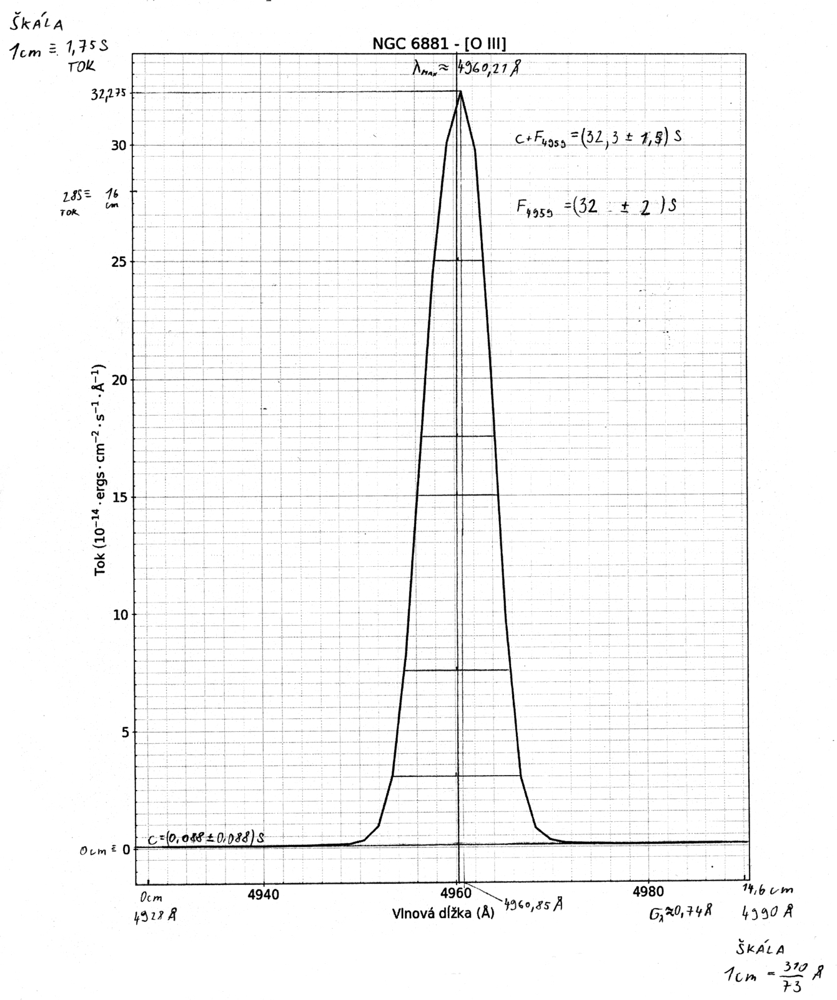

<figcaption>

**Obrázok 10:** Graf spektra okolo vlnovej dĺžky \[O III\] $4959\,\text{\AA}$ planetárnej hmloviny NGC 6881 doplnený o riešenie a poznámky.
</figcaption>

</figure>

<figure>

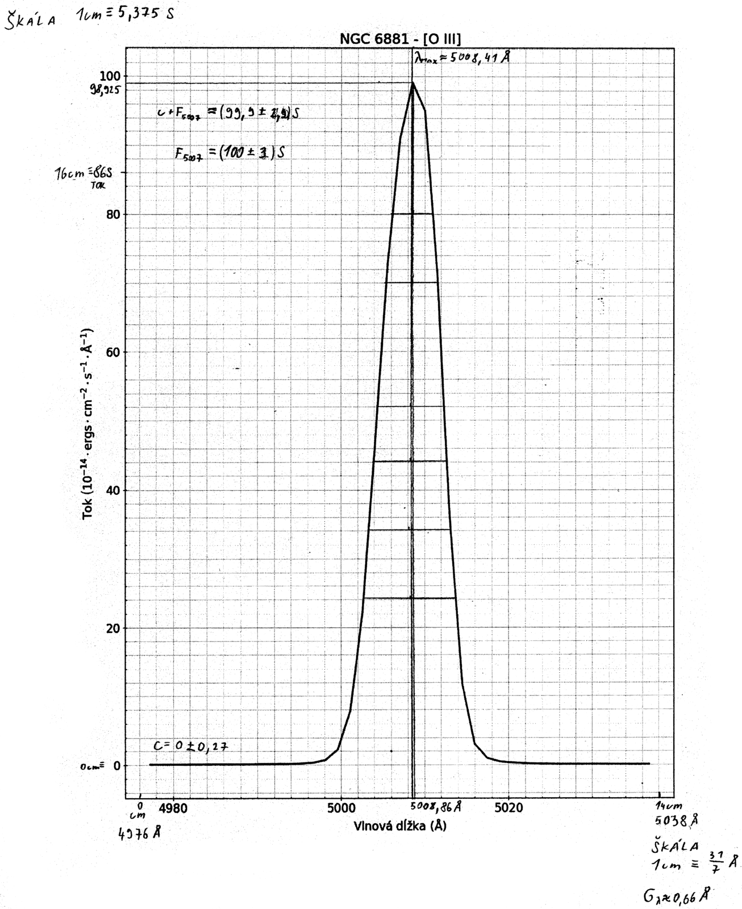

<figcaption>

**Obrázok 11:** Graf spektra okolo vlnovej dĺžky \[O III\] $5007\,\text{\AA}$ planetárnej hmloviny NGC 6881 doplnený o riešenie a poznámky.
</figcaption>

</figure>

<figure>

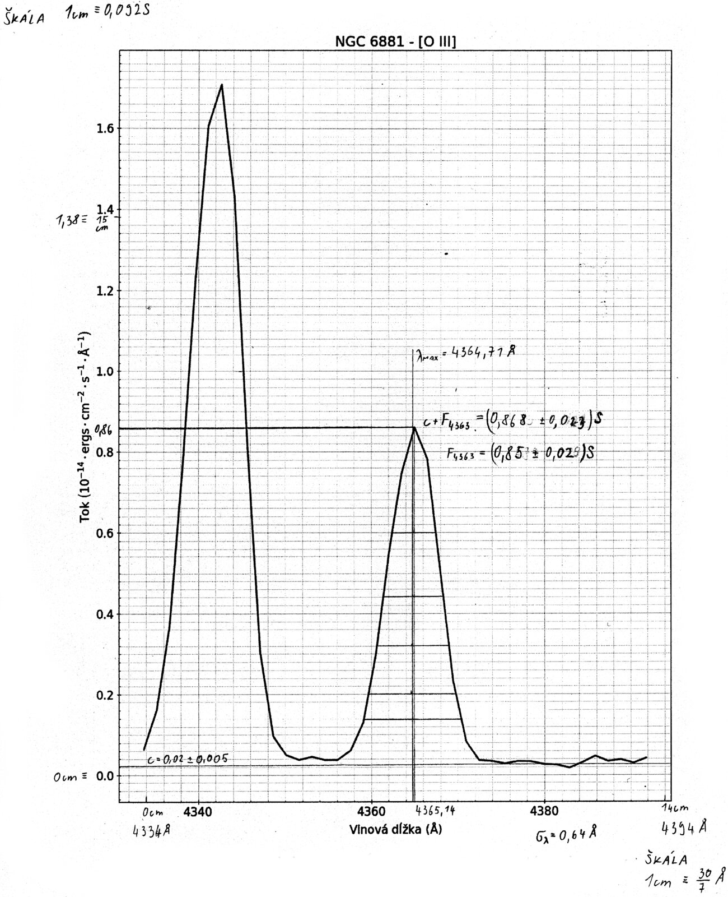

<figcaption>

**Obrázok 12:** Graf spektra okolo vlnovej dĺžky \[O III\] $4363\,\text{\AA}$ planetárnej hmloviny NGC 6881 doplnený o riešenie a poznámky.
</figcaption>

</figure>

<figure>

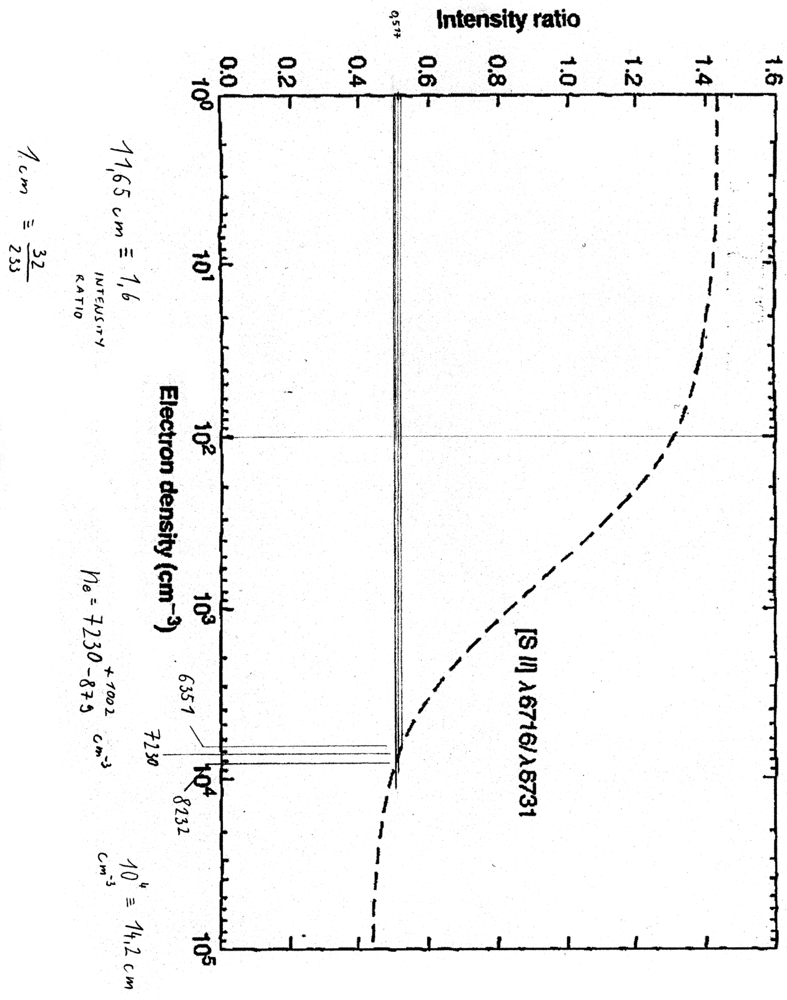

<figcaption>

**Obrázok 13:** Graf závislosti intenzity $P_{\textrm{I}}$ od elektrónovej hustoty doplnený o riešenie a poznámky.
</figcaption>

</figure>

