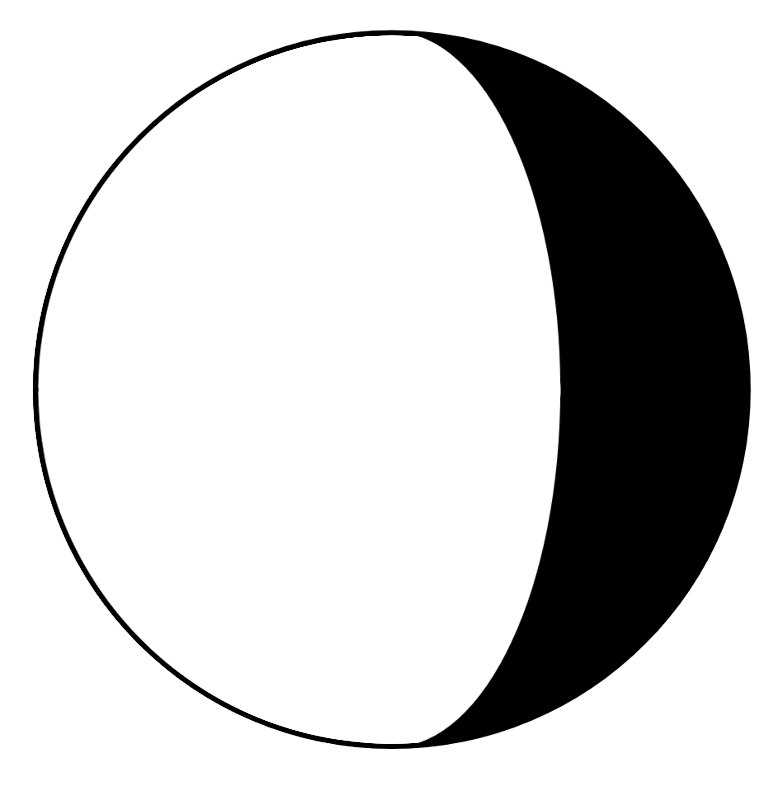
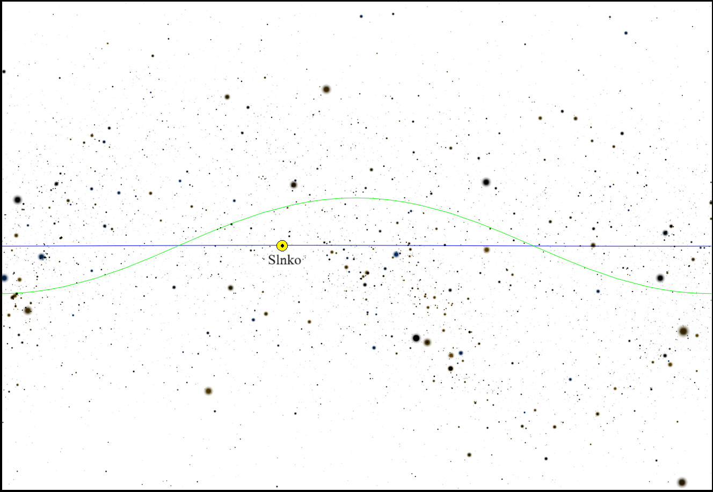
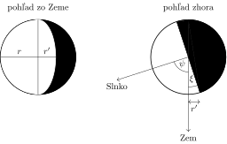
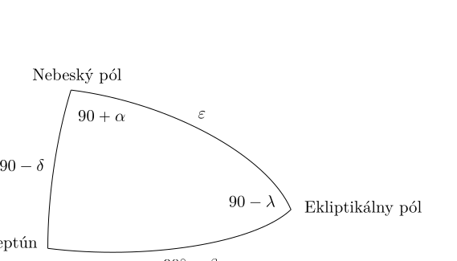
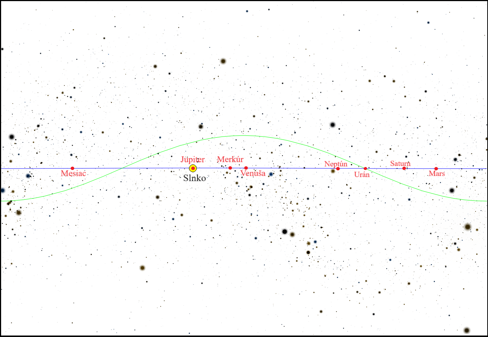

## Zadanie

V tejto úlohe máte k dispozícii mapu celej oblohy v Mercatorovej projekcii, v ktorej sú ekliptikálne súradnice zobrazené ako pravouhlá sieť. Na mape je vyznačená ekliptika, svetový rovník a poloha Slnka. Miestny hviezdny čas je $14\,\mathrm{h}\;30\,\mathrm{min}$. Vašou úlohou je zakresliť polohy planét a Mesiaca do mapy, pričom môžete predpokladať, že sa všetky tieto objekty v danom čase nachádzajú na ekliptike. Využiť môžete nasledujúce informácie.

- **Merkúr** sa nachádza v najideálnejšej možnej polohe na to, aby ho bolo možné pozorovať ráno pred východom Slnka.

- **Venuša** má fázu ako na obrázku 1 (horná časť obrázka smeruje na sever).

- **Mesiac** je v prvej štvrti.

- **Mars** pozorujeme s uhlovým priemerom $17{,}9''$.

- **Jupiter** pozorujeme s uhlovým priemerom $31{,}1''$.

- **Saturn** má ekliptikálnu dĺžku $150^{\circ}$.

- **Urán** má rektascenziu $12^{\mathrm{h}}$.

- **Neptún** sa nachádza najvyššie nad obzorom.

Pre každý jeden objekt aspoň stručne odôvodnite váš postup.

<figure>

<figcaption>

**Obrázok 1:** Schéma fázy Venuše.
</figcaption>

</figure>

<figure>

<figcaption>

**Obrázok 2:** Mapa hviezdnej oblohy. Prevzaté z programu Stellarium.
</figcaption>

</figure>

Riešenie

Modrá čiara na mape je ekliptika a zelená je rovník. Vďaka Mercatorovej projekcii sú ekliptikálne dĺžky zobrazené rovnomerne, čo výrazne zjednoduší zakresľovanie objektov do mapy. Stačí len určiť uhlovú vzdialenosť planét a Mesiaca od Slnka a prepočítať ju do vzdialenosti od Slnka v cm na mape.

<figure>

<figcaption>

**Obrázok 3:** Výpočet polohy Merkúru.
</figcaption>

</figure>

**Merkúr**

Ideálne podmienky na pozorovanie Merkúru sú vtedy, keď je v maximálnej elongácii. Pozorujeme ho ráno pred východom Slnka, je preto na západ od Slnka, teda v maximálnej západnej elongácii. Dráha Merkúru má veľkú excentricitu, aktuálna vzdialenosť Merkúru od Slnka preto výrazne ovplyvňuje, do akej maximálnej uhlovej vzdialenosti od Slnka sa môže dostať pri pohľade zo Zeme. Zaujímajú nás ideálne podmienky, tie nastanú pri najväčšej možnej uhlovej vzdialenosti Merkúru od Slnka. Merkúr vtedy musí byť v aféliu, jeho vzdialenosť od Slnka je 

$$
r_{\rm a} = a_\Me (1+e_\Me)\, . \tag{1}
$$

 Uhlovú vzdialenosť Merkúru od Slnka vypočítame na základe obr. 3 

$$
\sin \Delta \lambda = \frac{r_a}{a_\Ea}=\frac{a_\Me}{a_\Ea}(1+e_\Me)\, . \tag{2}
$$

 Vychádza $\Delta \lambda \approx 28^{\circ}$.

**Venuša**

Z fotky Venuše zistíme jej fázový uhol, z čoho sa následne dá určiť uhlová vzdialenosť Venuše od Slnka. Najskôr odmeriame priemer disku Venuše $2r$ a vzdialenosť $r'$. Polomer Venuše na obrázku je $r=2{,}8\,\mathrm{cm}$ (samozrejme, záleží to na škále, v akej je obrázok vytlačený). Vzdialenosť hranice medzi svetlom a tieňom od stredu disku Venuše je $r'=1{,}3\,\mathrm{cm}$.

Na obrázku 4 je schematický nákres pohľadu na Venuše zo Zeme a zhora. Uhol $\xi$ vypočítame ako 

$$
\sin \xi = \frac{r'}{r}\, . \tag{3}
$$

 Priamka smerujúca k Slnku je kolmá na hranicu svetla a tieňa, preto je súčet uhla $\xi$ a fázového uhla $\psi$ rovný $90^{\circ}$. Pre fázový uhol preto platí 

$$
\cos \psi =  \frac{r'}{r}\, . \tag{4}
$$

 Číselne dostaneme $\psi \approx 62^{\circ}$.

<figure>

<figcaption>

**Obrázok 4:** Výpočet fázového uhla Venuše.
</figcaption>

</figure>

<figure>

<figcaption>

**Obrázok 5:** Výpočet polohy Venuše z jej fázového uhla.
</figcaption>

</figure>

Uhlovú vzdialenosť Venuše a Slnka dostaneme zo sínusovej vety pre trojuholník Slnko-Zem-Venuša, viď obr. 5, 

$$
\begin{align*}
\frac{a_\Ve}{\sin \Delta \lambda} &= \frac{a_\Ea}{\sin \psi}\, , \tag{5}\\
\Delta \lambda &= \arcsin\left({\frac{a_\Ve}{a_\Ea}\sin \psi}\right) \approx 40^{\circ}\, . \tag{6}\end{align*}
$$

 Ako bolo uvedené v zadaní, na obrázku je sever smerom nahor. Tieň sa nachádza na pravej strane, z čoho vyplýva, že Venuša sa nachádza na západ od Slnka.

**Mesiac**

Mesiac je v prvej štvrti, to znamená, že sa nachádza $90^{\circ}$ na východ od Slnka.

**Mars**

V prípade Marsu a Jupitera poznáme iba ich uhlový priemer. Vyskúšame vypočítať ich uhlové priemery vo významných aspektoch, či sa budú zhodovať s uvedenými hodnotami. Skúsime najskôr opozíciu a konjunkciu, v nich majú planéty najväčší a najmenší uhlový priemer. Pre Mars vychádza 

$$
\begin{align*}
\theta_{\Ma, \rm k}&=\frac{2R_\Ma}{a_\Ma+a_\Ea}=1{,}80 \cdot 10^{-5}\,\mathrm{rad}=3{,}7''\, , \tag{7}\\
\theta_{\Ma, \rm o}&=\frac{2R_\Ma}{a_\Ma-a_\Ea}=8{,}66 \cdot 10^{-5}\,\mathrm{rad}=17{,}9''\, . \tag{8}\end{align*}
$$

 Vidíme, že uhlový priemer Marsu v opozícii sa zhoduje s hodnotou uvedenou v zadaní. Mars je teda o $180^{\circ}$ vzdialený od Slnka.

**Jupiter**

Uhlový priemer Jupitera v konjunkcii a opozícii je 

$$
\begin{align*}
\theta_{\Ju, \rm k}&=\frac{2R_\Ju}{a_\Ju+a_\Ea}=1{,}51 \cdot 10^{-4}\,\mathrm{rad}=31{,}1''\, , \tag{9}\\
\theta_{\Ju, \rm o}&=\frac{2R_\Ju}{a_\Ju-a_\Ea}=2{,}22 \cdot 10^{-4}\,\mathrm{rad}=45{,}8''\, . \tag{10}\end{align*}
$$

 Hodnota v zadaní sa zhoduje s uhlovým priemerom Jupitera v konjunkcii, na mape bude preto Jupiter na rovnakom mieste ako Slnko.

**Saturn**

Saturn má ekliptikálnu dĺžku $150^{\circ}$, stačí teda na mape odmerať vzdialenosť zodpovedajúcu $150^{\circ}$. Ekliptikálna dĺžka sa meria od jarného bodu smerom na východ. Vzdialenosť od jarného bodu po okraj mapy nie je dostačujúca, Saturn sa preto bude nachádzať pri jej pravom okraji.

**Urán**

Urán má rektascenziu$12^{\mathrm{h}}$, čo znamená, že sa nachádza v jesennom bode. Ten je v súhvezdí Panny, v mieste, kde sa pretína ekliptika s rovníkom.

**Neptún**

Zo zadania vyplýva, že Neptún práve kulminuje, nachádza sa na meridiáne. Polohu meridiánu vieme buď odhadnúť (menej presné) alebo vypočítať zo sférických vzorcov. Hodinový uhol objektov na meridiáne je$0^{\mathrm{h}}$, preto je ich rektascenzia rovná hviezdnemu času, teda $\alpha=14^{\mathrm{h}}\,30^{\mathrm{min}} = 217{,}5^{\circ}$. Rektascenzia sa síce nerovná ekliptikálnej dĺžke, ale môžeme ju aspoň použiť ako odhad, a Neptún zakresliť na ekliptikálnej dĺžke $\lambda=217{,}5^{\circ}$. Obidve veličiny by mali mať podobné hodnoty. Na získanie presnej hodnoty $\lambda$ je potrebné použiť vzorce zo sférickej trigonometrie.

<figure>

<figcaption>

**Obrázok 6:** Sférický trojuholník na prevod rovníkových a ekliptikálnych súradníc.
</figcaption>

</figure>

Na obrázku 6 je sférický trojuholník, ktorý použijeme na prepočet medzi ekliptikálnymi a rovníkovými súradnicami. V zadaní je predpoklad, že sa všetky planéty nachádzajú presne na ekliptike, teda ich ekliptikálna šírka je $\beta = 0^{\circ}$. Poznáme $\beta$ a $\alpha$ aj sklon ekliptiky $\varepsilon$, využijeme preto kosínusovú vetu 

$$
\sin \beta = \sin \delta \cos \varepsilon + \cos \delta \sin \varepsilon \cos (90^{\circ}+\alpha)\, , \tag{11}
$$

 ktorú s využitím $\sin \beta = 0$ ešte môžeme upraviť na 

$$
\tan \delta = \tan \varepsilon \cos (90^{\circ}+\alpha)\,. \tag{12}
$$

 Vďaka vlastnostiam funkcií sínus a kosínus sa tento výraz dá ešte ďalej zjednodušiť 

$$
\begin{align*}
\cos (90^{\circ}+\alpha) &= -\cos (90^{\circ}-\alpha) = - \sin \alpha\, , \tag{13}\\
\tan \delta &= \tan \varepsilon \sin \alpha\,. \tag{14}\end{align*}
$$

Deklinácia Neptúna je $\delta = -15^{\circ}$. Ekliptikálnu dĺžku vypočítame zo sínusovej vety (na úpravy sme opäť využili vlastnosti sínusu a kosínusu) 

$$
\cos \lambda = \frac{\cos \delta}{\cos \beta}\cos \alpha\, . \tag{15}
$$

 Funkcia $\arccos$ nám na kalkulačke dá $\lambda' = 140^{\circ}$, čo ešte nie je správny výsledok, ten by mal mať hodnotu blízku rektascenzii. Opäť využijeme vlastnosti kosínusu $\cos x = \cos (360^{\circ} - x )$ a dostaneme $\lambda = 220^{\circ}$. Vidíme, že od rektascenzie sa líši iba o $2{,}5^{\circ}$, takže $\lambda=\alpha$ by bola celkom dobrá aproximácia. Pri zakresľovaní do mapy by totiž rozdiel v týchto dvoch polohách bol minimálny.

Všetky planéty a Mesiac sú zakreslené v mape 7 na ďalšej strane.

<figure>

<figcaption>

**Obrázok 7:** Mapa so zakreslenými planétami a Mesiacom. Prevzaté z programu Stellarium.
</figcaption>

</figure>

