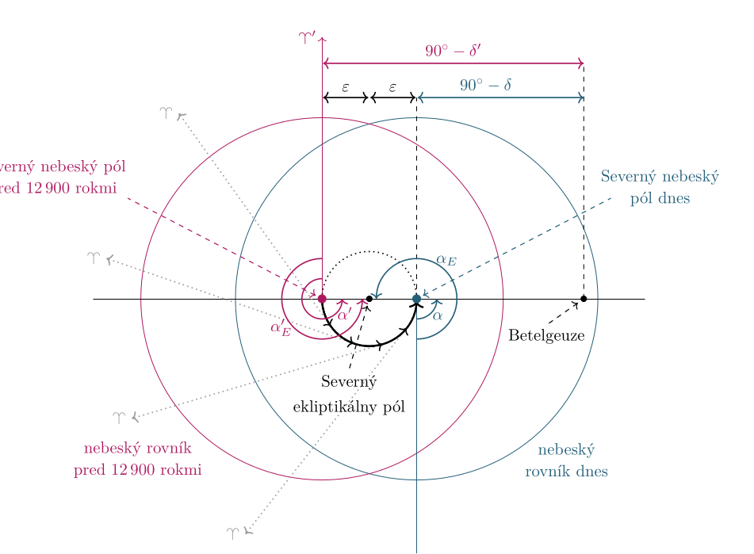

## Zadanie

Zem obieha okolo Slnka v rovine, ktorú voláme rovina ekliptiky. Rotačná os Zeme je voči kolmému smeru na rovinu ekliptiky vychýlená o $\varepsilon = 23{,}5^{\circ}$. Inými slovami, ekliptikálny a nebeský pól sú na nebeskej sfére vzdialené o uhol $\varepsilon$. Severná pologuľa Zeme je najviac priklonená ku Slnku počas letného slnovratu, a najviac odklonená počas zimného slnovratu.

Zemská rotačná os aktuálne mieri do súhvezdia Malý medveď, blízko hviezdy Polárka. Avšak, precesný pohyb rotačnej osi spôsobuje, že krúži okolo kolmého smeru na rovinu ekliptiky, pričom si približne zachováva vychýlenie o $\varepsilon$. Periódu precesie Zeme voláme platónsky rok, ktorý trvá $25\,800\,\mathrm{rokov}$. Rovnaký pohyb ako Zem vykonáva rýchlo roztočený vĺčik (peonza), ktorého rotačná os je mierne sklonená a pomaly sa nakláňa do rôznych smerov.

**Úlohy:**

<ol type="a">

<li>

Aká bola rektascenzia ekliptikálneho pólu $\alpha_{\mathrm{E}}'$ pred $12\,900$ rokmi? Jarný bod je vždy definovaný ako priesečník nebeského rovníka a ekliptiky, v ktorom sa Slnko nachádza počas jarnej rovnodennosti. Všimnite si, že $12\,900$ rokov je polovica platónskeho roka.

</li>

<li>

Hviezda Betelgeuze má dnes súradnice $\alpha = 6^{\mathrm{h}}, \, \delta = 7^{\circ}$. Aké boli jej súradnice $\alpha', \delta'$ pred $12\,900$ rokmi? Zanedbajte vlastný pohyb hviezdy a nutáciu.

</li>

<li>

Bola Betelgeuze pred $12\,900$ rokmi pozorovateľná zo Slovenska ako cirkumpolárna, zapadajúca, alebo nevychádzajúca hviezda? Uvažujte zemepisnú šírku $\varphi = 49^{\circ}$.

</li>

</ol>

Riešenie

Pri precesnom pohybe vykonáva nebeský pól kruhový pohyb okolo ekliptikálneho, čo je zobrazené na obrázku 1. Dôležité je uvedomiť si, že sa pohybuje celý ekvatoriálny súradnicový systém voči statickému ekliptikálnemu. To znamená, že sa posúva poloha jarného bodu $\Aries$ pozdĺž ekliptiky. Preto znamenia horoskopu nesedia s polohou Slnka medzi hviezdami. Astrológovia ich definovali v čase, kedy bolo všetko posunuté o približne mesiac v porovnaní so súčasnosťou.

Keďže v tejto úlohe vyšetrujeme situáciu pred $12\,900$ rokmi, čo je polovica platónskeho roka, tak nám bude stačiť rovinná geometria. Severný nebeský pól bol pred $12\,900$ romi na opačnej strane voči ekliptikálnemu pólu ako je dnes. Stále však v uhlovej vzdialenosti $\varepsilon$. Zároveň, jarný bod bol presne oproti jeho dnešnej polohe. Postupné posúvanie jarného bodu je zobrazené na obrázku 1 sivými prerušovanými čiarami.

<figure>

<figcaption>

**Obrázok 1:** Schéma precesie nebeského pólu okolo ekliptikálneho pólu.\
Ružovou je zobrazená situácia pred $12\,900$ rokmi a modrou situácia dnes.
</figcaption>

</figure>

<ol type="a">

<li>

Ako prvé určme rektascenziu severného ekliptikálneho pólu $\alpha_\textrm{E}$ v súčasnosti. V deň letného slnovratu je rotačná os Zeme priklonená k Slnku. Kolmica na rovinu ekliptiky, ktorá mieri do severného ekliptikálneho pólu, je voči rotačnej osi na opačnej strane ako Slnko. To znamená, že rektascenzia severného ekliptikálneho pólu je o $12^{\mathrm{h}}$ väčšia ako rektascenzia Slnka počas letného Slnovratu.

Rektascenzia je uhlová vzdialenosť meraná od jarného bodu pozdĺž nebeského rovníka v smere ročného pohybu Slnka. To sa v jarnom bode nachádza počas jarnej rovnodennosti, čo je štvrťroka pred letným slnovratom, teda posun rektascenzie na $6^{\mathrm{h}}$. Potom $\alpha_E = 18^{\mathrm{h}}$.

Avšak, rektascenzia severného ekliptikálneho pólu sa počas precesného pohybu nemení. To je preto, lebo jarný bod, od ktorého rektascenziu meriame, sa posúva spolu s ekvatoriálnou súradnicovou sústavou, na ktorú je ”pripevnená” rotačná os Zeme. Jarný bod totižto stále definujeme rovnako, ako priesečník nebeského rovníka a ekliptiky, a tento priesečník je ”ťahaný” medzi hviezdami pri precesnom pohybe.

Preto $\alpha_\mathrm{E}' = \alpha_\mathrm{E} = 18^{\mathrm{h}}$.

</li>

<li>

Z obrázku 1 vidíme, že ak je dnes rektascenzia Betelgeuze $\alpha = 6^{\mathrm{h}}$ (modrý uhol), tak po prerotovaní severného nebeského pólu a jarného bodu na opačnú stranu bude jej rektascenzia $\alpha' = 18^{\mathrm{h}}$ (ružový uhol).

Deklináciu $\delta'$ určíme takisto na základe obrázku 1. Vidíme, že platí 

$$
90^{\circ} - \delta' = \varepsilon + \varepsilon + (90^{\circ} - \delta) \,. \tag{1}
$$

 Vyjadrením a dosadením dostávame 

$$
\delta' = \delta - 2\varepsilon = 7^{\circ} - 2\cdot 23{,}5^{\circ} = -40^{\circ} \,. \tag{2}
$$

</li>

<li>

Z deklinácie je zrejmé, že hviezda Betelgeuze sa pred $12\,900$ rokmi nachádzala na južnej oblohe. Na Slovensku dokážeme pozorovať hviezdy južnej oblohy, keďže nebeský rovníky vychádza $90^{\circ} - \varphi = 41^{\circ}$ nad obzor. To znamená, že Betelgeuze bola stále tesne pozorovateľná, kulminovala vo výške $1^{\circ}$. Nazvali by sme ju teda zapadajúcou.

***Poznámka:*** V skutočnosti ročný pohyb a nutácia spôsobili, že Betelgeuze nebola pozorovateľná z geografickej šírky $49^{\circ}$ pred $12\,900$ rokmi. Aj po zarátaní atmosférickej refrakcie, sa dostala najvyššie $7'$ pod horizont. Z vyvýšeného miesta by ste ju však uvideli.

</li>

</ol>

