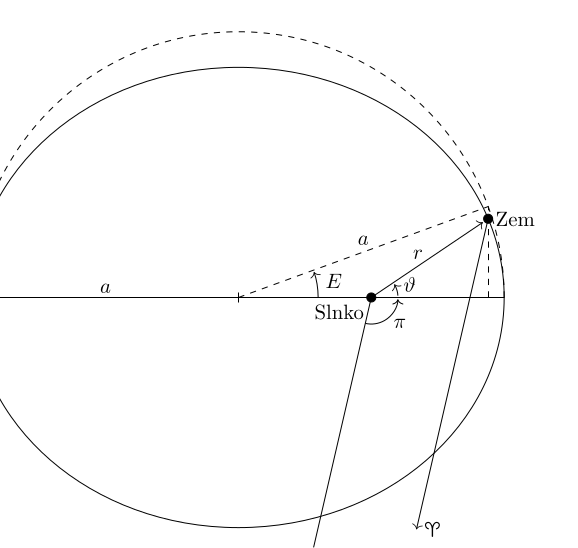
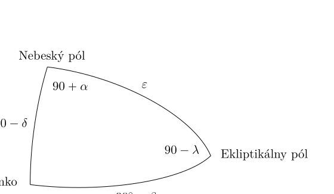

## Zadanie

Počas roka dochádza na Zemi k striedaniu ročných období. Dôvodom je naklonenie roviny zemského rovníka o uhol $\varepsilon = 23{,}4^{\circ}$ voči rovine ekliptiky. Zem zároveň obieha okolo Slnka po eliptickej dráhe, to znamená, že raz je k Slnku, bližšie inokedy ďalej. To spôsobuje, že na dané miesto na Zemi dopadá v rôzne dni rôzne množstvo žiarivej energie zo Slnka. Vypočítajte pomer žiarivých energií zo Slnka, ktoré dopadnú na celú plochu Liptovskej Mary za $1\,\mathrm{s}$ na pravé poludnie celoštátneho kola AO (2. 5. 2024) a na poludnie pri zverejnení úloh domáceho kola AO (15. 1. 2024). Poloha Liptovskej Mary je $49{,}1^{\circ}$ N, $19{,}5^{\circ}$ E a plocha $A$ = $27\,{\mathrm{km}}^{2}$.

Zem obieha okolo Slnka po eliptickej dráhe s excentricitou $e = 0{,}0167$. Prechod perihéliom tento rok nastáva 3. 1. 2024 a prechod aféliom 5. 7. 2024. Pre prípadné medzivýpočty môžete využiť slnečnú konštantu, ktorej hodnota je uvedená v zozname konštánt. Slnečná konštanta predstavuje množstvo energie, ktoré prejde za $1\,\mathrm{s}$ plochou $1\,{\mathrm{m}}^{2}$ orientovanou kolmo na slnečné lúče vo vzdialenosti $1\,\mathrm{au}$ od Slnka bez extinkcie (absorpcie). Pri výpočte zanedbajte vplyv atmosféry. Počas jedného dňa považujte deklináciu Slnka za konštantnú.

Budete potrebovať rovnicu elipsy v polárnych súradniciach, teda vzťah medzi vzdialenosťou od ohniska $r$ a pravou anomáliou $\vartheta$ 

$$
r = \frac{p}{1+e\cos\vartheta} \,,\quad \text{kde}\; p = a(1-e^2) \,. \tag{1}
$$

 Dĺžka perihélia je $\pi = 103^{\circ}$. Význam $\vartheta$ a $\pi$ je zrejmý z obrázka 1. Takisto sa vám budú hodiť vzťahy z regionálneho kola AO 

$$
r = a (1 - e \cos{E}) \a M = E - e \sin{E} \a M = n (t - T) \a n=\frac{2\pi}{P} \,. \tag{2}
$$

<figure>

<figcaption>

**Obrázok 1:** Schéma elementov dráhy Zeme.
</figcaption>

</figure>

Riešenie

Pre pomer slnečných energií využijeme rovnicu z regionálneho kola 

$$
\frac{\mathcal{E}_{\mathrm{CK}}}{\mathcal{E}_{\mathrm{DK}}} = \frac{A t}{A t} \frac{\sin{(90^{\circ} - \varphi + \delta_{\Sun(\mathrm{CK})})}}{\sin{(90^{\circ}} - \varphi + \delta_{\Sun(\mathrm{DK})})} \cdot \frac{\cfrac{L_\Sun}{4 \pi r_\mathrm{CK}^2}}{\cfrac{L_\Sun}{4 \pi r_\mathrm{DK}^2}} \,, \tag{3}
$$

 pričom po skrátení a úprave dostaneme rovnicu 

$$
\frac{\mathcal{E}_{\textrm{CK}}}{\mathcal{E}_{\textrm{DK}}} = \frac{\sin{(90^{\circ} - \varphi + \delta_{\Sun(CK)})}}{\sin{(90^{\circ}} - \varphi + \delta_{\Sun(DK)})} \cdot \frac{r^2_{DK}}{r^2_{CK}} \,. \tag{4}
$$

**Excentrická anomália**

Vypočítame si stredný denný pohyb $n = 2\pi/365{,}2596\,\mathrm{dňa} = 0{,}017201971\,\mathrm{rad}/\mathrm{deň} \,,$ kde sme použili ako periódu anomalistický rok. Vypočítame si čas od prechodu perihéliom pre domáce kolo (DK) a celoštátne kolo (CK) 

$$
\begin{align*}
    \Delta t(CK) &= 120\,\mathrm{dní} \,, \tag{5}\\
    \Delta t(DK) &= 12\,\mathrm{dní} \,. \tag{6}\end{align*}
$$

 Podľa zadaného vzťahu určíme stredné anomálie 

$$
\begin{align*}
    M_{\mathrm{CK}} &= 118{,}2722048^{\circ} = 2{,}064239387\,\mathrm{rad} \,, \tag{7}\\
    M_{\mathrm{DK}} &= 11{,}8272048^{\circ} = 0{,}2064239387\,\mathrm{rad} \,. \tag{8}\end{align*}
$$

Pomocou Keplerovej rovnice upravenej do tvaru 

$$
E_\mathrm{n} = M + e \sin \left(E_\mathrm{n-1} \right) \,, \tag{9}
$$

 ktorý je vhodný pre iteráciu (ako prvý odhad zvolíme $E_0 = M$), určíme excentrické anomálie 

$$
\begin{align*}
    E_{\mathrm{CK}} &= 2{,}078830221\,\mathrm{rad} = 119{,}108198^{\circ} \,, \tag{10}\\
    E_{\mathrm{DK}} &= 0{,}2099036452\,\mathrm{rad} = 12{,}02659298^{\circ} \,. \tag{11}\end{align*}
$$

**Vzdialenosť a deklinácia**

Pomocou excentrickej anomálie $E$ určíme pravú anomáliu $\vartheta$ a z nej vzdialenosť $r$. Využitím polárnej rovnice elipsy dostávame 

$$
\frac{a(1-e^2)}{1+e\cos\vartheta} = a (1 - e \cos{E}) \,, \tag{12}
$$

 odkiaľ si vyjadríme $\vartheta$ ako 

$$
\vartheta = \arccos{\left(\frac{\cos{E}-e}{1-e\cos{E}}\right)} \,. \tag{13}
$$

 Podľa odvodeného vzťahu vypočítame obe pravé anomálie 

$$
\begin{align*}
    \vartheta_{\mathrm{CK}} &= 2{,}093362781\,\mathrm{rad} = 119{,}9408523^{\circ} \,, \tag{14}\\
    \vartheta_{\mathrm{DK}} &= 0{,}2134122466\,\mathrm{rad} = 12{,}22762103^{\circ} \,. \tag{15}\end{align*}
$$

 Z pravých anomálií vypočítame vzdialenosti od Slnka 

$$
\begin{align*}
    r_{\mathrm{CK}} &= 1{,}008123889\,\mathrm{au} \,, \tag{16}\\
    r_{\mathrm{DK}} &= 0{,}9836665484\,\mathrm{au} \,. \tag{17}\end{align*}
$$

**Deklinácia**

Deklináciu určíme transformáciou ekliptikálnych súradníc, pričom ekliptikálna šírka je $\beta = 0^{\circ}$ a ekliptikálnu dĺžku $\lambda$ určíme podľa už zisteniej pravej anomálie $\vartheta$.

Z obrázku 1 (v zadaní) odvodíme vzťah medzi ekliptikálnou dĺžkou a pravou anomáliou $\lambda = 180^{\circ} + \pi + \vartheta$. Dostávame ekliptikálne dĺžky Slnka 

$$
\begin{align*}
    \lambda_{\mathrm{CK}} &= 402{,}9408523^{\circ} \equiv 42{,}94085233^{\circ} \,, \tag{18}\\
    \lambda_{\mathrm{DK}} &= 295{,}22762103^{\circ} \,. \tag{19}\end{align*}
$$

Na prevod ekliptikálnych súradníc na rovníkové využijeme sférický trojuholník podobný nautickému. Zobrazený je na obrázku 2.

<figure>

<figcaption>

**Obrázok 2:** Sférický trojuholník na prevod rovníkových a ekliptikálnych súradníc.
</figcaption>

</figure>

Platia v ňom sférické vzťahy 

$$
\begin{align*}
    \frac{\sin{a}}{\sin{\alpha}} &= \frac{\sin{b}}{\sin{\beta}}  \,, \tag{20}\\
    \cos{a} &= \cos{b}\,\cos{c} + \sin{b\,}\sin{c}\,\cos{\alpha}   \,, \tag{21}\end{align*}
$$

 z čoho po dosadení dostaneme 

$$
\begin{align*}
    \cos{\delta} \, \cos{\alpha} &= \cos{\beta} \, \cos{\lambda}   \,, \tag{22}\\
    \sin{\delta} &= \sin{\beta}\,\cos{\varepsilon}+\cos{\beta}\,\sin{\varepsilon}\,\sin{\lambda}   \,, \tag{23}\end{align*}
$$

 keďže v oboch prípadoch platí $\beta = 0^{\circ}$, vzťahy sa upravia do tvaru 

$$
\begin{align*}
    \cos{\delta}\, \cos{\alpha} &= \cos{\lambda}    \,, \tag{24}\\
    \sin{\delta} &= \sin{\varepsilon}\,\sin{\lambda}   \,. \tag{25}\end{align*}
$$

 Keďže nás zaujíma iba deklinácia, tak pre ňu dostaneme vzťah 

$$
\delta = \arcsin{\left(\sin{\varepsilon}\,\sin{\lambda}\right)} \,. \tag{26}
$$

 Z odvodeného vzťahu vypočítame deklináciu Slnka v príslušné dni 

$$
\begin{align*}
    \delta_{CK} &= 15{,}69724895^{\circ} \,, \tag{27}\\
    \delta_{DK} &= -21{,}05528476^{\circ} \,. \tag{28}\end{align*}
$$

**Záver**

Medzivýsledky, ktoré sme dostali, dosadíme do vzťahu (4) 

$$
\frac{\mathcal{E}_{\mathrm{CK}}}{\mathcal{E}_{\mathrm{DK}}} = \frac{\sin{\left(90^{\circ} - \varphi + \delta_\mathrm{CK}\right)}}{\sin{(90^{\circ}} -\varphi + \delta_\mathrm{DK})}\cdot \frac{r_\mathrm{DK}^2}{r_\mathrm{CK}^2} = 2,341302272 \doteq 2,34\,. \tag{29}
$$

