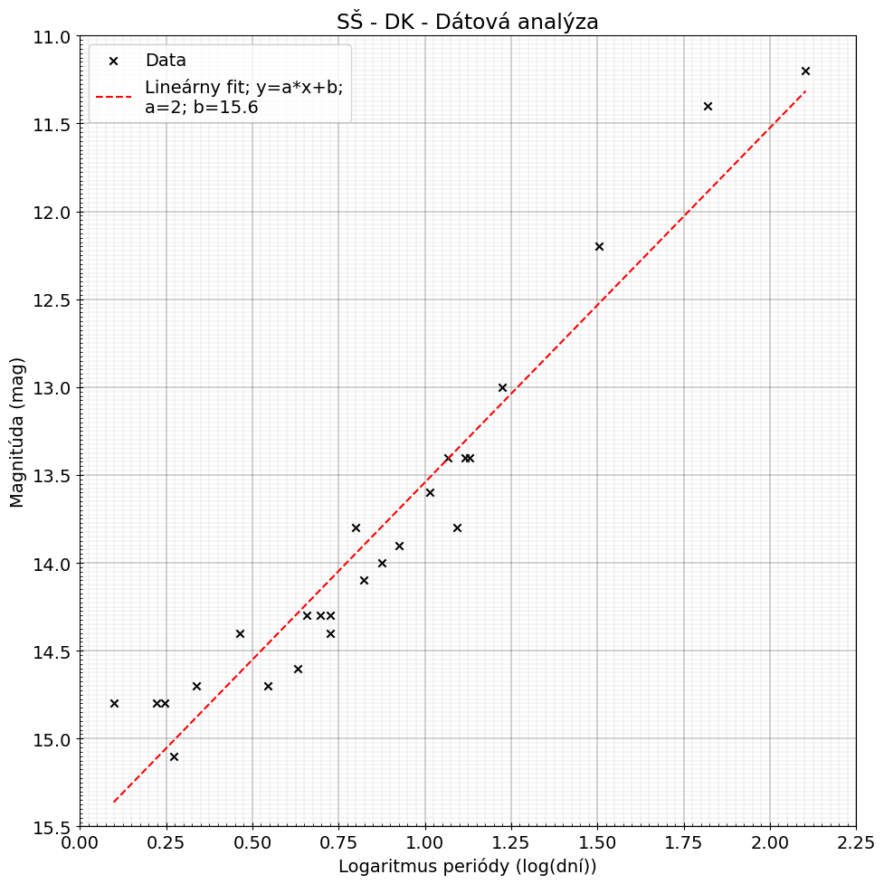
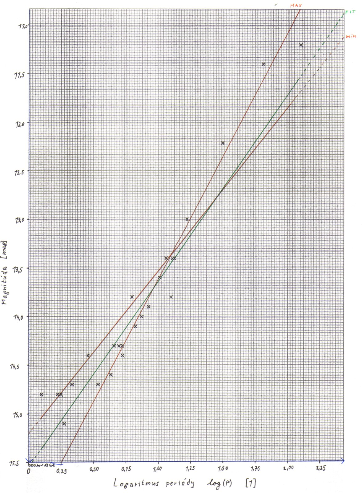
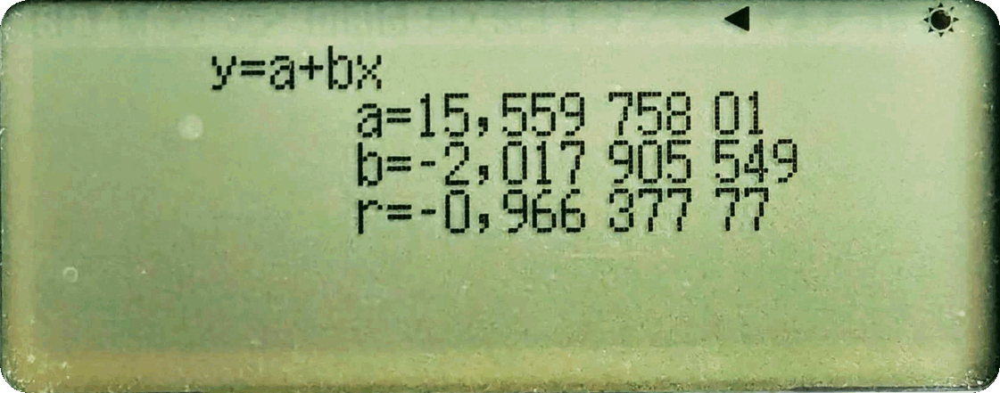
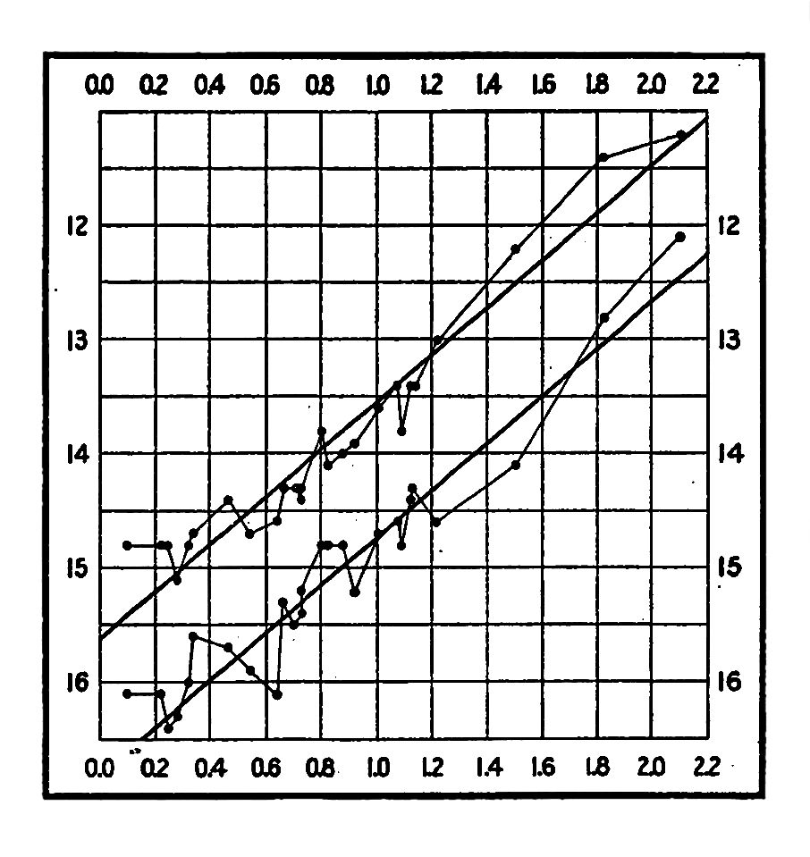

## Zadanie

V roku 1912 došlo k veľkému objavu v astronómii. Henrietta Swan Leavittová (1868 – 1921), ktorá v tej dobe pracovala ako „počítač“ a astronómka na Harvardovej univerzite, našla závislosť medzi jasnosťou a periódou oscilácie jasnosti jednej skupiny premenných hviezd, ktoré dnes nazývame cefeidy.

**Tabuľka 1:** Merania magnitúdy $m$ a periódy $P$ vybraných hviezd typu cefeida.

| Index | Harvardské číslo | $m$ (mag) | $P$ (dni) |
|:-----:|:----------------:|:---------------:|:---------------:|
|   1   |       1505       |      14,8       |     1,25336     |
|   2   |       1436       |      14,8       |     1,66370     |
|   3   |       1446       |      14,8       |     1,76200     |
|   4   |       1506       |      15,1       |     1,87505     |
|   5   |       1413       |      14,7       |     2,17352     |
|   6   |       1460       |      14,4       |     2,91300     |
|   7   |       1422       |      14,7       |     3,50100     |
|   8   |       842        |      14,3       |     4,28970     |
|   9   |       1425       |      14,3       |     4,54700     |
|  10   |       1742       |      14,3       |     4,98660     |
|  11   |       1646       |      14,4       |     5,31100     |
|  12   |       1649       |      14,3       |     5,32300     |
|  13   |       1492       |      13,8       |     6,29260     |
|  14   |       1400       |      14,1       |     6,65000     |
|  15   |       1355       |      14,0       |     7,48300     |
|  16   |       1374       |      13,9       |     8,39700     |
|  17   |       818        |      13,6       |    10,33600     |
|  18   |       1610       |      13,4       |    11,64500     |
|  19   |       1365       |      13,8       |    12,41700     |
|  20   |       1351       |      13,4       |    13,08000     |
|  21   |       827        |      13,4       |    13,47000     |
|  22   |       822        |      13,0       |    16,75000     |
|  23   |       823        |      12,2       |    31,94000     |
|  24   |       824        |      11,4       |    65,80000     |
|  25   |       821        |      11,2       |    127,00000    |

Uvedomila si, že ak do grafu vynesie na vodorovnú os logaritmus periódy oscilácie $P$ a na zvislú os magnitúdu $m$, tak sa všetky body budú nachádzať približne na priamke. Inými slovami, existuje lineárna závislosť medzi $\log(P)$ a $m$, ktorú dnes voláme *vzťah perióda-svietivosť* (v angličtine *Leavitt law*). Vašou úlohou je zreprodukovať Leavittovej postup a nájsť hodnotu konštánt $A$, $B$ vo funkcii 

$$
m = A\log(P) + B\, . \tag{1}
$$

 Všetky potrebné hodnoty sa nachádzajú v tabuľke 1. Keďže sa pozorované hviezdy nachádzajú v rovnakej hviezdokope, je možné predpokladať, že ich vzdialenosť od nás je rovnaká.

Úlohu riešte iba pomocou ručného vynášania bodov do grafu na milimetrový papier a neprogramovateľnej kalkulačky. Pod riešením sa rozumie ručné nakreslenie grafu na milimetrový papier aj s trendovou spojnicou (popísanou v tomto prípade funkciou 1), ktorá sa určuje priamo z bodov na papieri, tak ako je to zvykom na medzinárodnom kole.

Ak ste doteraz nemali skúsenosť s dátovou analýzou a neviete kde začať, tak sa pozrite na stránku [www.datova-analyza.aosk.eu](https://www.datova-analyza.aosk.eu).

Riešenie

Keďže sa jedná o úlohu z dátovej analýzy, tak spísať jeden konkrétny návod je kontraproduktívne, pretože správne riešenie je výberom správnych postupov a metód, ktoré sa používajú pre dosiahnutie čo najpresnejšieho výsledku.

Ako prvé sa môžeme pozrieť na to ako vyzerá graf 1 keď si ho necháme nakresliť v počítači aj s lineárnym fitom. Nás ale zaujíma ako to prenesieme na milimetrový papier, čo je zobrazené na grafe 2. Zaujímavé je si povšimnúť, že osa $y$ je obrátená. Nie je to požadované, ale je to typické pri práci s magnitúdami, pretože menšia magnitúda znamená jasnejší objekt.

<figure>

<figcaption>

**Obrázok 1:** Počítačom vygenerovaný graf.
</figcaption>

</figure>

<figure>

<figcaption>

**Obrázok 2:** Ručne vynesený graf na milimetrový papier.
</figcaption>

</figure>

**Dobrá prax pre vynášanie osí, popisov a bodov do grafu**

- Snaha využiť čo najväčšiu plochu milimetrového papiera na graf.

- Hlavné osi zvýrazniť, minimálne je potrebné označiť šípkou smer rastúcich hodnôt.

- Vyznačiť stupnicu na osi. Dôležité je nemať zbytočne veľa ani príliš málo hodnôt stupnice. Ideálne je okolo 10.

- Je potrebné napísať aká veličina a jednotka sa vynáša na osi.

- Body je najlepšie urobiť ako \[iks\] alebo krížik.

- Použitá ceruzka (preferovane), pero alebo fixka musí mať čo najtenší hrot.

- Trendovú spojnica (fit) vynášam zásadne za pomoci pravítka.

**Vyčítanie hodnôt $A$ a $B$ z nakreslenej lineárnej závislosti**

Najjednoduchšie je na nej nájsť dvojicu miest $[x_1; y_1]$ a $[x_2; y_2]$. Ideálne tak, aby jeden bod bol na začiatku a druhý na konci priamky. Potom vieme vypočítať $A$ a $B$ z hodnôt $x_1$, $y_1$, $x_2$, $y_2$. Ku konkrétnej rovnici dôjdeme keď si napíšeme zadaný vzťah (1) pre obe dvojice. 

$$
y_1 = A x_1 + B \a y_2 = A x_2 + B\, . \tag{2}
$$

 Následne odčítanie $y_1$ od $y_2$ vráti vzťah 

$$
y_1 - y_2 = A (x_1 - x_2) \,. \tag{3}
$$

 Ktorý je ľahko upraviteľný na tvar 

$$
A = \frac{y_1 - y_2}{x_1 - x_2} \, . \tag{4}
$$

 Z ktorého po spätnom dosadení do vzťahu (2) získam 

$$
B = y_1 - \frac{y_1 - y_2}{x_1 - x_2}x_1 \, . \tag{5}
$$

V grafe 2 sú vyznačené tri fity. Jeden zelený, označený ako **fit**, a dvojica červených označených ako **min** a **MAX**. To je z dôvodu, že k určeniu konštánt $A$ a $B$ môžme pristúpiť tak, že narysujeme fit, ktorý čo najlepšie vystihuje dáta, ale nemáme potom informáciu o neistote určených konštánt. Preto druhým prístupom je narysovať dvojicu kriviek, kde jedna vystihuje dáta tak, že je to maximálne prípustné natočenie a posunutie, a druhá to minimálne (metóda min-MAX). Metóda min-MAX môže byť o niečo menej presná, ale na druhú stranu nám poskytuje veľmi dôležitú informáciu o chybách konštánt $A$ a $B$ (smerodajné odchýlky).

Keď použijeme vzťahy (4) a (5) na krivky **fit**, **min** a **MAX** z grafu 2, dostaneme výsledky v tabuľke 2.

**Tabuľka 2:** Určenie konštánt $A$ a $B$ z fitov na grafe 2.

| Krivka  | $x_1$ | $y_1$ | $x_2$ | $y_2$ | $A$ | $B$ |
|:-------:|:---------:|:---------:|:---------:|:---------:|:---------:|:---------:|
|   Fit   | $0,025$ | $15,5$ | $2,375$ | $11,0$ | $-1,91$ | $15,55$ |
|   min   | $2,25$ | $11,43$ | $0$ | $15,2$ | $-1,68$ | $15,2$ |
|   MAX   | $2$ | $11,08$ | $0,25$ | $15,5$ | $-2,58$ | $16,25$ |
| min-MAX |           |           |           |           | $-2,13\pm0,45$ | $15,73\pm0,53$ |

Kde ako výsledné konštanty z metódy **min-MAX** sú určené ako priemery z kriviek **min** a **MAX**. Chyba ich určenia ($\sigma_{\textrm{A}}$ a $\sigma_{\textrm{B}}$) je určená ako 

$$
\sigma_{\textrm{A}} = \frac{|A_{\textrm{MAX}}-A_{\textrm{min}}|}{2} \a
    \sigma_{\textrm{B}} = \frac{|B_{\textrm{MAX}}-B_{\textrm{min}}|}{2} \, , \tag{6}
$$

 čo je iba rozdiel priemeru od jednej z extrémnych hodnôt v absolútnej hodnote.

**Overenie výsledkov na kalkulačke**

Ak máme model ktorý disponuje možnosťou ”štatistika” alebo ”tabuľka”, tak je možné do nej všetky zadané dáta vložiť a nechať ju, aby nám vrátila presné hodnoty fitu (ako na to je vo video návode <https://youtu.be/8tnc1niiTe4?t=2510>). V tomto prípade dostaneme naspäť hodnoty ako sú na obrázku 3.

<figure>

<figcaption>

**Obrázok 3:** Ukážka výsledku na kalkulačke (`Casio fx-991CEX`). Dôležitá je poznámka, že označenie $A$ a $B$ je vymenené a v malých písmenách.
</figcaption>

</figure>

**Výsledok**

Vidíme teda, že výsledok z **min-MAX** metódy je v rozsahu výsledku najlepšieho fitu ako aj v rozsahu výsledku kalkulačky. Nesmieme ale zabudnúť ešte na jednotky, ktoré sme zatiaľ do tabuľky nepísali kvôli čitateľnosti a estetike). 

$$
\boxed{
  \displaystyle
    \begin{aligned}
        \hspace{10pt}
        A &= -2{,}13 \pm 0{,}45\,\mathrm{mag} \hspace{10pt} \\[5pt]
        B &= 15{,}73 \pm 0{,}53\,\mathrm{mag}
    \end{aligned}
  } \tag{7}
$$

**Poznámka**

Dôležité je si povšimnúť jednej zákernej veci. Konštanta $B$ má jednotku $\mathrm{mag}$, pretože je to len jednoduché posunutie v osi $y$. Zároveň, keď sa pozrieme na predpis (1), vidíme, že aby to celé sedelo jednotkovo, musí $B$ mať rovnakú jednotku ako $m$. Ale povedať, že $A$ má jednotku ${\mathrm{mag} /\log(\mathrm{deň})}$ by bola chyba, pretože z čiste matematického pohľadu na vec, do logaritmu môžem vložiť iba čísla bez jednotky. To čo sme vlastne vynášali na graf, a to čo reprezentuje $\log(P)$, je vlastne logaritmus číselnej hodnoty počtu dní (perióda na počet dní). Zapísateľné je to ako $\log(P/\mathrm{deň})$, čoho jednotkou je $1$. Preto jednotkou konštanty $A$ je $\mathrm{mag}/1=\mathrm{mag}$.

<figure>

<figcaption>

**Obrázok 4:** Graf z pôvodného článku Henrietty Swan Leavittovej. Dvojica kriviek zodpovedá vyneseným jasnostiam hviezd v maxime a v minime ich svietivosti.\
V našom príklade sme pracovali iba s jasnosťami v maxime.\
Pôvodný článok určite stojí za pozretie a nájdete ho na adrese [www.aosk.eu/wp-content/uploads/2024/03/HSL_original_article.pdf](https://www.aosk.eu/wp-content/uploads/2024/03/HSL_original_article.pdf).
</figcaption>

</figure>

