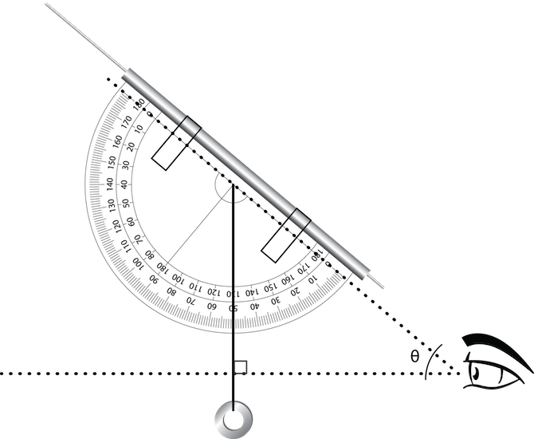

## Zadanie

Niektoré astronomické merania sú kritické na množstvo informácií, ktoré je potrebné odmerať v krátkom časovom intervale. Vašou úlohou bude práve jedno takéto meranie uskutočniť. Konkrétne to bude sledovanie preletu Medzinárodnej vesmírnej stanice (ISS).

<ol type="a">

<li>

Nájdite pomocou online nástroja (ako napríklad <https://www.heavens-above.com/>) čas vyhovujúci pre vaše miesto, kedy budete schopní pozorovať prelet ISS. V odpovedi nezabudnite zapísať zemepisnú polohu a dátum pozorovania.

</li>

<li>

Rozmyslite si a popíšte ako budete merať alebo odhadovať nasledovné veličiny ISS.

- Azimut východu

- Čas východu

- Maximálna výška nad obzorom

- Čas kulminácie

- Azimut západu

- Čas západu

- Maximálna jasnosť

- Čas nad obzorom

</li>

<li>

Vykonajte meranie, prípravu fotodokumentujte a spíšte výsledky aj s odhadmi chýb.

</li>

</ol>

Riešenie

Obdobne ako pri dátovej analýze k spísať jeden konkrétny návod je náročné, pretože správne riešenie je výberom správnych postupov a metód, ktoré sa používajú pre dosiahnutie čo najpresnejšieho výsledku. Preto aj hodnotenie bude na individuálnej úrovni a bude zohľadňovať externé podmienky, dosiahnutú presnosť a rigoróznosť postupu. V riešení pokúsime len popísať vhodné postupy a problematické miesta.

**Azimut východu a západu**

Ten môže byť problematický z hneď troch dôvodov. Ako prvé, musíme si dať pozor, že náš horizont má naozaj nulovú výšku nad obzorom (mysleným ideálnym). Za druhé, ISS môže byť náročné vidieť nízko nad obzorom. Ak sa objaví až v nejakej nezanedbateľnej výške nad obzorom, musíme pristúpiť k nejakej extrapolácií smerom k obzoru. A za tretie, samotné meranie azimutu. Ak meranie uskutočňujeme pomocou kompasu, je potrebné ešte uskutočniť opravu z magnetického na reálny severný pól (pre Košice je oprava približne $6^{\circ}$ na západ). Niektoré aplikácie, pre smartphony, ktoré zobrazujú kompas poskytujú túto opravu už automaticky.

**Čas východu a západu**

Máme obdobné problémy ako pri meraní azimutu východu a západu a navyše musíme mať k dispozícii zdroj presného času. K tomuto účelu poslúžia napríklad rádiom riadené hodinky alebo dostupné online nástroje, ktoré vďaka *Network Time Protocol* (protokol na prenos presného času internetom) dokážu zobraziť aktuálny atómový čas (<https://en.wikipedia.org/wiki/International_Atomic_Time>). Zároveň je potrebné presné určenie momentu východu. K tomuto potrebujeme nejak zosúladiť pozorovanie východu ISS s presnými hodinkami. Jedna z možností je natáčať hodinky na video a moment objavenia sa ISS na obzore zakričať, čím získame zvukový záznam na videu, ktorý korešponduje s hľadaným časom.

**Maximálna výška nad obzorom**

Jedna z nástrah je určenie do akého momentu ISS ešte stúpa nad obzor a od akého už klesá. Asi najjednoduchší postup je využitie olovnice a uhlomeru. Zavesíme tenkú niť do osi uhlomeru a na jej druhý koniec pripevníme olovnicu. Uhlomer využijeme na zameriavanie ISS až do momentu, kedy stále máme pocit, že olovnica sa nám hýbe jedným smerom. Vtedy si polohu olovnice zafixujeme na uhlomeri, napríklad pomocou pripravenej lepiacej pásky.

Druhá možnosť je mierne odhadová. Môžeme si pamätať, zapisovať, snímať na dlhú expozíciu alebo inak zaznamenávať miesto na oblohe, kadiaľ ISS cestuje a následne využiť nástroje, ako je napríklad Stellarium, aby sme odhadli maximálnu výšku ISS nad obzorom z porovnania s hviezdami alebo inými objektami na oblohe.

**Čas kulminácie**

Pozorovanie času kulminácií prináša rovnaké problémy ako pozorovanie času východu a pozorovanie maximálnej výšky nad obzorom. Ak používame ručnú metódu, ako napríklad uhlomer a olovnicu, potom môžeme využiť zvukové zahlásenie na video, ktoré sníma čas. Alebo ak snímame dráhu ISS na sériu kratších expozícií namiesto jednej dlhej, potom môžeme určiť čas z časovej značky fotky s kulmináciou.

**Maximálna jasnosť**

K tomuto je najjednoduchšie využiť naše vlastné oči. Dobrým postupom je nájsť si na oblohe nejaké hviezdy, ktorých jasnosti poznáme. Následne porovnať ISS v momente najväčšej jasnosti (odhadnutý) práve s týmito hviezdami a tak odhadnúť vizuálnu jasnosť ISS.

**Čas nad obzorom**

Vypočítateľný z času východu a západu. Pozor ale na výslednú chybu, tá by mala byť typicky niečo ako dvojnásobná voči chybe času východu alebo západu.

**Chyby merania**

V tomto riešení sme rozobrali niekoľko návrhov na možnosti merania a určite existujú aj iné inovatívne spôsoby, ktoré môžete vymyslieť. Stále ale potrebujeme vedieť odhadnúť chybu merania. To kvôli rôznym prístupom môže byť náročné ale existuje niekoľko základným postupov. Ak využívame meradlo typu hodinky alebo uhlomer a zároveň je zanedbateľný ľudský zdroj chyby, potom je chyba merania najčastejšie polovica najmenšieho dielika (v našom prípade je chyba uhlu určite vyššia). Ak sú merania závislé od reakčných schopností človeka, je potrebné reakčný čas nejakým spôsobom odhadnúť. Ak je meranie závislé od odhadu, je vhodné uvažovať typickú štatistickú chybu (zvyčajne $10\%$ alebo $5\%$). Pri vizuálnom odhadovaní magnitúd je typická presnosť na úrovni $0{,}5\,\mathrm{mag}$.

<figure>

<figcaption>

**Obrázok 1:** Znázornenie využitia uhlomeru a olovnice na pozorovanie výšky ISS nad obzorom.
</figcaption>

</figure>

