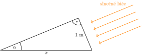
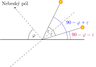

## Zadanie

Počas roka dochádza na Zemi k striedaniu ročných období. Dôvodom je naklonenie roviny zemského rovníka o uhol $\varepsilon = 23{,}4^{\circ}$ voči rovine ekliptiky. To spôsobuje, že na dané miesto na Zemi dopadá v rôzne dni rôzne množstvo žiarivej energie zo Slnka. Vypočítajte pomer žiarivých energií zo Slnka, ktoré dopadnú na celú plochu Liptovskej Mary za $1\,\mathrm{s}$ na pravé poludnie v deň letného a zimného slnovratu. Poloha Liptovskej Mary je $49{,}1^{\circ}$ N, $19{,}5^{\circ}$ E a plocha $A$ = $27\,{\mathrm{km}}^{2}$.

Predpokladajte kruhovú dráhu Zeme okolo Slnka a zanedbajte vplyv atmosféry. Pre prípadné medzivýpočty môžete využiť slnečnú konštantu, ktorej hodnota je uvedená v zozname konštánt. Slnečná konštanta predstavuje množstvo energie, ktoré prejde za $1\,\mathrm{s}$ plochou $1\,{\mathrm{m}}^{2}$ orientovanou kolmo na slnečné lúče vo vzdialenosti $1\,\mathrm{au}$ od Slnka bez extinkcie (absorpcie).

Riešenie

Solárna konštanta $k$ je definovaná ako energia dopadajúca na kolmú plochu. Ak chceme určiť energiu, ktorá dopadá na plochu pod uhlom $\alpha$ musíme hodnotu $k$ vynásobiť sínusom tohto uhla. Priemet kolmej plochy na reálnu zobrazuje obrázok 1. Kolmá plocha sa premietne na väčšiu v závislosti na sklone lúčov $\alpha$. A $\alpha$ priamo odpovedá výške Slnka nad horizontom $h$.

<figure>

<figcaption>

**Obrázok 1:** Schéma dopadu slnečných lúčov na Zem pod uhlom $\alpha$.
</figcaption>

</figure>

Na základe obrázku 2 platí 

$$
\alpha \equiv h = 90^{\circ} - \varphi + \delta\,, \tag{1}
$$

 kde $\varphi$ je geografická šírka a $\delta$ je deklinácia Slnka. Slnko sa v tom čase nachádza najďalej od ekliptiky, pričom uhol medzi rovníkom a ekliptikou je $\varepsilon$. V deň letného slnovratu je teda následne deklinácia Slnka $+\varepsilon$ a v deň zimného slnovratu je $-\varepsilon$.

<figure>

<figcaption>

**Obrázok 2:** Schéma znázorňujúca polohu Slnka v čase letného a zimného slnovratu.
</figcaption>

</figure>

Energia dopadajúca zo Slnka $\mathcal{E}$ na plochu $A$ za čas $t$ potom je 

$$
\mathcal{E} = A\,t\,k\,\sin{\left(90^{\circ}-\varphi+\delta\right)}\,. \tag{2}
$$

Pre podiel týchto energií dostávame vzťah 

$$
\frac{\mathcal{E}_{\textrm{LS}}}{\mathcal{E}_{\textrm{ZS}}} = \frac{A\,t\,k\,\sin(90^{\circ} - \varphi + \varepsilon)}{A\,t\,k\,\sin(90^{\circ} - \varphi - \varepsilon)} = \frac{\sin(90^{\circ} - \varphi + \varepsilon)}{\sin(90^{\circ} - \varphi - \varepsilon)} \approx 3,00\,. \tag{3}
$$

