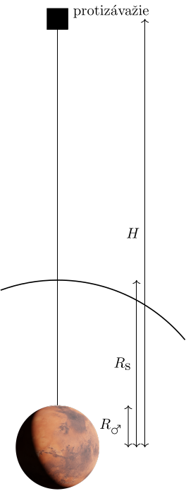

## Zadanie

V roku 2156 obyvatelia Marsu využívali na obchodovanie so Zemou vesmírny výťah. Po tom, ako na Marse vypukla občianska vojna, separatisti vyviedli výťah z orbity a on spadol na povrch Marsu.

Vesmírny výťah je koncept dopravného prostriedku na presun z povrchu planéty na obežnú dráhu. Na každý bod výťahu pôsobí tiažové zrýchlenie planéty a odstredivá sila, pričom celkové zrýchlenie pôsobiace na lano výťahu v určitom bode možno definovať ako 

$$
a = -\frac{GM}{r^2}+\omega^2r\, , \tag{1}
$$

 kde $M$ je hmotnosť planéty, $r$ vzdialenosť od stredu a $\omega$ jej uhlová rýchlosť.

Dôležitý bod sa nachádza vo vzdialenosti synchrónnej (areostacionárnej) dráhy, kde teleso obieha planétu rovnakou uhlovou rýchlosťou ako jej rotácia, čo spôsobuje, že sa nachádza stále nad tým istým bodom povrchu planéty. Vzdialenosť výťahu od stredu planéty možno vypočítať podľa vzťahu 

$$
H=\frac{R}{2}\bigg(\sqrt{1+8\bigg(\frac{R_\textrm{s}}{R}\bigg)^3}-1\bigg)\, , \tag{2}
$$

 kde $R_\textrm{s}$ je vzdialenosť synchrónnej dráhy od stredu planéty a $R$ polomer planéty. Ak sa výťahová kapsula nachádza pod týmto bodom, bude urýchľovaná smerom k povrchu planéty, zatiaľ čo nad týmto bodom bude kapsula výťahu urýchľovaná smerom od planéty.

<ol type="a">

<li>

Vypočítajte, koľkokrát obtočilo lano výťahu planétu, kým dopadol celý. Uveďte s presnosťou na 1 desatinné miesto.

</li>

</ol>

<ol type="a" start="2">

<li>

Závisí počet obtočení lana okolo planéty na jej polomere?

</li>

</ol>

Riešenie

Pre areostacionárnu dráhu, kde teleso obieha vždy nad rovnakým bodom povrchu Marsu, platí z rovnosti gravitačného a odstredivého zrýchlenia 

$$
\frac{GM_\Ma}{R^2_\textrm{s}}=\omega^2R_\textrm{s}=\frac{4\pi^2}{T^2}R_\textrm{s} \, , \tag{3}
$$

 kde $\omega$ je uhlová rýchlosť rotácie Marsu, $T$ je siderická rotačná perióda Marsu, teda $24\,\mathrm{h}$ $37\,\mathrm{min}$.

Pre výšku areostacionárnej dráhy teda dostávame 

$$
R_\textrm{s}^3=\frac{GMT^2}{4\pi^2}\, , \tag{4}
$$

 úpravou 

$$
R_\textrm{s}=\sqrt[3]{\frac{GMT^2}{4\pi^2}}\, . \tag{5}
$$

<figure>

<figcaption>

**Obrázok 1:** Schéma vesmírneho výťahu
</figcaption>

</figure>

<ol type="a">

<li>

Dĺžku lana chápeme ako vzdialenosť od povrchu Marsu k protizávažiu, ktoré je vo výške $H$ od stredu Marsu. Schéma vesmírneho výťahu Marsu je znázornená na obrázku 1.\
Je zjavné, že výška výťahu $H$ bude väčšia ako výška areostacionárnej orbity. Dĺžku výťahu dostávame ako $H-R_\Ma$, predelením obvodom Marsu dostávame počet obtočení $n$, teda pre počet obtočení lana výťahu platí 

$$
n=\frac{H-R_\Ma}{2\pi R_\Ma}=\frac{\frac{R_\Ma}{2}\bigg(\sqrt{1+8\bigg(\frac{R_\textrm{s}}{R_\Ma}\bigg)^3}-1\bigg)-R_\Ma}{2\pi R_\Ma} \, . \tag{6}
$$

Po dosadení dostávame 

$$
\begin{align*}
        n&=\frac{1}{2\cdot2\pi}\bigg(\sqrt{1+8\bigg(\frac{R_\textrm{s}}{R_\Ma}\bigg)^3}-1\bigg)-\frac{1}{2\pi} \tag{7}\\
        &=\frac{1}{4\pi}\bigg(\sqrt{1+8\bigg(\frac{R_\textrm{s}}{R_\Ma}\bigg)^3}-3\bigg) \approx3,1\ \textrm{otočení}. \tag{8}\end{align*}
$$

</li>

<li>

Ako vidíme z predošlého výpočtu, počet obtočení závisí aj na polomere planéty.

</li>

</ol>

