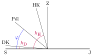

## Zadanie

Pozorovateľ, ktorý sa nachádza na severnej pologuli, určil výšku hviezdy nad severným horizontom počas jej hornej kulminácie $h_\mathrm{H}=74{,}27^{\circ}$ a výšku hviezdy počas jej dolnej kulminácie $h_\mathrm{D} = 4{,}45^{\circ}$. Vypočítajte deklináciu hviezdy $\delta$, ako aj zemepisnú šírku pozorovateľa $\varphi$. Na akom rozsahu zemepisných šírok je možné hviezdu pozorovať? Atmosférickú refrakciu zanedbajte.

Riešenie

Poloha hornej a dolnej kulminácie hviezdy je znázornená na obrázku 1. Vieme, že výška pólu nad horizontom sa rovná zemepisnej šírke pozorovateľa. Keďže hviezda sa nachádza stále v rovnakej uhlovej vzdialenosti od pólu (lebo má stále rovnakú deklináciu), vieme vypočítať zemepisnú šírku ako priemer výšok kulminácií

<figure>

<figcaption>

**Obrázok 1:** Kulminácie hviezdy.
</figcaption>

</figure>

$$
\varphi = \frac{h_\mathrm{H}+h_\mathrm{D}}{2}=39{,}36^{\circ}\, . \tag{1}
$$

Vzdialenosť hviezdy od pólu $p$ je definovaná ako 

$$
p=90^{\circ}-\delta\, , \tag{2}
$$

 kde $\delta$ je deklinácia hviezdy. Zároveň pre ňu platí 

$$
p=h_\mathrm{H}-\phi\, . \tag{3}
$$

 Z toho dostaneme deklináciu hviezdy $\delta=55{,}09^{\circ}$. Deklinácia je kladná, hviezda sa nachádza na sever od rovníka, môžeme ju preto určite pozorovať na celej severnej pologuli. Ak hviezdu pri hornej kulminácii pozorujeme na horizonte, nachádzame sa na najnižšej možnej zemepisnej šírke, odkiaľ je možné hviezdu ešte zahliadnuť. V takom prípade sa severný pól nachádza $p$ stupňov pod horizontom. Táto hraničná zemepisná šírka je 

$$
\varphi_\mathrm{h}=-p=-(90^{\circ}-\delta)=-34{,}91^{\circ}\, . \tag{4}
$$

 Hviezdu je teda možné pozorovať na zemepisných šírkach od $34{,}91^{\circ}$ S po $90^{\circ}$ N.

