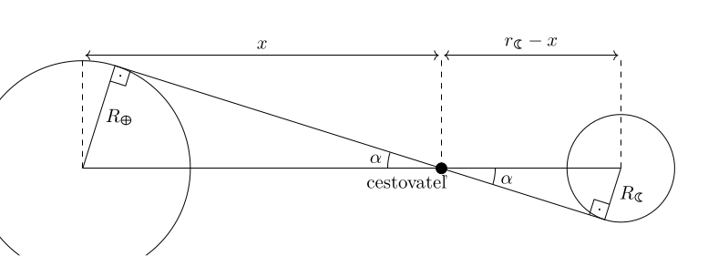

## Zadanie

Predstavte si cestovateľa, ktorý cestuje po priamke zo Zeme k Mesiacu. Po ceste narazil na pár zaujímavých miest.

<ol type="a">

<li>

V jednom momente pri pohľade von zistil, že Mesiac aj Zem majú rovnakú uhlovú veľkosť. Zistite ako ďaleko od stredu Zeme sa nachádzal. Na vyjadrenie použite hodnotu vzdialenosti stredov Zeme a Mesiaca $r_\Mo = 384\,400\,\mathrm{km}$ a pomer ich polomerov $\rho = R_\Mo/R_\Ea = \frac{27}{100}$.

</li>

<li>

Počas letu si taktiež v jednom momente všimol, že sa dostáva do gravitačného pôsobenia Mesiaca. To znamená rovnakú veľkosť gravitačnej sily od Zeme a Mesiaca. Zistite ako ďaleko od stredu Zeme sa nachádzal tentokrát. Použite $r_\Mo$ a pomer hmotností $\mu = M_\Mo/M_\Ea = 1/81$.

</li>

<li>

Cestovateľa zaujímalo, kedy prejde ťažiskom sústavy Zeme a Mesiaca. Na jeho prekvapenie zistil, že cez ťažisko nepôjde. Vysvetlite a výpočtom dokážte prečo. Použite hodnoty $r_\Mo$ a pomer hmotností $\mu = M_\Mo/M_\Ea = 1/81$.

</li>

</ol>

Úlohy riešte aj všeobecne, to znamená výsledok uveďte v tvare vzorca pre požadovanú veličinu. V prípade iba číselného riešenia, bude riešenie ohodnotené menším počtom bodov.

Riešenie

<ol type="a">

<li>

Začneme tým, že si nakreslíme obrázok 1.

<figure>

<figcaption>

**Obrázok 1:** Podobnosť trojuholníkov pri rovnosti uhlových veľkostí Zeme a Mesiaca.
</figcaption>

</figure>

Keďže cestovateľ v bode P vidí Zem aj Mesiac s rovnakou uhlovou veľkosťou, uhly $\alpha$ sa zhodujú. Oba trojuholníky sú zároveň pravouhlé, preto sú podľa vety $uu$ podobné. Pre pomery strán teda platí 

$$
\frac{r_\Mo - x}{x} = \frac{R_\Mo}{R_\Ea}\,, \tag{1}
$$

 kde pravú stranu nahradíme $\rho$ a zlomok na ľavej strane rozdelíme na dva 

$$
\frac{r_\Mo}{x} - 1 = \rho\,. \tag{2}
$$

 Pripočítame 1 a na oboch stranách prevrátime zlomky 

$$
\frac{x}{r_\Mo} = \frac{1}{\rho + 1}\,. \tag{3}
$$

 Nakoniec rovnicu prenásobíme $r_\Mo$ 

$$
x = \frac{r_\Mo}{\rho + 1}\, \approx 302\,700\,\mathrm{km}\,. \tag{4}
$$

</li>

<li>

Najprv si napíšeme vzťahy pre gravitačné sily od Zeme a od Mesiaca na bod vo vzdialenosti $x$ od Zeme: $F_\Ea = G M_\Ea m/x^2$, $F_\Mo = G M_\Mo m / (r_\Mo - x)^2$. Tieto sily dáme do rovnosti a vykrátime $G$ a $m$ 

$$
\frac{M_\Ea}{x^2} = \frac{M_\Mo}{(r_\Mo - x)^2}\,. \tag{5}
$$

 Rovnicu podelíme $M_\Ea$ a vynásobíme $(r_\Mo - x)^2$ 

$$
\frac{(r_\Mo - x)^2}{x^2} = \frac{M_\Mo}{M_\Ea}\,. \tag{6}
$$

 Rovnicu odmocníme a zlomok na pravej strane nahradíme $\mu$ 

$$
\frac{r_\Mo - x}{x} = \sqrt{\mu}\,, \tag{7}
$$

 Po rozdelení zlomku na ľavej strane a pripočítaní 1 dostaneme 

$$
\frac{r_\Mo}{x} = 1 + \sqrt{\mu}\,. \tag{8}
$$

 Na záver prevrátime zlomky a vyjadríme $x$ 

$$
x = \frac{r_\Mo}{1 + \sqrt{\mu}} \approx 346\,000\,\mathrm{km}\,. \tag{9}
$$

</li>

<li>

Napíšeme si vzťah pre výpočet polohy ťažiska dvoch telies (tzv. ”hojdačka”), kde vzdialenosť Zeme od ťažiska označíme $x$, a teda vzdialenosť Mesiaca od ťažiska je $r_\Mo - x$. 

$$
M_\Ea x = M_\Mo (r_\Mo - x)\,. \tag{10}
$$

 Rovnicu podelíme $M_\Mo$ a $x$ 

$$
\frac{M_\Ea}{M_\Mo} = \frac{r_\Mo - x}{x}\,. \tag{11}
$$

 Ľavú stranu nahradíme výrazom $\frac{1}{\mu}$ a zlomok na pravej strane rozdelíme na dva 

$$
\frac{1}{\mu} = \frac{r_\Mo}{x} - 1\,. \tag{12}
$$

 Pripočítame 1 a ľavú stranu upravíme na jeden zlomok 

$$
\frac{1 + \mu}{\mu} = \frac{r_\Mo}{x}\,. \tag{13}
$$

 Nakoniec prevrátime zlomky a vyjadríme $x$ 

$$
x = \frac{\mu}{1 + \mu} r_\Mo \approx 4688\,\mathrm{km}\,. \tag{14}
$$

 Podľa výsledku vidíme, že ťažisko sa nachádza $1690\,\mathrm{km}$ pod povrchom Zeme.

</li>

</ol>

