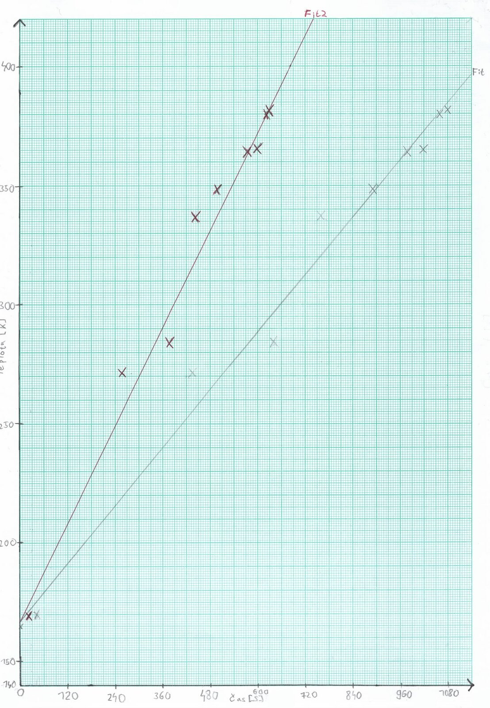

## Zadanie

V sci-fi románe Hidden Empire, prvej knihe zo série Saga of Seven Suns od Kevina J. Andersona, je opísaná scéna, kde je muž na veľkej kozmickej lodi v atmosfére plynného obra. Zatiaľ čo plavidlo zbiera vodík, muž ide na vyhliadkovú plošinu. V tomto bode je kozmická loď napadnutá záhadným plavidlom a je zničená. Muž je odhodený a spadne do plynného obra.

V roku 2017 sa M. J. Pitts, R. Howe, R. Javaid, F. R. J. Scanlan rozhodli skúmať príčinu smrti pri páde do atmosféry plynného obra, ako sa to stalo v tomto románe. V simulácii uvažovali, že plynný obor je Jupiter, plavidlo je vo výške, kde sa tlak vzduchu rovná zemskému atmosférickému tlaku, a muž má na sebe masku poskytujúcu kyslík. Možné príčiny smrti sú: veľký chlad, rýchlo meniaci sa alebo obrovský tlak a vysoká teplota. K tomuto problému pristúpili výpočtom, v ktorom sledovali, ako sa mení tlak a teplota každú sekundu počas pádu. Pomocou počítačového modelu terminálnej rýchlosti v atmosfére Jupitera určili, že človek začne umierať z dôvodu extrémneho tepla po 11 minútach.

Píše sa rok 2222 a vy ste sa rozhodli tento predpoklad otestovať experimentálne. Dostali ste sa kozmickou loďou na rovnaké začiatočné podmienky, aké sú popísané v modeli, a zhodili ste testovaciu figurínu. Merali ste teplotu a tlak, a overili ste, že padajúci človek naozaj zomrie vplyvom extrémnej teploty oveľa skôr. Po prehliadnutí svojich nameraných hodnôt, ste si však uvedomili, že vaše namerané hodnoty sú iné ako vyšli zo simulácie, pretože ste si na meranie času doniesli kyvadlové hodiny zo Slovenska. Tie sa budú vplyvom síl na Jupiteri chovať inak.

**Úlohy**

<ol type="a">

<li>

Podľa tabuľky 1 narysujte graf závislosti teploty na čase. Nájdite lineárnu funkciu, ktorá najlepšie vyhovuje meraným hodnotám.

</li>

<li>

Ste nad severným pólom Jupitera vo vzdialenosti $R_{\textrm{Ju}}=6{,}69 \cdot 10^{7}\,\mathrm{m}$ od jeho stredu. Tiažové zrýchlenie na Slovensku je $g = 9{,}81\,\mathrm{m}\,{\mathrm{s}}^{-2}$. Vypočítajte korekciu lineárnej funkcie času pre namerané hodnoty a do grafu dokreslite jej opravenú (skutočnú) verziu.

</li>

<li>

Vypočítajte korekciu času, ak by ste boli nad rovníkom, vo vzdialenosti od stredu Jupitera $R_{\textrm{Ju2}}=7{,}15 \cdot 10^{7}\,\mathrm{m}$. Nemusíte prepočítavať body, funkciu, ani nič vykresľovať do grafu. Stačí určiť čas, za ktorý človek umrie pri teplote $400$ K.

</li>

</ol>

**Tabuľka 1:** Namerané dáta závislosti teploty a tlaku na čase.

|       |       |         |       |
|:-----:|:-----:|:-------:|:-----:|
| Index |  čas  | teplota | tlak  |
|  \#   | \(s\) |  \(K\)  | (bar) |
|   1   |   0   |  165,2  |   1   |
|   2   |  44   |  168,9  |  1,4  |
|   3   |  439  |  271,6  |  7,9  |
|   4   |  640  |  284,1  |  9,3  |
|   5   |  759  |  337,2  |  13   |
|   6   |  891  |  349,3  | 14,4  |
|   7   |  981  |  363,9  | 14,8  |
|   8   | 1022  |  365,1  | 15,3  |
|   9   | 1059  |  380,7  | 16,6  |
|  10   | 1089  |  381,7  | 16,7  |

**Pomôcka**

Vzťah pre periódu kyvadla je $T = 2\pi \sqrt{l/g}$, kde $l$ je dĺžka vlákna a $g$ je tiažové zrýchlenie.

Riešenie

<ol type="a">

<li>

Na milimetrový papier si vynesieme graf závislosti teploty na čase, pričom dodržujeme základné pravidlá dátovky. Napríklad vhodne zvolená stupnica, správne označené osi, využitie väčšiny plochy milimetrového papiera, dobre zastruhaná ceruzka atď. Takýto graf môže vyzerať podobne ako na obrázku 1.

Hľadanú funkciu si označíme 

$$
T(t) = A(t) + B \,. \tag{1}
$$

 Koeficienty A a B hľadáme lineárnou regresiou. Na kalkulačke prejdeme do módu štatistika. Do tabuľky v kalkulačke zadáme hodnoty času ako hodnoty x a hodnoty teploty ako y. Kalkulačka nám vráti hodnoty fitu. Video návod na tento postup môžte nájsť na <https://youtu.be/8tnc1niiTe4?t=2510>. Dostali sme nasledovné hodnoty. 

$$
\boxed{
  \displaystyle
    \begin{aligned}
        \hspace{10pt}
        A &= 0{,}201\,\mathrm{K} \hspace{10pt} \\[5pt]
        B &= 167{,}7\,\mathrm{K}
    \end{aligned}
  } \tag{2}
$$

 Do rovnice (1) dosadíme 2 hodnoty t. Takto získame 2 body funkcie, ktoré spojíme priamkou.

</li>

<li>

Sme nad severným pólom a naše hodiny sú vnútri vesmírnej lode. Jediná relevantná sila, ktorej veľkosť je iná ako na Zemi je gravitačná. Naše nové tiažové zrýchlenie vypočítame vzťahom 

$$
g_{\textrm{Ju}} = G\frac{M_{\textrm{Ju}}}{R_{\textrm{Ju}}^2}. \tag{3}
$$

Zároveň poznáme vzťah pre periódu kyvadla $T = 2\pi \sqrt{l/g}$. Čím bude perióda kyvadla menšia, tým rýchlejšie bude merať čas, a skutočný čas teda bude menší. To znamená, že pomer časov na Zemi a na Jupiteri bude prevrátený pomer periód kyvadla na Zemi a na Jupiteri. 

$$
\frac{t_{\textrm{Ju}}}{t} = \frac{T}{T_{\textrm{Ju}}} = \frac{\sqrt{\frac{l}{g}}}{\sqrt{\frac{l}{g_{\textrm{Ju}}}}} = \sqrt{\frac{g_{\textrm{Ju}}}{g}} \,. \tag{4}
$$

 Dosadením rovnice (3) do (4) dostávame 

$$
\frac{t_{\textrm{Ju}}}{t} = \sqrt{\frac{M_{\textrm{Ju}}G}{gR_{\textrm{Ju}}^2}} \approx 1,70 \,. \tag{5}
$$

 Koeficient funkcie A môžme vynásobiť týmto pomerom a dostaneme koeficient po korektúre $A_{\textrm{2}}$. Znova do rovnice (1) dosadíme 2 hodnoty t. Takto získame 2 body funkcie a spojíme ich priamkou. V obrázku 1 sú označené aj body po korektúre, no tie vynášať netreba.

<figure>

<figcaption>

**Obrázok 1:** Graf závislosti teploty na čase.
</figcaption>

</figure>

</li>

<li>

Nad rovníkom bude na kyvadlo pôsobiť aj odstredivá sila. Keďže Jupiter je veľmi hmotný a rýchlo rotuje, jej veľkosť nebude zanedbateľná. Vzťah pre výpočet odstredivej sily je 

$$
F_{\textrm{o}} = m\omega ^{2}R_{\textrm{Ju2}} \,, \tag{6}
$$

 kde $F_{\textrm{o}}$ je odstredivá sila a $\omega$ je uhlová rýchlosť. Odstredivá sila bude mať opačný smer ako gravitačná, a odstredivú silu si vieme vyjadriť cez periódu rotácie Jupitera 

$$
\omega = \frac{2\pi}{P_{\textrm{Ju}}} \,. \tag{7}
$$

 Pre tiažové zrýchlenie na rovníku, ktoré je rozdielom gravitačného a odstredivého, platí 

$$
g_{\textrm{Ju2}} = \frac{M_{\textrm{Ju}}G}{R_{\textrm{Ju2}}^2} - \frac{4\pi ^{2}}{P_{\textrm{Ju}}^{2}} R_{\textrm{Ju2}} \,. \tag{8}
$$

 Po dosadení do (4) dostávame 

$$
\frac{t_{\textrm{Ju2}}}{t} \approx 1,51 \,. \tag{9}
$$

Funkciu opravíme rovnako ako v (b) a vypočítame jej koreň pre $T = 400$ K. 

$$
t_{\textrm{smrť}} \approx 760\,\mathrm{s} = 12\,\mathrm{min}\;40\,\mathrm{s} \,. \tag{10}
$$

</li>

</ol>

