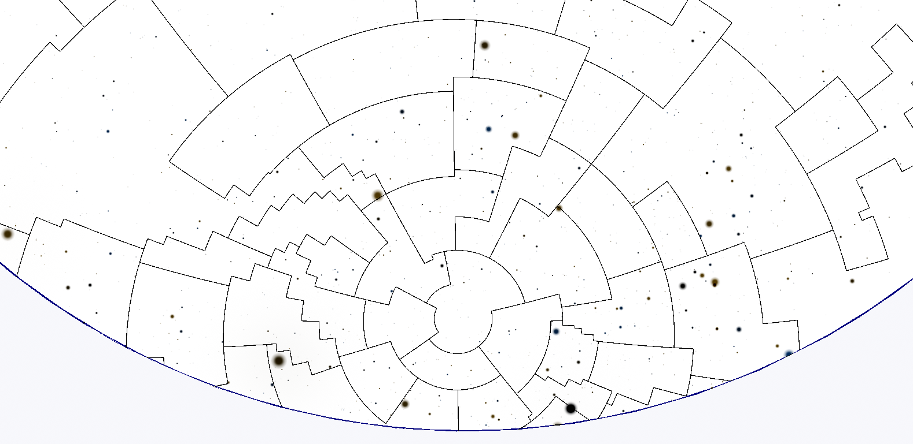
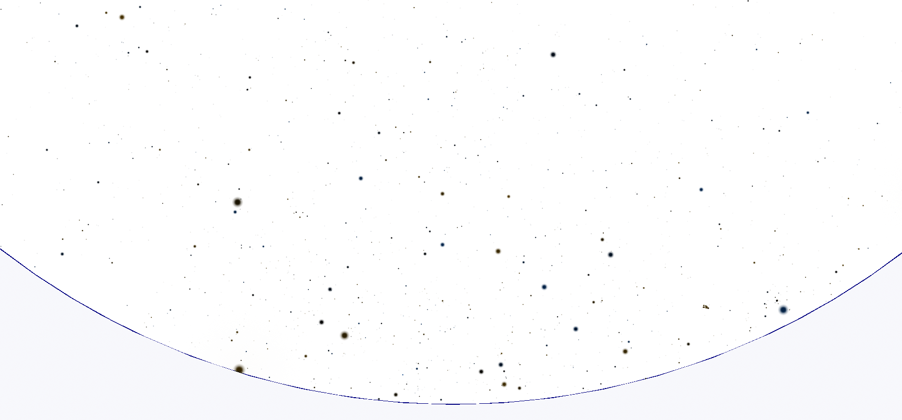
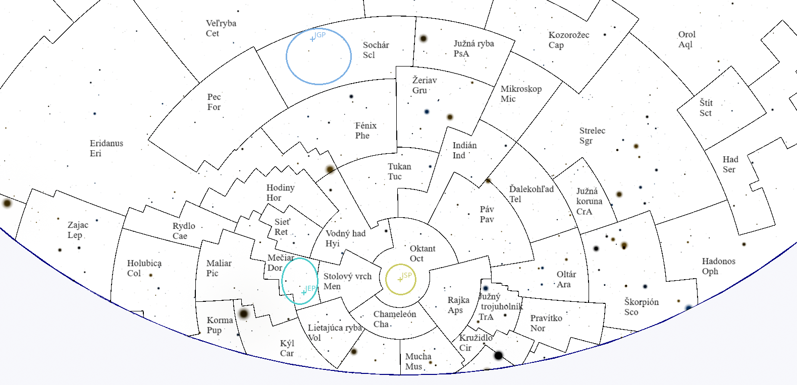
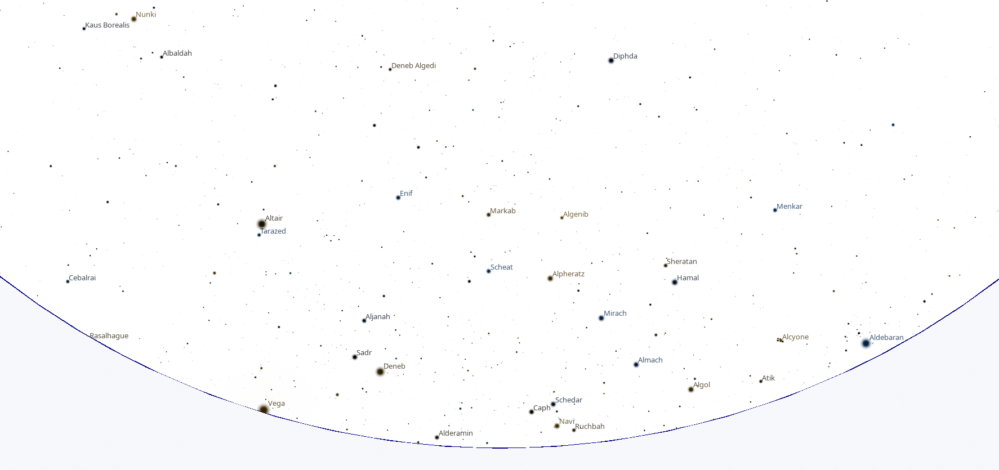
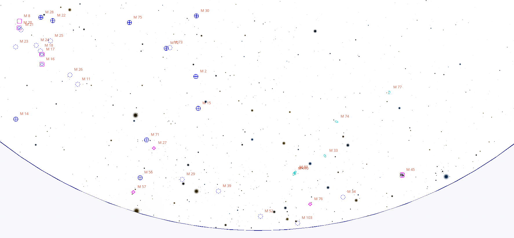

## Zadanie

Predstavte si, že ste sa dostali na IOAA do Brazílie. Ste vo Vassouras, je 24. 8. 2024, 1:00 hod. miestneho času a práve sa nachádzate pod jasnou brazílskou oblohou spolu s peknou Brazílčankou/Brazílčanom. Toto je ideálna chvíľa, kedy môžete niekomu predviesť svoje znalosti nočnej oblohy.

Najskôr sa pozeráte smerom na juh, kde sú súhvezdia, ktoré zo Slovenska vôbec nevidno. Vy ste sa ale poctivo pripravovali na IOAA, takže ich všetky poznáte.

<ol type="a">

<li>

Na mape 1 (1) identifikujte 12 ľubovoľných súhvezdí. V mape ich označte číslami od 1 do 12 v ľubovoľnom poradí, na samostatný papier potom k číslam priraďte ich slovenské názvy a latinské skratky.

</li>

<li>

Do mapy 1 zakreslite polohu južného svetového pólu (JP), južného pólu ekliptiky (EP) a južného galaktického pólu (GP). Označte ich skratkami uvedenými v zátvorkách.

</li>

</ol>

Po tom, čo Brazílčanku/Brazílčana ohúrite svojimi znalosťami južnej oblohy, sa pozriete na opačnú stranu nad severný horizont, kde sú už samé známe súhvezdia. V tejto časti oblohy sa vyznáte veľmi dobre a poznáte nielen súhvezdia, ale aj názvy hviezd a rôzne objekty hlbokého vesmíru.

<ol type="a" start="3">

<li>

Na mape 2 zakrúžkujte a označte číslami 1 až 8 ľubovoľných 8 hviezd. Na samostatný papier potom k jednotlivým číslam napíšte názvy hviezd alebo ich Bayerove označenia. Ak napíšete oboje, nedostanete žiadne body navyše.

</li>

<li>

Na mape 2 (obr. 2) zakrúžkujte pozíciu ľubovoľných 7 Messierových objektov a napíšte k nim ich označenia v Messierovom katalógu.

</li>

</ol>

*Poznámka: keďže IOAA v Brazílii je až za niekoľko mesiacov a zatiaľ na ňu ešte len trénujete, v mape 1 sú ako pomôcka nakreslené aj hranice súhvezdí.*

<figure>

<figcaption>

**Obrázok 1:** Mapa 1. Prevzaté z programu Stellarium.
</figcaption>

</figure>

<figure>

<figcaption>

**Obrázok 2:** Mapa 2. Prevzaté z programu Stellarium.
</figcaption>

</figure>

Riešenie

<ol type="a">

<li>

Názvy a skratky súhvezdí sú v mape na obr. 3.

</li>

<li>

Za zakreslenie pólov do oblastí vyznačených na mape ako na obr. 3 bol plný počet bodov, polovičný počet bodov bol za zakreslenie pólov aspoň do správnych súhvezdí.

</li>

<li>

Názvy najjasnejších hviezd sú na obr. 4. Body sa dali získať aj za správne mená a označenia hviezd, ktoré na mape nie sú pomenované.

</li>

<li>

Všetky Messierove objekty v tejto časti oblohy sú zakreslené na obr. 5.

</li>

</ol>

<figure>

<figcaption>

**Obrázok 3:** Riešenie úloh (a) a (b). Prevzaté z programu Stellarium.
</figcaption>

</figure>

<figure>

<figcaption>

**Obrázok 4:** Riešenie úlohy (c). Prevzaté z programu Stellarium.
</figcaption>

</figure>

<figure>

<figcaption>

**Obrázok 5:** Riešenie úlohy (d). Prevzaté z programu Stellarium.
</figcaption>

</figure>

