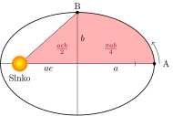

## Zadanie

Planéta obieha okolo Slnka po eliptickej trajektórii proti smeru hodinových ručičiek, ako je znázornené na obrázku.

<figure>

</figure>

<ol type="a">

<li>

Určte čas, za ktorý sa planéta dostane z bodu A do bodu B ako funkciu jej periódy obehu $T$ a excentricity dráhy $e$.

</li>

<li>

Určte najbližší dátum a približný čas od dnešného dňa, kedy sa Zem bude nachádzať na svojej trajektórii v bode, ktorý prislúcha bodu B na obrázku.

</li>

</ol>

**Pomôcka:** Zem sa nachádzala v perihéliu 3. 1. 2024 o 0:39.

Riešenie

Kľúčovou myšlienkou v riešení je využiť 2. Keplerov zákon, ktorý hovorí: Sprievodič (spojnica Slnka a planéty) opíše za rovnaký čas rovnakú plochu. Dôsledkom tejto formulácie je, že pomer plôch opísaných sprievodičom je rovný pomeru časov, za ktoré dané plochy sprievodič opísal.

<ol type="a">

<li>

Ako bolo spomenuté vyššie, pre zistenie času, za ktorý planéta prejde nejaký čas $t$, potrebujeme zistiť plochu $S$, ktorú sprievodič vytne za tento čas a porovnať ho s iným časom, respektíve plochou. Ako vidíme na obrázku 1, plochu $S$ určíme ako súčet štvrtiny obsahu elipsy (pre obsah elipsy platí $S_\textrm{elipsa} = \pi a b$) a obsahu trojuholníka tvoreného ohniskom, v ktorom sa nachádza Slnko, bodom B a stredom elipsy. Obsah tohto trojuholníka vieme spočítať klasicky, keďže poznáme dĺžky dvoch strán na seba kolmých, ako na obrázku 1.

</li>

</ol>

<figure>

<figcaption>

**Obrázok 1:** Plocha opísaná sprievodičom
</figcaption>

</figure>

Túto plochu potrebujeme porovnať s nejakou inou plochou a zrejme najvýhodnejšie je to urobiť pre celú elipsu, pretože vieme, že sprievodič opíše obsah celej elipsy za celú periódu planéty $T$. Teda tieto plochy a časy môžeme dať do pomeru 

$$
\frac{t}{T} = \frac{S}{S_{elipsa}} = \frac{ \frac{\pi a b}{4} + \frac{a b e}{2} }{\pi a b}\, . \tag{1}
$$

 Odtiaľ už nie je ťažké vyjadriť čas $t$ a po zjednodušení dostávame 

$$
t = \frac{T}{2} \left( \frac{1}{2} + \frac{e}{\pi} \right)\, . \tag{2}
$$

<ol type="a" start="2">

<li>

Vzťah ktorý sme získali v (a) teraz využijeme na výpočet požadovaného času, ktorý uplynie od okamihu keď je Zem v perihéliu po moment keď prejde bodom B. Nemôžeme však zabudnúť na to, že musíme k rovnici (2) ešte pripočítať člen $\frac{T}{2}$, čo je čas, ktorý je potrebný na to, aby sa Zem dostala z miesta jej perihélia do bodu A. Výsledná rovnica pre tento čas bude teda po úprave vyzerať nasledovne: 

$$
\tau = \frac{T}{2} \left( \frac{3}{2} + \frac{e}{\pi} \right)\, . \tag{3}
$$

Po dosadení hodnoty pre dĺžku anomalistického roka (časový úsek medzi dvoma okamihmi, keď je Zem v perihéliu) za $T$ a hodnoty excentricity $e$ z tabuľky konštánt, dostávame hodnotu $\tau = 274{,}916\,\mathrm{dňa} = 274\,\mathrm{dní} \; 21\,\mathrm{h}\;59\,\mathrm{min}$. Teraz nám už len stačí pripočítať čas $\tau$ k dátumu a času perihélia. Uvažujeme aj fakt, že rok 2024 je prestupný a teda február má 29 dní a dostávame výsledný dátum 3.10.2024 a približný čas 22:38 (časy v rozmedzí 22:10 – 23:00 budú uznané). Riešenie kde sa nezoberie do úvahy prestupný rok, ale so správnym postupom bude hodnotené ako správne, avšak nie plným počtom bodov.

</li>

</ol>

**Poznámka**

Pri uvažovaní zjednodušenia, že Zem obieha okolo Slnka po kružnici dostaneme dátum 2.10.2024 a čas približne 23:20, čo je vo výsledku rozdiel takmer jedného dňa, preto toto riešenie nie je vzhľadom na veľké zjednodušenie správne a budú zaň udelené len čiastkové body.

